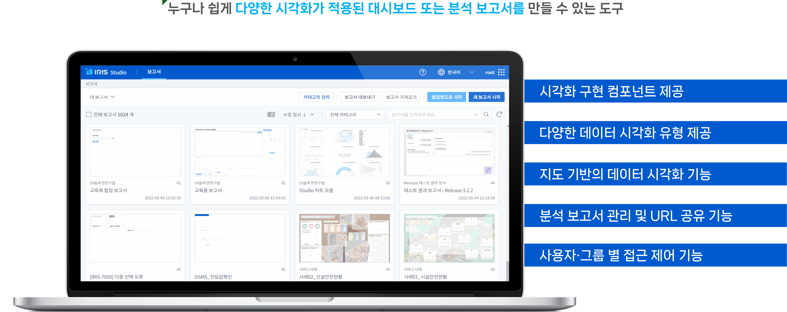
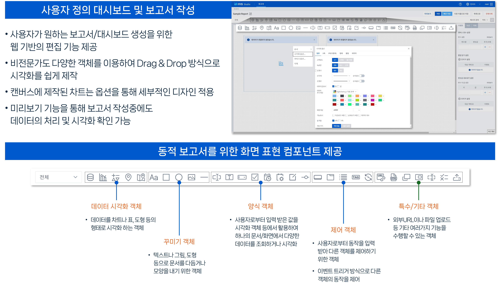
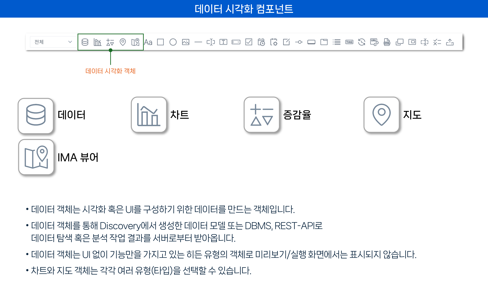
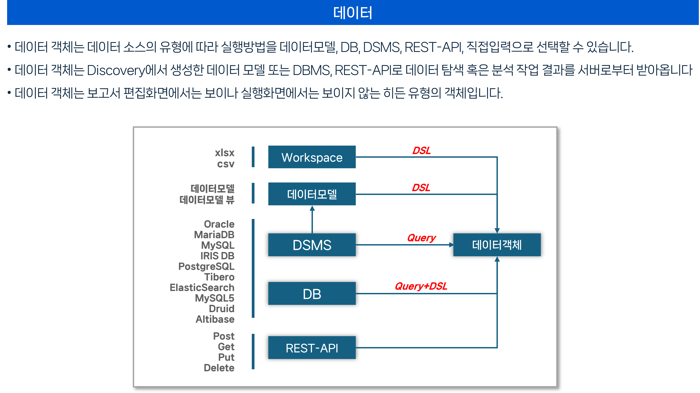
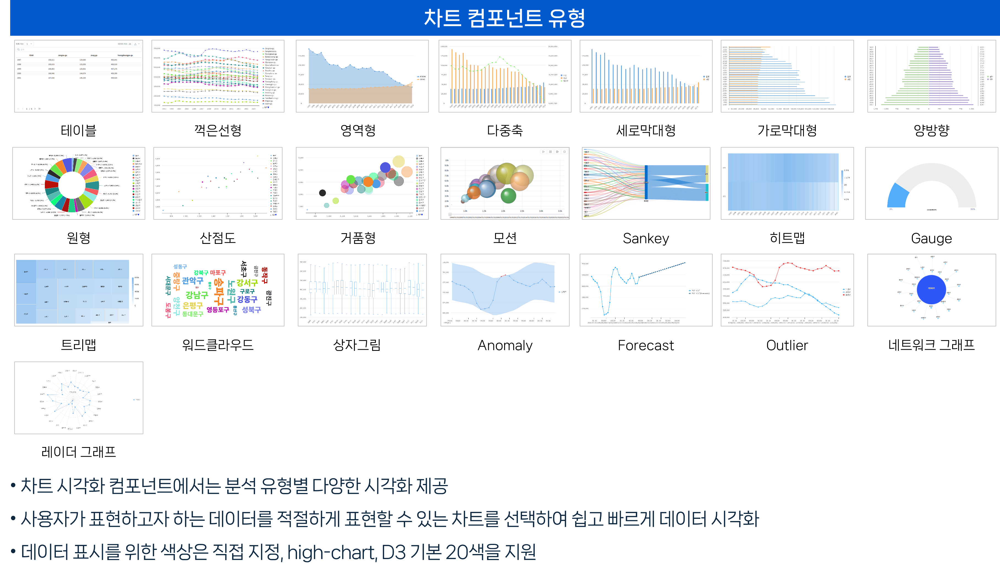
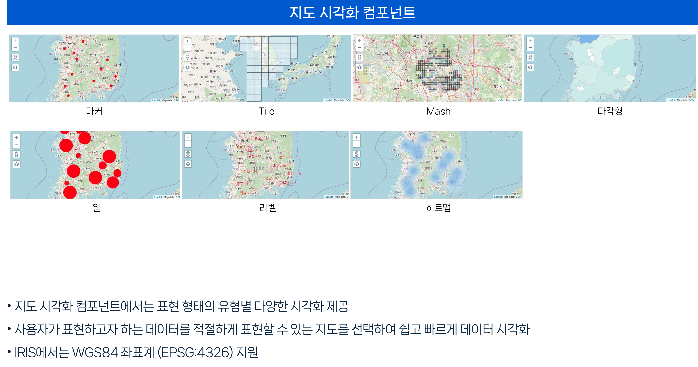
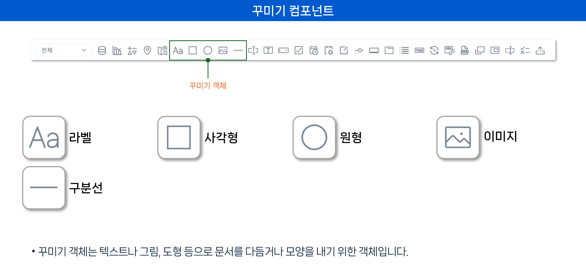
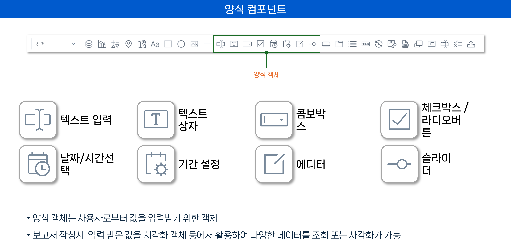
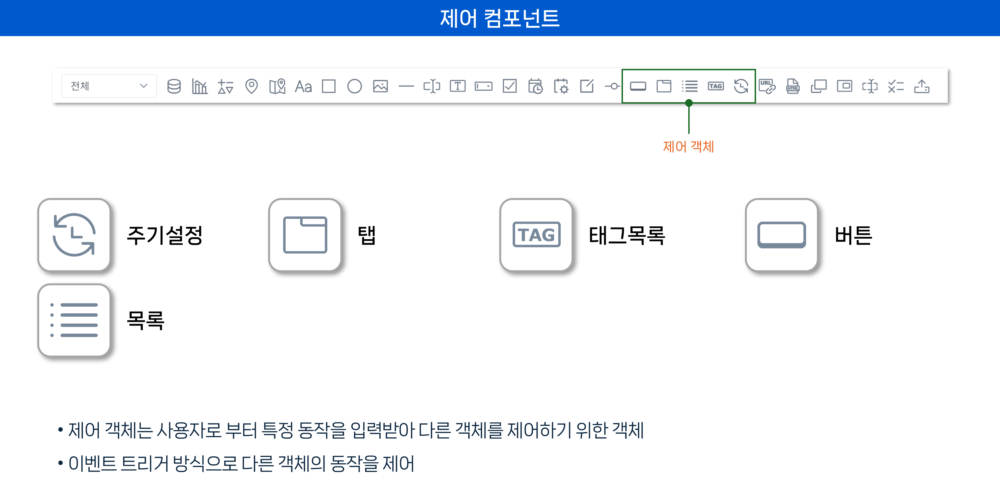
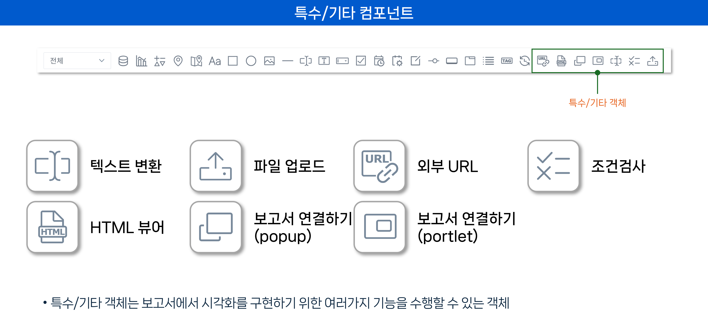

# IRIS01-Studio 소개와 컴포넌트

## 01. Studio 소개

IRIS VDAP의 Studio는 누구나 쉽게 다양한 시각화가 적용된 대시보드 또는 분석 보고서를 만들 수 있는 도구 입니다.

IRIS VDAP은 

* 시각화 구현을 위한 컴포넌트를 제공 합니다.
* 다양한 데이터 시각화 유형을 제공 합니다.
* 지도 기반의 데이터 시각화 기능을 제공 합니다.
* 분석 보고서 관리 및 URL 공유 기능을 제공 합니다.
* 사용자·그룹 별 접근 제어 기능을 제공 합니다.

---

## 02. Stuido의 기본 구성

Studio를 이용한 사용자 정의 대시보드 및 보고서 작성 기능

- 사용자가 원하는 보고서/대시보드 생성을 위한 웹 기반의 편집 기능 제공
- 비전문가도 다양한 객체를 이용하여 Drag & Drop 방식으로 데이터 시각화를 쉽게 제작 가능
- 캔버스에 제작된 차트를 옵션을 통해 세부적인 디자인 적용 가능
- 미리보기 기능을 통해 보고서 작성 중에도 데이터의 처리 및 시각화 확인 가능

동적 보고서를 위한 화면 표현 컴포넌트

* 데이터 시각화 객체 그룹 : 데이터를 차트나 표, 도형 등의 형태로 시각화 하는 객체
* 양식 객체 그룹 : 사용자로부터 입력 받은 값을 시각화 객체 등에서 활용하여 하나의 문서/화면에서 다양한 데이터를 조회하거나 시각화
* 특수/기타 객체 그룹 : 외부URL이나 파일 업로드 등 기타 여러가지 기능을 수행할 수 있는 객체
* 꾸미기 객체 그룹 : 텍스트나 그림, 도형 등으로 문서를 다듬거나 모양을 내기 위한 객체
* 제어 객체 그룹 : 사용자로부터 동작을 입력 받아 다른 객체를 제어하기 위해 이벤트 트리거 방식으로 다른 객체의 동작을 제어

---

## 03. 데이터 시각화 객체

데이터 시각화 컴포넌트

- 데이터 객체는 시각화 혹은 UI를 구성하기 위한 데이터를 만드는 객체입니다.
- 데이터 객체를 통해 Discovery에서 생성한 데이터 모델 또는 DBMS, REST-API로 데이터 탐색 혹은 분석 작업 결과를 서버로부터 받아옵니다.
- 데이터 객체는 UI 없이 기능만을 가지고 있는 히든 유형의 객체로 미리보기/실행 화면에서는 표시되지 않습니다.
- 차트와 지도 객체는 각각 여러 유형(타입)을 선택할 수 있습니다.

데이터 시각화 객체

* 데이터 : Workspace, 데이터모델, DB, DSMS, Rest-API, 직접입력 등 IRIS VDAP에 연결된 여러 유형의 데이터를 조회, 처리하는 객체입니다.
* 차트 : 테이블외 22종의 차트의 유형을 제공합니다.
* 증감율 : 데이터 객체에서 처리된 값에 대한 증/감 내역을 출력하는 기능을 제공합니다
* 지도 : GIS 기반의 데이터를 지도에 출력합니다.
* IMA 뷰어 : Map Analyser에서 분석한 GIS 기반의 데이터를 출력합니다.

---

## 04. 데이터 객체와 데이터 소스

데이터 객체

- 데이터 객체는 데이터 소스의 유형에 따라 실행방법을 데이터모델, DB, DSMS, REST-API, 직접입력으로 선택할 수 있습니다.
- 데이터 객체는 Discovery에서 생성한 데이터 모델 또는 DBMS, REST-API로 데이터 탐색 혹은 분석 작업 결과를 서버로부터 받아옵니다
- 데이터 객체는 보고서 편집화면에서는 보이나 실행화면에서는 보이지 않는 히든 유형의 객체입니다.

데이터 객체 유형

* Workspace : 사용자가 등록(업로드)한 파일을 처리하는 유형
	* 데이터 타입 : csv, Excel
	* 언어 : DSL
* 데이터모델 : IRIS Discovery에서 연결된 데이터로 만든 메타 데이터를 처리하는 유형
	* 데이터 타입 : 데이터모델, 데이터모델뷰
	* 언어 : DSL
* DSMS : IRIS Discovery에서 연결된 데이터베이스의 데이터를 처리하는 유형
	* 데이터 타입 : Oracle, MySQL, PostgreSQL와 같은 RDBMS
	* 언어 : SQL
	* 특징 : CRUD 가능
* DSMS : IRIS Discovery에서 연결된 데이터베이스의 데이터를 처리하는 유형
	* 데이터 타입 : Oracle, MySQL, PostgreSQL와 같은 RDBMS
	* 언어 : SQL, DSL
	* 특징 : Read만 가능
* REST-API : 타 서버와 API 연동으로 데이터를 처리하는 유형
	* 처리 방식 : Post, Get, Put, Delete
* 직접입력 : 사용자가 직접 입력한 데이터를 처리하는 유형
	* 데이터 타입 : Json

---

## 05. 차트 컴포넌트 유형

차트 컴포넌트

- 차트 시각화 컴포넌트에서는 분석 유형별 다양한 시각화 제공
- 사용자가 표현하고자 하는 데이터를 적절하게 표현할 수 있는 차트를 선택하여 쉽고 빠르게 데이터 시각화
- 데이터 표시를 위한 색상은 직접 지정, high-chart, D3 기본 20색을 지원

차트 컴포넌트 유형

* 테이블 : 데이터를 행과 열의 구조로 되어 있는 테이블 형태로 출력
* 꺽은선형 : 범주형(주로 시계열) 항목을 X축 기준으로 Y축에 수치형 변수의 크기에 따라 위치와 점을 찍고 선으로 연결하여 출력
* 영역형 : 꺾은선형 차트를 기반으로 하여 축과 선 사이의 출력되는 영역의 볼륨을 색으로 표현
* 다중축 : 범주형(주로 시계열) 항목을 X축 기준으로 Y축에 2개 이상의 데이터의 크기를 서로 다른 차트 유형(세로막대형, 꺾은선형)으로 출력하며 스택(누적)과 풀스택(100% 누적) 기능 선택 출력 가능
* 가로막대형 : 범주형(주로 시계열) 항목을 Y축 기준으로 막대를 그리고 데이터 크기에 따라 막대 길이를 다르게 출력하며 스택(누적)과 풀스택(100% 누적) 기능 선택 출력 가능
* 세로막대형 : 범주형(주로 시계열) 항목을 X축 기준으로 막대를 그리고 데이터 크기에 따라 막대 길이를 다르게 출력하며 스택(누적)과 풀스택(100% 누적) 기능 선택 출력 가능
* 양방향 : 2개의 세부 항목으로 구성된 그룹별 크기를 막대 길이로 출력
* 원형 : 범주형 항목별 데이터가 전체 데이터 중 차지하는 구성 비중 크기만큼 조각의 크기를 나누어 출력
* 산점도 : 일정 시간 간격으로 시계열로 되어 있는 범주형 항목을 X축 기준으로 Y축에 데이터의 크기에 따라 위치와 점으로 배열하여 출력
* 거품형 : 2개의 수치형 변수를 기준으로 X, Y축을 그리고 원으로 표현된 개별 항목별로 남은 수치형 변수의 데이터 크기를 원의 크기로 표현
* 모션 : 거품형 차트를 기본으로 하여 시간의 흐름에 따른 데이터와 데이터의 움직임까지 출력
* Sankey : 범주형 변수의 항목별 데이터의 흐름을 표현하며 한 개의 축을 그린 뒤 세부 항목별 데이터의 이동 경로를 곡선으로 표현되는데 선의 경로와 두께를 기준으로 데이터를 해석
* 히트맵 : 2개의 범주형 변수의 항목들을 x축과 y축에 배치한 격자 무늬 형태의 차트 영역에 수치형 변수 데이터 크기를 색으로 표현하며 구간별로 다른 색으로 표현해 데이터의 크기 파악이 가능
* Gauge(게이지) : 자동차 계기판과 같은 형태로 데이터의 크기를 표현하여 조각의 크기를 기준으로 항목마다 전체 데이터 중 차지하는 비중 파악이 가능
* 트리맵 : 전체 데이터를 하나의 사각형으로 표현하고, 항목별 데이터 크기에 따라 사각형을 네모 조각으로 나누어 표현하며 조각의 크기가 클수록 전체 중 특정 항목이 차지 하는 비중이 크다는 것을 의미
* 워드클라우드 : 범주형 변수의 값을 텍스트 형태의 시각화 요소로 표현하고, 수치형 변수의 크기에 따라 요소의 크기를 다르게 표현
* 상자그림 : 통계 측면에서 5가지 요약 수치 (Five-Number Summary : 최솟값, 제1사분위수, 제2사분위, 제3분위수, 최댓값)를 표현
* Anomaly : DSL의 anomalies 실행 결과에서 이상 값과 상/하한 임계치 라인을 표현
* Forecast : DSL의 forecast 실행 결과를 꺽은선형 차트로 표현하여 조회된 데이터를 기준으로 현재 이후의 데이터의 흐름을 예측
* Outlier : 데이터 분포 중 다른 측정값에서 크게 벗어난 값을 표현
* 네트워크 그래프 : 데이터 항목을 의미하는 노드와 관계성을 표현하는 선으로 표현
* 레이더 그래프 : 동심원 위에 점을 찍어 그 도형의 모양으로 데이터의 크기  등의 변수 분포를 표현

---

## 06. 지도 컴포넌트 유형

지도 컴포넌트

- 지도 시각화 컴포넌트에서는 표현 형태의 유형별 다양한 시각화 제공
- 사용자가 표현하고자 하는 데이터를 적절하게 표현할 수 있는 지도를 선택하여 쉽고 빠르게 데이터 시각화
- IRIS에서는 WGS84 좌표계 (EPSG:4326) 지원

지도 컴포넌트 유형

* 
Base Map : 지도 객체의 기본이 되는 지도로 API를 통해 지도 정보 표현하며 기본 제공 지도(Opne Street Map, Vwolrd, 국토정보플랫폼 맵, Naver Map, Google Maps)외 자체 지도 서버에서  API 연동 가능
* 
마커 : 데이터의 위치 정보를 지도에 점 또는 핀 모양의 이미지로 표시
* 
Tile : 타일 ​​맵은 각 지역이 동일한 모양과 크기의 단일 타일로 표시되는 맵으로써 타일의 크기 , 타일 정보는오픈 소스 지리공간 재단(OSGeo-Open Source Geospatial Foundation)이 개발한 타일 웹 맵을 사용하며 크기(레벨)은 1 ~ 22까지 표시
* 
Mash : 메쉬 맵은 타일 맵과 비슷하게 지도상에 나타내지만 타일의 정보(Mesh code)는 일본의 지리 정보원에서 정의 한 것으로 메쉬의 크기는 1~5까지 표시
* 
원 : '클러스터링'이라고도 하며 데이터의 위치 정보와 수량을 지도에 원형(버블)의 크기로 표시
* 
다각형 : Geo Json 포맷으로 정의된 데이터에 있는 각 좌표들의 꼭지점이 선으로 이어진 도형을 표시
* 
라벨 : 데이터의 위치 정보에 지정한 텍스트를 표시
* 
히트맵 : 데이터의 위치 정보와 수량같이 색상으로 표현할 수 있는 다양한 정보를 지도 위에 표시

---

## 07. 꾸미기 컴포넌트

꾸미기 컴포넌트

* 꾸미기 컴포넌트는 텍스트나 그림, 도형 등으로 문서를 다듬거나 모양을 내기 위한 객체입니다.

꾸미기 컴포넌트 종류

* 라벨 : 라벨 컴포넌트는 고정 텍스트와 변수를 이용한 다른 컴포넌트의 데이터를 출력할 수 있는 동적 텍스트를 지원
* 사각형 : 사각형 도형을 만들 수 있는 컴포넌트로 라운드를 0 ~ 100의 범위에서 지정이 가능
* 원형 : 원형 도형을 만들 수 있는 컴포넌트
* 이미지 : 업로드하는 이미지와 타 서버에서의 URL 호출을 지원
* 구분선 : 가로 또는 세로의 구분선을 표현

---

## 08. 양식 컴포넌트

양식 컴포넌트

* 양식 객체는 사용자로부터 값을 입력받기 위한 컴포넌트
* 보고서 작성시 입력 받은 값을 시각화 객체 등에서 활용하여 다양한 데이터를 조회 또는 사각화가 가능

양식 컴포넌트 종류

* 텍스트 입력 : 텍스트 입력 컴포넌트에서 사용될 텍스트를 고정(안내문구), 사용자 입력 기능 제공
* 텍스트 상자 : 텍스트 처리 방식은 '텍스트 입력'과 동일하나 텍스트 박스는 컴포넌트 영역에서 자동 다중 줄을 지원
* 콤보박스 : 다른 컴포넌트의 데이터 연동과 사용자 직접 입력 지원하여 테이터를 선택할 수 있는 기능 제공
* 체크박스 / 라디오버튼 : 필요에 따라 체크박스 또는 라디오버튼으로 지정 가능하며 체크박스/라디오버튼은 다른 컴포넌트의 데이터 연동과 사용자 직접 입력 지원
* 날짜/시간선택 : 단일 날짜 또는 시간 선택 또는 날짜와 시간을 동시에 선택 기능 제공
* 기간 설정 : 시간 범위에 대한 사전 지정 또는 직접 선택 기능 제공
* 에디터 : 사용자가 게시물과 같은 데이터를 작성할 수 있는 기능을 제공하나 사용자가 작성한 데이터를 저장할 서버와 REST-API 연동 구성이 필요
* 슬라이더 : 사용자 또는 다른 컴포넌트의 데이터 연동하여 사전 지정 출력 또는 직접 선택 기능 제공

---

## 09. 제어 컴포넌트

제어 컴포넌트

* 제어 객체는 사용자로 부터 특정 동작을 입력받아 다른 객체를 제어하기 위한 객체
* 이벤트 트리거 방식으로 다른 객체의 동작을 제어

제어 컴포넌트 종류

* 주기설정 : 주기적으로 이벤트를 실행하여 트리거를 발생
* 탭 : 탭에 할당(그룹핑)된 컴포넌트에 대해 show/hide을 수행
* 태그목록 : 선택이 가능한 목록을 출력하며 데이터객체와 연결하여 가져오거나, 사용자가 항목과 값을 직접 입력 가능
* 버튼 : 버튼을 클릭하는 경우 이벤트를 발생
* 목록 : 검색, 선택이 가능한 목록을 출력하며 목록(List) 으로 나타날 데이터 필드를 설정 할 수 있고 선택한 목록의 값을 변수에 저장하여 다른 객체로 전달

---

## 10. 특수 및 기타 컴포넌트

특수/기타 컴포넌트

* 특수/기타 객체는 보고서에서 시각화를 구현하기 위한 여러가지 기능을 수행할 수 있는 객체

특수/기타 컴포넌트 종류

* 텍스트 변환 : 보고서 내의 '캐쉬' 기능을 수행하며 텍스트 변환 컴포넌트는 여러 개의 컴포넌트와 연결이 가능하고 여러 컴포넌트 중 최종 처리 데이터를 가지고 있음
* 파일 업로드 : 사용자가 로컬 컴퓨터에서 선택한 파일을 REST API로 데이터를 업로드 수행하는 기능으로 업로드 대상 서버와 API 구성이 필요
* 외부 URL : HTML의 iFrame과 같이 외부 URL을 입력하여 해당 URL 페이지를 보고서 내에서 로딩
* 조건검사 : 변수에 저장된 값의 조건을 검사하여 결과에 따른 이벤트를 분기하는 기능으로 하나의 변수에 대해 여러 개의 조건을 지정 가능하며 메시지 관리 에서 생성한 메시지 이름을 입력하면 해당 조건이 되면 메시지를 Alert으로 출력
* HTML 뷰어 : IRIS VDAP의 웹서버 기능으로 데이터 객체로부터 받은 HTML 코드를 바인딩하여 화면에 출력
* 보고서 연결하기(popup) : popup은 다른 보고서를 팝업으로 출력하며 동시에 하나의 팝업만 실행 가능
* 보고서 연결하기(portlet) : portlet은 보고서 내에서 지정한 영역에 다른 보고서를 출력
