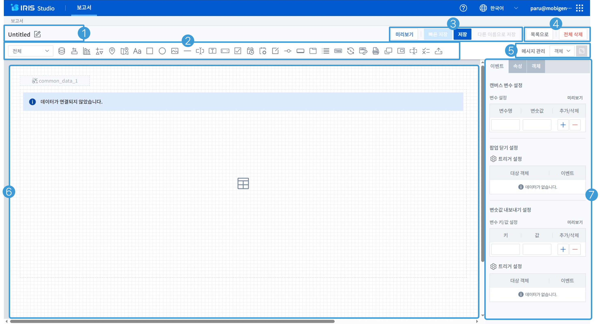
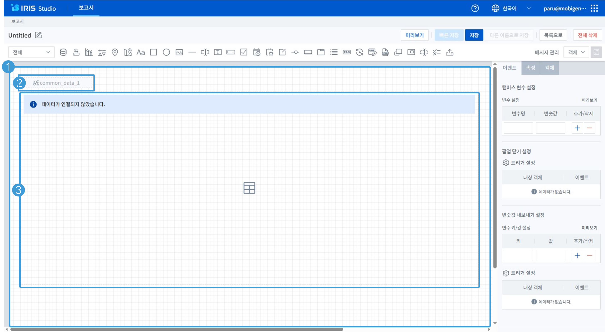
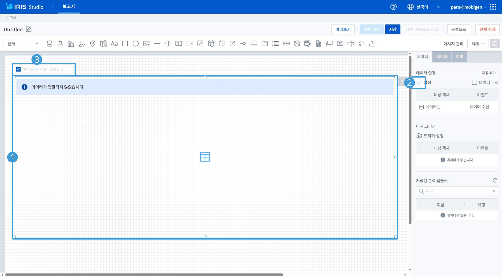
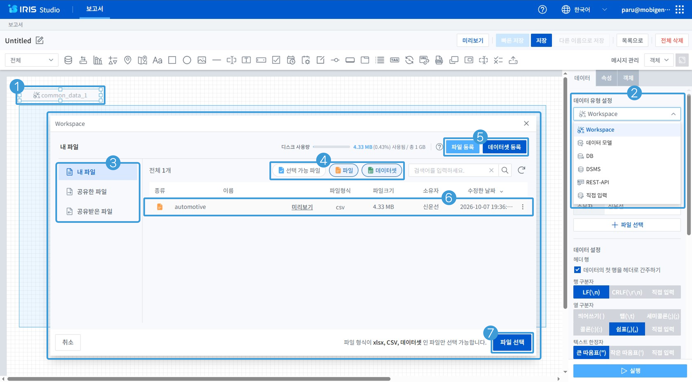
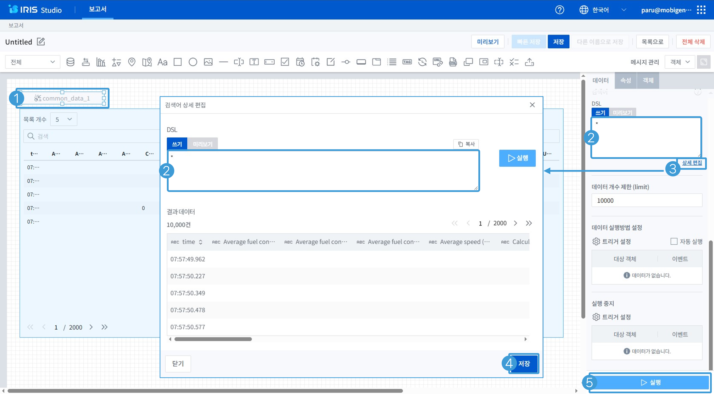
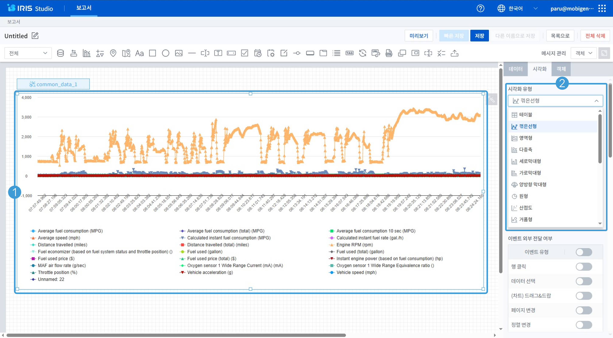
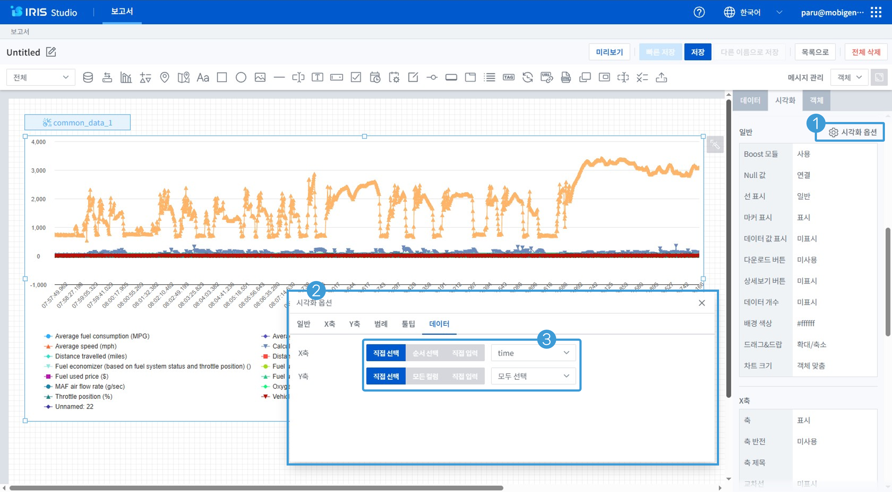

# IRIS02-Studio 기본 설정

## 11. Studio 편집 화면

* Studio의 보고서는 하나의 캔버스가 하나의 보고서이며 하나의 화면으로 실행됩니다.
* Studio의 모든 객체의 데이터는 Json 데이터로 관리됩니다.

1. 보고서 명 관리 영역 : 보고서명을 입력, 수정을 할 수 있습니다.
2. 객체 선택 영역 : 보고서를 만들기 위해 사용할 컴포넌트를 선택할 수 있습니다.
3. 보고서 제어 영역
	* 미리보기 : 저작 중인 보고서를 실행해 볼 수 있습니다.
	* 빠른저장 : 저작 중인 보고서에 대해 변경된 내역을 저장할 수 있습니다.
	* 저장 : 저작 중인 보고서에 대해 변경된 내역을 저장하며 실행된 보고서의 화면을 캡쳐하여 썸네일로 만듭니다.
	* 다른 이름으로 저장 : 저작 중인 보고서를 다른 이름으로 저장(복제)할 수 있습니다.
4. 보고서 관리 영역
	* 목록으로 : 만들어진 보고서 목록 화면으로 나가갈 수 있습니다.
	* 전체삭제 : 보고서 내의 모든 컴포넌트를 삭제할 수 있습니다.
5. 객체 속성 내용 확인 영역
	* 메시지 관리 : 조건검사 컴포넌트에서 사용할 Alert 메시지를 추가, 수정, 삭제 할 수 있습니다.
	* 객체 목록 보기 : 보고서 내에서 사용한 객체의 리스트를 확인 할 수 있습니다.
	* 히든객체 숨김/보기 : 히든 컴포넌트 (데이터, 조건검사, 텍스트변환)에 대해 숨김/보기를 할 수 있습니다.
	* 변수 목록 보기 : 보고서 내의 컴포넌트들이 트리서 수행 후 자체 변수에 저장된 인수의 내역을 확인 할 수 있습니다.
6. 캔버스 영역 : Studio를 저작하는 기본 Base 컴포넌트 입니다.
7. 선택된 객체 설정 영역 : 제작자가 선택한 객체의 세부 설정을 할 수 있는 영역입니다.

---

## 12. 데이터 객체와 차트 객체

- 캔버스는 ‘새 보고서 시작’시 자동으로 생성됩니다.
- 캔버스도 하나의 객체입니다.

1. 캔버스 객체 : Studio를 저작하는 기본 Base 컴포넌트 입니다.
2. 데이터 객체 : 보고서에서 사용할 데이터를 호출, 조회, 처리하는 컴포넌트 입니다.
3. 차트 객체 : 데이터 객체에서 호출, 조회, 처리된 데이터를 출력하는 컴포넌트 입니다.

---

## 13. 데이터 객체와 차트 객체 연결

- 차트 객체는 데이터 객체만 연결이 가능하며 하나의 차트 객체에서 여러 개의 데이터 객체를 연결할 수 있습니다.
- 설정 영역에서 설정을 활성화 한 후에 데이터 객체를 선택하고 설정 영역에서 확인 수행을 해야 합니다.

 1. 선택된 차트 객체
 2. 데이터 연결 설정 상태
	 * 기어 아이콘 클릭 하면 체크 아이콘으로 변경 – 선택
	 * 체크 아이콘을 클릭 하면 기어 아이콘으로 변경 – 완료
 3. 차트 객체와 연결하기 위해 선택된 데이터 객체

---

## 14. 데이터 객체의 유형 및 데이터 파일 등록

- 데이터 객체의 유형은 Workspace, 데이터모델, DB, DSMS, REST-API, 직접입력이 있습니다.

1. 데이터 객체
2. 선택된 ‘데이터 객체’의 데이터 유형 설정
	* Workspace : 사용자가 등록(업로드)한 파일을 처리하는 유형
	* 데이터모델 : IRIS Discovery에서 연결된 데이터로 만든 메타 데이터(데이터모델/데이터모델뷰)를 처리하는 유형
	* DB : IRIS Discovery에서 연결된 데이터베이스의 데이터를 처리하는 유형으로 선택한 데이터베이스의 테이블에 대해 Read만 가능하며 SQL와 DSL을 함께 사용이 가능
	* DSMS : IRIS Discovery에서 연결된 데이터베이스의 데이터를 처리하는 유형으로 선택한 데이터베이스의 테이블에 대해 CRUD가 가능하며 SQL만 사용 가능
	* REST-API : 타 서버와 API 연동으로 데이터를 처리하는 유형
	* 직접입력 :사용자가 직접 입력한 데이터(Json)를 처리하는 유형
3. Workspace의 등록된 파일 확인
4. 선택 가능한 파일 형식 선택
5. 데이터 등록 (‘파일등록’ 클릭 후 팝업되는 탐색기에서 파일 선택)
6. 등록된 데이터 파일 등 중 사용할 데이터 파일 선택
7. ‘파일 선택’ 버튼 클릭으로 파일 선택 작업 완료

---

## 15. 데이터 객체에 DSL 입력 및 수행

* ‘쓰기’는 DSL 을 입력하는 기능이며 변수를 ’${변수명}’으로 사용할 수 있으며 ‘미리보기’는 실행될 DSL을 확인할 수 있습니다.
* ‘상세 편집’에서 입력한 DSL을 미리 수행 및 확인이 가능하며 ‘저장’을 클릭하여 저장해야 합니다.

1. 데이터 객체
2. 검색어 입력창 :  연결된 데이터에 대한 호출, 조회, 처리를 행하는 DSL이나 SQL을 입력 
3. 객체 속성 내용 확인 영역의 상세편집 : '상세편집' 화면을 호출
4. 상세편집의 검색어 DSL 저장(적용) : 검색어 입력창의 내용을 출력하며 상세편집 화면에서 제작자가 입력한 검색어를 미리 수행이 가능하고 저장을 클릭해야 '검색어 입력창'에 반영이됨
5. 선택한 데이터 객체에 입력한 DSL 실행 : 제작자가 입력한 검색어를 연결된 데이터에 대한 호출, 조회, 처리를 수행

---

## 16. 차트 객체 설정

* 차트 객체의 기본 시각화 유형은 ‘테이블’ 입니다.

1. 선택된 차트 객체
2. 차트 객체의 시각화 유형 선택
	* 테이블 : 데이터를 행과 열의 구조로 되어 있는 테이블 형태로 출력
	* 꺽은선형 : 범주형(주로 시계열) 항목을 X축 기준으로 Y축에 수치형 변수의 크기에 따라 위치와 점을 찍고 선으로 연결하여 출력
	* 영역형 : 꺾은선형 차트를 기반으로 하여 축과 선 사이의 출력되는 영역의 볼륨을 색으로 표현
	* 다중축 : 범주형(주로 시계열) 항목을 X축 기준으로 Y축에 2개 이상의 데이터의 크기를 서로 다른 차트 유형(세로막대형, 꺾은선형)으로 출력하며 스택(누적)과 풀스택(100% 누적) 기능 선택 출력 가능
	* 가로막대형 : 범주형(주로 시계열) 항목을 Y축 기준으로 막대를 그리고 데이터 크기에 따라 막대 길이를 다르게 출력하며 스택(누적)과 풀스택(100% 누적) 기능 선택 출력 가능
	* 세로막대형 : 범주형(주로 시계열) 항목을 X축 기준으로 막대를 그리고 데이터 크기에 따라 막대 길이를 다르게 출력하며 스택(누적)과 풀스택(100% 누적) 기능 선택 출력 가능
	* 양방향 : 2개의 세부 항목으로 구성된 그룹별 크기를 막대 길이로 출력
	* 원형 : 범주형 항목별 데이터가 전체 데이터 중 차지하는 구성 비중 크기만큼 조각의 크기를 나누어 출력
	* 산점도 : 일정 시간 간격으로 시계열로 되어 있는 범주형 항목을 X축 기준으로 Y축에 데이터의 크기에 따라 위치와 점으로 배열하여 출력
	* 거품형 : 2개의 수치형 변수를 기준으로 X, Y축을 그리고 원으로 표현된 개별 항목별로 남은 수치형 변수의 데이터 크기를 원의 크기로 표현
	* 모션 : 거품형 차트를 기본으로 하여 시간의 흐름에 따른 데이터와 데이터의 움직임까지 출력
	* Sankey : 범주형 변수의 항목별 데이터의 흐름을 표현하며 한 개의 축을 그린 뒤 세부 항목별 데이터의 이동 경로를 곡선으로 표현되는데 선의 경로와 두께를 기준으로 데이터를 해석
	* 히트맵 : 2개의 범주형 변수의 항목들을 x축과 y축에 배치한 격자 무늬 형태의 차트 영역에 수치형 변수 데이터 크기를 색으로 표현하며 구간별로 다른 색으로 표현해 데이터의 크기 파악이 가능
	* Gauge(게이지) : 자동차 계기판과 같은 형태로 데이터의 크기를 표현하여 조각의 크기를 기준으로 항목마다 전체 데이터 중 차지하는 비중 파악이 가능
	* 트리맵 : 전체 데이터를 하나의 사각형으로 표현하고, 항목별 데이터 크기에 따라 사각형을 네모 조각으로 나누어 표현하며 조각의 크기가 클수록 전체 중 특정 항목이 차지 하는 비중이 크다는 것을 의미
	* 워드클라우드 : 범주형 변수의 값을 텍스트 형태의 시각화 요소로 표현하고, 수치형 변수의 크기에 따라 요소의 크기를 다르게 표현
	* 상자그림 : 통계 측면에서 5가지 요약 수치 (Five-Number Summary : 최솟값, 제1사분위수, 제2사분위, 제3분위수, 최댓값)를 표현
	* Anomaly : DSL의 anomalies 실행 결과에서 이상 값과 상/하한 임계치 라인을 표현
	* Forecast : DSL의 forecast 실행 결과를 꺽은선형 차트로 표현하여 조회된 데이터를 기준으로 현재 이후의 데이터의 흐름을 예측
	* Outlier : 데이터 분포 중 다른 측정값에서 크게 벗어난 값을 표현
	* 네트워크 그래프 : 데이터 항목을 의미하는 노드와 관계성을 표현하는 선으로 표현
	* 레이더 그래프 : 동심원 위에 점을 찍어 그 도형의 모양으로 데이터의 크기  등의 변수 분포를 표현

---

## 17. 차트 객체의 시각화 옵션 설정

* 차트 객체의 시각화 유형 선택 시 자동으로 X, Y축에 컬럼이 매핑 됩니다.
* 차트 객체의 시각화 유형 변경 후 차트 객체에 데이터가 나타나지 않는 경우 시각화 옵션의 데이터를 확인해야 합니다.

1. 차트 객체의 시각화 옵션 실행
2. 시각화 옵션 : 차트의 유형별로 탭과 항목에서 세부 내역을설정
3. X,Y 축과 같이 차트에 출력할 컬럼 선택
