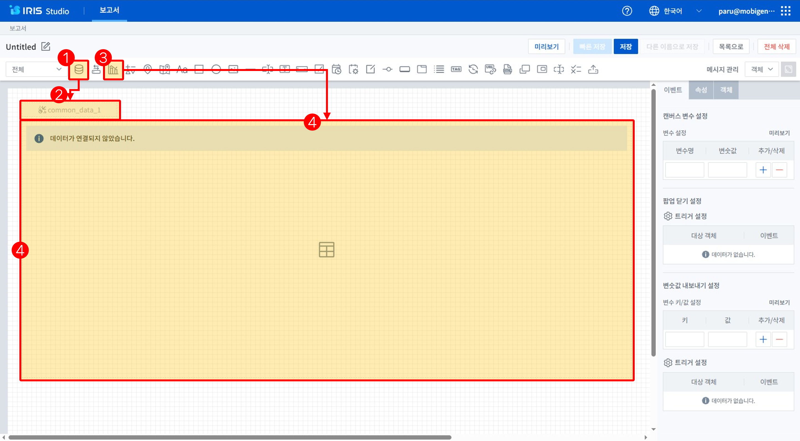
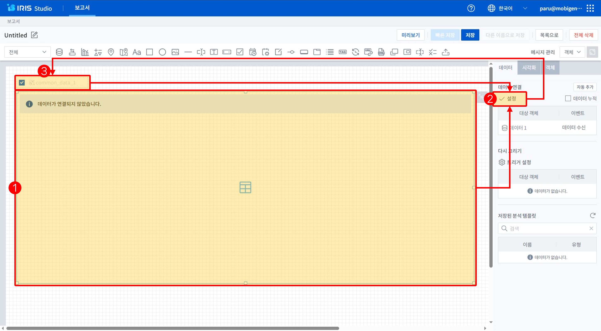
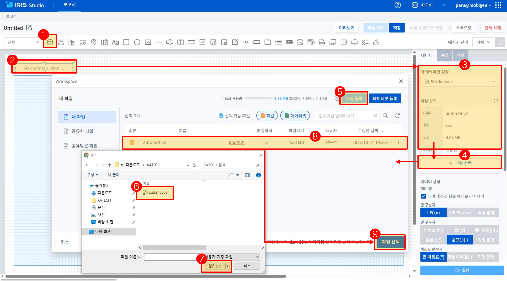
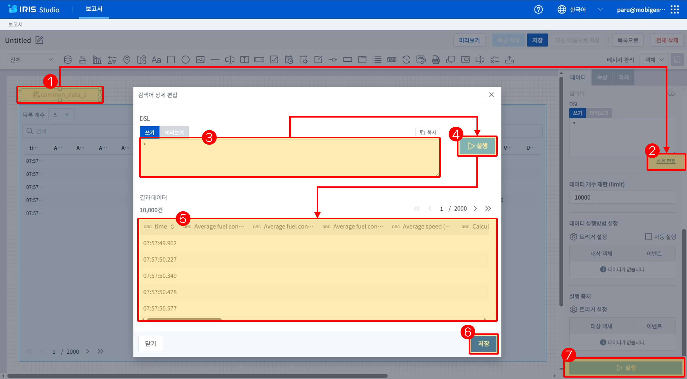
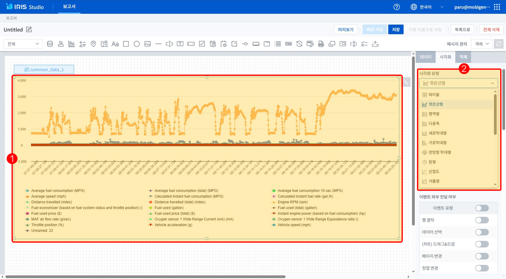
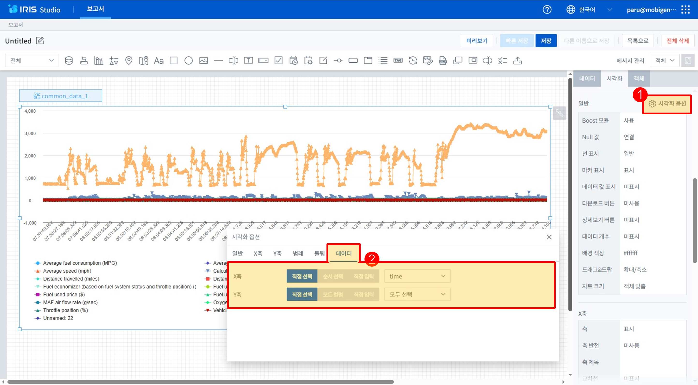

# IRIS03-데이터와 차트 실습

## 18. 실습: 데이터 객체와 차트 객체를 캔버스에 놓기

* Studio의 객체는 캔버스 위에 Drag&Drop으로 위치 및 크기를 설정할 수 있습니다.
* 객체의 크기 위치는 변경이 가능하며 설정영역의 ‘객체’ 탭에서 상세하게 설정이 가능합니다.

1. 개체 선택 영역에서 ‘데이터’ 객체를 선택합니다.
2. 캔버스의 특정 위치에서 Drag&Drop 으로 위치 및 크기 설정합니다.
3. 개체 선택 영역에서 ‘차트’ 객체 선택합니다.
4. 캔버스의 특정 위치에서 Drag&Drop 으로 위치 및 크기 설정합니다.

---

## 19. 실습: 데이터 객체와 차트 객체 연결

- 차트 객체는 데이터 객체만 연결이 가능하며 하나의 차트 객체에서 여러 개의 데이터 객체를 연결할 수 있습니다.
- 설정 영역에서 설정을 활성화 한 후에 데이터 객체를 선택하고 설정 영역에서 확인 수행을 해야 합니다.

1. 차트 객체를 선택합니다.
2. 연결 설정의 기어 아이콘을 클릭하여 활성화 상태로 변경합니다.
3. 차트 객체와 연결하기 위한 데이터 객체 선택합니다.
4. 연결 설정의 체크 아이콘을 다시 클릭하여 완료합니다.

---

## 20. 실습: 데이터 객체 삽입 및 데이터 등록

- Studio의 데이터 객체에서 사용할 데이터는 ‘automotive’와 같은 이전 교육에서 생성한 데이터를 사용하며
- Workspace에 업로드 하는 데이터 파일은 csv 파일이어야 하며 UTF-8 저장되어야 합니다.

1. 데이터 객체를 선택합니다.
2. 캔버스 위에 데이터 객체를 올려 놓습니다.
3. 데이터 객체의 시각화 유형을 선택합니다. (Workspace를 선택합니다.)
4. ‘파일 선택’을 클릭하여 데이터 객체에서 사용할 데이터 선택창을 실행합니다.
5. 데이터 선택창에서 ‘파일 등록’을 클릭하여 등록할 파일을 선택할 탐색기 실행합니다.
6. 탐색기에서 등록할 파일 선택합니다.
7. 선택한 파일 열기를 선택합니다.
8. 등록된 데이터 선택 합니다.
9. 선택된 데이터 파일로 등록 합니다.

---

## 21. 실습: 데이터 객체 실행

- 데이터 객체에 연결된 DB 또는 파일의 데이터 조회 처리를 실행하기 위한 상세 편집을 통해 미리 실행하여 결과를 확인할 수 있습니다.
- 실행된 결과를 확인 후 ‘저장’ 버튼을 클릭해야 적용됩니다.
- ‘편집모드’에서는 데이터 객체의 ‘실행’버튼을 클릭하면 Query와 DSL이 수행됩니다.

1. 차트를 선택합니다.
2. ‘설정영역’의 테이터 탭에서 검색어 영역의 ‘상세편집’을 클릭합니다.
3. ‘상세편집’ 화면에서 DSL([DSL 설명 및 예제](https://docs.iris.tools/manual/IRIS-Manual/IRIS-Discovery-Middleware/command/index.html#command-references))을 입력합니다.
4. ‘실행’ 버튼을 클릭하여 수행합니다.
5. 처리 결과가 정상적으로 출력되는지 확인합니다.
6. ‘저장’버튼을 클릭하여 적용합니다.
7. ‘실행’ 버튼을 클릭합니다.

---

## 22. 실습: 차트 객체의 시각화 설정 ①

* 차트 객체의 기본 시각화 유형인 ‘테이블’에서 다른 시각화 유형으로 변경을 할 수 있습니다

1. 차트 객체를 선택합니다.
2. 차트 객체의 시각화 유형 중 꺽은선형을 선택합니다.

---

## 23. 실습: 차트 객체의 시각화 설정 ②

- 차트 객체의 기본 시각화 유형인 ‘테이블’에서 다른 시각화 유형으로 변경을 할 수 있습니다.
- 시각화 유형을 변경한 후 차트에 데이터가 나타나지 않는 경우 ‘데이터’ 객체에서 처리된 테이터 컬럼을 확인해야 합니다.

1. 설정영역의 ‘시각화’ 탭의 ‘시각화옵션’을 클릭합니다.
2. 시각화 옵션의 ‘테이터’ 탭의 데이터 연결 항목을 확인합니다.
