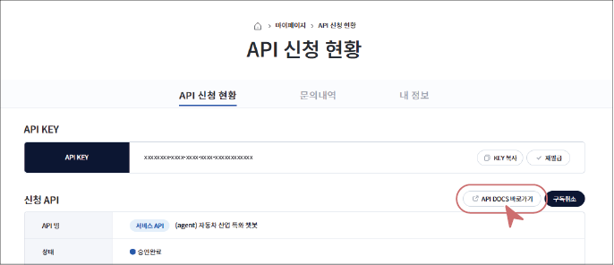
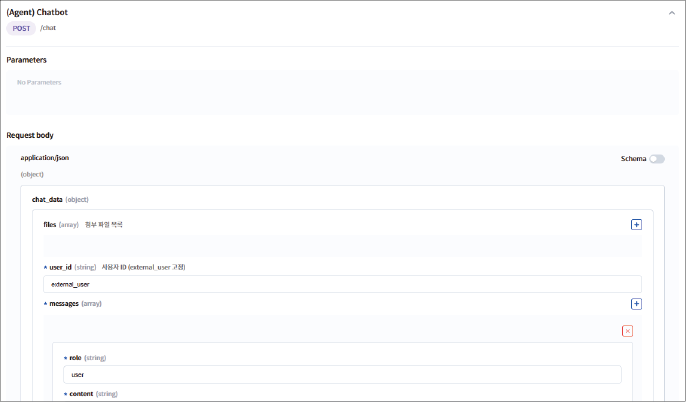

### API 호출하기

API 사용 승인이 완료되면 API를 사용할 수 있습니다. 
실행 테스트도 할 수 있습니다. 
1. **마이페이지** > **API 신청 현황**에서 해당 API를 클릭하세요.

2. 상세 화면에서 **API DOCS 바로가기**를 클릭하세요.



3. Parameters와 Request body 영역에 필요한 값을 입력하세요.
- 필수 값(*)이 표시된 항목은 반드시 입력해야 합니다.
- 선택 값은 필요에 따라 입력합니다.



4. 해당 값을 모두 입력 후, **Execute**를 클릭하세요.
- 요청과 응답 결과가 화면에 표시되며, 응답 상태 코드와 반환 데이터를 확인할 수 있습니다.

>  **참고**
>
> - 사용 신청 전이라도 API가 정상적으로 작동하는지 최대 10회까지 테스트할 수 있습니다.
>   - API 검색 > 호출 테스트할 API 클릭 > **API DOCS 바로가기** > **Test Key 발급** > 호출 테스트 시작
> - API 문서는 버전별로 json 포맷으로 제공합니다.

#### API Key로 직접 호출하기
API DOCS 화면의 코드 탭(shell, javascript, python)에는 API Key가 포함된 호출 코드가 표시됩니다. 이 코드를 복사하면 터미널이나 직접 만든 프로그램에서 같은 API를 호출할 수 있습니다.


직접 호출할 때는 다음 두 가지를 지정합니다.

- **서비스 URL**: `https://api-gateway.bigdata-car.kr/<기본 경로>/<버전>` 형식입니다. 입력값은 주소 뒤에 쿼리로 붙이거나(GET), 본문에 JSON으로 담습니다(POST).

- **X-Api-Key 헤더**: **마이페이지** > **API 신청 현황**의 API KEY 값을 요청 헤더 `X-Api-Key`에 넣습니다.

```bash
curl -H "X-Api-Key: 발급받은 API Key" \
  "https://api-gateway.bigdata-car.kr/fuel-efficiency/v1?acceleration=0.05&velocity=80&rpm=2200"
```

| 응답 코드 | 의미 | 확인할 곳 |
|---|---|---|
| 200 | 정상 호출 | 응답 본문(JSON) |
| 401 | API Key가 없거나 틀림 | `X-Api-Key` 헤더 값, 사용 신청 승인 여부 |
| 404 | 등록되지 않은 경로 호출 | 서비스 URL의 기본 경로와 버전 |
| 422 | 입력값 누락 또는 형식 오류 | 파라미터 이름과 값 |
