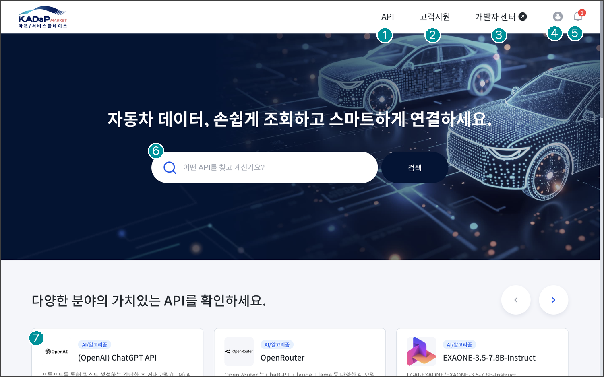
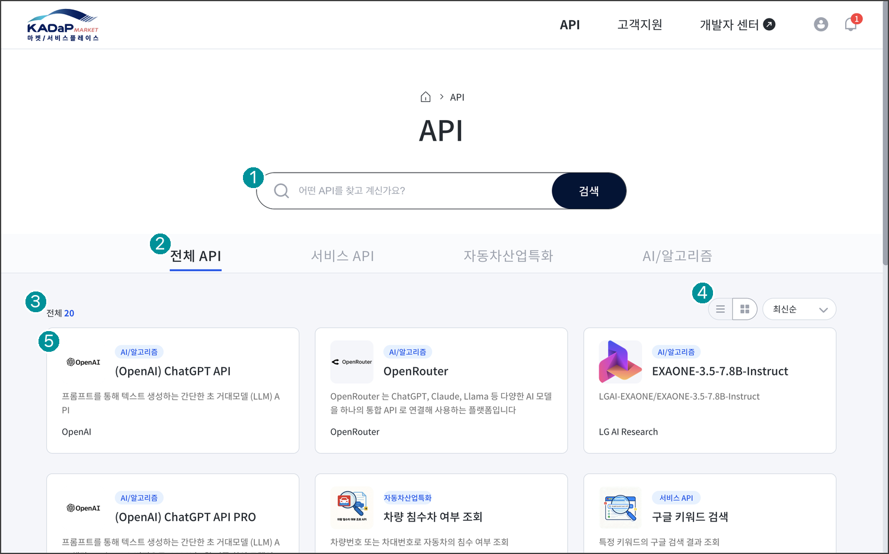
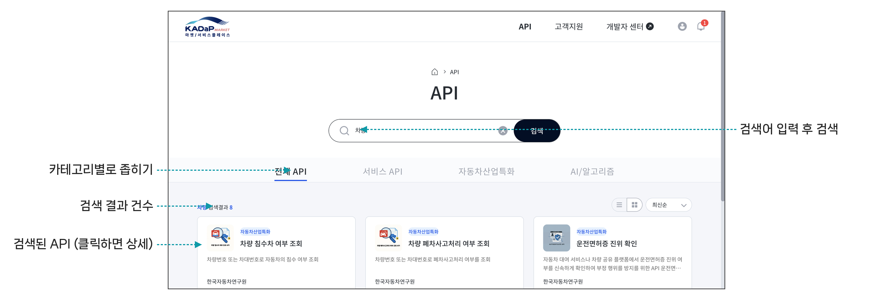
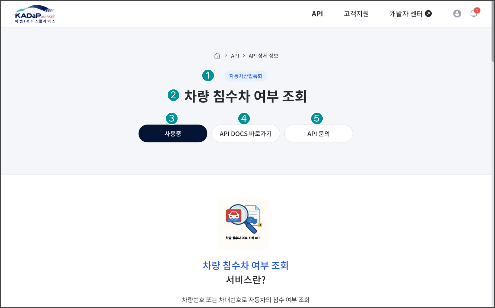
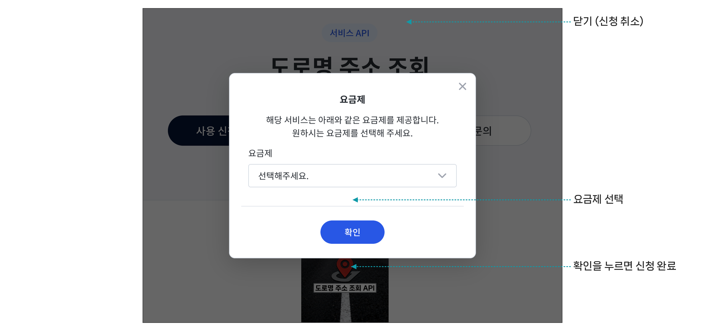
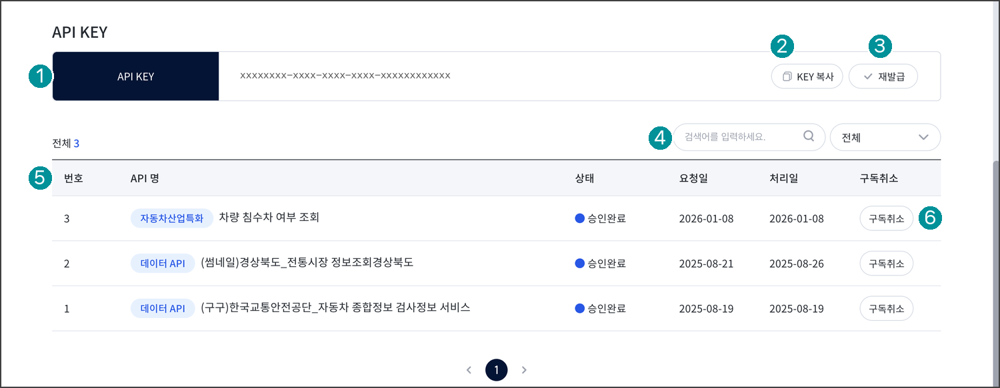
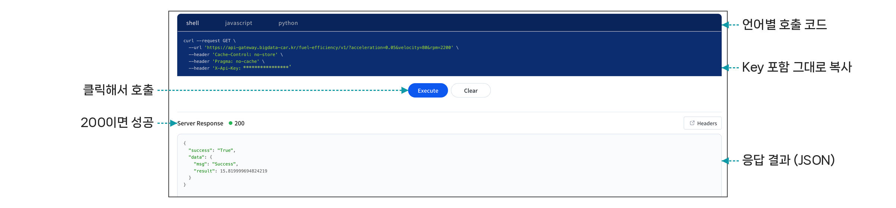

## 실습 1. API 마켓 플레이스에서 API 사용하기

API 마켓 플레이스에 공개된 API를 찾아 사용 신청하고, 승인 후 API Key로 호출합니다. 실습은 사용자 입장에서 진행합니다.

| 순서 | 할 일 | 확인 |
|---|---|---|
| 1 | API 목록에서 키워드로 검색 | 상세 화면이 열림 |
| 2 | **사용 신청하기** > 요금제 선택 | 마이페이지 상태 : 승인대기 |
| 3 | 개발자 승인 대기 | 상태 : 승인완료 |
| 4 | API DOCS에서 값 입력 후 **Execute** | 응답 코드 200 |
| 5 | API Key를 넣어 curl로 호출 | 터미널에 결과(JSON) 출력 |

### 1. API 마켓 플레이스 접속하기

1. 자동차 데이터 플랫폼(www.bigdata-car.kr)에 로그인한 뒤 **데이터 서비스 제공** > **API 마켓 플레이스**를 클릭하세요.

- 바로가기: [api.bigdata-car.kr](https://api.bigdata-car.kr)



| 번호 | 항목 | 설명 |
|---|------|------|
| 1 | API | 전체 API 목록 |
| 2 | 고객지원 | 공지사항, FAQ, 고객문의 |
| 3 | 개발자 센터 | API 등록과 관리 (개발자 권한 필요) |
| 4 | 마이페이지 | API 신청 현황, API Key, 문의내역 |
| 5 | 알림 | 승인, 답변 알림 |
| 6 | 검색창 | API 이름과 설명으로 검색 |
| 7 | 추천 API | 마켓에 공개된 API |

### 2. API 검색하기

1. 상단 메뉴의 **API**를 클릭하세요.



| 번호 | 항목 | 설명 |
|---|------|------|
| 1 | 검색창 | API 이름과 설명으로 검색 |
| 2 | 카테고리 탭 | 서비스 API, 자동차산업특화, AI/알고리즘 |
| 3 | 전체 건수 | 현재 조건에 맞는 API 수 |
| 4 | 보기 방식 · 정렬 | 목록형, 카드형, 최신순 |
| 5 | API 카드 | 카테고리, 이름, 설명, 제공기관 |

2. 검색창에 키워드를 입력하고 **검색**을 클릭하세요.

- 예) "차량"으로 검색하면 차량 관련 API가 표시됩니다.



3. 사용할 API 카드를 클릭하세요. API 상세 화면으로 이동합니다.

### 3. API 사용 신청하기

1. API 상세 화면에서 API 소개, 요청 · 응답 형식, 요금제를 확인하세요.



| 번호 | 항목 | 설명 |
|---|------|------|
| 1 | 카테고리 | API 분류 |
| 2 | API 이름 | 마켓에 표시되는 이름 |
| 3 | 사용 신청하기 | 요금제를 골라 사용 신청 (승인 후 **사용중**으로 변경) |
| 4 | API DOCS 바로가기 | 사용법 확인과 테스트 호출 |
| 5 | API 문의 | 개발자에게 질문 (고객문의로 이동) |

2. **사용 신청하기**를 클릭하고 요금제를 선택한 뒤 **확인**을 클릭하세요.



3. **마이페이지** > **API 신청 현황**에서 상태를 확인하세요.

- **승인대기**: 개발자의 승인을 기다리는 상태입니다.

- **승인완료**: 이 시점부터 API Key로 호출할 수 있습니다.

>  **참고**
>
> 승인 전에도 **API DOCS 바로가기** > **Test Key 발급**으로 API별 최대 10회까지 호출해 볼 수 있습니다.

### 4. API Key 확인하기

**마이페이지** > **API 신청 현황**에서 API Key를 확인합니다. API Key는 승인된 모든 API에 공통으로 사용합니다.



| 번호 | 항목 | 설명 |
|---|------|------|
| 1 | API KEY | 내 계정의 API Key (모든 API 공통) |
| 2 | KEY 복사 | 호출할 때 붙여 넣기 |
| 3 | 재발급 | 유출 시 새로 발급 (기존 Key는 즉시 사용 불가) |
| 4 | 검색 · 상태 필터 | API 이름과 상태로 찾기 |
| 5 | 신청 목록 | API 이름, 상태, 요청일, 처리일 |
| 6 | 구독취소 | 더 이상 쓰지 않는 API 해지 |

### 5. API DOCS에서 호출하기

1. API 상세 화면에서 **API DOCS 바로가기**를 클릭하세요.

2. Parameters 입력칸에 값을 입력하고 **Execute**를 클릭하세요.

3. 응답 코드 **200**과 응답 결과(JSON)를 확인하세요.



### 6. 터미널에서 API Key로 호출하기

API DOCS의 **shell** 탭에 표시된 호출 코드를 복사해 터미널에서 실행하세요. 요청 헤더 `X-Api-Key`에 API Key가 들어 있습니다.

```bash
curl -H "X-Api-Key: 발급받은 API Key" \
  "https://api-gateway.bigdata-car.kr/<기본 경로>/v1?입력값"
```

API Key를 빼고 호출하면 API Gateway가 다음과 같이 거부합니다.

```json
{"status":401,"message":"Unauthorized (this error issued by osori gateway.)"}
```
