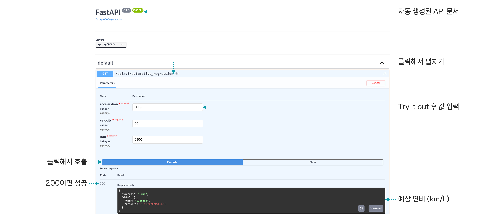
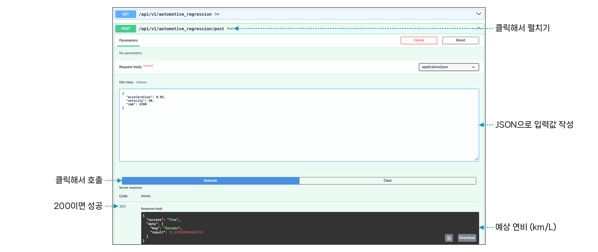

## 실습 2. 연비 예측 모델을 API로 만들기 (FastAPI)

2일차에 학습한 연비 예측 모델(XGBoost)을 FastAPI로 감싸 API로 만들고, 클라우드 VM에서 실행합니다. 입력은 가속도 · 속도 · 엔진 RPM이고, 출력은 예상 연비(km/L)입니다.

| 순서 | 할 일 | 확인 |
|---|---|---|
| 1 | VM 접속 (웹터미널 또는 SSH) | 터미널 프롬프트 표시 |
| 2 | 패키지 설치 | Successfully installed |
| 3 | 2일차 실습 코드와 학습한 모델 파일을 VM에 올리기 | model.py와 모델 파일 확인 |
| 4 | API 서버 실행 | Application startup complete |
| 5 | curl로 GET 호출 | `{"success":"True", ...}` |
| 6 | `/docs`에서 **Execute** | 응답 코드 200, 예상 연비 |

### 1. 패키지 설치하기

클라우드 VM에 접속한 뒤 API 서버(fastapi, uvicorn)와 모델 실행(xgboost, scikit-learn, pandas)에 필요한 패키지를 설치하세요.

```bash
pip3 install fastapi uvicorn xgboost scikit-learn pandas
```

>  **참고**
>
> 설치 중 버전 경고가 출력되어도 예측 결과가 나오면 정상입니다.

### 2. 모델 불러오기 (model.py)

`model.py`는 2일차에 학습한 XGBoost 모델과 스케일러를 불러와 연비를 예측합니다. API 서버는 이 파일의 `cal_distance` 함수를 호출합니다.

```python
import joblib                                    # 저장된 모델 파일을 불러오는 도구
import numpy as np                               # 숫자 계산
import pandas as pd                              # 표 형태 데이터

class MyDistance:                                # 연비 예측 모델 클래스
    def __init__(self, model_path="saved_models/xgboost_fuel_model.pkl",
                 scaler_path="saved_models/telemetry_scaler.pkl"):
        self.model = joblib.load(model_path)     # 2일차에 학습한 XGBoost 모델 불러오기
        self.scaler = joblib.load(scaler_path)   # 입력값 정규화 도구 불러오기
    def cal_distance(self, acc, vel, rpm):       # 가속도, 속도, RPM으로 연비 예측
        data = pd.DataFrame([{'acceleration': acc, 'velocity': vel, 'rpm': rpm}])
        scaled = self.scaler.transform(data)     # 학습 때와 같은 기준으로 정규화
        prediction = self.model.predict(scaled)[0]   # 모델로 연비 예측
        return float(np.round(prediction, 2))    # 예상 연비(km/L) 반환
```

모델이 정상적으로 불러와지는지 먼저 확인하세요.

```bash
python3 -c "from model import MyDistance; print(MyDistance().cal_distance(0.05, 80, 2200))"
```

```text
>> [MyDistance Engine] 모델 및 스케일러 로드 완료 (서빙 준비 완료)
15.819999694824219
```

### 3. API 서버 코드 (automotive_regression.py)

같은 연비 예측 기능을 GET과 POST 두 방식으로 제공합니다.

| 구분 | GET | POST |
|---|---|---|
| 입력값 위치 | 주소 뒤 쿼리<br>`?acceleration=0.05&velocity=80&rpm=2200` | 본문 (JSON)<br>`{"acceleration": 0.05, "velocity": 80, "rpm": 2200}` |
| 주소 | `/api/v1/automotive_regression` | `/api/v1/automotive_regression/post` |
| 주 용도 | 조회 | 데이터 전달 · 처리 |

```python
from fastapi import FastAPI                          # API 서버 프레임워크
from starlette.responses import JSONResponse         # JSON 응답
from pydantic import BaseModel                       # POST 본문(JSON) 형식 정의
from model import *                                  # 연비 예측 모델 (model.py)

app = FastAPI()                                      # API 서버 생성
mydistance = MyDistance()                            # 서버 시작 시 모델을 한 번 불러옴

@app.get("/api/v1/automotive_regression")            # GET 방식 주소
async def GET(acceleration: float, velocity: float, rpm: int):   # 쿼리 파라미터 3개
    result = mydistance.cal_distance(acc=acceleration, vel=velocity, rpm=rpm)
    return JSONResponse({'success': 'True',
                         'data': {'msg': 'Success', 'result': result}})

class DISTANCE(BaseModel):                           # 요청 본문 형식
    acceleration: float                              # 가속도 (g)
    velocity: int                                    # 차속 (km/h)
    rpm: int                                         # 엔진 회전수 (rpm)

@app.post('/api/v1/automotive_regression/post')      # POST 방식 주소
async def POST(param: DISTANCE):                     # 본문을 DISTANCE 형식으로 받음
    result = mydistance.cal_distance(acc=param.acceleration,
                                     vel=float(param.velocity), rpm=param.rpm)
    return JSONResponse({'success': 'True',
                         'data': {'msg': 'Success', 'result': result}})
```

- 함수 위에 `@app.get(...)`, `@app.post(...)`를 붙이면 그 함수가 해당 주소의 API가 됩니다.

- GET은 함수의 매개변수 이름이 그대로 입력 항목 이름이 됩니다.

- POST는 `BaseModel`로 본문 형식을 정하므로, 형식이 틀린 요청은 422로 자동 거부됩니다.

### 4. API 서버 실행하기

`automotive_regression.py`가 있는 위치에서 다음 명령으로 서버를 실행하세요. 마켓 플레이스에서 연결할 수 있도록 8000 포트를 사용합니다.

```bash
uvicorn automotive_regression:app --host 0.0.0.0 --port 8000
```

```text
INFO:     Application startup complete.
INFO:     Uvicorn running on http://0.0.0.0:8000
```

### 5. 호출해 보기

다른 터미널을 열고 GET과 POST로 호출하세요.

```bash
curl "http://localhost:8000/api/v1/automotive_regression?acceleration=0.05&velocity=80&rpm=2200"

curl -X POST http://localhost:8000/api/v1/automotive_regression/post \
     -H 'Content-Type: application/json' \
     -d '{"acceleration": 0.05, "velocity": 80, "rpm": 2200}'
```

```json
{"success":"True","data":{"msg":"Success","result":15.819999694824219}}
```

### 6. 자동 생성 문서(/docs)에서 호출하기

서버를 실행하면 `http://VM 주소:8000/docs`에 API 문서가 자동으로 만들어집니다.

1. GET 항목을 클릭해 펼친 뒤 **Try it out**을 클릭하세요.

2. 값을 입력하고 **Execute**를 클릭하세요.

3. 응답 코드 **200**과 예상 연비를 확인하세요.



POST는 **Request body**에 JSON을 입력하고 **Execute**를 클릭합니다. GET과 같은 입력이면 같은 결과가 나옵니다.



서버가 실행된 상태로 두고 다음 실습으로 넘어갑니다.
