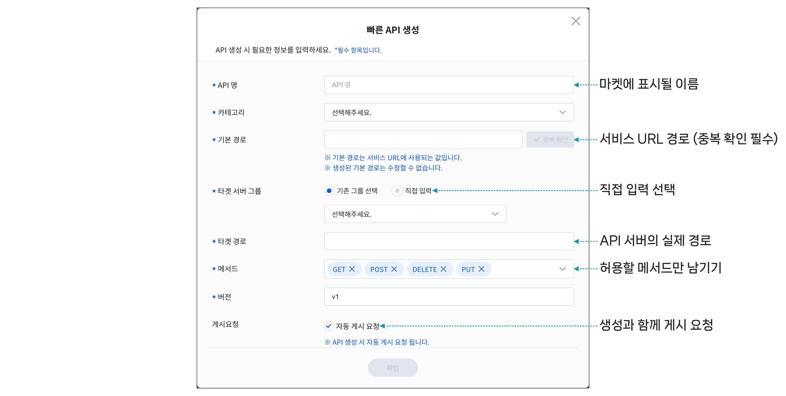
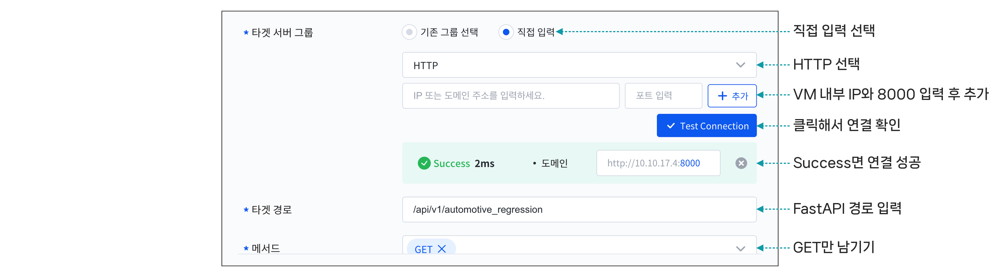
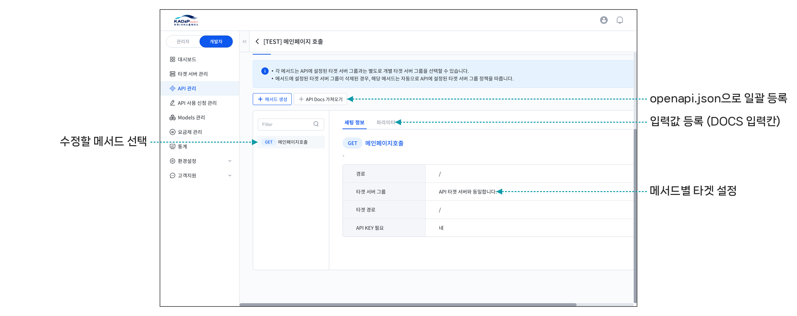
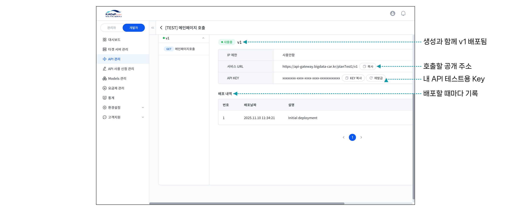
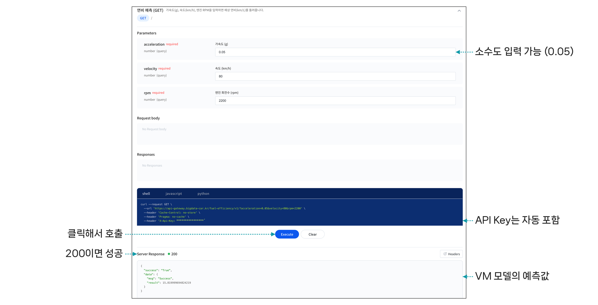
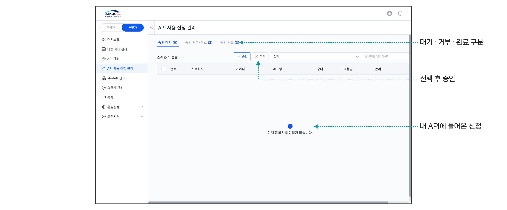
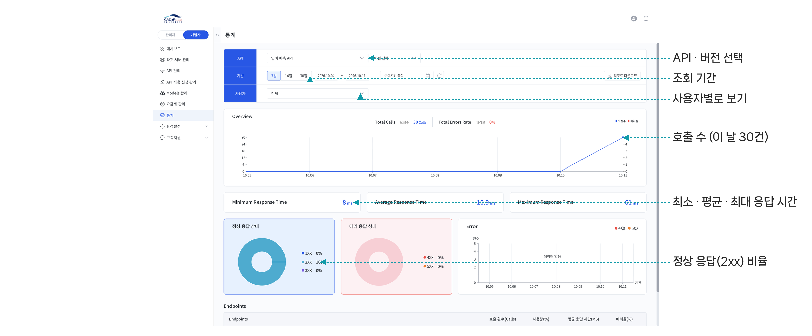
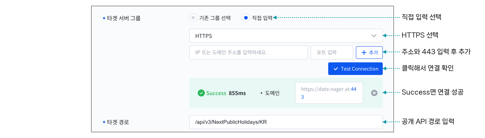

## 실습 3. 연비 예측 API 등록 · 공개하기

[실습 2](05-18.md)에서 VM에 실행한 연비 예측 API를 마켓 플레이스에 등록하고 공개합니다. 실습은 개발자 입장에서 진행합니다.

| 순서 | 할 일 | 확인 |
|---|---|---|
| 1 | 빠른 API 생성 (타겟 : VM 내부 IP:8000) | Test Connection Success |
| 2 | 메서드 이름 · 파라미터 등록 | API DOCS에 입력칸 표시 |
| 3 | API DOCS에서 **Execute** | 응답 코드 200, 예상 연비 |
| 4 | 게시 요청 (관리자 승인) | 마켓 플레이스에 공개 |
| 5 | 다른 교육생의 사용 신청 승인 | 통계에서 호출 수 확인 |

사용자의 호출은 다음 순서로 VM의 API 서버에 전달됩니다.

```text
사용자 ── X-Api-Key ──▶ API Gateway ──▶ 타겟 서버 (VM 내부 IP:8000)
         https://api-gateway.bigdata-car.kr/<기본 경로>/v1
```

>  **참고**
>
> 개발자 센터를 이용하려면 개발자 권한이 필요합니다. 개발자 권한은 [개발자 등록](05-03.md#api-개발자-등록)을 참고하세요.

### 1. 빠른 API 생성하기

1. 상단의 **개발자 센터** > **API 관리**에서 **빠른 API 생성**을 클릭하세요.

2. 다음 정보를 입력하세요.

- **API 명**: 마켓에 표시될 이름입니다. (예: 연비 예측 API)

- **카테고리**: API 분류를 선택합니다.

- **기본 경로**: 서비스 URL에 쓰이는 경로입니다. 입력 후 **중복 확인**을 클릭하세요. 생성 후에는 수정할 수 없습니다. (예: fuel-efficiency-본인 이름)

- **타겟 경로**: API 서버의 실제 경로입니다. `/api/v1/automotive_regression`을 입력합니다.

- **메서드**: 허용할 메서드만 남깁니다. GET만 남기세요.

- **자동 게시 요청**: 기본으로 선택되어 있으며, 생성과 함께 게시 요청이 진행됩니다.



3. 타겟 서버 그룹에서 **직접 입력**을 선택하고 VM 정보를 입력하세요.

- **프로토콜**: HTTP

- **주소 · 포트**: VM 내부 IP와 8000을 입력한 뒤 **추가**를 클릭하세요.

- **Test Connection**을 클릭해 **Success**가 표시되는지 확인하세요. Success가 나오지 않으면 VM에서 API 서버가 실행 중인지 확인합니다.



4. **확인**을 클릭하세요.

API가 생성되고 v1 버전이 바로 배포됩니다.

### 2. 메서드 이름과 파라미터 등록하기

빠른 API 생성으로 만든 메서드는 이름이 **untitled method**로 표시되고 파라미터가 비어 있습니다. 파라미터를 등록해야 API DOCS에 입력칸이 표시됩니다.

1. API 상세 화면의 **정의된 메서드**를 클릭한 뒤, 메서드 오른쪽 위의 설정(⚙) > **수정**을 클릭하고 이름과 설명을 입력하세요.

2. **파라미터** 탭에서 다음 3개를 하나씩 입력하고 **추가**를 클릭하세요.

| 이름 | 파라미터 타입 | 타입 | Required |
|---|---|---|---|
| acceleration | 쿼리 | number | 켬 (기본값) |
| velocity | 쿼리 | number | 켬 (기본값) |
| rpm | 쿼리 | number | 켬 (기본값) |



3. **저장**한 뒤 **API 배포**를 클릭해 v1에 다시 배포하세요.

>  **참고**
>
> `http://VM 주소:8000/openapi.json`을 열어 파일로 저장한 뒤 **API Docs 가져오기**로 올리면 메서드와 파라미터를 한 번에 등록할 수 있습니다.

### 3. 내 API 호출해 보기

1. **버전** 탭에서 서비스 URL과 API KEY를 확인하세요.



2. 버전 상세 화면 오른쪽 위의 메뉴(⋮) > **API DOCS 바로가기**를 클릭하세요.

3. 값을 입력하고 **Execute**를 클릭하세요. API Key는 자동으로 들어갑니다.

4. 결과가 [실습 2](05-18.md)에서 VM에 직접 호출한 값과 같은지 확인하세요.



터미널에서는 다음과 같이 호출합니다.

```bash
curl -H "X-Api-Key: 버전 탭의 API KEY" \
  "https://api-gateway.bigdata-car.kr/<기본 경로>/v1?acceleration=0.05&velocity=80&rpm=2200"
```

```json
{"success":"True","data":{"msg":"Success","result":15.819999694824219}}
```

### 4. 게시 요청하기

1. API 상세 화면 상단의 **게시요청**을 클릭하세요. 빠른 API 생성에서 **자동 게시 요청**을 선택했다면 생략합니다.

2. 관리자가 승인하면 API가 마켓 플레이스에 공개됩니다. 실습에서는 강사가 일괄 승인합니다.

### 5. 사용 신청 승인하고 통계 확인하기

1. 다른 교육생의 API를 [실습 1](05-17.md)과 같은 방법으로 사용 신청하세요.

2. **개발자 센터** > **API 사용 신청 관리**에서 내 API에 들어온 신청을 선택하고 승인하세요.



3. 다른 교육생이 내 API를 호출한 뒤 **통계** 메뉴에서 API와 기간을 선택해 호출 수, 응답 시간, 응답 상태를 확인하세요.



### 문제 해결

| 증상 | 원인 | 확인할 곳 |
|---|---|---|
| Test Connection 실패 | VM에서 서버가 실행 중이 아님 | uvicorn 실행 여부, 포트 8000 |
| 401 Unauthorized | API Key가 없거나 틀림 | `X-Api-Key` 헤더 값 |
| 404 Not Found | 등록하지 않은 경로를 호출 | 타겟 경로, 메서드 경로 |
| 422 | 입력값 누락 또는 형식 오류 | 파라미터 이름과 값 |
| API DOCS 입력칸 없음 | 메서드 파라미터를 등록하지 않음 | 메서드 수정 > 파라미터 |

>  **참고**
>
> VM에 API 서버를 실행하지 못한 경우, 웹에 공개된 API를 타겟으로 등록해 같은 절차를 진행할 수 있습니다. 프로토콜은 **HTTPS**, 주소는 `date.nager.at`, 포트는 `443`, 타겟 경로는 `/api/v3/NextPublicHolidays/KR`을 입력합니다.
> 
