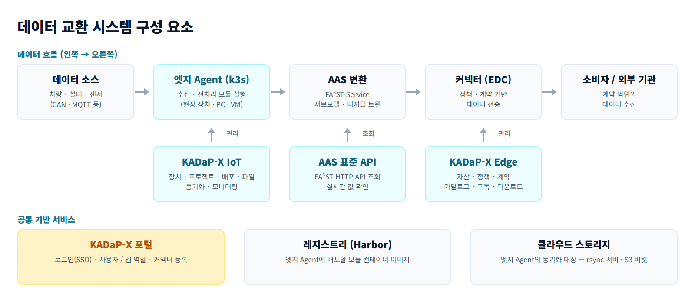

# 자동차 데이터 스페이스 KADaP -X 

데이터의 수집과 교환을 지원 하기 위한 시스템으로 

제조 설비나 차량의 데이터를 수집해 가공하고, 계약한 참여자와 안전하게 교환할 수 있습니다.

# 소개

자동차 데이터스 페이스에 참여하는 기업이 데이터의 통제권을 지키면서 데이터를 주고받을 수 있도록 지원합니다. 제조 설비에서 수집한 데이터를 전처리하고, AAS(자산 관리 쉘) 표준 모델로 변환 후 커넥터(EDC)를 활용하여 지정한 참여자에게만 전달합니다.

자동차 데이터 스페이스는 포털, IoT, Edge 시스템으로 구성됩니다. 
- 포털에 : 로그인, 사용자와 앱 권한, 커넥터 등록을 관리 합니다. 
- IoT :  데이터 수집을 담당하여 수집 장치를 등록하고 수집 모듈과 가공 모듈을 배포합니다. 
- Edge : 교환을 담당하여 자산, 정책, 계약을 만들어 기업간 EDC기반 데이터를 교환합니다.

## 서비스 구성

데이터 교환 시스템의 주요 서비스 구성은 다음과 같습니다.

데이터는 데이터 소스 → IoT 단말기(엣지 Agent, k3s) → AAS 변환(FA³ST Service) → 커넥터(Edge, EDC) → 소비자 순서로 흐릅니다. 

엣지 Agent는 KADaP-X IoT에서 관리하고, AAS 값은 FA³ST Service의 표준 API로 조회하며, 데이터 교환은 KADaP-X Edge에서 진행합니다. 수집 모듈과 가공 모듈의 이미지는 레지스트리(Harbor)에, 동기화한 파일은 클라우드 스토리지에 보관합니다.

## 문서 구성 

자동차 데이터 스페이스에서 제공하는 주요 기능과 특징은 다음과 같습니다.

- **포털(사용자용)** (06-01)
   - **로그인(SSO)**: 소속 회사를 선택하고 로그인하면, 같은 계정으로 KADaP-X IoT와 KADaP-X Edge도 사용할 수 있습니다.
- **포털(관리자용)** (06-02)
   - **사용자와 앱 권한 관리**: 회사 관리자가 포털 사용자와 앱 사용자를 추가하고 역할을 부여할 수 있습니다.
   - **커넥터 등록**: 데이터 교환에 쓸 커넥터와 기술 사용자(서비스 계정)를 등록할 수 있습니다.
- **엣지 장치 준비** (06-03)
   - **엣지 Agent 설치**: 설치 스크립트로 현장 장치에 k3s 기반 엣지 Agent를 설치할 수 있습니다.
   - **장치 등록**: 설치한 장치를 KADaP-X IoT에 등록해 원격으로 관리할 수 있습니다.
- **KADaP-X IoT** (06-04)
   - **장치와 프로젝트 관리**: 장치를 등록하고 프로젝트로 묶어 관리할 수 있습니다.
   - **모듈 배포**: 레지스트리(Harbor)에 올린 수집 이미지와 전처리 이미지를 장치에 배포하고, 배포 로그를 확인할 수 있습니다.
   - **파일 확인과 동기화**: 장치의 출력 파일을 확인하고, RSYNC 또는 S3로 클라우드 스토리지에 동기화할 수 있습니다.
- **AAS 연동** (06-05)
   - **FA³ST Service**: MQTT로 들어오는 센서 값을 AAS 서브모델에 반영하고, AAS v3 표준 API로 조회할 수 있습니다.
- **KADaP-X Edge** (06-06)
   - **제공자**: 자산, 정책, 계약을 정의하고 오퍼링을 게시할 수 있습니다.
   - **소비자**: 카탈로그를 조회해 구독하고, 계약이 체결되면 데이터를 다운로드할 수 있습니다.

## 작업별 안내

작업에 따라 다음 절을 참고하세요.

- **새 장치를 시스템에 연결**: 설치 스크립트로 엣지 Agent를 설치하고 KADaP-X IoT에 장치를 등록하세요.
- **차량이나 설비 데이터를 수집**: 장치에 수집 모듈을 배포하세요.
- **원시 데이터를 전처리**: 전처리 이미지를 등록하고 장치에 배포하세요.
- **데이터에 표준 의미를 부여**: FA³ST Service로 센서 값을 AAS 서브모델에 반영하세요.
- **다른 참여자에게 데이터를 제공**: KADaP-X Edge에서 자산과 계약을 등록하세요. 소비자는 계약을 맺은 뒤 데이터를 다운로드합니다.
- **클라우드로 데이터를 동기화**: RSYNC 또는 S3 동기화를 설정하세요.
- **계정이나 역할 문제를 해결**: KADaP-X 포털에서 사용자와 역할을 확인하세요.

