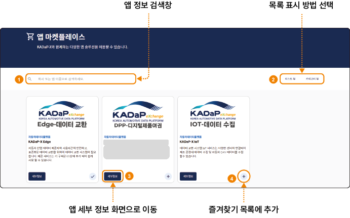

## 앱 마켓플레이스

앱 마켓플레이스 화면에서 포털에 등록된 앱을 찾고 세부 정보를 확인할 수 있습니다.

### 화면 구성

앱 마켓플레이스 화면은 다음과 같이 구성됩니다.

| 번호 | 항목 | 설명 |
|---|---|---|
| 1 | 앱 정보 검색창 | 회사 이름이나 앱 이름으로 앱을 검색할 수 있습니다. |
| 2 | 목록 표시 방법 선택 | **리스트 뷰**와 **카테고리 뷰** 중에서 목록 표시 방식을 선택할 수 있습니다. |
| 3 | 세부정보 | 클릭하면 앱 세부 정보 화면으로 이동합니다. |
| 4 | 즐겨찾기 추가(+) | 앱을 즐겨찾기 목록에 추가합니다. |

### 앱 정보 확인하기

앱 정보를 확인하려면 다음 순서대로 진행하세요.

1. 메인 메뉴에서 **마켓플레이스** > **앱 마켓플레이스**를 클릭하세요.
   - 앱 마켓플레이스 화면이 표시됩니다.
2. 확인할 앱의 **세부정보**를 클릭하세요.
   - 앱 세부 정보 화면이 표시됩니다.
3. 아래 표의 항목을 확인하세요.

앱 세부 정보 화면의 항목은 다음과 같습니다. 화면은 '06-01-16 앱 구독 신청하기'의 그림을 참고하세요.

| 항목 | 설명 |
|---|---|
| 앱 기본 정보 | 앱의 사용 예시, 지원 언어, 가격, 상태를 표시합니다. |
| 설명 | 앱이 제공하는 서비스를 설명합니다. |
| 개인정보처리방침 | 앱이 수집, 처리, 저장하는 데이터 항목을 표시합니다. |
| 문서 | 이용 약관, 데이터 모델 같은 앱의 첨부 문서를 다운로드할 수 있습니다. |
| 기술 사용자 | 앱을 사용할 기술 사용자에게 필요한 권한을 표시합니다. |
| 앱 공급자 정보 | 앱을 등록한 공급자의 홈페이지와 연락처를 표시합니다. |
