# KADaP-X 포털

[TOC]

KADaP-X 포털에 로그인해 회사 정보를 확인하고 사용자, 앱 접근 권한, 커넥터를 관리하는 방법을 설명합니다. 장치 등록, 배포, 데이터 교환은 포털이 아니라 KADaP-X IoT와 KADaP-X Edge에서 합니다.

# 06-01-01 사용 순서

KADaP-X 포털을 사용하려면 다음 순서대로 진행하세요.

1. 회사를 선택하고 로그인하세요. ('06-01-02 포털 접속하기' 참고)
2. 홈 화면의 메뉴와 구독 중인 앱을 확인하세요. ('06-01-03 홈 화면 구성' 참고)
3. 회사 정보와 BPN을 확인하세요. ('06-01-04 나의 조직' 참고)
4. 포털 사용자를 추가하세요. ('06-01-05 포털 사용자 관리' 참고)
5. 사용자에게 앱 접근 권한을 부여하세요. ('06-01-06 앱 접근 관리'와 '06-01-07 앱 사용자 관리' 참고)
6. 기술 사용자(서비스 계정)를 생성하세요. ('06-01-08 기술 사용자 관리' 참고)
7. 커넥터를 등록하세요. ('06-01-09 커넥터 등록' 참고)
8. 상대 회사의 BPN을 확인하세요. ('06-01-10 파트너 네트워크' 참고)
9. 구독 중인 앱 카드를 클릭해 KADaP-X IoT나 KADaP-X Edge로 이동하세요. ('06-01-03 홈 화면 구성' 참고)

4~7단계는 회사 관리자 권한이 필요합니다. 일반 사용자는 1~3단계와 8~9단계를 진행하세요.

> **참고 -** 포털을 사용하려면 회사가 데이터스페이스에 등록(온보딩)되어 있어야 합니다. 포털 주소는 `https://exchange.bigdata-car.kr`이고, 계정은 회사 관리자에게 받습니다.

# 06-01-02 포털 접속하기

포털 주소로 바로 접속하거나, 자동차데이터플랫폼 전체 메뉴에서 포털로 이동할 수 있습니다.

### 화면 구성

자동차데이터플랫폼 전체 메뉴 화면은 다음과 같이 구성됩니다.

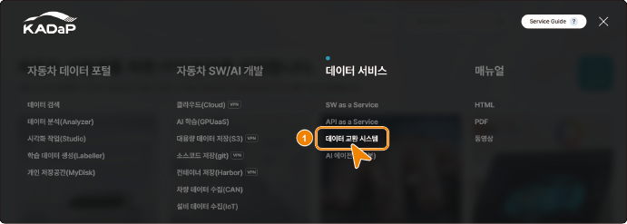

| 번호 | 항목 | 설명 |
|---|---|---|
| 1 | 데이터 서비스 > 데이터 교환 시스템 | 자동차데이터플랫폼(www.bigdata-car.kr) 전체 메뉴에서 이 메뉴를 클릭하면 포털로 이동합니다. |

### 포털에 접속하기

포털에 접속하려면 다음 순서대로 진행하세요.

1. 브라우저에서 포털 주소(`https://exchange.bigdata-car.kr`)로 접속하세요.
   - 회사 선택 화면이 표시됩니다.
2. 계정이 속한 회사를 선택하세요.
   - 로그인 화면이 표시됩니다.
3. 아이디와 비밀번호를 입력해 로그인하세요.
   - 포털 홈 화면이 표시됩니다.

# 06-01-03 홈 화면 구성

포털 홈 화면에서 메뉴로 이동하고, 구독 중인 앱을 확인할 수 있습니다.

### 화면 구성

포털 홈 화면은 다음과 같이 구성됩니다.

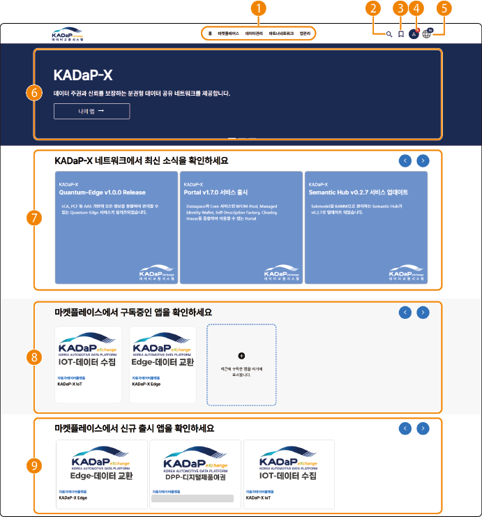

| 번호 | 항목 | 설명 |
|---|---|---|
| 1 | 메인 메뉴 | 포털의 주요 메뉴로 이동할 수 있습니다. 메뉴별 기능은 표 아래를 참고하세요. |
| 2 | 통합 검색 | 포털 안의 정보를 검색할 수 있습니다. |
| 3 | 즐겨찾기 | 구독 중인 앱 가운데 즐겨찾기에 추가한 앱을 표시합니다. |
| 4 | 내 정보 | 로그인한 사용자의 정보와 알림을 확인할 수 있습니다. 표시되는 메뉴는 사용자 권한에 따라 다르며, 자세한 내용은 '06-01-13 나의 계정'을 참고하세요. |
| 5 | 언어 설정 | 포털 화면의 언어를 국문이나 영문으로 바꿀 수 있습니다. |
| 6 | 바로가기 | 자주 사용하는 메뉴로 바로 이동할 수 있습니다. 바로가기별 이동 화면은 표 아래를 참고하세요. |
| 7 | 최신 소식 | 포털 공지를 표시합니다. |
| 8 | 구독 앱 | 구독 중인 앱 목록을 표시합니다. 포털과 연동된 앱을 클릭하면 그 앱의 홈 화면으로 이동합니다. |
| 9 | 신규 출시 앱 | 포털에 새로 등록된 앱 목록을 표시합니다. |

**메인 메뉴**(1번)의 기능은 다음과 같습니다.

- **홈**: 포털 홈 화면으로 이동합니다.
- **마켓플레이스**: 포털에 등록된 앱의 상세 정보를 확인하고 구독을 신청할 수 있습니다.
- **데이터 관리**: 데이터 제공자가 사용할 시맨틱 모델을 확인하고, 필요하면 시맨틱 모델 등록을 신청할 수 있습니다.
- **파트너 네트워크**: 포털에 등록된 회사의 정보를 확인할 수 있습니다.
- **앱관리**: 회사 관리자는 앱을 등록하고 관리할 수 있습니다.

**바로가기**(6번)를 클릭하면 다음 화면으로 이동합니다.

- **나의 앱**: 나의 조직 화면으로 이동합니다. 소속 회사 정보와 앱 구독 목록을 확인할 수 있습니다.
- **마켓플레이스**: 앱 마켓플레이스 화면으로 이동합니다.
- **포털 사용자 관리**: 회사 관리자가 클릭하면 포털 사용자 관리 화면으로 이동합니다.

# 06-01-04 나의 조직

나의 조직 화면에서 소속 회사의 정보와 구독 중인 앱을 확인할 수 있습니다.

### 화면 구성

나의 조직 화면은 다음과 같이 구성됩니다.

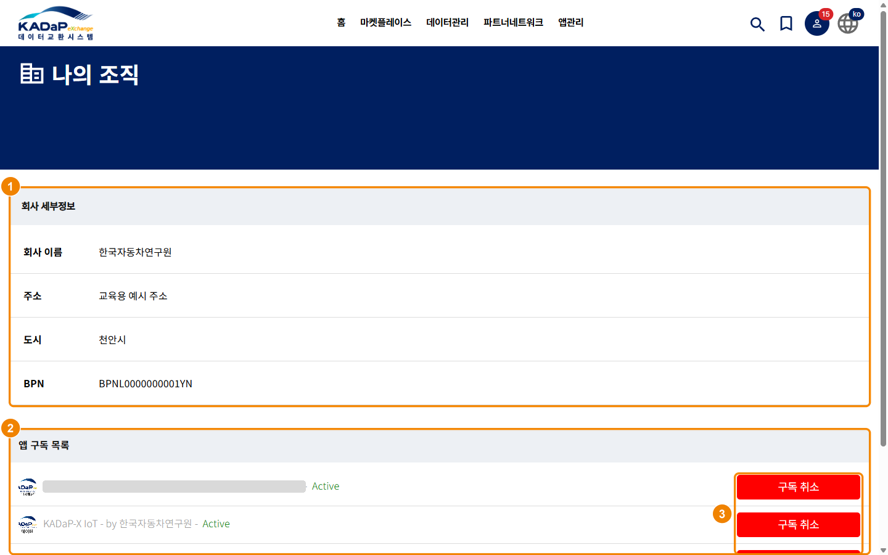

| 번호 | 항목 | 설명 |
|---|---|---|
| 1 | 회사 세부정보 | 회사 이름, 주소, 도시, BPN(읽기 전용)을 표시합니다. |
| 2 | 앱 구독 목록 | 구독 중인 앱의 이름, 제공자, 상태(Active)를 표시합니다. |
| 3 | 구독 취소 | 회사 관리자는 이 버튼으로 앱 구독을 취소할 수 있습니다. |

### 회사 정보와 구독 앱 확인하기

회사 정보와 구독 중인 앱을 확인하려면 다음 순서대로 진행하세요.

1. 오른쪽 위의 **내 정보** > **나의 조직**을 클릭하세요.
   - 나의 조직 화면이 표시됩니다.
2. **회사 세부정보**에서 회사의 BPN을 확인하세요.
   - **BPN**: 데이터스페이스에서 회사를 식별하는 번호입니다. 온보딩 때 회사마다 발급되며, 상대 회사는 카탈로그를 조회하거나 접근 정책의 조건을 정할 때 이 번호를 사용합니다. (예: `BPNL…`)
3. **앱 구독 목록**에서 KADaP-X IoT와 KADaP-X Edge가 **Active**인지 확인하세요.
   - **상태**: 구독이 활성화되어 앱을 사용할 수 있으면 `Active`로 표시됩니다. 홈 화면의 구독 앱에도 `Active`인 앱만 나타납니다.

> **주의 -** **구독 취소**를 클릭하면 회사의 모든 사용자가 그 앱을 사용할 수 없게 됩니다. 앱 사용을 끝내기로 회사에서 결정한 경우에만 클릭하세요.

# 06-01-05 포털 사용자 관리

**내 정보** > **포털 사용자 관리** 화면에서 포털 사용자를 등록하고 관리할 수 있습니다.

### 화면 구성

포털 사용자 관리 화면은 다음과 같이 구성됩니다.

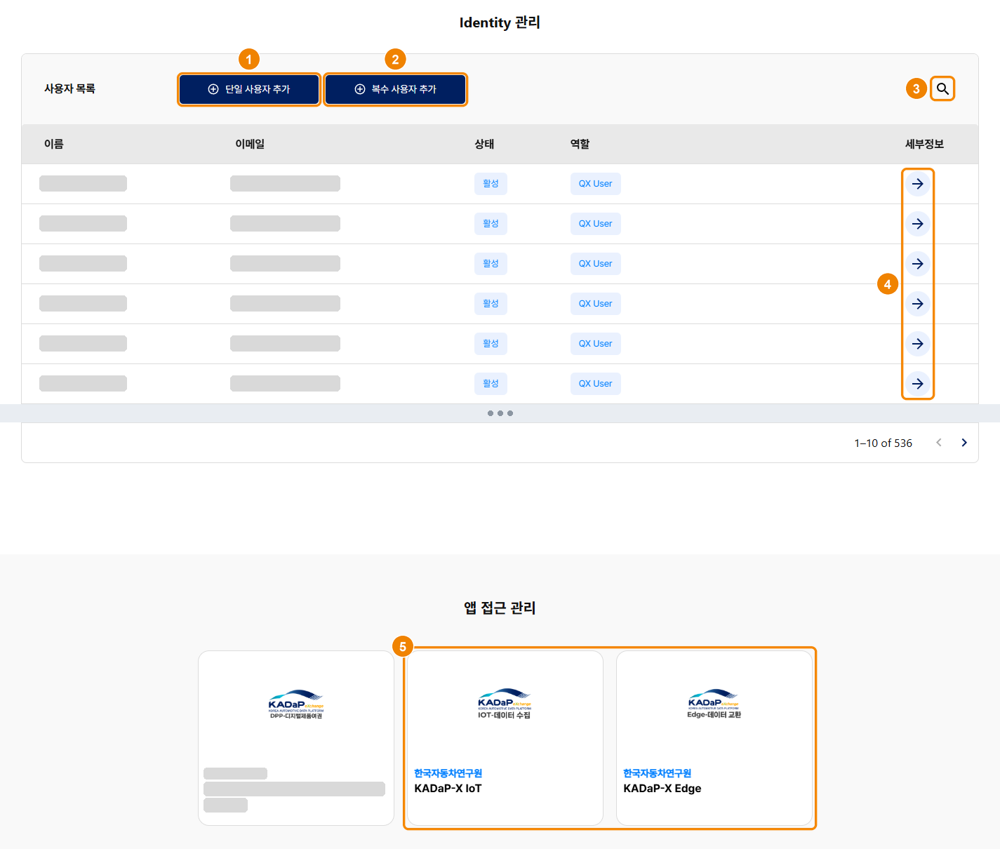

| 번호 | 항목 | 설명 |
|---|---|---|
| 1 | 단일 사용자 추가 | 클릭하면 사용자를 한 명씩 등록하는 창이 열립니다. |
| 2 | 복수 사용자 추가 | 템플릿 파일로 여러 사용자를 한 번에 등록할 수 있습니다. |
| 3 | 사용자 검색 | 포털 사용자를 검색할 수 있습니다. |
| 4 | 세부정보 | 사용자 목록(이름, 이메일, 상태, 역할)의 각 행에 있는 화살표입니다. 클릭하면 그 사용자의 계정 화면으로 이동합니다. |
| 5 | 앱 접근 관리 | 구독 앱 카드를 클릭하면 앱 사용자 관리 화면으로 이동합니다. 자세한 내용은 '06-01-06 앱 접근 관리'를 참고하세요. |

### 포털 사용자 추가하기

포털 사용자를 추가하려면 다음 순서대로 진행하세요.

1. 오른쪽 위의 **내 정보** > **포털 사용자 관리**를 클릭하세요.
   - 포털 사용자 관리 화면이 표시됩니다.
2. **+ 단일 사용자 추가**를 클릭하세요.
   - **단일 사용자 추가** 창이 표시됩니다.
3. 사용자 정보를 입력하세요. [*]가 표시된 항목은 반드시 입력해야 합니다.
   - **사용자 ID**: 등록할 사용자의 ID를 입력합니다.
   - **이름**: 사용자의 이름을 입력합니다.
   - **성**: 사용자의 성을 입력합니다.
   - **이메일**: 사용자의 이메일 주소를 입력합니다.
   - **KX 포털 사용자 역할 선택**: 사용자에게 부여할 포털 역할을 선택합니다. 역할별 설명은 역할 세부 도움말을 클릭해 확인할 수 있습니다.
4. **확인**을 클릭하세요.

# 06-01-06 앱 접근 관리

포털 사용자 관리 화면 아래쪽에서 회사가 구독한 앱마다 사용자의 접근 권한을 지정할 수 있습니다.

### 화면 구성

포털 사용자 관리 화면의 앱 접근 관리 영역은 다음과 같이 구성됩니다.

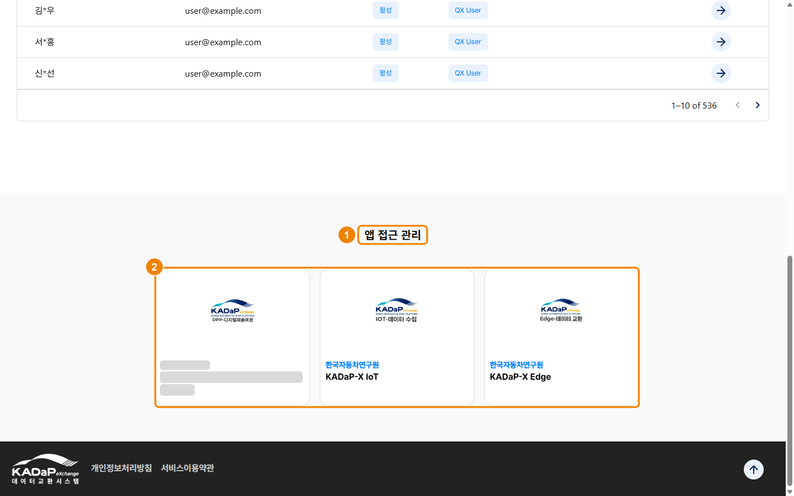

| 번호 | 항목 | 설명 |
|---|---|---|
| 1 | 앱 접근 관리 | 회사가 구독한 앱을 카드로 표시하는 영역입니다. |
| 2 | 앱 카드 | **KADaP-X IoT**, **KADaP-X Edge** 같은 구독 앱의 제공사와 앱 이름을 표시합니다. 카드를 클릭하면 앱 사용자 관리 화면으로 이동합니다. |

### 앱 접근 권한 부여하기

앱 접근 권한을 부여하려면 다음 순서대로 진행하세요.

1. **포털 사용자 관리** 화면을 아래로 내려 **앱 접근 관리** 영역으로 이동하세요.
2. 접근 권한을 부여할 앱 카드(예: **KADaP-X IoT**)를 클릭하세요.
   - 앱 사용자 관리 화면이 표시됩니다.
3. 앱 사용자 관리 화면에서 사용자를 등록하세요. ('06-01-07 앱 사용자 관리' 참고)
4. 같은 방법으로 **KADaP-X Edge** 카드를 클릭해 사용자를 등록하세요.

# 06-01-07 앱 사용자 관리

앱 사용자 관리 화면에서 앱의 역할 설명을 확인하고 앱 사용자를 관리할 수 있습니다. 이 화면은 앱 접근 관리에서 앱 카드를 클릭하면 열립니다.

### 화면 구성

앱 사용자 관리 화면은 다음과 같이 구성됩니다.

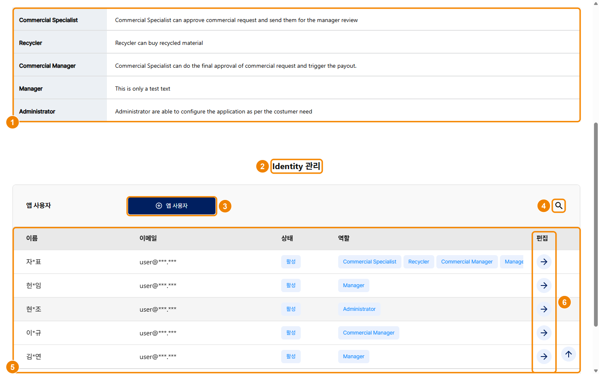

| 번호 | 항목 | 설명 |
|---|---|---|
| 1 | 앱 역할 | 앱에 정의된 역할의 이름과 설명을 표시합니다. 역할은 앱마다 다릅니다. |
| 2 | Identity 관리 — 앱 사용자 | 이 앱에 등록된 사용자를 관리하는 영역입니다. |
| 3 | 앱 사용자(추가) | 포털 사용자를 골라 역할을 부여하고 앱 사용자로 등록할 수 있습니다. |
| 4 | 검색 | 이름이나 이메일로 앱 사용자를 검색할 수 있습니다. |
| 5 | 앱 사용자 목록 | 앱 사용자의 이름, 이메일, 상태(활성), 부여된 역할 배지를 표시합니다. |
| 6 | 편집 | 클릭하면 역할 관리 창이 열려 사용자의 역할을 바꿀 수 있습니다. |

### 앱 사용자 등록하기

앱 사용자를 등록하려면 다음 순서대로 진행하세요.

1. **앱 사용자**를 클릭하세요.
   - 앱 사용자 권한 추가 창이 표시됩니다.
2. 부여할 역할을 선택하세요.
   - **역할**: 하나 이상 선택합니다. 역할은 앱마다 다릅니다. (예: `Manager`)
3. 사용자 목록에서 등록할 사용자를 선택하세요.
   - **사용자**: 포털 사용자 관리에 등록된 사용자만 목록에 표시됩니다.
4. **확인**을 클릭하세요.
5. 앱 사용자 목록에 사용자와 역할이 표시되는지 확인하세요.

등록한 사용자의 역할을 바꾸려면 그 행의 **편집** 아이콘을 클릭해 역할 관리 창에서 바꾸세요.

> **참고 -** KADaP-X IoT와 KADaP-X Edge는 역할에 따라 기능이 달라지지 않으므로, 역할은 어느 것이든 하나만 부여하면 됩니다.

# 06-01-08 기술 사용자 관리

**내 정보** > **기술 사용자 관리** 화면에서 기술 사용자(서비스 계정)를 등록하고 관리할 수 있습니다.

### 화면 구성

기술 사용자 관리 화면은 다음과 같이 구성됩니다.

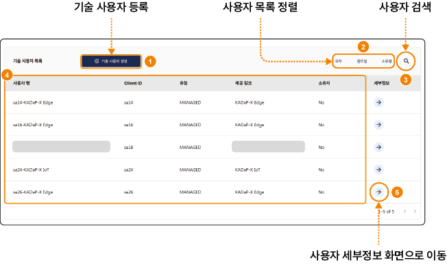

| 번호 | 항목 | 설명 |
|---|---|---|
| 1 | 기술 사용자 생성 | 클릭하면 기술 사용자를 등록하는 창이 열립니다. |
| 2 | 목록 정렬 | **모두**, **관리형**, **소유형** 중에서 선택한 유형의 기술 사용자를 표시합니다. |
| 3 | 사용자 검색 | 기술 사용자를 검색할 수 있습니다. |
| 4 | 기술 사용자 목록 | 기술 사용자의 사용자 명, Client ID, 유형(MANAGED 등), 제공 링크, 소유자를 표시합니다. |
| 5 | 세부정보 | 화살표를 클릭하면 그 기술 사용자의 세부 정보 화면으로 이동합니다. |

### 기술 사용자 생성하기

기술 사용자를 생성하려면 다음 순서대로 진행하세요.

1. 오른쪽 위의 **내 정보** > **기술 사용자 관리**를 클릭하세요.
   - 기술 사용자 관리 화면이 표시됩니다.
2. **+ 기술 사용자 생성**을 클릭하세요.
   - **기술 사용자 생성** 창이 표시됩니다.
3. 기술 사용자 정보를 입력하세요. [*]가 표시된 항목은 반드시 입력해야 합니다.
   - **사용자 이름**: 기술 사용자의 이름을 입력합니다.
   - **설명**: 기술 사용자의 설명을 입력합니다. 기술 사용자가 여러 개이면 설명을 보고 서로 구분할 수 있습니다.
   - **기술 사용자 역할**: 기술 사용자에게 부여할 역할을 선택합니다. (아래 표 참고)
4. **확인**을 클릭하세요.

선택할 수 있는 기술 사용자 역할은 다음과 같습니다.

| 역할 | 설명 |
|---|---|
| Registration External | 외부 시스템에서 회사의 온보딩이나 서비스 등록을 처리합니다. |
| Semantic Model Management | 시맨틱 모델을 생성하고 관리합니다. 데이터를 표준 규격으로 변환하거나 가공하는 앱에 필요한 역할입니다. |
| Identity Wallet Management | 회사의 전자 지갑(Identity Wallet)에 접근해 자격 증명을 요청하거나 저장합니다. 데이터 계약을 맺을 때 디지털 서명도 할 수 있습니다. |
| BPDM Pool | 비즈니스 파트너 데이터 관리 풀(BPDM)에 접근해 등록된 회사의 BPN 같은 마스터 데이터를 조회하거나 관리합니다. |
| Dataspace Discovery | 데이터스페이스에서 사용할 수 있는 데이터 자산이나 참여자 엔드포인트를 조회합니다. |
| Offer Management | 마켓플레이스에 데이터 상품이나 앱 서비스를 오퍼링으로 등록합니다. 구독 요청 활성화, 커넥터 등록 같은 오퍼링 관련 기능도 관리합니다. |
| QX Membership Info | 데이터스페이스(QX)의 가입 정보와 자격 상태를 검증하고 관리합니다. |

# 06-01-09 커넥터 등록

**내 정보** > **커넥터 등록** 화면에서 회사의 커넥터를 등록하고 관리할 수 있습니다.

### 화면 구성

커넥터 등록 화면은 다음과 같이 구성됩니다.

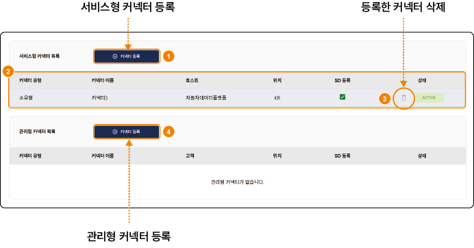

| 번호 | 항목 | 설명 |
|---|---|---|
| 1 | 서비스형 커넥터 등록 | 서비스형 커넥터 목록의 **커넥터 등록** 버튼입니다. 회사 네트워크에 구축한 커넥터를 등록할 수 있습니다. |
| 2 | 등록한 커넥터 | 등록한 커넥터의 유형, 이름, 호스트, 위치, SD 등록, 상태를 표시합니다. |
| 3 | 등록한 커넥터 삭제 | 휴지통 아이콘을 클릭해 커넥터를 삭제할 수 있습니다. |
| 4 | 관리형 커넥터 등록 | 관리형 커넥터 목록의 **커넥터 등록** 버튼입니다. 고객이나 제3자가 제공하는 커넥터를 등록할 수 있습니다. |

### 커넥터 등록하기

서비스형 커넥터를 등록하려면 다음 순서대로 진행하세요.

1. 오른쪽 위의 **내 정보** > **커넥터 등록**을 클릭하세요.
   - 커넥터 등록 화면이 표시됩니다.
2. 서비스형 커넥터 목록의 **+ 커넥터 등록**을 클릭하세요.
   - 서비스형 커넥터 등록 창이 표시됩니다.
3. 커넥터 구성 방법을 확인하고 체크박스를 선택하세요.
4. **다음**을 클릭하세요.
5. 커넥터 정보를 입력하세요.
   - **이름**: 커넥터 이름을 20자 이내로 입력합니다.
   - **커넥터 URL/엔드포인트**: 커넥터 URL을 도메인이나 IP 주소 형식으로 입력합니다. URL에는 HTTPS 프로토콜을 포함해야 합니다.
   - **위치**: 두 자리 국가 코드를 입력합니다. (예: 한국은 KR, 미국은 US)
   - **고객 링크**: 관리형 커넥터를 등록할 때 고객이 구독하는 앱 링크를 목록에서 선택합니다.
6. **확인**을 클릭하세요.

관리형 커넥터는 관리형 커넥터 목록의 **+ 커넥터 등록**을 클릭해 같은 순서로 등록하세요.

# 06-01-10 파트너 네트워크

파트너 네트워크 화면에서 포털에 등록된 파트너 회사의 BPN, 주소, 사업자 등록 번호 같은 정보를 확인할 수 있습니다.

### 화면 구성

파트너 네트워크 화면은 다음과 같이 구성됩니다.

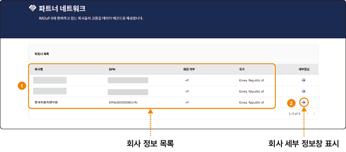

| 번호 | 항목 | 설명 |
|---|---|---|
| 1 | 회사 정보 목록 | 포털에 등록된 파트너 회사의 회사명, BPN, 회원 여부, 국가를 표시합니다. BPN은 회사 정보를 데이터 교환 시스템에 등록할 때 자동으로 부여되는 회사 식별 번호입니다. |
| 2 | 세부정보 | 화살표 아이콘을 클릭하면 회사 세부 정보 창이 표시됩니다. |

### 파트너 정보 확인하기

파트너 회사의 정보를 확인하려면 다음 순서대로 진행하세요.

1. 메인 메뉴에서 **파트너 네트워크**를 클릭하세요.
   - 파트너 네트워크 화면이 표시됩니다.
2. 확인할 회사 행의 **세부정보** 화살표 아이콘을 클릭하세요.
   - 회사 세부 정보 창이 표시됩니다.
3. 회사명, BPN, 주소, 고유번호(사업자 등록 번호)를 확인하세요.

# 06-01-11 ID 공급자 설정

**내 정보** > **ID 공급자 설정** 화면에서 회사의 ID 공급자(IdP)를 등록하고 관리할 수 있습니다.

### 화면 구성

ID 공급자 설정 화면은 다음과 같이 구성됩니다.

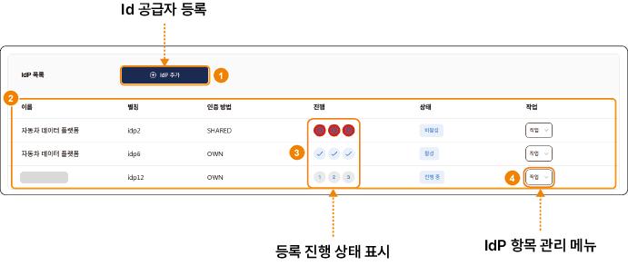

| 번호 | 항목 | 설명 |
|---|---|---|
| 1 | IdP 추가 | 클릭하면 ID 공급자를 등록하는 창이 열립니다. |
| 2 | IdP 목록 | 등록한 ID 공급자의 이름, 별칭, 인증 방법, 진행, 상태(활성, 비활성, 진행 중), 작업을 표시합니다. |
| 3 | 진행 | 등록 단계 1~3의 진행 상태를 표시합니다. |
| 4 | 작업 | IdP를 관리하는 메뉴를 표시합니다. 메뉴에는 설정, 활성, 비활성화, 삭제, 사용자 계정 업데이트가 있습니다. |

### ID 공급자 추가하기

ID 공급자를 추가하려면 다음 순서대로 진행하세요.

1. 오른쪽 위의 **내 정보** > **ID 공급자 설정**을 클릭하세요.
   - ID 공급자 설정 화면이 표시됩니다.
2. **+ IdP 추가**를 클릭하세요.
   - **IdP 추가** 창이 표시됩니다.
3. 등록 단계에 따라 정보를 입력하세요. [*]가 표시된 항목은 반드시 입력해야 합니다.

# 06-01-12 회사 역할 변경

회사 관리자는 회사 역할 변경 화면에서 앱 제공자, 서비스 제공자, 온보딩 서비스 제공자 역할을 추가하거나 해제할 수 있습니다.

### 화면 구성

회사 역할 변경 화면은 다음과 같이 구성됩니다.

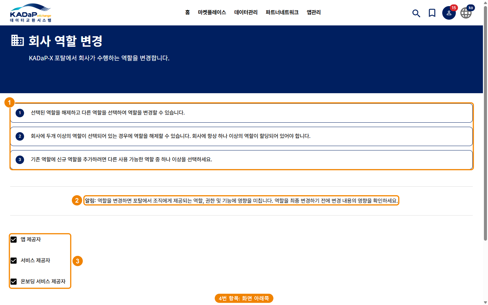

| 번호 | 항목 | 설명 |
|---|---|---|
| 1 | 안내 1 ~ 3 | 역할을 추가하고 해제하는 규칙을 안내합니다. 회사에는 항상 하나 이상의 역할이 있어야 합니다. |
| 2 | 알림 | 역할을 바꾸면 메뉴, 권한, 기능이 달라진다는 경고를 표시합니다. |
| 3 | 역할 체크박스 | 앱 제공자, 서비스 제공자, 온보딩 서비스 제공자 역할을 선택합니다. 참여자 역할은 기본으로 부여됩니다. |
| 4 | 취소 · 변경(아래로 스크롤) | **변경**을 클릭하면 선택한 역할로 바꾸고, **취소**를 클릭하면 바꾸지 않고 나갑니다. |

### 회사 역할 변경하기

회사 역할을 변경하려면 다음 순서대로 진행하세요.

1. 오른쪽 위의 **내 정보** > **회사 역할 변경**을 클릭하세요.
   - 회사 역할 변경 화면이 표시됩니다.
2. 안내와 알림을 읽고, 추가하거나 해제할 역할을 선택하세요.
   - **앱 제공자**: 마켓플레이스에 앱을 등록하는 회사의 역할입니다.
   - **서비스 제공자**: 서비스를 등록하는 회사의 역할입니다.
   - **온보딩 서비스 제공자**: 다른 회사의 가입을 대행하는 회사의 역할입니다.
3. 화면을 아래로 내려 **변경**을 클릭하세요. 확인을 요청하는 창이 표시되면 내용을 확인한 뒤 진행하세요.
   - 역할을 추가하면 관련 메뉴(앱관리 등)가 활성화됩니다.

# 06-01-13 나의 계정

**내 정보** 메뉴에서 계정 정보를 확인하고, 권한에 따라 사용자, 커넥터, 회사 역할 같은 관리 화면으로 이동할 수 있습니다.

### 화면 구성

**내 정보** 메뉴는 다음과 같이 구성됩니다.

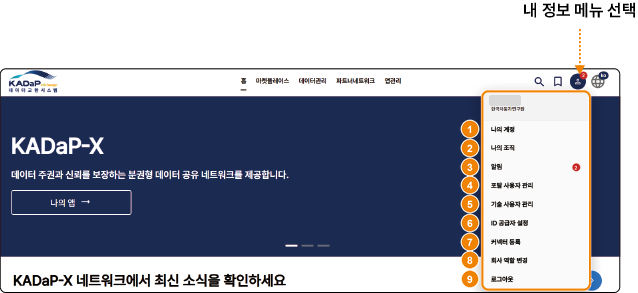

| 번호 | 항목 | 설명 |
|---|---|---|
| 1 | 나의 계정 | 로그인한 사용자의 계정 정보를 확인할 수 있습니다. 표시되는 정보는 표 아래를 참고하세요. |
| 2 | 나의 조직 | 소속 회사 정보와 앱 구독 목록을 확인할 수 있습니다. 앱 구독은 회사 관리자만 **구독 취소**를 클릭해 해지할 수 있습니다. |
| 3 | 알림 | 포털 알림을 확인할 수 있습니다. 읽지 않은 알림이 있으면 **내 정보** 아이콘에 배지가 표시됩니다. |
| 4 | 포털 사용자 관리 | 회사 관리자는 사용자별로 포털 역할과 앱 접근 권한을 설정할 수 있습니다. 자세한 내용은 '06-01-05 포털 사용자 관리'를 참고하세요. |
| 5 | 기술 사용자 관리 | 회사 관리자는 앱 접근을 허용할 기술 사용자를 등록할 수 있습니다. 자세한 내용은 '06-01-08 기술 사용자 관리'를 참고하세요. |
| 6 | ID 공급자 설정 | 회사 관리자는 ID 공급자를 설정해 회사 사용자의 인증 방법을 관리할 수 있습니다. 자세한 내용은 '06-01-11 ID 공급자 설정'을 참고하세요. |
| 7 | 커넥터 등록 | 회사 관리자는 서비스형 커넥터와 관리형 커넥터를 등록할 수 있습니다. 자세한 내용은 '06-01-09 커넥터 등록'을 참고하세요. |
| 8 | 회사 역할 변경 | 회사 관리자는 회사의 역할을 변경할 수 있습니다. 자세한 내용은 '06-01-12 회사 역할 변경'을 참고하세요. |
| 9 | 로그아웃 | 포털에서 로그아웃합니다. |

**나의 계정**(1번) 화면의 항목은 다음과 같습니다.

- **TOKEN을 클립보드로 복사**: 로그인한 사용자의 인증 토큰을 클립보드에 복사합니다. 복사한 토큰은 사용자 인증에 사용할 수 있습니다.
- **사용자 삭제**: 로그인한 사용자의 계정을 삭제합니다. 삭제는 관리자가 승인한 뒤 적용됩니다.
- **개인 정보**: 사용자 이름과 이메일 주소를 표시합니다.
- **상태 정보**: 계정의 상태와 생성일을 표시합니다.
- **발행 정보**: 조직명과 관리자 정보를 표시합니다.
- **포털 역할**: 사용자에게 부여된 포털 역할을 표시합니다.
- **앱 권한**: 앱별로 부여된 사용자 역할을 표시합니다.

# 06-01-14 알림

알림 화면에서 앱과 서비스 구독, 사용자 계정 변경 같은 포털 알림을 확인하고 정리할 수 있습니다. 읽지 않은 알림이 있으면 **내 정보** 아이콘의 배지에 그 수가 표시됩니다.

### 화면 구성

알림 화면은 다음과 같이 구성됩니다.

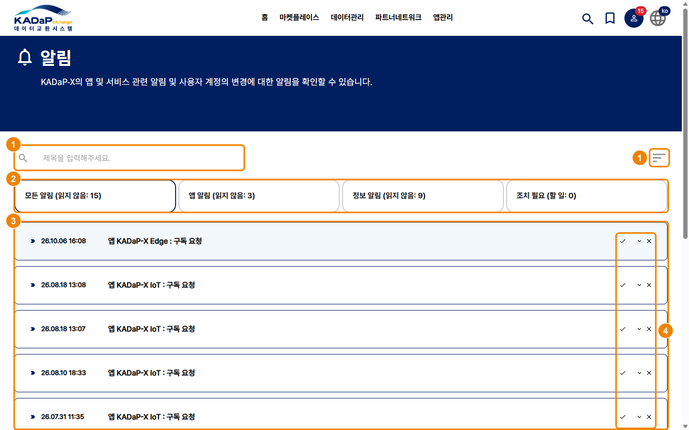

| 번호 | 항목 | 설명 |
|---|---|---|
| 1 | 제목 검색 · 정렬 | 알림 제목을 검색하고 정렬 순서를 바꿀 수 있습니다. |
| 2 | 필터 탭 | **모든 알림**, **앱 알림**, **정보 알림**, **조치 필요** 탭으로 알림을 골라 볼 수 있습니다. 탭마다 읽지 않은 알림 수가 표시되고, **조치 필요** 탭에는 처리할 일의 수가 표시됩니다. |
| 3 | 알림 목록 | 알림의 날짜와 제목(예: 앱 KADaP-X IoT : 구독 요청)을 표시합니다. |
| 4 | 행 아이콘 | ✓로 읽음 처리하고, ∨로 내용을 펼치고, ×로 삭제할 수 있습니다. |

### 알림 확인하기

알림을 확인하려면 다음 순서대로 진행하세요.

1. 오른쪽 위의 **내 정보** > **알림**을 클릭하세요.
   - 알림 화면이 표시됩니다.
2. **조치 필요** 탭에서 처리할 일이 있는지 먼저 확인하세요.
3. 알림 행의 ∨를 클릭해 내용을 확인하세요.
   - **앱 알림**: 앱 구독 요청과 활성화를 알립니다. (예: `앱 KADaP-X Edge : 구독 요청`)
   - **정보 알림**: 계정 생성과 역할 변경을 안내합니다. (예: 환영 알림)
4. 확인한 알림은 ✓를 클릭해 읽음 처리하세요.

# 06-01-15 앱 마켓플레이스

앱 마켓플레이스 화면에서 포털에 등록된 앱을 찾고 세부 정보를 확인할 수 있습니다.

### 화면 구성

앱 마켓플레이스 화면은 다음과 같이 구성됩니다.

| 번호 | 항목 | 설명 |
|---|---|---|
| 1 | 앱 정보 검색창 | 회사 이름이나 앱 이름으로 앱을 검색할 수 있습니다. |
| 2 | 목록 표시 방법 선택 | **리스트 뷰**와 **카테고리 뷰** 중에서 목록 표시 방식을 선택할 수 있습니다. |
| 3 | 세부정보 | 클릭하면 앱 세부 정보 화면으로 이동합니다. |
| 4 | 즐겨찾기 추가(+) | 앱을 즐겨찾기 목록에 추가합니다. |

### 앱 정보 확인하기

앱 정보를 확인하려면 다음 순서대로 진행하세요.

1. 메인 메뉴에서 **마켓플레이스** > **앱 마켓플레이스**를 클릭하세요.
   - 앱 마켓플레이스 화면이 표시됩니다.
2. 확인할 앱의 **세부정보**를 클릭하세요.
   - 앱 세부 정보 화면이 표시됩니다.
3. 아래 표의 항목을 확인하세요.

앱 세부 정보 화면의 항목은 다음과 같습니다. 화면은 '06-01-16 앱 구독 신청하기'의 그림을 참고하세요.

| 항목 | 설명 |
|---|---|
| 앱 기본 정보 | 앱의 사용 예시, 지원 언어, 가격, 상태를 표시합니다. |
| 설명 | 앱이 제공하는 서비스를 설명합니다. |
| 개인정보처리방침 | 앱이 수집, 처리, 저장하는 데이터 항목을 표시합니다. |
| 문서 | 이용 약관, 데이터 모델 같은 앱의 첨부 문서를 다운로드할 수 있습니다. |
| 기술 사용자 | 앱을 사용할 기술 사용자에게 필요한 권한을 표시합니다. |
| 앱 공급자 정보 | 앱을 등록한 공급자의 홈페이지와 연락처를 표시합니다. |

# 06-01-16 앱 구독 신청하기

앱 세부 정보 화면에서 앱 구독을 신청할 수 있습니다.

### 화면 구성

앱 세부 정보 화면은 다음과 같이 구성됩니다.

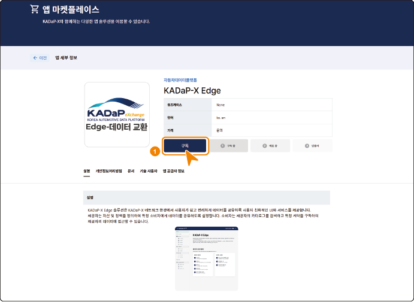

| 번호 | 항목 | 설명 |
|---|---|---|
| 1 | 구독 | 클릭하면 앱 구독 요청 창이 열립니다. 요청한 구독은 앱 제공자가 처리하며, 최대 5일이 걸립니다. |

### 앱 구독 신청하기

앱 구독을 신청하려면 다음 순서대로 진행하세요.

1. 메인 메뉴에서 **마켓플레이스** > **앱 마켓플레이스**를 클릭하세요.
   - 앱 마켓플레이스 화면이 표시됩니다.
2. 구독할 앱의 **세부정보**를 클릭하세요.
   - 앱 세부 정보 화면이 표시됩니다.
3. 앱 정보를 확인하고 **구독**을 클릭하세요.
   - 앱 구독 요청 창이 표시됩니다.
4. 안내 내용을 읽고 **확인**을 클릭하세요.

구독 처리가 끝나면 다음 단계를 안내하는 알림이 포털에 표시됩니다.

# 06-01-17 앱 등록 관리

앱 등록 관리 화면에서 회사가 등록한 앱의 목록과 상태를 확인하고 관리할 수 있습니다. 이 화면은 메인 메뉴의 **앱관리** > **앱 등록 관리**를 클릭하면 열립니다.

### 화면 구성

앱 등록 관리 화면은 다음과 같이 구성됩니다.

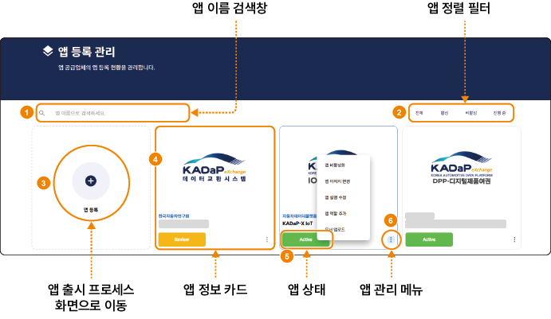

| 번호 | 항목 | 설명 |
|---|---|---|
| 1 | 앱 이름 검색창 | 앱 이름으로 등록한 앱을 검색할 수 있습니다. |
| 2 | 앱 정렬 필터 | **전체**, **활성**, **비활성**, **진행 중** 가운데 선택한 상태의 앱을 표시합니다. |
| 3 | 앱 등록 | 클릭하면 앱 출시 프로세스 화면으로 이동해 앱 정보를 입력할 수 있습니다. |
| 4 | 앱 정보 카드 | 등록한 앱 정보를 카드로 표시합니다. 마켓플레이스에도 이 카드가 그대로 게시됩니다. |
| 5 | 앱 상태 | 앱의 현재 상태(예: **Review**, **Active**)를 표시합니다. |
| 6 | 앱 관리 메뉴 | 더 보기(⋮) 아이콘을 클릭하면 앱 비활성화, 앱 이미지 변경, 앱 설명 수정, 앱 역할 추가, 문서 업로드 메뉴가 표시됩니다. 등록 검토 중이거나 비활성화된 앱에는 이 메뉴가 표시되지 않습니다. |

# 06-01-18 문제 해결하기

포털을 사용하다 문제가 생기면 아래 표에서 증상을 찾아 조치하세요. 문제는 대부분 포털 주소, 계정, 앱 접근 권한에서 생깁니다.

| 단계 | 증상 | 조치 |
|---|---|---|
| 접속 | 회사 선택 화면에 소속 회사가 없음 | 접속한 주소가 포털 주소(`https://exchange.bigdata-car.kr`)인지 확인하세요. 회사가 아직 온보딩되지 않았다면 운영 기관에 문의하세요. |
| 접속 | 로그인 실패 | 아이디와 비밀번호가 맞는지, 회사 선택 화면에서 소속 회사를 선택했는지 확인하세요. |
| 접속 | 로그인 뒤 "접근 권한이 없습니다" | 회사 관리자에게 '06-01-05 포털 사용자 관리'에서 계정의 포털 역할을 확인해 달라고 요청하세요. |
| 홈 | 구독 앱이 표시되지 않음 | '06-01-04 나의 조직'의 앱 구독 목록에서 앱 상태가 Active인지 확인하세요. Active가 아니면 회사 관리자에게 문의하세요. |
| 앱 이동 | 앱 카드를 클릭한 뒤 KADaP-X IoT나 KADaP-X Edge에서 로그인 화면이 반복됨 | 브라우저의 쿠키와 캐시를 삭제하고 다시 시도하세요. 그래도 반복되면 '06-01-07 앱 사용자 관리'에 앱 사용자로 등록되어 있는지 확인하세요. |
| 앱 이동 | KADaP-X IoT나 KADaP-X Edge에서 "접근권한 없음" | '06-01-06 앱 접근 관리'에서 앱 카드를 클릭한 뒤, '06-01-07 앱 사용자 관리'에서 그 사용자를 앱 사용자로 등록하고 역할을 1개 부여하세요. |
| 사용자 관리 | 초대 메일이 오지 않음 | 이메일 주소가 맞는지, 메일이 스팸함에 있는지, 사용자 목록에서 상태가 활성인지 확인하세요. |
| 기술 사용자 | Secret을 잃어버림 | 기술 사용자 세부정보에서 **자격 증명 재설정**을 실행하고, 새 Secret으로 커넥터와 앱 설정을 바꾸세요. 재설정하면 기존 Secret은 더 이상 쓸 수 없습니다. |
| 커넥터 | 상태가 ACTIVE가 아니거나 SD 등록이 비어 있음 | 커넥터 URL, 위치, 기술 사용자 입력값을 확인하세요. 그래도 해결되지 않으면 운영 기관에 문의하세요. |
| 공통 | 화면이 영문으로 표시됨 | 오른쪽 위 언어 아이콘에서 KO를 선택하세요. |
