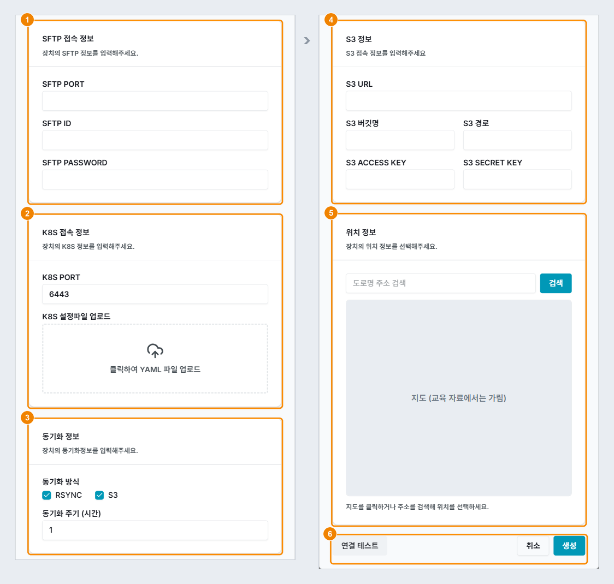

# 엣지 장치 준비

[TOC]

엣지 장치에 k3s 기반 엣지 Agent를 설치하고 KADaP-X IoT에 등록하는 방법을 설명합니다. 엣지 장치로는 Ubuntu 22.04 또는 24.04를 쓰는 Linux 장비나 가상 머신(VM), Windows PC의 WSL Ubuntu를 사용할 수 있습니다. 설치를 마친 뒤의 장치 관리는 KADaP-X IoT 화면에서 합니다.

# 06-02-01 사용 순서

엣지 장치를 준비하려면 다음 순서대로 진행하세요.

1. 장치와 설치 파일이 요구 사항에 맞는지 확인하세요. ('06-02-02 준비물 확인하기' 참고)
2. 설치 파일 `install_edge.tar`의 압축을 푸세요. ('06-02-03 설치 파일 준비하기' 참고)
3. `run.sh`에 KADaP-X IoT 주소를 입력하세요. ('06-02-04 run.sh 설정하기' 참고)
4. `./run.sh`를 실행해 엣지 Agent를 설치하세요. ('06-02-05 설치 스크립트 실행하기' 참고)
5. 발급된 kubeconfig 파일을 PC로 복사하세요. ('06-02-06 kubeconfig 확보하기' 참고)
6. 장치에 SSH 서버가 없으면 설치하세요. ('06-02-07 SSH 서버 준비하기' 참고)
7. MQTT 브로커로 데이터를 받는 장치라면 장치에서 브로커에 접속할 수 있는지 확인하세요. ('06-02-08 MQTT 경로 확인하기' 참고)
8. KADaP-X IoT에 장치를 등록하세요. ('06-02-09 KADaP-X IoT에 장치 등록하기' 참고)
9. 설치와 등록 결과를 확인하세요. ('06-02-10 설치 확인하기' 참고)

# 06-02-02 준비물 확인하기

엣지 Agent를 설치하기 전에 장치와 설치 파일이 요구 사항에 맞는지 확인합니다.

### 준비물 확인하기

준비물을 확인하려면 다음 순서대로 진행하세요.

1. 아래 표의 항목을 차례로 확인하세요.
   - 요구 사항에 맞지 않으면 설치 스크립트가 사전 점검 단계에서 `[FAIL]`을 표시하고 중단합니다.
2. 설치와 등록에 필요한 정보를 미리 준비하세요.
   - 장치 계정의 sudo 비밀번호
   - KADaP-X IoT 주소와 로그인 계정
   - MQTT 브로커의 주소와 계정(MQTT로 데이터를 받는 경우)

| 항목 | 요구 사항 | 비고 |
|---|---|---|
| 장치 | Linux 장비, VM, Windows PC의 WSL Ubuntu 중 1대 | 장치마다 한 번씩 설치합니다. |
| OS | Ubuntu 22.04 또는 24.04 권장, x86_64 또는 arm64 | 설치 스크립트가 OS와 아키텍처를 점검합니다. |
| 필수 구성 | systemd(`systemctl`), `curl` | WSL에서는 systemd를 켜야 합니다. |
| 자원 | CPU 2코어, 메모리 4GB, 디스크 20GB 이상 | 설치 직후 메모리 약 1.7GB, 디스크 약 3.5GB를 사용합니다. |
| 네트워크 | 인터넷 연결(설치 중 약 700MB 다운로드) | KADaP-X IoT에서 장치의 6443, 22, 31000 포트에 접속할 수 있어야 합니다. NAT, VPN, WSL 환경에서는 네트워크 관리자에게 확인하세요. |
| 권한 | sudo 권한이 있는 계정 | 설치 중에 sudo 비밀번호를 입력합니다. |
| 설치 파일 | `install_edge.tar` | 설치 본체 `install-k3s.sh`와 실행 스크립트 `run.sh`가 들어 있습니다. |

> **주의 -** WSL은 Ubuntu 창을 모두 닫으면 1분 안에 Ubuntu를 종료합니다. Ubuntu가 종료되면 k3s도 함께 멈춰 KADaP-X IoT와 장치의 연결이 끊어지므로, 장치를 사용하는 동안에는 Ubuntu 창을 하나 이상 열어 두세요.

# 06-02-03 설치 파일 준비하기

설치 파일 `install_edge.tar`를 장치의 홈 폴더에 복사하고 압축을 풉니다.

### 설치 파일 풀기

설치 파일을 준비하려면 다음 순서대로 진행하세요.

1. 장치의 터미널을 여세요.
   - WSL에서는 Windows 시작 메뉴에서 **Ubuntu**를 실행합니다.
   - Linux 장비나 VM에서는 장치 계정으로 로그인하거나 SSH로 접속합니다.
2. 아래 명령을 차례로 실행해 설치 파일을 홈 폴더에 복사하고 압축을 푸세요.
3. 마지막 명령의 결과에 `install-k3s.sh`와 `run.sh`가 표시되는지 확인하세요.

```bash
cd ~
cp /mnt/c/Users/<Windows 사용자>/Downloads/install_edge.tar .
tar -xf install_edge.tar
ls -l install-k3s.sh run.sh
```

위 명령은 WSL에서 Windows 다운로드 폴더에 받아 둔 설치 파일을 복사하는 예입니다. `<Windows 사용자>`에는 Windows 계정 폴더 이름을 넣으며, 폴더 이름은 `ls /mnt/c/Users`로 확인할 수 있습니다. `install-k3s.sh`는 `run.sh`가 실행하므로 직접 실행하지 않습니다.

> **참고 -** Linux 장비나 VM에는 PC에서 `scp install_edge.tar <계정>@<장치 IP>:~` 명령으로 설치 파일을 올립니다.

# 06-02-04 run.sh 설정하기

설치하기 전에 실행 스크립트 `run.sh`에 KADaP-X IoT 주소를 입력합니다. 대부분은 `IOT_URL` 한 줄만 고치면 됩니다.

### run.sh 수정하기

`run.sh`를 수정하려면 다음 순서대로 진행하세요.

1. `nano run.sh`를 실행해 파일을 여세요.
2. `IOT_URL` 값을 KADaP-X IoT 주소로 고치세요. 값 양쪽의 따옴표는 그대로 두세요.
3. KADaP-X IoT가 장치에 접속하는 주소가 장치 IP와 다르면 `TLS_SAN`에 그 주소를 입력하세요.
   - NAT, VPN, WSL 포트 포워딩을 쓰는 경우가 여기에 해당합니다. 주소는 네트워크 관리자에게 확인하세요.
4. `Ctrl+O`와 `Enter`를 눌러 저장하고, `Ctrl+X`를 눌러 편집기를 닫으세요.

```sh
#!/bin/sh
# KADaP 엣지(k3s) 설치 실행 스크립트
#   실행:  ./run.sh        <- sudo 를 붙이지 마세요. 안에서 sudo 를 호출합니다.
# 고칠 곳은 아래 IOT_URL 한 줄입니다. 장치 IP 는 스크립트가 자동으로 감지합니다.

IOT_URL="https://<KADaP-X IoT 주소>"            # KADaP-X IoT 주소 (n8n 임베드 허용)
K3S_VERSION="v1.36.4+k3s1"                      # 설치할 k3s 버전 (비우면 stable 최신)
KUBECONFIG_OUT="$HOME/edge.kubeconfig.yaml"     # 발급될 kubeconfig 파일
TLS_SAN=""                                      # (선택) 장치 IP 외에 접속에 쓸 주소

# ---- 아래는 고치지 않아도 됩니다 ----
# IOT_URL 을 바꾸지 않았으면 중단합니다
case "$IOT_URL" in *"<"*|*">"*|"") echo "run.sh 의 IOT_URL 을 … 바꾼 뒤 다시 실행하세요." >&2; exit 1 ;; esac
# sudo ./run.sh 로 실행하면 kubeconfig 가 /root 에 생기므로 중단합니다
if [ "$(id -u)" -eq 0 ] && [ -n "$SUDO_USER" ]; then
  echo "sudo 없이  ./run.sh  로 실행하세요." >&2; exit 1
fi
cd "$(dirname "$0")" || exit 1
SUDO="sudo"; [ "$(id -u)" -eq 0 ] && SUDO=""

exec $SUDO ./install-k3s.sh \
  ${K3S_VERSION:+-v $K3S_VERSION} \
  ${TLS_SAN:+--tls-san $TLS_SAN} \
  --generate-kubeconfig \
  --kubeconfig-out "$KUBECONFIG_OUT" \
  --install-n8n \
  --n8n-insecure-cookie \
  --data-dir /data/ \
  --n8n-host n8n.default.local \
  --n8n-iframe-allow "$IOT_URL"
```

`run.sh`의 변수는 다음과 같습니다.

- **`IOT_URL`**: KADaP-X IoT 주소를 입력합니다. KADaP-X IoT 화면 안에 노코드(n8n) 화면을 표시할 때 사용합니다. (예: `https://<KADaP-X IoT 주소>`)
- **`TLS_SAN`**: 장치 IP 말고 다른 주소로 장치에 접속할 때 그 주소를 입력합니다. 장치 IP로 접속하면 비워 둡니다. 이 값은 kubeconfig의 접속 주소(`Server:`)가 되며, 설치한 뒤에 바꾸려면 다시 설치해야 합니다.
- **`K3S_VERSION`**: 설치할 k3s 버전입니다. 보통은 그대로 둡니다.
- **`KUBECONFIG_OUT`**: 발급할 kubeconfig 파일의 경로입니다. 보통은 그대로 둡니다.

> **참고 -** KADaP-X IoT에서 장치의 CPU, 메모리, 디스크 사용량을 보려면 Telegraf 옵션을 추가해 설치해야 합니다. 자세한 내용은 '06-03-07 장치 상태정보 보기'를 참고하세요.

# 06-02-05 설치 스크립트 실행하기

`run.sh`를 실행해 엣지 Agent(k3s)를 설치합니다. 설치는 네트워크 상태에 따라 몇 분 정도 걸립니다.

### 설치 스크립트 실행하기

설치 스크립트를 실행하려면 다음 순서대로 진행하세요.

1. `./run.sh`를 실행하세요.
   - 명령 앞에 `sudo`를 붙이지 마세요. 스크립트가 필요한 단계에서 sudo를 직접 호출합니다.
2. 비밀번호를 물으면 장치 계정의 비밀번호를 입력하세요.
   - 입력하는 동안 화면에는 아무것도 표시되지 않습니다.
3. "모든 단계 완료"가 표시될 때까지 기다리세요.
4. 아래 출력 예시와 비교해 표의 항목이 정상인지 확인하세요.

```
[INFO]  ======== k3s 설치 스크립트 시작 ========
[INFO]  사전 점검 시작...
[INFO]  감지된 OS: Ubuntu 24.04.5 LTS
[INFO]  아키텍처: x86_64
[ OK ]  사전 점검 완료
[INFO]  시스템 환경 준비...
[ OK ]  시스템 환경 준비 완료
[INFO]  데이터 폴더 생성: /data/
[ OK ]  데이터 폴더 준비 완료: /data/ (<계정>:<계정> 755)
[INFO]  활성 방화벽 미감지 - 스킵
[INFO]  k3s 설치 시작 (mode=server)
[INFO]  지정 버전: v1.36.4+k3s1
[INFO]  TLS SAN 자동 추가 (device_ip): <장치 IP>
[INFO]  TLS SAN 적용: <장치 IP>
[INFO]  공식 인스톨러 다운로드 및 실행...
  …
[ OK ]  k3s 설치 완료
[ OK ]  k3s 서비스 active
[INFO]  API 서버 응답 대기...
[INFO]  노드 Ready 대기...

[ OK ]  ==== 클러스터 정보 ====
NAME       STATUS   ROLES           AGE   VERSION        INTERNAL-IP   …
<장치명>    Ready    control-plane   2s    v1.36.4+k3s1   <장치 IP>      …

[ OK ]  ==== Agent Join 정보 ====
    K3S_URL=https://<장치 IP>:6443
    K3S_TOKEN=<토큰>
[INFO]  API 접근용 kubeconfig 발급 시작...
[ OK ]  ServiceAccount 생성: kube-system/admin-token-user
[ OK ]  ClusterRoleBinding 생성: admin-token-user-binding (role=cluster-admin)
[INFO]  외부 server URL 자동 결정: https://<장치 IP>:6443
[ OK ]  토큰 발급 완료 (973 chars)
[INFO]  Step 4: kubeconfig 파일 작성: /home/<계정>/edge.kubeconfig.yaml
[ OK ]  kubeconfig 검증 성공 (API 도달 가능)

[ OK ]  ==== API 접근용 kubeconfig 발급 완료 ====
    파일: /home/<계정>/edge.kubeconfig.yaml (mode=644, 일반 사용자 읽기 가능)
    Server:         https://<장치 IP>:6443
[INFO]  n8n Helm 설치 시작 (host=n8n.default.local, port=31000)
[ OK ]  helm 설치 완료: v3.22.0+g144ca65
[ OK ]  Traefik Deployment 준비 완료
[ OK ]  Traefik Middleware 적용: n8n/n8n-iframe
  …
[ OK ]  ==== n8n 배포 상태 ====
NAME                       READY   STATUS    RESTARTS   AGE
pod/n8n-7f57fb4b88-v246k   1/1     Running   0          115s
[INFO]  직접 포트 접근: http://<장치 IP>:31000/  (Service LB 포트)
[ OK ]  ======== 모든 단계 완료 ========

[ OK ]  ============================================================
[ OK ]  =             등록 설정 파일이 생성되었습니다              =
[ OK ]  = /home/<계정>/edge.kubeconfig.yaml 파일을 다운로드 하여  =
[ OK ]  =            장비 등록 페이지에서 업로드 하세요            =
[ OK ]  ============================================================
```

출력에서 확인할 항목은 다음과 같습니다.

| 출력 항목 | 설명 | 정상 기준 |
|---|---|---|
| 클러스터 정보 | k3s 노드의 상태를 표시합니다. | STATUS가 `Ready`입니다. |
| kubeconfig 발급 | 장치 접속 주소를 넣은 kubeconfig 파일을 만들고 접속을 검증합니다. | "kubeconfig 검증 성공 (API 도달 가능)"과 `Server: https://<장치 IP>:6443`이 표시됩니다. |
| n8n 배포 상태 | 노코드(n8n) Pod의 상태를 표시합니다. | STATUS가 `Running`입니다. |
| 마지막 줄 | 설치 완료와 등록 설정 파일 안내를 표시합니다. | "모든 단계 완료"가 표시됩니다. |

> **주의 -** 출력의 `K3S_TOKEN`은 클러스터에 노드를 추가할 수 있는 비밀 값입니다. 화면을 캡처하거나 공유할 때는 이 값을 가리세요.

# 06-02-06 kubeconfig 확보하기

설치 스크립트가 발급한 kubeconfig 파일(`~/edge.kubeconfig.yaml`)을 KADaP-X IoT에 접속할 PC로 복사합니다. 이 파일은 장치를 등록할 때 업로드합니다.

### kubeconfig 복사하기

kubeconfig 파일을 PC로 복사하려면 다음 순서대로 진행하세요.

1. 설치 출력에 "kubeconfig 검증 성공 (API 도달 가능)"이 표시되었는지 확인하세요.
2. 아래 명령 중 환경에 맞는 명령으로 파일을 PC로 복사하세요.
   - sudo 없이 복사할 수 있습니다.
3. 복사한 파일은 고치지 말고 그대로 업로드하세요.

```bash
# WSL: Windows 다운로드 폴더로 복사
cp ~/edge.kubeconfig.yaml /mnt/c/Users/<Windows 사용자>/Downloads/

# Linux 장비 · VM: PC에서 실행
scp <계정>@<장치 IP>:~/edge.kubeconfig.yaml .
```

kubeconfig 파일에는 클러스터 관리자 권한의 토큰과 장치 접속 주소(`server: https://<장치 IP>:6443`)가 들어 있습니다. 이 토큰에는 만료 기한이 없습니다.

> **주의 -** 클러스터 관리자 권한이 담긴 파일입니다. 다른 사람과 공유하지 말고, 장치 등록을 마치면 PC에 복사한 파일을 삭제하세요.

# 06-02-07 SSH 서버 준비하기

KADaP-X IoT의 장치 파일 관리는 SFTP로 장치에 접속합니다. 설치 스크립트는 SSH 서버를 설치하지 않으므로, 장치에 SSH 서버가 없으면 따로 설치합니다.

### SSH 서버 설치하기

SSH 서버를 준비하려면 다음 순서대로 진행하세요.

1. `systemctl is-active ssh`를 실행해 SSH 서버가 실행 중인지 확인하세요.
   - `active`가 표시되면 2단계는 건너뛰세요. SSH로 접속해 쓰는 Linux 장비나 VM에는 보통 SSH 서버가 이미 있습니다.
2. 아래 명령으로 SSH 서버를 설치하고 실행하세요.
3. 장치를 등록할 때 입력할 SFTP 접속 정보를 확인하세요.
   - **SFTP ID**: 장치 계정입니다. `whoami`로 확인할 수 있습니다. (예: `<계정>`)
   - **SFTP PASSWORD**: 장치 계정의 비밀번호입니다.
   - **SFTP PORT**: SSH 포트입니다. (예: `22`)

```bash
sudo apt-get update
sudo apt-get install -y openssh-server
sudo systemctl enable --now ssh
```

> **참고 -** 장치의 방화벽이 켜져 있으면 22번 포트를 허용하세요.

# 06-02-08 MQTT 경로 확인하기

MQTT 브로커로 데이터를 받는 장치라면, 장치에서 브로커에 접속해 토픽을 구독할 수 있는지 확인합니다. 실제 데이터 수집은 KADaP-X IoT에서 배포하는 수집 모듈이 하며, 여기서는 브로커 주소와 계정, 토픽이 맞는지만 확인합니다.

### 브로커 구독 테스트하기

MQTT 경로를 확인하려면 다음 순서대로 진행하세요.

1. MQTT 명령줄 도구(`mosquitto-clients`)를 설치하세요.
2. 브로커 주소, 포트, 계정, 토픽을 넣어 구독하세요.
   - 메시지 5건을 받으면 명령이 끝납니다.
3. 메시지가 오지 않으면 `Ctrl+C`로 멈추고, `-d` 옵션을 붙여 다시 실행하세요.
   - `received CONNACK (0)`이 표시되면 접속과 인증은 정상입니다. 이때는 토픽 이름이 맞는지, 그 토픽에 메시지가 발행되고 있는지 확인하세요.

```bash
sudo apt-get install -y mosquitto-clients
mosquitto_sub -h <브로커 주소> -p <포트> -u <사용자> -P <비밀번호> \
  -t "<토픽>" -C 5
```

`mosquitto_sub`의 옵션은 다음과 같습니다.

- **`-h`, `-p`**: 브로커 주소와 포트를 지정합니다. TLS를 쓰는 브로커는 보통 `8883` 포트를 씁니다. (예: `<브로커 주소>`, `1883`)
- **`-u`, `-P`**: 브로커 사용자와 비밀번호를 지정합니다.
- **`-t`**: 구독할 토픽을 지정합니다. 와일드카드 `+`(한 단계)와 `#`(하위 전체)를 쓸 수 있습니다. (예: `<토픽>`)
- **`-C`**: 받을 메시지 수를 지정합니다. 지정한 수만큼 받으면 명령이 끝납니다. (예: `5`)
- **`-d`**: 접속 과정(CONNECT, CONNACK, SUBSCRIBE)을 출력합니다. 문제를 확인할 때 사용합니다.

# 06-02-09 KADaP-X IoT에 장치 등록하기

설치한 장치를 KADaP-X IoT에 등록합니다. 등록할 때는 앞에서 준비한 kubeconfig 파일과 SFTP 접속 정보를 사용합니다.

### 화면 구성

장치 추가 창의 아래쪽은 다음과 같이 구성됩니다. 창 위쪽의 기본 정보부터 부가설정까지는 '06-03-04 장치 추가하기'를 참고하세요.



| 번호 | 항목 | 설명 |
|---|---|---|
| 1 | SFTP 접속 정보 | SFTP PORT, SFTP ID, SFTP PASSWORD를 입력합니다. 부가설정에서 SFTP를 선택하면 표시됩니다. |
| 2 | K8S 접속 정보 | K8S PORT를 입력하고, "클릭하여 YAML 파일 업로드"를 클릭해 kubeconfig 파일을 업로드합니다. |
| 3 | 동기화 정보 | 동기화 방식(RSYNC, S3)과 동기화 주기를 지정합니다. 부가설정에서 동기화를 선택하면 표시됩니다. 그림은 RSYNC와 S3를 모두 선택한 예입니다. |
| 4 | S3 정보 | S3 URL, 버킷명, 경로, ACCESS KEY, SECRET KEY를 입력합니다. 동기화 방식에서 S3를 선택하면 표시됩니다. |
| 5 | 위치 정보 | 주소를 검색하거나 지도를 클릭해 장치 위치를 지정합니다. |
| 6 | 연결 테스트 · 취소 · 생성 | 입력한 값으로 K8s와 SFTP 접속을 점검하고, 장치를 생성합니다. |

### 장치 등록하기

장치를 등록하려면 다음 순서대로 진행하세요.

1. KADaP-X IoT(`https://<KADaP-X IoT 주소>`)에 로그인하고 **장치 관리** > **생성**을 클릭하세요.
   - 장치 추가 창이 표시됩니다.
2. 기본 정보, 수집대상, 데이터 처리 유형, 부가설정을 입력하세요.
   - **장치명**: 장치를 구분할 이름을 입력합니다. (예: `edge-01`)
   - **IP**: 설치 출력의 `Server:` 주소를 입력합니다. `TLS_SAN`을 비워 두었다면 장치 IP입니다. (예: `<장치 IP>`)
   - **수집대상, 데이터 처리 유형**: 장치에서 수집할 데이터와 처리 방식을 선택합니다. (예: 설비데이터 수집, 전처리)
   - **부가설정**: SFTP, 노코드, 동기화 중에서 사용할 기능을 선택합니다. 노코드를 선택하면 n8n 포트에 `31000`을 입력합니다.
3. SFTP 접속 정보와 K8S 접속 정보를 입력하세요.
   - **SFTP PORT, ID, PASSWORD**: '06-02-07 SSH 서버 준비하기'에서 확인한 값을 입력합니다. (예: `22`, `<계정>`)
   - **K8S PORT**: k3s API 포트를 입력합니다. (예: `6443`)
   - **K8S 설정파일**: '06-02-06 kubeconfig 확보하기'에서 복사한 파일을 업로드합니다. (예: `edge.kubeconfig.yaml`)
4. 부가설정에서 동기화를 선택했다면 동기화 방식과 주기, S3 정보를 입력하세요. 자세한 내용은 '06-03-25 S3 동기화 설정하기'를 참고하세요.
5. **연결 테스트**를 클릭해 SFTP와 K8S 모두 "연결 성공"이 표시되는지 확인하세요.
6. **생성**을 클릭하세요.
   - 장치 목록에 등록한 장치가 **NORMAL** 배지와 함께 표시됩니다.

# 06-02-10 설치 확인하기

장치 터미널과 KADaP-X IoT에서 설치와 등록이 제대로 되었는지 확인합니다.

### 설치 점검하기

설치와 등록 결과를 점검하려면 다음 순서대로 진행하세요.

1. 장치 터미널에서 아래 표의 명령을 실행해 결과를 확인하세요.
2. KADaP-X IoT에서 장치 등록 결과를 확인하세요.
3. 정상 기준에 맞지 않는 항목이 있으면 '06-02-11 문제 해결하기'에서 같은 증상을 찾아 조치하세요.

| 확인 항목 | 방법 | 정상 기준 |
|---|---|---|
| 설치 완료 | 설치 출력의 마지막 줄을 확인합니다. | "모든 단계 완료"와 등록 설정 파일 안내가 표시됩니다. |
| k3s 동작 | `sudo k3s kubectl get nodes`를 실행합니다. | STATUS가 `Ready`입니다. |
| kubeconfig 발급 | 설치 출력의 kubeconfig 발급 부분을 확인합니다. | "kubeconfig 검증 성공 (API 도달 가능)"이 표시됩니다. |
| 데이터 폴더 | `ls -ld /data`를 실행합니다. | 폴더 소유자가 설치에 사용한 계정입니다. |
| n8n | `sudo k3s kubectl -n n8n get pods`를 실행합니다. | `Running`이 표시되고, 브라우저에서 `http://<장치 IP>:31000/`에 접속할 수 있습니다. |
| SSH 서버 | `systemctl is-active ssh`를 실행합니다. | `active`가 표시됩니다. |
| MQTT 경로 | MQTT로 데이터를 받는 경우 `mosquitto_sub`로 토픽을 구독합니다. | 메시지를 받습니다. |
| IoT 등록 | 장치 추가 창에서 **연결 테스트**를 클릭하고 장치 목록을 확인합니다. | SFTP와 K8S 모두 "연결 성공"이 표시되고, 장치 목록에 **NORMAL** 배지가 표시됩니다. |
| 장치 설정 화면 | 프로젝트에 장치를 연결한 뒤 장치 설정 화면의 탭을 확인합니다. | 수집대상에 차량데이터 수집을 선택했으면 CAN Viewer 탭이, 부가설정에 노코드를 선택했으면 노코드 ↗ 탭이 표시됩니다. |

# 06-02-11 문제 해결하기

설치와 등록 중에 문제가 생기면 아래 표에서 증상을 찾아 조치하세요.

| 단계 | 증상 | 조치 |
|---|---|---|
| 실행 | "run.sh 의 IOT_URL 을 … 바꾼 뒤 다시 실행하세요" | `run.sh`의 `IOT_URL`이 `<KADaP-X IoT 주소>` 그대로입니다. KADaP-X IoT 주소로 고친 뒤 다시 실행하세요. |
| 실행 | "root 권한으로 실행해야 합니다" | `install-k3s.sh`를 직접 실행한 경우입니다. `./run.sh`로 실행하세요. |
| 실행 | "sudo 없이 ./run.sh 로 실행하세요" | `sudo ./run.sh`로 실행한 경우입니다. `./run.sh`로 다시 실행하세요. |
| 실행 | `/data` 소유자가 `root` | root 계정으로 설치한 경우입니다. `sudo chown <계정>:<계정> /data`로 소유자를 바꾸세요. |
| 사전 점검 | "필수 명령어 누락: systemctl" | systemd가 꺼져 있습니다. WSL에서는 `systemctl is-system-running`으로 systemd가 켜져 있는지 확인하세요. |
| 사전 점검 | "기존 k3s 설치가 감지되었습니다" | 다시 설치할 때는 `y`를 입력하고, 중단할 때는 Enter를 누르세요. |
| kubeconfig | "kubeconfig 검증 실패" 경고 | `TLS_SAN` 주소로 이 장치에 접속할 수 있는지 확인하세요. 방화벽에서 6443 포트가 열려 있는지도 확인하세요. |
| n8n | "helm wait 타임아웃" 경고 | 이미지 다운로드가 늦어진 경우입니다. `sudo k3s kubectl -n n8n get pods`로 상태가 Running이 될 때까지 기다리세요. |
| n8n | 화면이 열리지 않거나 로그인이 유지되지 않음 | 31000 포트에 접속할 수 있는지 확인하세요. HTTP 주소로 여는 데 필요한 `--n8n-insecure-cookie` 옵션이 `run.sh`에 그대로 있는지도 확인하세요. |
| 등록 | 연결 테스트 실패(K8S) | kubeconfig의 `server:` 주소와 K8S PORT를 확인하세요. KADaP-X IoT 서버에서 장치의 6443 포트에 접속할 수 있는지도 확인하세요. |
| 등록 | 연결 테스트 실패(SFTP) | SSH 서버가 실행 중인지, 계정과 비밀번호, 22번 포트가 맞는지 확인하세요. |
| 등록 | 목록 상태가 계속 `-` | 30초 뒤 새로고침하세요. 그래도 같으면 `sudo k3s kubectl get nodes`로 노드가 Ready인지, 장치 IP가 바뀌지 않았는지 확인하세요. |
| MQTT | 구독되지 않거나 메시지가 오지 않음 | 브로커 주소, 포트, 계정과 방화벽을 확인하세요. 토픽 이름과 구독 권한, 그 토픽에 메시지가 발행되고 있는지도 확인하세요. |
| WSL | Ubuntu 창을 닫은 뒤 장치가 오프라인 | Ubuntu가 종료된 경우입니다. **Ubuntu**를 다시 실행하고 1~2분 뒤 `sudo k3s kubectl get nodes`로 Ready인지 확인하세요. |
