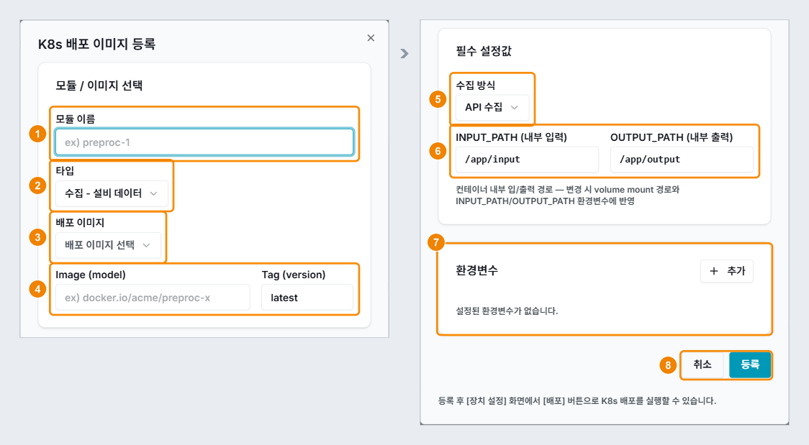

## 배포 추가하기(수집 - 설비 데이터)

K8s 배포 이미지 등록 창에서 설비 데이터를 수집하는 모듈을 등록할 수 있습니다. 여기서는 MQTT 브로커에서 데이터를 받는 수집 모듈 `collect-mqtt`를 예로 설명합니다.

### 화면 구성

K8s 배포 이미지 등록 창은 다음과 같이 구성됩니다.

| 번호 | 항목 | 설명 |
|---|---|---|
| 1 | 모듈 이름 | 모듈 이름을 입력합니다. 소문자, 숫자, 하이픈만 쓸 수 있으며, 대문자와 공백은 자동으로 변환됩니다. |
| 2 | 타입 | **사용자 등록 이미지**, **가공 - 전처리, AI 모델**, **수집 - 차량 데이터**, **수집 - 설비 데이터** 중에서 선택합니다. 장치의 수집대상과 데이터 처리 유형에 맞는 타입만 표시됩니다. |
| 3 | 배포 이미지 | 기본 모듈 목록에서 이미지를 선택합니다. 타입이 사용자 등록 이미지이면 이 항목이 레지스트리 이미지 (Repository)로 바뀝니다. |
| 4 | Image (model) · Tag (version) | 이미지 경로와 태그를 표시합니다. 직접 입력할 수도 있습니다. |
| 5 | 수집 방식 | API 수집과 센서 시리얼 중에서 선택합니다. 센서 시리얼을 선택하면 장치 경로 입력란이 표시됩니다. |
| 6 | INPUT_PATH · OUTPUT_PATH | 배포 이미지가 입력을 읽고 결과를 쓰는 컨테이너 안의 경로입니다. 기본값은 각각 `/app/input`과 `/app/output`이며, 이미지가 다른 경로를 쓰면 그 경로로 바꿉니다. 바꾼 경로는 볼륨 마운트 경로와 `INPUT_PATH` · `OUTPUT_PATH` 환경변수에 함께 반영됩니다. |
| 7 | 환경변수 | **추가**를 클릭하고 KEY와 VALUE를 한 쌍씩 입력합니다. |
| 8 | 취소 · 등록 | **등록**을 클릭하면 모듈이 등록됩니다. 등록한 모듈은 K8s 배포 이미지 목록에서 배포합니다. |

### 설비 데이터 수집 모듈 추가하기

설비 데이터 수집 모듈을 추가하려면 다음 순서대로 진행하세요.

1. 장치 설정 화면의 **K8s 배포 이미지**에서 **배포 추가**를 클릭하세요.
   - K8s 배포 이미지 등록 창이 표시됩니다.
2. 모듈 이름을 입력하고 타입에서 **수집 - 설비 데이터**를 선택하세요.
   - **모듈 이름**: 모듈을 구분할 이름을 입력합니다. (예: `collect-mqtt`)
3. 배포 이미지를 선택하거나 Image와 Tag를 직접 입력하세요.
   - **Image와 Tag**: 이미지 경로와 태그를 두 칸에 나누어 입력합니다. (예: `harbor.bigdata-car.kr/quantumsurf/collect-mqtt`, `0.1.0`)
4. 수집 방식은 **API 수집**으로 두세요.
   - **센서 시리얼**: 수집 방식을 센서 시리얼로 선택한 경우에만 장치 경로를 입력합니다. (예: `/dev/ttyUSB0`)
5. **환경변수**에 브로커 정보를 추가하세요.
   - **환경변수**: MQTT 브로커의 주소, 포트, 토픽, 사용자, 비밀번호를 하나씩 추가합니다. '06-02-08 MQTT 경로 확인하기'에서 확인한 값을 입력합니다. (예: `MQTT_HOST=<브로커 주소>`, `MQTT_PORT=1883`, `MQTT_TOPIC=<토픽>`, `MQTT_USER`, `MQTT_PASS`)
6. **등록**을 클릭하세요.
7. K8s 배포 이미지 목록에서 등록한 모듈의 **배포**를 클릭하세요.
