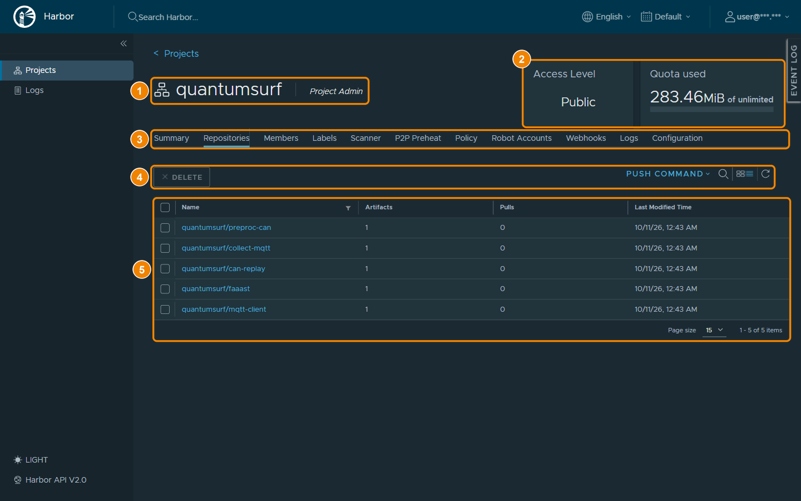

## 레지스트리 확인하기

KADaP 컨테이너 레지스트리(Harbor)에서 장치에 배포할 이미지의 프로젝트, 리포지토리, 태그를 확인할 수 있습니다.

### 화면 구성

레지스트리(Harbor) 프로젝트 화면은 다음과 같이 구성됩니다.

| 번호 | 항목 | 설명 |
|---|---|---|
| 1 | 프로젝트 이름 · 내 역할 | 프로젝트 이름과 로그인한 사용자의 역할(Project Admin 등)을 표시합니다. 프로젝트는 이미지를 묶는 단위입니다. |
| 2 | Access Level · Quota used | 접근 수준과 사용 용량을 표시합니다. Public이면 장치가 계정 없이 이미지를 내려받을(pull) 수 있습니다. |
| 3 | 탭 | Summary, Repositories, Members, Labels, Scanner, P2P Preheat, Policy, Robot Accounts, Webhooks, Logs, Configuration 탭이 있습니다. |
| 4 | DELETE · PUSH COMMAND · 검색 · 보기 전환 · 새로고침 | 선택한 리포지토리를 삭제하거나 푸시 명령을 복사할 수 있습니다. 목록을 검색하거나 보기 방식을 바꿀 수도 있습니다. |
| 5 | 리포지토리 목록 | Name, Artifacts, Pulls, Last Modified Time을 표시합니다. Name은 프로젝트/이미지 형식이고, Artifacts는 태그 수입니다. |

### 이미지 주소 확인하기

배포할 이미지의 주소를 확인하려면 다음 순서대로 진행하세요.

1. `https://harbor.bigdata-car.kr`에 접속해 **LOGIN WITH 자동차포털**을 클릭하고 포털 계정으로 로그인하세요.
2. **Projects**에서 이미지가 들어 있는 프로젝트를 클릭하세요. (예: `quantumsurf`)
3. **Repositories** 탭에서 배포할 이미지 이름을 확인하세요.
4. 리포지토리를 클릭하고 **Artifacts** 탭에서 태그를 확인하세요.
5. **COPY PULL COMMAND**를 클릭해 이미지 주소를 복사하세요.

복사한 주소는 '06-03-18 이미지 추가하기'의 Repository URL, Image Name, Image Tag에 나누어 입력합니다. 각 값은 다음과 같습니다.

- **레지스트리 주소**: Repository URL에 입력합니다. (예: `harbor.bigdata-car.kr`)
- **프로젝트**: 이미지가 들어 있는 Harbor 프로젝트입니다. 퀀텀서프가 공개한 모듈 이미지는 `quantumsurf` 프로젝트에 있습니다.
- **이미지 이름과 태그**: Image Name과 Image Tag에 입력합니다. `quantumsurf` 프로젝트에는 `collect-mqtt`, `preproc-can`, `mqtt-client`, `faaast` 같은 모듈 이미지가 있습니다. (예: `quantumsurf/preproc-can`, `0.1.0`)
- **계정**: `quantumsurf`는 공개 프로젝트이므로 이미지를 내려받을 때 계정이 필요 없습니다. '06-03-18 이미지 추가하기'의 User ID와 Secret Key는 비워 둡니다.
