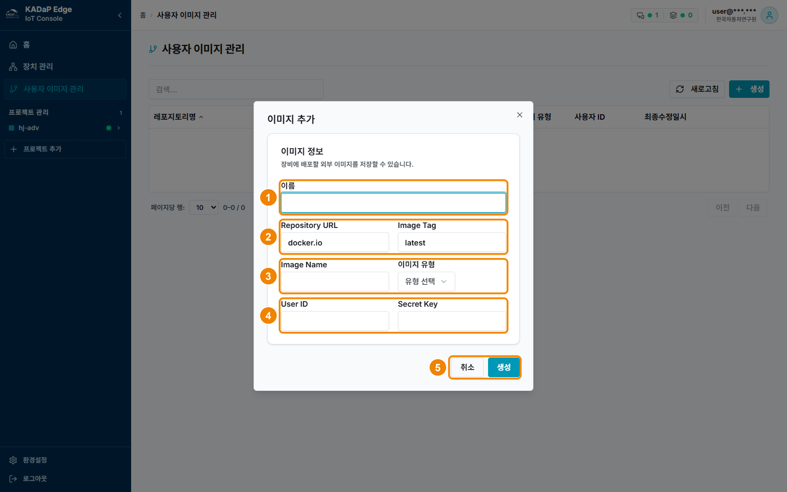

## 이미지 추가하기

이미지 추가 창에서 장치에 배포할 이미지의 레지스트리 주소, 이름, 태그, 인증 정보를 등록할 수 있습니다.

### 화면 구성

이미지 추가 창은 다음과 같이 구성됩니다.

| 번호 | 항목 | 설명 |
|---|---|---|
| 1 | 이름 | 목록에 표시할 리포지토리명을 입력합니다. 64자까지 입력할 수 있습니다. |
| 2 | Repository URL · Image Tag | 레지스트리 주소와 태그를 입력합니다. 기본값은 각각 `docker.io`와 `latest`입니다. |
| 3 | Image Name · 이미지 유형 | 레지스트리 안의 이미지 경로를 입력합니다. 이미지 유형은 수집과 가공 중에서 선택합니다. |
| 4 | User ID · Secret Key | 비공개 레지스트리를 쓸 때 인증 정보를 입력합니다. Secret Key는 가려서 표시됩니다. |
| 5 | 취소 · 생성 | **생성**을 클릭하면 이미지가 등록됩니다. |

### 이미지 추가하기

이미지를 추가하려면 다음 순서대로 진행하세요.

1. 사용자 이미지 관리에서 **생성**을 클릭하세요.
   - 이미지 추가 창이 표시됩니다.
2. 기본값(`docker.io`, `latest`)을 지우고 배포할 이미지 정보를 입력하세요.
   - **이름**: 목록에서 구분할 이름을 입력합니다. (예: `preproc-can`)
   - **Repository URL**: KADaP 컨테이너 레지스트리(Harbor)의 주소를 입력합니다. (예: `harbor.bigdata-car.kr`)
   - **Image Name과 Image Tag**: 전처리 이미지의 경로와 버전을 입력합니다. (예: `quantumsurf/preproc-can`, `0.1.0`)
   - **이미지 유형**: 전처리 이미지는 가공을 선택합니다.
   - **User ID와 Secret Key**: `quantumsurf`는 공개 프로젝트이므로 비워 둡니다.
3. **생성**을 클릭하세요.

> **참고 -** 비공개 프로젝트의 이미지는 User ID와 Secret Key에 Harbor 로봇 계정의 이름과 시크릿을 입력합니다.
