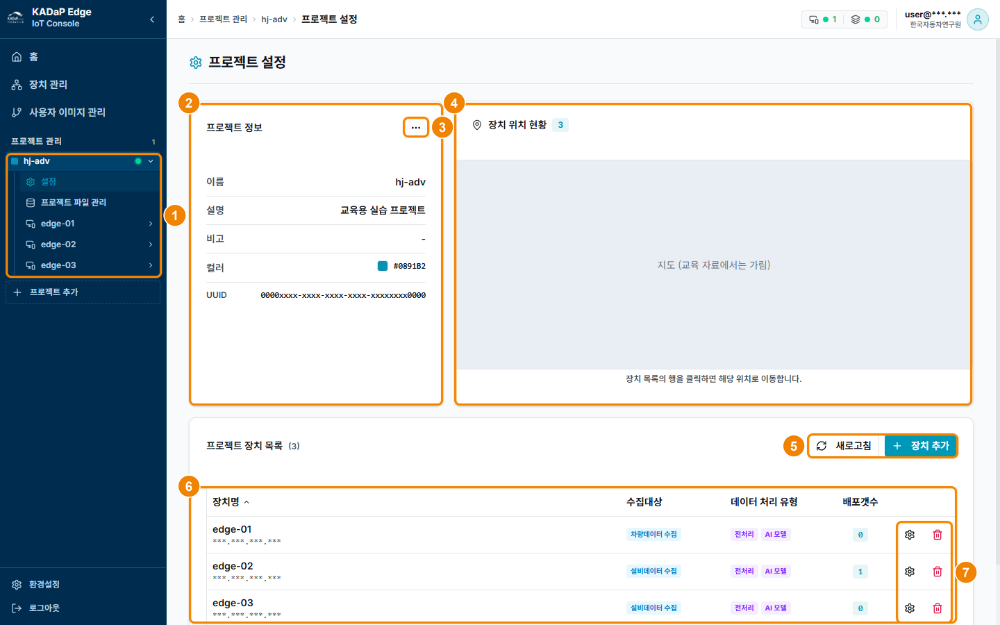

## 프로젝트 설정

프로젝트 설정 화면에서 프로젝트 정보와 장치 위치, 프로젝트에 연결한 장치 목록을 확인할 수 있습니다.

### 화면 구성

프로젝트 설정 화면은 다음과 같이 구성됩니다.

| 번호 | 항목 | 설명 |
|---|---|---|
| 1 | 프로젝트 트리 | 왼쪽 프로젝트 관리에서 프로젝트를 펼치면 설정, 프로젝트 파일 관리, 연결한 장치로 이동할 수 있습니다. |
| 2 | 프로젝트 정보 | 이름, 설명, 비고, 컬러, UUID를 표시합니다. |
| 3 | 더 보기(⋯) | 프로젝트를 수정하거나 삭제할 수 있습니다. 삭제한 프로젝트는 복구할 수 없습니다. |
| 4 | 장치 위치 현황 | 프로젝트에 연결한 장치의 위치를 지도에 표시합니다. 장치 목록에서 행을 클릭하면 지도가 그 장치의 위치로 이동합니다. |
| 5 | 새로고침 · 장치 추가 | **새로고침**을 클릭하면 목록을 새로 불러옵니다. **장치 추가**를 클릭하면 프로젝트에 장치를 연결하는 창이 열립니다('06-03-20 프로젝트 장치 추가하기' 참고). |
| 6 | 프로젝트 장치 목록 | 장치명(IP), 수집대상, 데이터 처리 유형, 배포갯수를 표시합니다. |
| 7 | 설정 · 삭제 | 톱니바퀴 아이콘을 클릭하면 장치 설정 화면으로 이동합니다. 휴지통 아이콘을 클릭하면 장치와 프로젝트의 연결이 해제됩니다. |

### 프로젝트 정보 확인하기

프로젝트 정보를 확인하려면 다음 순서대로 진행하세요.

1. 왼쪽 **프로젝트 관리**에서 프로젝트를 펼치고 **설정**을 클릭하세요.
   - 프로젝트 설정 화면이 표시됩니다.
2. 프로젝트 정보와 프로젝트 장치 목록을 확인하세요.
3. 장치 행의 톱니바퀴 아이콘을 클릭해 장치 설정 화면으로 이동하세요.
