# KADaP-X IoT

[TOC]

KADaP-X IoT는 엣지 장치를 관리하는 웹 콘솔입니다. 이 콘솔에서 엣지 장치를 등록하고, 장치에 수집 모듈과 가공 모듈을 컨테이너로 배포할 수 있습니다. 모듈이 만든 출력 파일을 확인하고 클라우드로 동기화할 수도 있습니다. 장치에 엣지 Agent(k3s)를 설치하는 방법은 06-02 엣지 장치 준비에서 설명합니다. 이 절은 화면을 메뉴 순서로 설명하며, 작업 순서는 '06-03-01 사용 순서'에서 안내합니다.

# 06-03-01 사용 순서

KADaP-X IoT를 사용하려면 다음 순서대로 진행하세요.

1. 엣지 장치를 KADaP-X IoT에 등록하세요. 출력 파일을 클라우드로 동기화하려면 부가설정에서 **동기화**를 선택하고 동기화 방식, 주기, S3 정보도 입력하세요. ('06-03-04 장치 추가하기'와 '06-03-25 S3 동기화 설정하기' 참고)
2. 장치를 묶을 프로젝트를 만드세요. ('06-03-22 프로젝트 추가하기' 참고)
3. 프로젝트에 장치를 연결하세요. ('06-03-20 프로젝트 장치 추가하기' 참고)
4. 수집 모듈을 등록하고 배포하세요. ('06-03-09 배포 추가하기(수집 - 설비 데이터)'와 '06-03-08 K8s 배포 이미지 관리하기' 참고)
5. 수집 모듈의 출력 파일과 로그를 확인하세요. ('06-03-13 장치 파일 관리'와 '06-03-12 배포 로그 보기' 참고)
6. 레지스트리에서 전처리 이미지를 확인하고 사용자 이미지로 등록하세요. ('06-03-17 레지스트리 확인하기'와 '06-03-18 이미지 추가하기' 참고)
7. 전처리 모듈을 배포하고 출력 파일을 확인하세요. ('06-03-10 배포 추가하기(가공 - 전처리)'와 '06-03-13 장치 파일 관리' 참고)
8. 버킷에서 동기화 결과를 확인하세요. 장치 편집에서 동기화 값을 바꿨다면 해당 모듈을 다시 배포하세요. ('06-03-25 S3 동기화 설정하기'와 '06-03-26 버킷 확인하기' 참고)

다음 작업은 필요할 때 진행하세요.

- 차량 데이터를 수집하려면 DBC 파일을 업로드하고 수집할 신호를 선택한 뒤, 연결 방식(CAN 인터페이스 또는 MQTT)을 골라 차량 데이터 수집 모듈을 배포하세요. ('06-03-14 CAN Viewer', '06-03-15 CAN 필터링하기', '06-03-11 배포 추가하기(수집 - 차량 데이터)' 참고)
- RSYNC 방식으로도 동기화할 수 있습니다. ('06-03-24 RSYNC 동기화 설정하기'와 '06-03-21 프로젝트 파일 관리' 참고)
- AAS 표준 API로 센서 값을 제공하려면 AAS 연동 모듈 `mqtt-client`와 `faaast`를 배포하세요. ('06-03-16 사용자 이미지 관리', '06-04-10 장치에 모듈로 배포하기' 참고)

# 06-03-02 홈 화면

홈 화면에서 프로젝트와 장치 현황을 한눈에 확인할 수 있습니다. KADaP-X IoT에 로그인하면 홈 화면이 처음 표시됩니다.

### 화면 구성

홈 화면은 다음과 같이 구성됩니다.

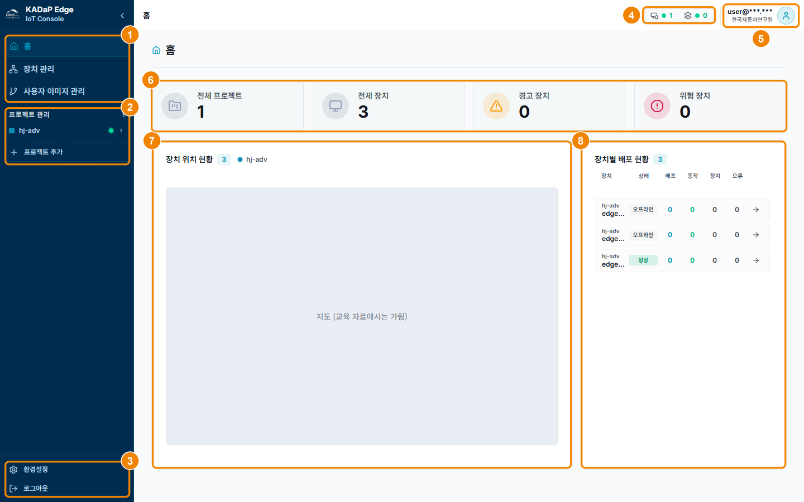

| 번호 | 항목 | 설명 |
|---|---|---|
| 1 | 메뉴 | 홈, 장치 관리, 사용자 이미지 관리 메뉴를 표시합니다. 장치 관리에서는 장치를 등록하고 편집하며, 사용자 이미지 관리에서는 모듈 이미지를 등록합니다. |
| 2 | 프로젝트 관리 | 프로젝트 목록과 프로젝트 추가 메뉴를 표시합니다. 프로젝트를 펼치면 설정, 프로젝트 파일 관리, 장치 메뉴가 표시됩니다. |
| 3 | 환경설정 · 로그아웃 | 테마와 레이아웃을 설정하거나 로그아웃할 수 있습니다. 자세한 내용은 '06-03-23 환경설정'을 참고하세요. |
| 4 | 장치 · 배포 상태 | 온라인 장치 수와 실행 중인 배포 수를 표시합니다. |
| 5 | 내 정보 | 로그인한 계정과 소속 회사를 표시합니다. |
| 6 | 현황 카드 | 전체 프로젝트, 전체 장치, 경고 장치, 위험 장치 수를 표시합니다. |
| 7 | 장치 위치 현황 | 프로젝트별 장치 위치를 지도에 표시합니다. |
| 8 | 장치별 배포 현황 | 장치별 상태(정상 또는 오프라인)와 배포, 동작, 정지, 오류 수를 표시합니다. 화살표를 클릭하면 장치 설정 화면으로 이동합니다. |

### 장치 현황 확인하기

장치 현황을 확인하려면 다음 순서대로 진행하세요.

1. KADaP-X IoT에 로그인하세요. 다른 화면에 있다면 왼쪽 메뉴에서 **홈**을 클릭하세요.
   - 홈 화면이 표시됩니다.
2. **장치별 배포 현황**에서 장치의 상태와 배포 수를 확인하세요.
3. 장치를 자세히 보려면 장치의 화살표를 클릭하세요.
   - 장치 설정 화면이 표시됩니다.

# 06-03-03 장치 관리

장치 관리 화면에서 엣지 장치 목록을 확인하고 장치를 등록, 편집, 삭제할 수 있습니다.

### 화면 구성

장치 관리 화면은 다음과 같이 구성됩니다.

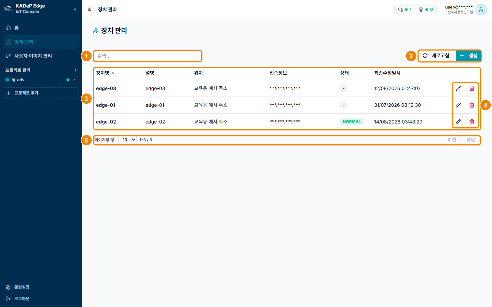

| 번호 | 항목 | 설명 |
|---|---|---|
| 1 | 검색 | 장치 목록에서 장치를 검색할 수 있습니다. |
| 2 | 새로고침 · 생성 | **새로고침**을 클릭하면 목록을 새로 불러옵니다. **생성**을 클릭하면 장치 추가 창이 열립니다. |
| 3 | 장치 목록 | 장치명, 설명, 위치, 접속정보(IP), 상태, 최종수정일시를 표시합니다. 열 머리글을 클릭하면 그 열을 기준으로 정렬됩니다. |
| 4 | 수정 · 삭제 | 연필 아이콘을 클릭하면 장치 편집 창이 열리고, 휴지통 아이콘을 클릭하면 장치가 삭제됩니다. 삭제한 장치는 복구할 수 없습니다. |
| 5 | 페이지 이동 | 페이지당 행 수를 바꾸거나 **이전**, **다음**을 클릭해 페이지를 이동할 수 있습니다. |

### 장치 등록 · 편집하기

장치를 등록하거나 편집하려면 다음 순서대로 진행하세요.

1. 왼쪽 메뉴에서 **장치 관리**를 클릭하세요.
   - 장치 관리 화면이 표시됩니다.
2. 작업에 맞는 버튼을 클릭하세요.
   - **생성**을 클릭하면 새 장치를 등록할 수 있습니다. ('06-03-04 장치 추가하기' 참고)
   - 장치 행의 연필 아이콘을 클릭하면 등록한 장치를 편집할 수 있습니다. ('06-03-05 장치 편집하기' 참고)

> **참고 -** 상태가 **NORMAL**이면 KADaP-X IoT가 장치에 접속한 상태이고, `-`이면 아직 접속하지 못한 상태입니다. KADaP-X IoT는 30초마다 장치 접속 여부를 확인합니다.

# 06-03-04 장치 추가하기

장치 추가 창에서 새 엣지 장치를 KADaP-X IoT에 등록할 수 있습니다. 등록한 장치에는 모듈을 배포하고 장치 상태를 확인할 수 있습니다.

### 화면 구성

장치 추가 창은 다음과 같이 구성됩니다.

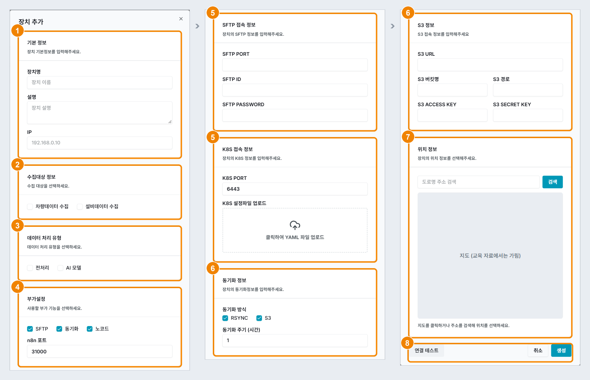

| 번호 | 항목 | 설명 |
|---|---|---|
| 1 | 기본 정보 | 장치명, 설명, IP를 입력합니다. |
| 2 | 수집대상 정보 | 차량데이터 수집과 설비데이터 수집 중에서 1개 이상 선택합니다. |
| 3 | 데이터 처리 유형 | 전처리와 AI 모델 중에서 선택합니다. |
| 4 | 부가설정 | SFTP, 동기화, 노코드 중에서 사용할 기능을 선택합니다. 노코드를 선택하면 n8n 포트를 입력합니다. |
| 5 | SFTP 접속 정보 · K8S 접속 정보 | SFTP PORT, ID, PASSWORD와 K8S PORT를 입력하고, K8S 설정파일을 업로드합니다. |
| 6 | 동기화 정보 · S3 정보 | 동기화 방식, 동기화 주기, S3 접속 정보를 입력합니다. 부가설정에서 동기화를 선택하면 표시됩니다. |
| 7 | 위치 정보 | 도로명 주소를 검색한 뒤 말풍선의 **선택**을 클릭하거나, 지도를 클릭해 장치 위치를 지정합니다. |
| 8 | 연결 테스트 · 취소 · 생성 | **연결 테스트**를 클릭하면 입력한 값으로 K8s와 SFTP 접속을 점검합니다. **생성**을 클릭하면 장치가 등록됩니다. |

### 장치 추가하기

장치를 추가하려면 다음 순서대로 진행하세요.

1. **장치 관리**에서 **생성**을 클릭하세요.
   - 장치 추가 창이 표시됩니다.
2. 기본 정보, 수집대상, 데이터 처리 유형, 부가설정을 입력하세요.
   - **장치명**: 장치를 구분할 이름을 입력합니다. 64자까지 입력할 수 있습니다. (예: `edge-01`)
   - **IP**: 엣지 Agent를 설치할 때 출력된 `Server:` 주소의 IP를 입력합니다. (예: `<장치 IP>`)
   - **수집대상 정보**: 수집할 데이터에 맞게 선택하며, 둘 다 선택할 수도 있습니다. 차량데이터 수집을 선택하면 CAN Viewer 탭과 **수집 - 차량 데이터** 배포 타입을, 설비데이터 수집을 선택하면 **수집 - 설비 데이터** 배포 타입을 쓸 수 있습니다.
   - **데이터 처리 유형**: 가공 모듈을 배포할 장치에서 선택합니다. (예: 전처리)
   - **부가설정**: 사용할 기능만 선택합니다. SFTP는 장치 파일 관리에, 노코드는 n8n 화면에, 동기화는 가공 모듈의 출력을 클라우드로 보내는 데 필요합니다. 노코드를 선택하면 n8n 포트에 `31000`을 입력합니다.
3. SFTP 접속 정보와 K8S 접속 정보를 입력하세요.
   - **SFTP PORT, ID, PASSWORD**: 장치의 SSH 포트, 계정, 비밀번호를 입력합니다. 자세한 내용은 '06-02-07 SSH 서버 준비하기'를 참고하세요.
   - **K8S PORT**: k3s API 포트를 입력합니다. (예: `6443`)
   - **K8S 설정파일**: kubeconfig 파일을 업로드합니다. 자세한 내용은 '06-02-06 kubeconfig 확보하기'를 참고하세요.
4. 부가설정에서 동기화를 선택했다면 동기화 정보와 S3 정보를 입력하세요. ('06-03-24 RSYNC 동기화 설정하기'와 '06-03-25 S3 동기화 설정하기' 참고)
   - **동기화 방식, 동기화 주기**: RSYNC와 S3 중에서 사용할 방식을 선택하고, 주기를 시간 단위로 입력합니다. (예: `S3`, `1`(1시간))
   - **S3 정보**: 동기화 방식에서 S3를 선택하면 표시됩니다. S3 URL, 버킷명, 경로, ACCESS KEY, SECRET KEY를 입력합니다.
5. **연결 테스트**를 클릭해 SFTP와 K8S 모두 "연결 성공"이 표시되는지 확인하세요.
6. **생성**을 클릭하세요.

> **참고 -** 가공 모듈의 **출력 선택**에 S3가 표시되려면 부가설정에서 동기화를 선택하고 동기화 방식에서 S3를 선택해야 합니다. 장치를 등록한 뒤 장치 편집에서 선택해도 됩니다.

# 06-03-05 장치 편집하기

장치 편집 창에서 등록한 장치의 정보를 수정할 수 있습니다. 장치 편집 창의 항목은 장치 추가 창과 같습니다.

### 화면 구성

장치 편집 창은 다음과 같이 구성됩니다.

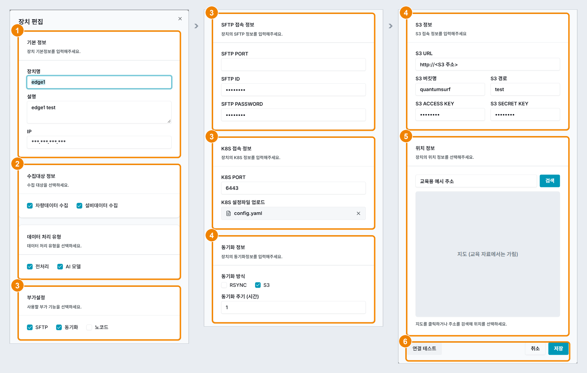

| 번호 | 항목 | 설명 |
|---|---|---|
| 1 | 기본 정보 | 저장된 장치명, 설명, IP가 입력되어 있습니다. |
| 2 | 수집대상 정보 · 데이터 처리 유형 | 선택한 항목을 바꿀 수 있습니다. |
| 3 | 부가설정 · SFTP · K8S 접속 정보 | 부가설정과 접속 정보를 수정합니다. 저장된 K8S 설정파일은 `config.yaml`로 표시됩니다. |
| 4 | 동기화 정보 · S3 정보 | 동기화 방식, 동기화 주기, S3 접속 정보를 수정합니다. 부가설정에서 동기화를 선택하면 표시됩니다. |
| 5 | 위치 정보 | 저장된 주소와 지도 위치를 표시합니다. |
| 6 | 연결 테스트 · 취소 · 저장 | **연결 테스트**를 클릭하면 접속을 점검합니다. **저장**을 클릭하면 수정한 내용이 저장됩니다. |

### 장치 편집하기

장치를 편집하려면 다음 순서대로 진행하세요.

1. 장치 관리 목록에서 장치 행의 **연필**을 클릭하세요. 장치 설정 화면에서는 장치 정보 카드의 **✎**을 클릭해도 됩니다.
   - 장치 편집 창이 표시됩니다.
2. 바꿀 값을 수정하세요.
   - **장치명 변경**: 바꾼 장치명은 장치 관리 목록, 프로젝트 트리, 프로젝트 장치 목록에 반영됩니다. (예: `edge-01`)
   - **K8S 설정파일**: 파일을 바꾸려면 **X**를 클릭해 기존 파일을 지우고 새 파일을 업로드합니다. (예: `edge.kubeconfig.yaml`)
   - **동기화**: 부가설정에서 **동기화**를 선택하면 동기화 정보가 표시됩니다. 자세한 내용은 '06-03-24 RSYNC 동기화 설정하기'와 '06-03-25 S3 동기화 설정하기'를 참고하세요.
   - **수집대상 추가**: 수집대상을 추가로 선택하면 장치 설정 화면의 탭과 배포 타입 목록이 바뀝니다. 예를 들어 차량데이터 수집을 선택하면 CAN Viewer 탭이 표시됩니다.
3. **연결 테스트**를 클릭해 SFTP와 K8S 모두 "연결 성공"이 표시되는지 확인하세요.
4. **저장**을 클릭하세요.

# 06-03-06 장치 설정 · 정보

장치 설정 화면에서 프로젝트에 연결한 장치의 등록 정보와 위치를 확인할 수 있습니다. 화면 아래쪽에서는 장치에 모듈을 배포하고 장치 상태정보를 확인할 수 있습니다.

### 화면 구성

장치 설정 화면은 다음과 같이 구성됩니다.

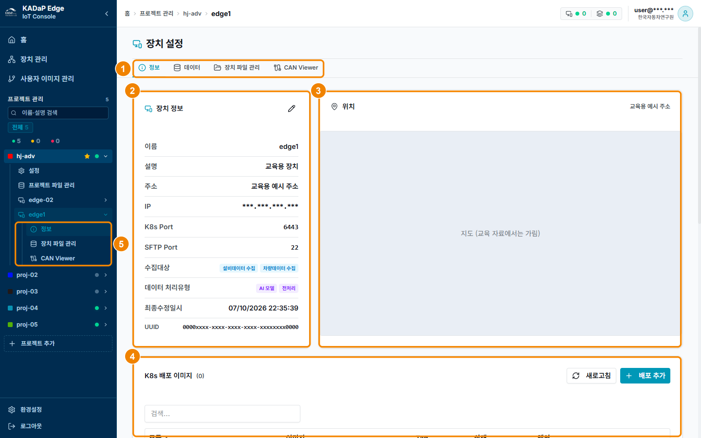

| 번호 | 항목 | 설명 |
|---|---|---|
| 1 | 탭 | 정보, 데이터, 장치 파일 관리, CAN Viewer 탭을 표시합니다. CAN Viewer 탭은 수집대상에 차량데이터 수집을, 노코드 ↗ 탭은 부가설정에 노코드를 선택한 장치에만 표시됩니다. |
| 2 | 장치 정보 | 이름, 설명, 주소, IP, K8s Port, SFTP Port, 수집대상, 데이터 처리유형, 최종수정일시, UUID를 표시합니다. ✎을 클릭하면 장치 편집 창이 열립니다. |
| 3 | 위치 | 장치 위치를 지도에 표시합니다. |
| 4 | K8s 배포 이미지(아래로 스크롤) | 장치에 등록한 모듈 목록과 새로고침, 배포 추가 버튼을 표시합니다. 자세한 내용은 '06-03-08 K8s 배포 이미지 관리하기'를 참고하세요. |
| 5 | 장치 바로가기 | 왼쪽 프로젝트 트리에서 장치를 펼치면 정보, 장치 파일 관리, CAN Viewer로 바로 이동할 수 있습니다. 노코드를 선택한 장치에는 n8n 화면을 새 창으로 여는 노코드 ↗ 링크도 표시됩니다. |

### 장치 정보 확인하기

장치 정보를 확인하려면 다음 순서대로 진행하세요.

1. 왼쪽 **프로젝트 관리**에서 프로젝트를 펼치고 장치를 클릭하세요. 프로젝트 설정 화면의 프로젝트 장치 목록에서 톱니바퀴 아이콘을 클릭해도 됩니다.
   - 장치 설정 화면이 표시됩니다.
2. **정보** 탭에서 장치 정보를 확인하세요.
3. 화면을 아래로 스크롤해 K8s 배포 이미지와 장치 상태정보를 확인하세요.

# 06-03-07 장치 상태정보 보기

장치 설정 화면 아래쪽의 장치 상태정보에서 장치의 CPU, 메모리, 디스크, 네트워크 사용량을 확인할 수 있습니다.

### 화면 구성

장치 상태정보 화면은 다음과 같이 구성됩니다.

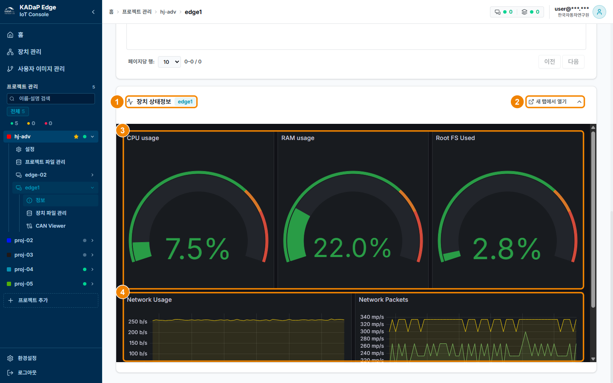

| 번호 | 항목 | 설명 |
|---|---|---|
| 1 | 장치 상태정보 + 장치명 배지 | 현재 값을 보여 주는 장치의 이름을 배지로 표시합니다. |
| 2 | 새 탭에서 열기 · 접기 | 대시보드를 새 탭에서 크게 보거나, 카드를 접고 펼칠 수 있습니다. |
| 3 | CPU usage · RAM usage · Root FS Used | 현재 사용률을 게이지로 표시합니다. |
| 4 | Network Usage · Network Packets | 네트워크 송수신량과 패킷 수를 시간에 따른 그래프로 표시합니다. |

### 장치 상태정보 보기

장치 상태정보를 보려면 다음 순서대로 진행하세요.

1. 장치 설정 화면의 **정보** 탭을 아래로 스크롤해 **장치 상태정보**를 펼치세요.
2. 크게 보려면 **새 탭에서 열기**를 클릭하세요.

장치 상태정보의 값을 확인할 때 알아 둘 내용은 다음과 같습니다.

- **값 출처**: 장치에 설치한 Telegraf가 10초마다 값을 보냅니다. Telegraf는 엣지 Agent를 설치할 때 `--install-telegraf` 옵션으로 함께 설치합니다.
- **host 태그**: Telegraf의 host 태그가 KADaP-X IoT의 장치명과 같아야 값이 표시됩니다. host 태그는 설치할 때 `--telegraf-hostname` 옵션으로 지정합니다. (예: `--telegraf-hostname edge-01`)
- **No data**: Telegraf가 설치되지 않았거나, 장치가 오프라인이거나, host 태그가 장치명과 다르면 표시됩니다.

> **참고 -** 기본 `run.sh`로 설치한 장치는 Telegraf가 없어 No data로 표시됩니다. 값을 표시하려면 엣지 Agent를 설치할 때 `--install-telegraf` 옵션과 함께 수집 서버 접속 옵션(`--influxdb-url`, `--influxdb-token`, `--influxdb-org`, `--influxdb-bucket`)을 지정해야 합니다. 수집 서버 접속 정보는 운영 기관에 문의하세요.

# 06-03-08 K8s 배포 이미지 관리하기

장치 설정 화면 아래쪽의 K8s 배포 이미지에서 장치에 배포할 수집 모듈과 가공 모듈을 등록하고 배포할 수 있습니다. 등록한 모듈을 시작하거나 정지하고, 로그를 확인하거나 삭제할 수도 있습니다.

### 화면 구성

K8s 배포 이미지 화면은 다음과 같이 구성됩니다.

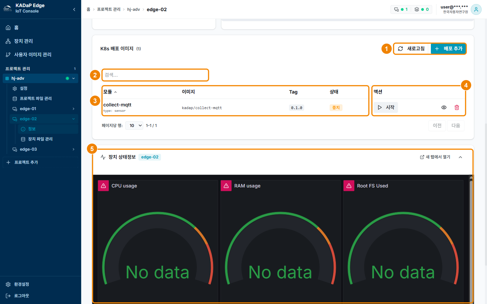

| 번호 | 항목 | 설명 |
|---|---|---|
| 1 | 새로고침 · 배포 추가 | **새로고침**을 클릭하면 목록을 새로 불러오고, **배포 추가**를 클릭하면 K8s 배포 이미지 등록 창이 열립니다. |
| 2 | 검색 | 모듈 이름으로 검색할 수 있습니다. |
| 3 | 배포 목록 | 모듈(이름, 타입), 이미지, Tag, 상태를 표시합니다. |
| 4 | 액션 | 모듈 상태에 따라 다른 버튼과 아이콘이 표시됩니다. 상태별 버튼과 아이콘은 표 아래에서 설명합니다. |
| 5 | 장치 상태정보 | CPU, RAM, 디스크, 네트워크 사용량을 표시합니다. 자세한 내용은 '06-03-07 장치 상태정보 보기'를 참고하세요. |

모듈 상태별로 표시되는 버튼과 아이콘은 다음과 같습니다.

- **미배포**: **배포** 버튼, 배포설정 수정(슬라이더 아이콘), 휴지통이 표시됩니다. 이 상태에서 휴지통을 클릭하면 등록한 모듈이 삭제됩니다.
- **실행중**: **정지** 버튼, 로그 보기(두루마리 아이콘), 눈 아이콘, 휴지통이 표시됩니다.
- **중지**: **시작**(▷) 버튼, 눈 아이콘, 휴지통이 표시됩니다.

눈 아이콘을 클릭하면 배포설정을 읽기 전용으로 볼 수 있습니다. **실행중**이나 **중지** 상태에서 휴지통을 클릭하면 배포만 삭제되고 모듈은 미배포 상태로 돌아갑니다.

### 모듈 배포하기

모듈을 배포하려면 다음 순서대로 진행하세요.

1. 장치 설정 화면을 아래로 스크롤해 **K8s 배포 이미지**에서 **배포 추가**를 클릭하세요.
   - K8s 배포 이미지 등록 창이 표시됩니다.
2. 모듈 타입에 맞게 항목을 입력하세요. ('06-03-09 배포 추가하기(수집 - 설비 데이터)', '06-03-10 배포 추가하기(가공 - 전처리)', '06-03-11 배포 추가하기(수집 - 차량 데이터)' 참고)
3. **등록**을 클릭하세요.
   - 목록에 모듈이 **미배포** 상태로 추가됩니다.
4. 추가한 모듈 행에서 **배포**를 클릭하세요. 중지된 모듈을 다시 실행하려면 **시작**을 클릭하세요.
5. 상태가 **실행중**으로 바뀌는지 확인하세요.
6. 로그 보기 아이콘을 클릭해 배포 이벤트와 Pod 로그를 확인하세요. ('06-03-12 배포 로그 보기' 참고)

> **참고 -** 배포설정은 미배포 상태에서만 수정할 수 있습니다. 실행중이거나 중지된 모듈의 배포설정을 고치려면 휴지통을 클릭해 미배포 상태로 되돌린 뒤 배포설정 수정(슬라이더 아이콘)으로 고치고 다시 **배포**하세요.

# 06-03-09 배포 추가하기(수집 - 설비 데이터)

K8s 배포 이미지 등록 창에서 설비 데이터를 수집하는 모듈을 등록할 수 있습니다. 여기서는 MQTT 브로커에서 데이터를 받는 수집 모듈 `collect-mqtt`를 예로 설명합니다.

### 화면 구성

K8s 배포 이미지 등록 창은 다음과 같이 구성됩니다.

| 번호 | 항목 | 설명 |
|---|---|---|
| 1 | 모듈 이름 | 모듈 이름을 입력합니다. 소문자, 숫자, 하이픈만 쓸 수 있으며, 대문자와 공백은 자동으로 변환됩니다. |
| 2 | 타입 | **사용자 등록 이미지**, **가공 - 전처리, AI 모델**, **수집 - 차량 데이터**, **수집 - 설비 데이터** 중에서 선택합니다. 장치의 수집대상과 데이터 처리 유형에 맞는 타입만 표시됩니다. |
| 3 | 배포 이미지 | 기본 모듈 목록에서 이미지를 선택합니다. 타입이 사용자 등록 이미지이면 이 항목이 레지스트리 이미지 (Repository)로 바뀝니다. |
| 4 | Image (model) · Tag (version) | 이미지 경로와 태그를 표시합니다. 직접 입력할 수도 있습니다. |
| 5 | 수집 방식 | API 수집과 센서 시리얼 중에서 선택합니다. 센서 시리얼을 선택하면 장치 경로 입력란이 표시됩니다. |
| 6 | INPUT_PATH · OUTPUT_PATH | 배포 이미지가 입력을 읽고 결과를 쓰는 컨테이너 안의 경로입니다. 기본값은 각각 `/app/input`과 `/app/output`이며, 이미지가 다른 경로를 쓰면 그 경로로 바꿉니다. 바꾼 경로는 볼륨 마운트 경로와 `INPUT_PATH` · `OUTPUT_PATH` 환경변수에 함께 반영됩니다. |
| 7 | 환경변수 | **추가**를 클릭하고 KEY와 VALUE를 한 쌍씩 입력합니다. |
| 8 | 취소 · 등록 | **등록**을 클릭하면 모듈이 등록됩니다. 등록한 모듈은 K8s 배포 이미지 목록에서 배포합니다. |

### 설비 데이터 수집 모듈 추가하기

설비 데이터 수집 모듈을 추가하려면 다음 순서대로 진행하세요.

1. 장치 설정 화면의 **K8s 배포 이미지**에서 **배포 추가**를 클릭하세요.
   - K8s 배포 이미지 등록 창이 표시됩니다.
2. 모듈 이름을 입력하고 타입에서 **수집 - 설비 데이터**를 선택하세요.
   - **모듈 이름**: 모듈을 구분할 이름을 입력합니다. (예: `collect-mqtt`)
3. 배포 이미지를 선택하거나 Image와 Tag를 직접 입력하세요.
   - **Image와 Tag**: 이미지 경로와 태그를 두 칸에 나누어 입력합니다. (예: `harbor.bigdata-car.kr/quantumsurf/collect-mqtt`, `0.1.0`)
4. 수집 방식은 **API 수집**으로 두세요.
   - **센서 시리얼**: 수집 방식을 센서 시리얼로 선택한 경우에만 장치 경로를 입력합니다. (예: `/dev/ttyUSB0`)
5. **환경변수**에 브로커 정보를 추가하세요.
   - **환경변수**: MQTT 브로커의 주소, 포트, 토픽, 사용자, 비밀번호를 하나씩 추가합니다. '06-02-08 MQTT 경로 확인하기'에서 확인한 값을 입력합니다. (예: `MQTT_HOST=<브로커 주소>`, `MQTT_PORT=1883`, `MQTT_TOPIC=<토픽>`, `MQTT_USER`, `MQTT_PASS`)
6. **등록**을 클릭하세요.
7. K8s 배포 이미지 목록에서 등록한 모듈의 **배포**를 클릭하세요.

# 06-03-10 배포 추가하기(가공 - 전처리)

K8s 배포 이미지 등록 창에서 전처리 모듈을 사용자 등록 이미지로 등록할 수 있습니다. 전처리 모듈은 수집 모듈의 출력 파일을 받아 가공합니다. 예로 드는 `preproc-can`은 원시 CAN 파일을 물리량으로 변환합니다.

### 화면 구성

전처리 모듈의 K8s 배포 이미지 등록 창은 다음과 같이 구성됩니다.

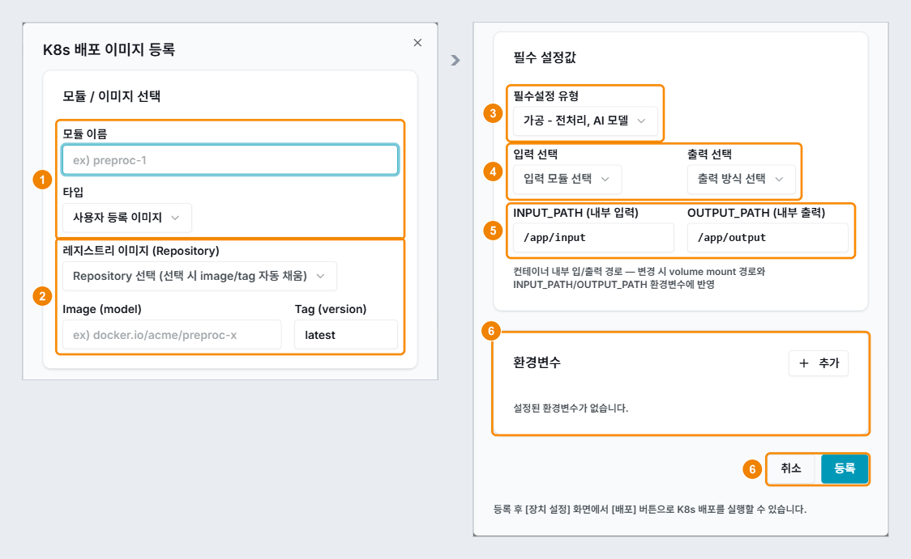

| 번호 | 항목 | 설명 |
|---|---|---|
| 1 | 모듈 이름 · 타입 | 모듈 이름을 입력하고, 타입에서 **사용자 등록 이미지**를 선택합니다. |
| 2 | 레지스트리 이미지 (Repository) | 사용자 이미지 관리에 등록한 이미지를 선택합니다. 선택하면 Image와 Tag가 자동으로 입력됩니다. |
| 3 | 필수설정 유형 | **가공 - 전처리, AI 모델**을 선택합니다. |
| 4 | 입력 선택 · 출력 선택 | 입력 선택에서는 같은 장치의 수집 모듈을 선택합니다. 출력 선택에서는 선택 없음, RSYNC, S3, 수동설정 중 하나를 선택합니다. |
| 5 | INPUT_PATH · OUTPUT_PATH | 전처리 이미지가 입력 파일을 읽고 결과를 쓰는 컨테이너 안의 경로입니다. 기본값은 `/app/input`과 `/app/output`이며, 이미지가 다른 경로를 쓰면 그 경로로 바꿉니다. 예로 든 `preproc-can`은 기본값을 사용합니다. |
| 6 | 환경변수 · 취소 · 등록 | 변환 옵션이 있으면 환경변수로 입력합니다. **등록**을 클릭하면 모듈이 등록됩니다. |

### 전처리 모듈 추가하기

전처리 모듈을 추가하려면 다음 순서대로 진행하세요.

1. 사용자 이미지 관리에 전처리 이미지를 등록하세요. ('06-03-18 이미지 추가하기' 참고)
2. 장치 설정 화면의 **K8s 배포 이미지**에서 **배포 추가**를 클릭하세요.
   - K8s 배포 이미지 등록 창이 표시됩니다.
3. 모듈 이름을 입력하고 타입에서 **사용자 등록 이미지**를 선택하세요.
   - **모듈 이름**: 모듈을 구분할 이름을 입력합니다. (예: `preproc-can`)
4. 레지스트리 이미지에서 등록한 전처리 이미지를 선택하세요.
   - **레지스트리 이미지**: '06-03-18 이미지 추가하기'에서 입력한 이름을 선택합니다. (예: `preproc-can`(`quantumsurf/preproc-can:0.1.0`))
5. 필수설정 유형에서 **가공 - 전처리, AI 모델**을 선택하고 입력 선택과 출력 선택을 지정하세요.
   - **입력 선택**: 입력으로 사용할 수집 모듈을 선택합니다. (예: `collect-mqtt`)
   - **출력 선택**: 출력 파일을 내보낼 방식을 선택합니다. RSYNC와 S3 중에서는 장치에 설정한 동기화 방식만 표시됩니다. 수동설정을 선택하면 장치의 절대 경로를 입력합니다. (예: `S3`)
6. **등록**을 클릭하세요.
7. K8s 배포 이미지 목록에서 등록한 모듈의 **배포**를 클릭하세요.

# 06-03-11 배포 추가하기(수집 - 차량 데이터)

K8s 배포 이미지 등록 창에서 장치의 CAN 인터페이스나 MQTT 브로커로 차량 데이터를 수집하는 모듈을 등록할 수 있습니다. **수집 - 차량 데이터** 타입은 장치의 수집대상에 **차량데이터 수집**을 선택한 경우에만 타입 목록에 표시됩니다.

### 화면 구성

차량 데이터 수집 모듈의 K8s 배포 이미지 등록 창은 다음과 같이 구성됩니다.

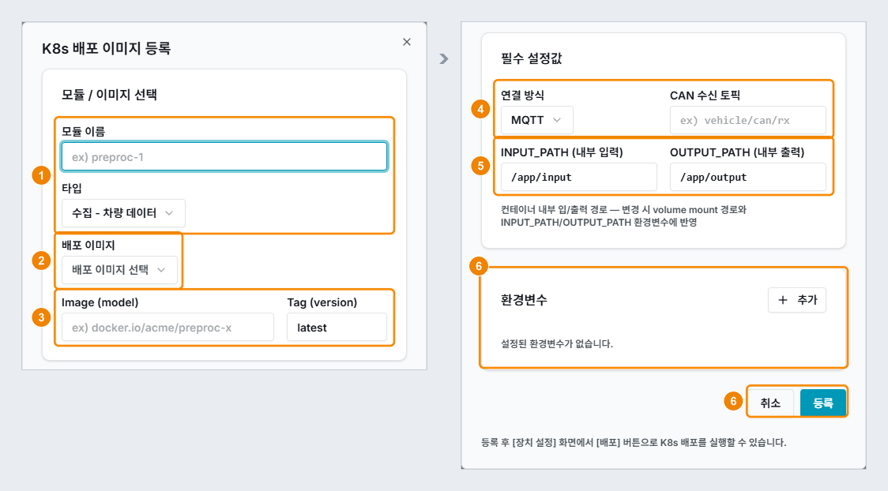

| 번호 | 항목 | 설명 |
|---|---|---|
| 1 | 모듈 이름 · 타입 | 모듈 이름을 입력하고, 타입에서 **수집 - 차량 데이터**를 선택합니다. |
| 2 | 배포 이미지 | `can/can-decoder`를 선택합니다. 한국자동차연구원이 제공하는 이미지로, CAN 데이터를 수집하고 디코딩합니다. |
| 3 | Image (model) · Tag (version) | 배포 이미지를 선택하면 자동으로 입력됩니다. |
| 4 | 연결 방식 · CAN 수신 토픽 | 연결 방식에서 **CAN 인터페이스**와 **MQTT** 중 하나를 선택합니다. 선택한 방식에 따라 CAN 인터페이스 이름이나 CAN 수신 토픽을 입력하는 칸이 표시됩니다. |
| 5 | INPUT_PATH · OUTPUT_PATH | 수집 이미지가 결과 파일을 쓰는 컨테이너 안의 경로입니다. 기본값은 `/app/input`과 `/app/output`이며, 이미지가 다른 경로를 쓰면 그 경로로 바꿉니다. 출력 파일은 장치 파일 관리에서 확인합니다. 클라우드 동기화는 출력 선택을 RSYNC나 S3로 지정한 가공 모듈에만 적용됩니다. |
| 6 | 환경변수 · 취소 · 등록 | 필요하면 환경변수를 추가하고 **등록**을 클릭합니다. |

### 차량 데이터 수집 모듈 추가하기

차량 데이터 수집 모듈을 추가하려면 다음 순서대로 진행하세요.

1. 장치 편집에서 수집대상 **차량데이터 수집**이 선택되어 있는지 확인하세요.
2. **CAN Viewer** 탭의 **CAN 필터링**에서 DBC 파일을 업로드하고 수집할 신호를 선택해 저장하세요. ('06-03-15 CAN 필터링하기' 참고)
3. 장치 설정 화면의 **K8s 배포 이미지**에서 **배포 추가**를 클릭하세요.
   - K8s 배포 이미지 등록 창이 표시됩니다.
4. 모듈 이름을 입력하고 타입에서 **수집 - 차량 데이터**를 선택하세요.
5. 배포 이미지에서 `can/can-decoder`를 선택하세요.
6. 연결 방식을 선택하고, 선택한 방식에 맞는 값을 입력하세요.
   - **CAN 인터페이스**: 차량이나 장비를 장치의 CAN 인터페이스에 직접 연결할 때 선택합니다. 장치에서 `ip link`로 확인한 인터페이스 이름을 입력합니다. (예: `can0`)
   - **MQTT**: 차량 CAN 데이터를 MQTT 브로커로 받을 때 선택합니다. CAN 수신 토픽에 데이터가 들어오는 토픽을 입력합니다. (예: `vehicle/can/rx`)
7. **등록**을 클릭하세요.
8. K8s 배포 이미지 목록에서 등록한 모듈의 **배포**를 클릭하세요.
   - CAN 필터링에서 선택한 신호만 OUTPUT_PATH에 파일로 저장됩니다. 저장된 파일은 장치 파일 관리에서 확인할 수 있습니다.

> **참고 -** MQTT 방식은 CAN 수신 토픽만 설정합니다. 장치 밖의 브로커를 쓰려면 브로커 주소, 포트, 계정을 환경변수로 추가하세요. 수집 이미지는 연결 방식과 토픽을 환경변수(`CAN_CONNECT_TYPE`, `MQTT_TOPIC`)로 읽을 수 있어야 합니다.

# 06-03-12 배포 로그 보기

로그 보기 창에서 실행 중인 모듈의 배포 이벤트와 Pod 로그를 확인할 수 있습니다.

### 구성

로그 보기 창은 다음과 같이 구성됩니다.

| 항목 | 설명 |
|---|---|
| 제목 | 창 제목에 "<모듈명> — 로그 보기"가 표시됩니다. |
| 탭 | 배포 이벤트 탭과 Pod 로그 탭이 있습니다. |
| 배포 이벤트 표 | Type, Reason, Object, Message, Last Seen을 표시합니다. Type에는 Normal 또는 Warning과 반복 횟수(×횟수)가 표시됩니다. |
| Pod 로그 | 모듈의 첫 번째 Pod 로그를 표시합니다. |
| 새로고침 · 닫기 | **새로고침**을 클릭하면 현재 탭의 내용을 새로 불러오고, **닫기**를 클릭하면 창이 닫힙니다. |

### 배포 로그 확인하기

배포 로그를 확인하려면 다음 순서대로 진행하세요.

1. K8s 배포 이미지 목록에서 **실행중** 행의 **로그 보기**(두루마리 아이콘)를 클릭하세요.
   - 로그 보기 창이 표시됩니다.
2. **배포 이벤트** 탭에서 Warning 이벤트가 있는지 확인하세요. 이미지를 내려받지 못하는 등 배포에 문제가 있으면 Warning이 표시됩니다.
3. **Pod 로그** 탭에서 구독 메시지와 처리 메시지 같은 모듈의 로그를 확인하세요.
4. 최신 로그를 보려면 **새로고침**을 클릭하세요.

로그에 다음 표시가 나타나면 표의 조치를 따르세요.

| 표시 | 설명 | 조치 |
|---|---|---|
| Warning · ErrImagePull | 이미지 이름, 태그, 레지스트리 인증 중 하나가 잘못되었습니다. | 배포설정의 Image와 Tag, 사용자 이미지의 User ID와 Secret Key를 확인하세요. |
| (no log) | Pod 로그가 아직 만들어지지 않았습니다. | 잠시 뒤 **새로고침**을 클릭하세요. |
| (failed to fetch log) | Pod 로그를 가져오지 못했습니다. | 장치의 K8s 접속 상태와 모듈의 상태를 확인하세요. |

# 06-03-13 장치 파일 관리

장치 파일 관리 화면에서 장치의 폴더와 파일을 탐색하고 파일을 다운로드, 업로드, 삭제할 수 있습니다. 수집 모듈과 가공 모듈의 출력 파일도 이 화면에서 확인합니다.

### 화면 구성

장치 파일 관리 화면은 다음과 같이 구성됩니다.

| 번호 | 항목 | 설명 |
|---|---|---|
| 1 | 탭 | 정보, 데이터, **장치 파일 관리**, CAN Viewer 탭을 표시합니다. |
| 2 | 경로 | 현재 폴더의 경로를 표시하며, 경로를 클릭해 상위 폴더로 이동할 수 있습니다. root는 장치의 최상위 폴더(`/`)입니다. |
| 3 | 검색 · 날짜 · 파일 형식 | 이름으로 검색하고, 수정일 범위와 파일 형식으로 필터링할 수 있습니다. **Apply**를 클릭하면 필터가 적용되고, **초기화**를 클릭하면 필터가 해제됩니다. |
| 4 | 새로고침 · 폴더 생성 · 업로드 | 목록을 새로 불러오거나, 폴더를 만들거나, 파일을 업로드할 수 있습니다. |
| 5 | 폴더 · 파일 목록 | 폴더와 파일을 이름과 크기가 적힌 카드로 표시합니다. 카드의 더 보기(⋮)에서 파일을 다운로드하거나 폴더와 파일을 삭제할 수 있습니다. |

### 출력 파일 확인하기

모듈의 출력 파일을 확인하려면 다음 순서대로 진행하세요.

1. 왼쪽 프로젝트 트리에서 장치를 펼치고 **장치 파일 관리**를 클릭하세요.
2. 폴더를 차례로 클릭해 배포설정의 출력 경로로 이동하세요. (예: `data/raw`, `data/output`)
   - **수집 출력**: `collect-mqtt` 같은 수집 모듈이 저장한 원시 CAN 파일입니다. (예: `data/raw/raw_<일시>.csv`, `latest.json`)
   - **가공 출력**: `preproc-can` 같은 전처리 모듈이 물리량으로 변환한 파일입니다. (예: `data/output/decoded_raw_<일시>.csv`)
   - **AAS 출력**: `faaast` 모듈이 저장한 AAS 모델 파일과 `mqtt-client` 모듈이 마지막으로 받은 값입니다. (예: `aas/model_persistence.json`, `sensor-latest.json`)
3. 파일 카드의 더 보기(**⋮**)에서 **다운로드**를 클릭하세요.
4. 다운로드한 파일을 열어 내용을 확인하세요.

# 06-03-14 CAN Viewer

CAN Viewer 화면에서 장치에 업로드한 CAN DB(DBC)의 신호 목록을 확인하고, 수집할 신호를 선택할 수 있습니다. CAN Viewer 탭은 수집대상에 차량데이터 수집을 선택한 장치에만 표시됩니다.

### 화면 구성

CAN Viewer 화면은 다음과 같이 구성됩니다.

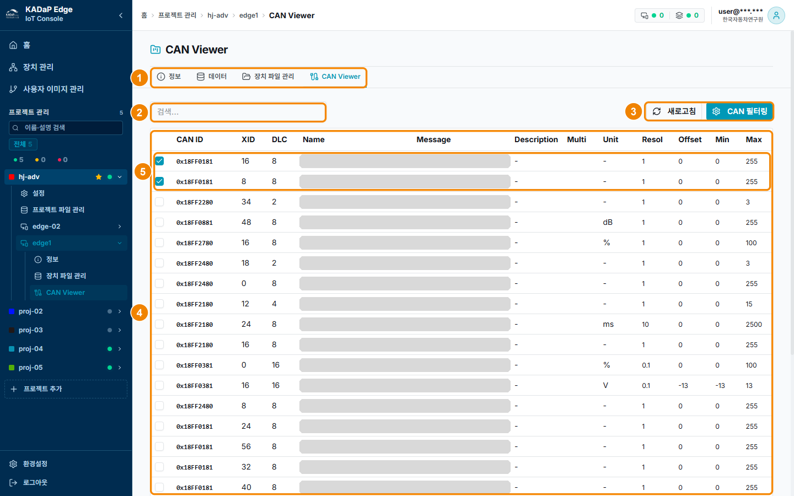

| 번호 | 항목 | 설명 |
|---|---|---|
| 1 | 탭 | 정보, 데이터, 장치 파일 관리, CAN Viewer 탭을 표시합니다. |
| 2 | 검색 | 신호 이름으로 검색할 수 있습니다. |
| 3 | 새로고침 · CAN 필터링 | **새로고침**을 클릭하면 목록을 새로 불러옵니다. **CAN 필터링**을 클릭하면 DBC를 업로드하고 신호를 선택하는 창이 열립니다. |
| 4 | 신호 표 | CAN ID, XID, DLC, Name, Message, Description, Multi, Unit, Resol, Offset, Min, Max를 표시합니다. |
| 5 | 선택한 신호 | CAN 필터링에서 선택한 신호는 선택된 상태로 목록 위쪽에 표시됩니다. |

### 수집 신호 확인하기

수집할 신호를 선택하고 확인하려면 다음 순서대로 진행하세요.

1. 왼쪽 프로젝트 트리에서 장치를 펼치고 **CAN Viewer**를 클릭하세요.
2. **CAN 필터링**을 클릭해 DBC 파일을 업로드하고 수집할 신호를 선택하세요. ('06-03-15 CAN 필터링하기' 참고)
3. 선택한 신호가 목록 위쪽에 선택된 상태로 표시되는지 확인하세요.

# 06-03-15 CAN 필터링하기

CAN 필터링 창에서 DBC 또는 CSV 파일을 업로드하고, 수집할 신호를 선택해 장치에 저장할 수 있습니다.

### 화면 구성

CAN 필터링 창은 다음과 같이 구성됩니다.

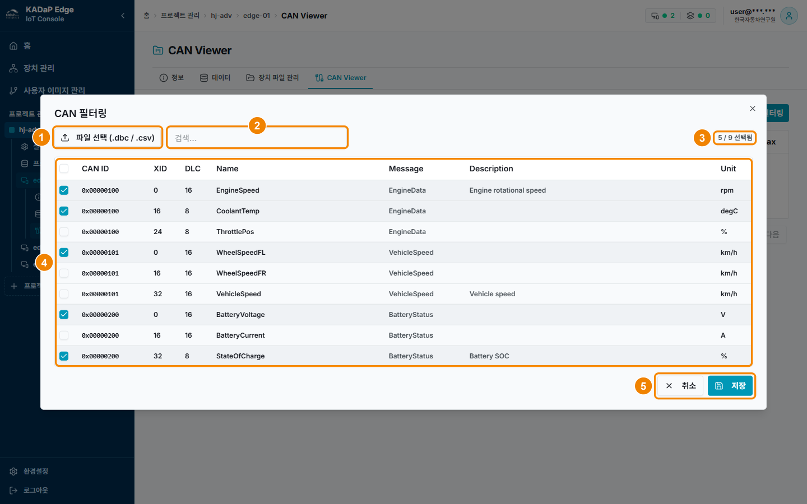

| 번호 | 항목 | 설명 |
|---|---|---|
| 1 | 파일 선택 (.dbc / .csv) | 신호 정의 파일을 업로드합니다. |
| 2 | 검색 | 신호 이름으로 검색할 수 있습니다. |
| 3 | N / M 선택됨 | 선택한 신호 수와 전체 신호 수를 표시합니다. |
| 4 | 신호 표 | 머리글의 선택 칸을 클릭하면 모든 신호가 선택됩니다. 행이나 행의 선택 칸을 클릭하면 그 신호를 선택하거나 선택을 해제합니다. |
| 5 | 취소 · 저장 | 파일을 불러온 뒤 신호를 1개 이상 선택하면 **저장**이 활성화됩니다. |

### 수집 신호 선택하기

수집할 신호를 선택하려면 다음 순서대로 진행하세요.

1. CAN Viewer에서 **CAN 필터링**을 클릭하세요.
   - CAN 필터링 창이 표시됩니다.
2. **파일 선택**을 클릭해 수집할 차량의 DBC 파일이나 CSV 파일을 업로드하세요.
   - **파일**: 수집할 차량의 신호 정의 파일을 업로드합니다. 그림은 메시지 3개와 신호 9개가 정의된 DBC 파일을 불러온 예입니다. (예: `vehicle.dbc`)
3. 수집할 신호를 선택하세요.
   - **선택 신호**: 수집할 신호만 선택합니다. (예: `EngineSpeed`, `CoolantTemp`, `WheelSpeedFL`, `BatteryVoltage`, `StateOfCharge` → `5 / 9 선택됨`)
4. **저장**을 클릭하세요.
   - 선택한 신호가 장치의 CAN DB 파일(`generated.dbc`, `generated.csv`)로 저장됩니다. 이 파일은 **수집 - 차량 데이터** 타입 모듈의 `/app/config/*`에 마운트됩니다.
5. CAN Viewer 목록 위쪽에 선택한 신호가 표시되는지 확인하세요.

> **참고 -** 신호를 바꾼 뒤에는 **수집 - 차량 데이터** 모듈을 다시 배포해야 바뀐 신호가 반영됩니다.

# 06-03-16 사용자 이미지 관리

사용자 이미지 관리 화면에서 레지스트리에 있는 수집 모듈과 가공 모듈의 컨테이너 이미지를 등록할 수 있습니다. 기본 모듈 목록에 없는 이미지를 여기에 등록합니다. (예: 전처리 모듈 `preproc-can`, AAS 연동 모듈 `mqtt-client` · `faaast`) 등록한 이미지는 K8s 배포 이미지 등록 창에서 타입을 **사용자 등록 이미지**로 선택한 뒤 레지스트리 이미지 (Repository)에서 선택합니다.

### 화면 구성

사용자 이미지 관리 화면은 다음과 같이 구성됩니다.

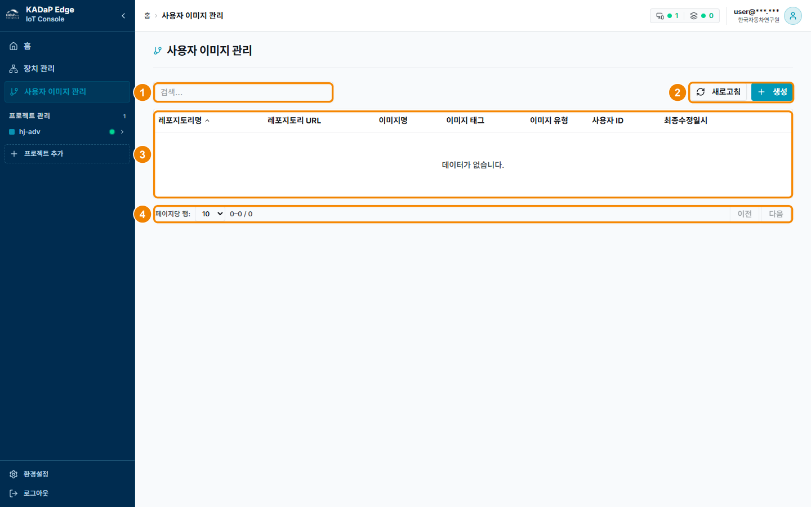

| 번호 | 항목 | 설명 |
|---|---|---|
| 1 | 검색 | 이미지 목록에서 이미지를 검색할 수 있습니다. |
| 2 | 새로고침 · 생성 | **새로고침**을 클릭하면 목록을 새로 불러옵니다. **생성**을 클릭하면 이미지 추가 창이 열립니다. |
| 3 | 이미지 목록 | 레포지토리명, 레포지토리 URL, 이미지명, 이미지 태그, 이미지 유형, 사용자 ID, 최종수정일시를 표시합니다. |
| 4 | 페이지 이동 | 페이지당 행 수를 바꾸거나 **이전**, **다음**을 클릭해 페이지를 이동할 수 있습니다. |

### 이미지 등록하기

이미지를 등록하려면 다음 순서대로 진행하세요.

1. 왼쪽 메뉴에서 **사용자 이미지 관리**를 클릭하세요.
2. 배포할 이미지가 레지스트리에 있는지 확인하세요. ('06-03-17 레지스트리 확인하기' 참고)
3. **생성**을 클릭해 이미지를 등록하세요. ('06-03-18 이미지 추가하기' 참고)

# 06-03-17 레지스트리 확인하기

KADaP 컨테이너 레지스트리(Harbor)에서 장치에 배포할 이미지의 프로젝트, 리포지토리, 태그를 확인할 수 있습니다.

### 화면 구성

레지스트리(Harbor) 프로젝트 화면은 다음과 같이 구성됩니다.

| 번호 | 항목 | 설명 |
|---|---|---|
| 1 | 프로젝트 이름 · 내 역할 | 프로젝트 이름과 로그인한 사용자의 역할(Project Admin 등)을 표시합니다. 프로젝트는 이미지를 묶는 단위입니다. |
| 2 | Access Level · Quota used | 접근 수준과 사용 용량을 표시합니다. Public이면 장치가 계정 없이 이미지를 내려받을(pull) 수 있습니다. |
| 3 | 탭 | Summary, Repositories, Members, Labels, Scanner, P2P Preheat, Policy, Robot Accounts, Webhooks, Logs, Configuration 탭이 있습니다. |
| 4 | DELETE · PUSH COMMAND · 검색 · 보기 전환 · 새로고침 | 선택한 리포지토리를 삭제하거나 푸시 명령을 복사할 수 있습니다. 목록을 검색하거나 보기 방식을 바꿀 수도 있습니다. |
| 5 | 리포지토리 목록 | Name, Artifacts, Pulls, Last Modified Time을 표시합니다. Name은 프로젝트/이미지 형식이고, Artifacts는 태그 수입니다. |

### 이미지 주소 확인하기

배포할 이미지의 주소를 확인하려면 다음 순서대로 진행하세요.

1. `https://harbor.bigdata-car.kr`에 접속해 **LOGIN WITH 자동차포털**을 클릭하고 포털 계정으로 로그인하세요.
2. **Projects**에서 이미지가 들어 있는 프로젝트를 클릭하세요. (예: `quantumsurf`)
3. **Repositories** 탭에서 배포할 이미지 이름을 확인하세요.
4. 리포지토리를 클릭하고 **Artifacts** 탭에서 태그를 확인하세요.
5. **COPY PULL COMMAND**를 클릭해 이미지 주소를 복사하세요.

복사한 주소는 '06-03-18 이미지 추가하기'의 Repository URL, Image Name, Image Tag에 나누어 입력합니다. 각 값은 다음과 같습니다.

- **레지스트리 주소**: Repository URL에 입력합니다. (예: `harbor.bigdata-car.kr`)
- **프로젝트**: 이미지가 들어 있는 Harbor 프로젝트입니다. 퀀텀서프가 공개한 모듈 이미지는 `quantumsurf` 프로젝트에 있습니다.
- **이미지 이름과 태그**: Image Name과 Image Tag에 입력합니다. `quantumsurf` 프로젝트에는 `collect-mqtt`, `preproc-can`, `mqtt-client`, `faaast` 같은 모듈 이미지가 있습니다. (예: `quantumsurf/preproc-can`, `0.1.0`)
- **계정**: `quantumsurf`는 공개 프로젝트이므로 이미지를 내려받을 때 계정이 필요 없습니다. '06-03-18 이미지 추가하기'의 User ID와 Secret Key는 비워 둡니다.

# 06-03-18 이미지 추가하기

이미지 추가 창에서 장치에 배포할 이미지의 레지스트리 주소, 이름, 태그, 인증 정보를 등록할 수 있습니다.

### 화면 구성

이미지 추가 창은 다음과 같이 구성됩니다.

| 번호 | 항목 | 설명 |
|---|---|---|
| 1 | 이름 | 목록에 표시할 리포지토리명을 입력합니다. 64자까지 입력할 수 있습니다. |
| 2 | Repository URL · Image Tag | 레지스트리 주소와 태그를 입력합니다. 기본값은 각각 `docker.io`와 `latest`입니다. |
| 3 | Image Name · 이미지 유형 | 레지스트리 안의 이미지 경로를 입력합니다. 이미지 유형은 수집과 가공 중에서 선택합니다. |
| 4 | User ID · Secret Key | 비공개 레지스트리를 쓸 때 인증 정보를 입력합니다. Secret Key는 가려서 표시됩니다. |
| 5 | 취소 · 생성 | **생성**을 클릭하면 이미지가 등록됩니다. |

### 이미지 추가하기

이미지를 추가하려면 다음 순서대로 진행하세요.

1. 사용자 이미지 관리에서 **생성**을 클릭하세요.
   - 이미지 추가 창이 표시됩니다.
2. 기본값(`docker.io`, `latest`)을 지우고 배포할 이미지 정보를 입력하세요.
   - **이름**: 목록에서 구분할 이름을 입력합니다. (예: `preproc-can`)
   - **Repository URL**: KADaP 컨테이너 레지스트리(Harbor)의 주소를 입력합니다. (예: `harbor.bigdata-car.kr`)
   - **Image Name과 Image Tag**: 전처리 이미지의 경로와 버전을 입력합니다. (예: `quantumsurf/preproc-can`, `0.1.0`)
   - **이미지 유형**: 전처리 이미지는 가공을 선택합니다.
   - **User ID와 Secret Key**: `quantumsurf`는 공개 프로젝트이므로 비워 둡니다.
3. **생성**을 클릭하세요.

> **참고 -** 비공개 프로젝트의 이미지는 User ID와 Secret Key에 Harbor 로봇 계정의 이름과 시크릿을 입력합니다.

# 06-03-19 프로젝트 설정

프로젝트 설정 화면에서 프로젝트 정보와 장치 위치, 프로젝트에 연결한 장치 목록을 확인할 수 있습니다.

### 화면 구성

프로젝트 설정 화면은 다음과 같이 구성됩니다.

| 번호 | 항목 | 설명 |
|---|---|---|
| 1 | 프로젝트 트리 | 왼쪽 프로젝트 관리에서 프로젝트를 펼치면 설정, 프로젝트 파일 관리, 연결한 장치로 이동할 수 있습니다. |
| 2 | 프로젝트 정보 | 이름, 설명, 비고, 컬러, UUID를 표시합니다. |
| 3 | 더 보기(⋯) | 프로젝트를 수정하거나 삭제할 수 있습니다. 삭제한 프로젝트는 복구할 수 없습니다. |
| 4 | 장치 위치 현황 | 프로젝트에 연결한 장치의 위치를 지도에 표시합니다. 장치 목록에서 행을 클릭하면 지도가 그 장치의 위치로 이동합니다. |
| 5 | 새로고침 · 장치 추가 | **새로고침**을 클릭하면 목록을 새로 불러옵니다. **장치 추가**를 클릭하면 프로젝트에 장치를 연결하는 창이 열립니다('06-03-20 프로젝트 장치 추가하기' 참고). |
| 6 | 프로젝트 장치 목록 | 장치명(IP), 수집대상, 데이터 처리 유형, 배포갯수를 표시합니다. |
| 7 | 설정 · 삭제 | 톱니바퀴 아이콘을 클릭하면 장치 설정 화면으로 이동합니다. 휴지통 아이콘을 클릭하면 장치와 프로젝트의 연결이 해제됩니다. |

### 프로젝트 정보 확인하기

프로젝트 정보를 확인하려면 다음 순서대로 진행하세요.

1. 왼쪽 **프로젝트 관리**에서 프로젝트를 펼치고 **설정**을 클릭하세요.
   - 프로젝트 설정 화면이 표시됩니다.
2. 프로젝트 정보와 프로젝트 장치 목록을 확인하세요.
3. 장치 행의 톱니바퀴 아이콘을 클릭해 장치 설정 화면으로 이동하세요.

# 06-03-20 프로젝트 장치 추가하기

프로젝트 설정 화면의 장치 추가 창에서 장치 관리에 등록한 장치를 프로젝트에 연결할 수 있습니다.

### 화면 구성

프로젝트 설정 화면의 장치 추가 창은 다음과 같이 구성됩니다.

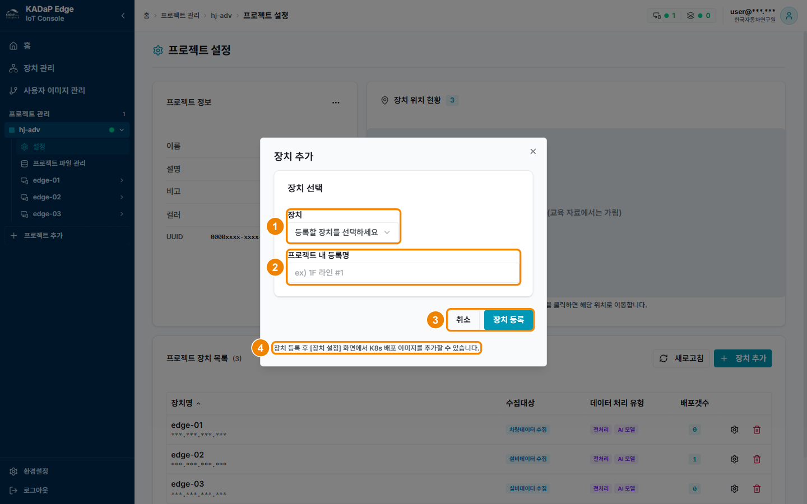

| 번호 | 항목 | 설명 |
|---|---|---|
| 1 | 장치 | 등록된 장치 중에서 선택합니다. |
| 2 | 프로젝트 내 등록명 | 프로젝트에 장치를 연결할 때 저장하는 이름입니다. 장치를 선택하면 장치명이 자동으로 입력됩니다. |
| 3 | 취소 · 장치 등록 | **장치 등록**을 클릭하면 장치가 프로젝트에 연결됩니다. |
| 4 | 안내 | 장치를 등록한 뒤 장치 설정 화면에서 K8s 배포 이미지를 추가하라는 안내를 표시합니다. |

### 프로젝트에 장치 연결하기

프로젝트에 장치를 연결하려면 다음 순서대로 진행하세요.

1. 프로젝트 설정 화면의 **프로젝트 장치 목록**에서 **장치 추가**를 클릭하세요.
   - 장치 추가 창이 표시됩니다.
2. **장치**에서 연결할 장치를 선택하세요.
   - **장치**: 장치 관리에 등록한 장치를 선택합니다. (예: `edge-01`)
   - **프로젝트 내 등록명**에 장치명이 자동으로 입력됩니다.
3. **프로젝트 내 등록명**은 그대로 두고 **장치 등록**을 클릭하세요.
   - **프로젝트 내 등록명**: 자동으로 입력된 장치명을 그대로 사용합니다. 프로젝트 트리와 프로젝트 장치 목록에는 이 이름이 아니라 장치 관리의 장치명이 표시됩니다. (예: `edge-01`)
4. 프로젝트 장치 목록과 왼쪽 프로젝트 트리에 장치가 표시되는지 확인하세요.

# 06-03-21 프로젝트 파일 관리

프로젝트 파일 관리 화면에서 KADaP-X IoT 서버에 있는 프로젝트 폴더를 확인할 수 있습니다. RSYNC로 동기화된 장치별 출력 파일도 이 화면에서 확인합니다.

### 화면 구성

프로젝트 파일 관리 화면은 다음과 같이 구성됩니다.

| 번호 | 항목 | 설명 |
|---|---|---|
| 1 | 프로젝트 파일 관리 | 왼쪽 프로젝트 트리에서 프로젝트를 펼치면 표시되는 메뉴입니다. |
| 2 | 경로 | 현재 폴더의 경로를 표시합니다. 맨 위 폴더는 root입니다. |
| 3 | 검색 · 날짜 · 파일 형식 | 이름으로 검색하고, 수정 날짜와 파일 형식으로 필터링할 수 있습니다. |
| 4 | 새로고침 | 폴더 목록과 파일 목록을 새로 불러옵니다. |
| 5 | 폴더 | 폴더 목록을 표시합니다. 추가(+)를 클릭하면 폴더를 만들 수 있습니다. |
| 6 | 파일 | 파일 목록을 표시하며, 추가(+)를 클릭해 파일을 업로드할 수 있습니다. 파일의 더 보기(⋮)에서 파일을 다운로드하거나 삭제할 수 있습니다. |

### 동기화 파일 확인하기

RSYNC로 동기화된 파일을 확인하려면 다음 순서대로 진행하세요.

1. 왼쪽 **프로젝트 관리**에서 프로젝트를 펼치고 **프로젝트 파일 관리**를 클릭하세요.
2. RSYNC 동기화를 설정한 장치의 폴더를 열고 출력 파일이 업로드되었는지 확인하세요.

# 06-03-22 프로젝트 추가하기

프로젝트 추가 창에서 새 프로젝트를 만들 수 있습니다. 프로젝트는 장치를 묶어 배포와 파일을 관리하는 단위입니다.

### 화면 구성

프로젝트 추가 창은 다음과 같이 구성됩니다.

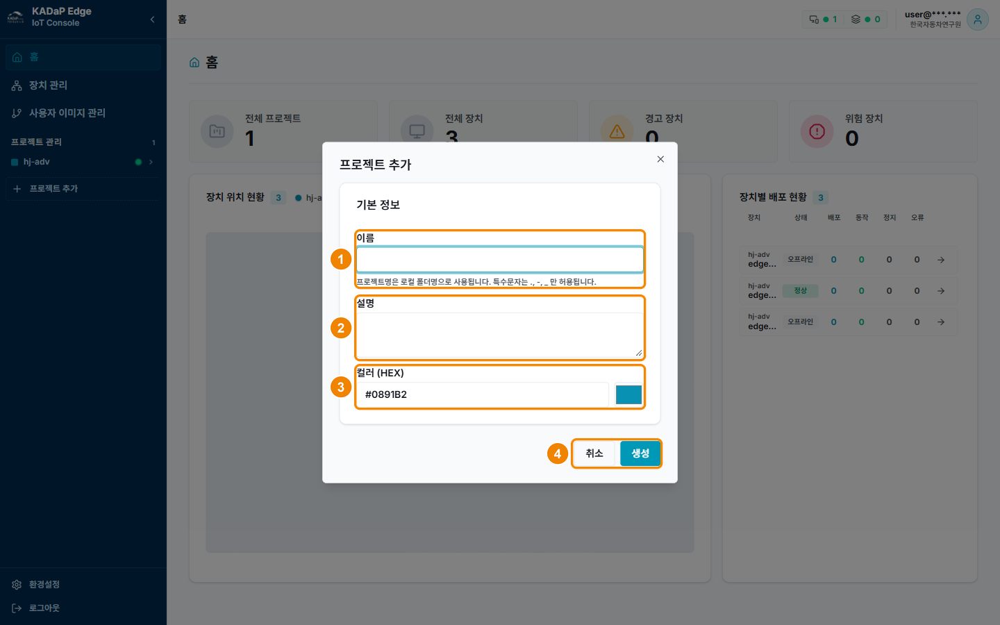

| 번호 | 항목 | 설명 |
|---|---|---|
| 1 | 이름 | 프로젝트 이름을 입력합니다. 필수 항목이며, 안내 문구 "프로젝트명은 로컬 폴더명으로 사용됩니다. 특수문자는 ., -, _ 만 허용됩니다."가 표시됩니다. |
| 2 | 설명 | 프로젝트 설명을 입력합니다. 선택 항목이며 255자까지 입력할 수 있습니다. |
| 3 | 컬러 (HEX) | HEX 값을 입력하거나 색상 선택기에서 색을 선택합니다. 선택한 색은 지도 마커와 프로젝트 트리의 프로젝트 표시에 사용됩니다. |
| 4 | 취소 · 생성 | **생성**을 클릭하면 프로젝트가 만들어집니다. |

### 프로젝트 추가하기

프로젝트를 추가하려면 다음 순서대로 진행하세요.

1. 왼쪽 메뉴에서 **프로젝트 추가**를 클릭하세요.
   - 프로젝트 추가 창이 표시됩니다.
2. 이름, 설명, 컬러를 입력하세요.
   - **이름**: 한글, 영문, 숫자, 공백과 `. - _`를 사용해 64자까지 입력합니다. (예: `edge-project`)
   - **설명**: 프로젝트 용도를 입력합니다. (예: `설비 센서 데이터 수집`)
   - **컬러 (HEX)**: `#RRGGBB` 형식으로 입력합니다. 기본값은 `#0891B2`입니다.
3. **생성**을 클릭하세요.
   - 왼쪽 **프로젝트 관리** 아래에 프로젝트가 표시됩니다.

이어서 프로젝트의 **설정**에서 장치를 연결하세요. 자세한 내용은 '06-03-20 프로젝트 장치 추가하기'를 참고하세요.

# 06-03-23 환경설정

환경설정 창에서 화면 테마와 레이아웃을 바꾸고 버전 정보를 확인할 수 있습니다.

### 화면 구성

환경설정 창은 다음과 같이 구성됩니다.

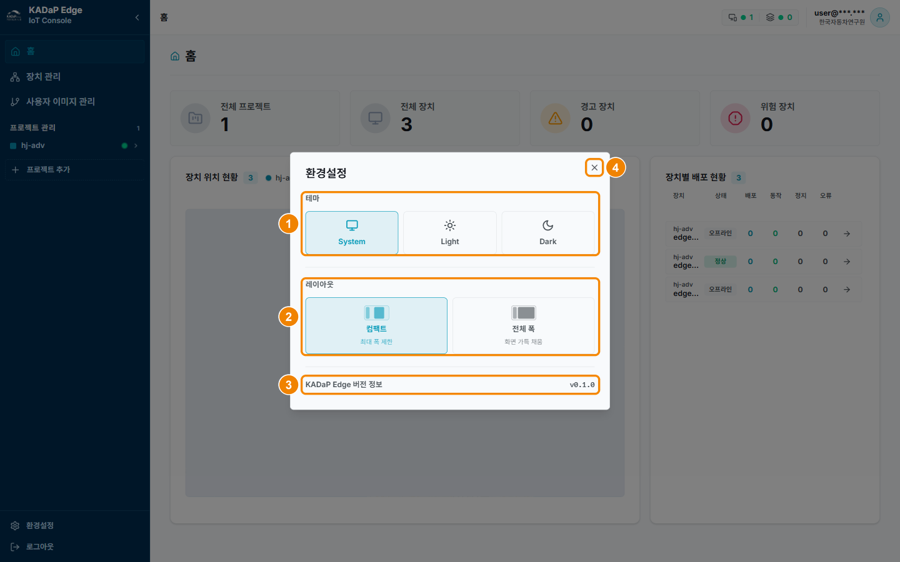

| 번호 | 항목 | 설명 |
|---|---|---|
| 1 | 테마 | System, Light, Dark 중에서 선택합니다. |
| 2 | 레이아웃 | 컴팩트와 전체 폭 중에서 선택합니다. 컴팩트는 콘텐츠의 최대 폭을 제한하고, 전체 폭은 화면을 가득 채웁니다. |
| 3 | KADaP Edge 버전 정보 | 현재 버전을 표시합니다. |
| 4 | 닫기(X) | 창을 닫습니다. 설정은 선택하는 즉시 적용되므로 따로 저장하지 않아도 됩니다. |

### 화면 설정 바꾸기

화면 설정을 바꾸려면 다음 순서대로 진행하세요.

1. 왼쪽 메뉴 아래쪽의 **환경설정**을 클릭하세요.
   - 환경설정 창이 표시됩니다.
2. 원하는 테마와 레이아웃을 선택하세요.
   - 설정이 바로 적용됩니다.
3. **X**를 클릭해 창을 닫으세요.

환경설정의 저장 위치와 버전은 다음과 같습니다.

- **저장 위치**: 설정은 사용 중인 브라우저에 저장되므로 다른 PC나 다른 브라우저에는 적용되지 않습니다.
- **버전**: 이 문서를 작성할 때의 버전입니다. (예: `v0.1.0`)

# 06-03-24 RSYNC 동기화 설정하기

장치 편집 창에서 RSYNC 동기화를 설정할 수 있습니다. RSYNC 동기화를 설정하면 출력 선택을 RSYNC로 지정한 가공 모듈의 출력 폴더가 rsync 서버로 주기적으로 동기화됩니다.

### 화면 구성

RSYNC 동기화 설정 화면은 다음과 같이 구성됩니다.

| 번호 | 항목 | 설명 |
|---|---|---|
| 1 | 동기화 방식 | RSYNC와 S3 중에서 선택합니다. |
| 2 | 동기화 주기 (시간) | 동기화를 반복할 주기를 시간 단위로 입력합니다. |

### RSYNC 동기화 설정하기

RSYNC 동기화를 설정하려면 다음 순서대로 진행하세요.

1. 장치 관리에서 장치 행의 **연필**을 클릭하세요.
   - 장치 편집 창이 표시됩니다.
2. **부가설정**에서 **동기화**를 선택하세요.
   - 동기화 정보가 표시됩니다.
3. 동기화 방식에서 **RSYNC**를 선택하고 동기화 주기를 입력하세요.
   - **동기화 주기**: 동기화를 반복할 주기를 시간 단위로 입력합니다. (예: `1`(1시간))
   - **rsync 대상 서버**: 화면에서 입력하지 않습니다. 운영 기관이 서버에서 설정합니다.
4. **저장**을 클릭하세요.
5. 가공 모듈의 K8s 배포 이미지 등록 창에서 **출력 선택**에 **RSYNC**가 표시되는지 확인하세요.

동기화된 파일은 '06-03-21 프로젝트 파일 관리'에서 확인합니다.

> **참고 -** 동기화 설정은 모듈을 배포할 때 적용됩니다. 장치 편집에서 주기를 바꿨다면 모듈을 다시 배포하세요.

# 06-03-25 S3 동기화 설정하기

장치 추가 창이나 장치 편집 창에서 S3 동기화를 설정할 수 있습니다. S3 동기화를 설정하면 출력 선택을 S3로 지정한 가공 모듈의 출력 폴더가 S3 버킷으로 주기적으로 동기화됩니다.

### 화면 구성

S3 동기화 설정 화면은 다음과 같이 구성됩니다.

| 번호 | 항목 | 설명 |
|---|---|---|
| 1 | 동기화 방식 · 동기화 주기 (시간) | 동기화 방식에서 S3를 선택하고, 주기를 시간 단위로 입력합니다. 그림은 RSYNC와 S3를 모두 선택한 예입니다. |
| 2 | S3 URL | S3 API 주소를 입력합니다. |
| 3 | S3 버킷명 · S3 경로 | 버킷 이름과 버킷 안의 경로를 입력합니다. |
| 4 | S3 ACCESS KEY · S3 SECRET KEY | S3 접근 키를 입력합니다. 저장된 키는 가려서 표시됩니다. |

### S3 동기화 설정하기

S3 동기화를 설정하려면 다음 순서대로 진행하세요.

1. 장치 추가 창이나 장치 편집 창의 **부가설정**에서 **동기화**를 선택하세요.
   - 동기화 정보가 표시됩니다.
2. 동기화 방식에서 **S3**를 선택하세요.
   - S3 정보가 표시됩니다.
3. 동기화 주기와 S3 정보를 입력하세요.
   - **동기화 주기**: 출력 파일을 버킷에 업로드하는 간격을 시간 단위로 입력합니다. (예: `1`(1시간))
   - **S3 URL**: 한국자동차연구원 스토리지의 S3 API 주소를 입력합니다. 스토리지 콘솔 주소와 다르며, HTTP 8085 포트를 사용합니다. (예: `http://storage-api.bigdata-car.kr:8085`)
   - **S3 버킷명과 S3 경로**: 파일을 업로드할 버킷과 버킷 안의 폴더를 입력합니다. 여러 장치가 한 버킷을 함께 쓰면 장치마다 폴더를 다르게 지정합니다. (예: `<버킷명>`, `<이름>/`)
   - **S3 ACCESS KEY와 SECRET KEY**: 스토리지 콘솔의 **Access Keys** 메뉴에서 발급한 키를 입력합니다. 키를 직접 발급할 수 없다면 운영 기관에 요청합니다.
4. 장치 추가 창에서는 **생성**을, 장치 편집 창에서는 **저장**을 클릭하세요.
5. 가공 모듈을 등록할 때 **출력 선택**을 **S3**로 지정하고 배포하세요. ('06-03-10 배포 추가하기(가공 - 전처리)' 참고)
   - 동기화 주기가 지나면 버킷의 지정한 경로에 출력 파일이 업로드됩니다.

동기화된 파일은 스토리지 콘솔에서 확인합니다. 자세한 내용은 '06-03-26 버킷 확인하기'를 참고하세요.

> **참고 -** 동기화 설정은 모듈을 **배포**할 때의 S3 정보와 동기화 주기로 적용됩니다. 장치 편집에서 S3 정보나 주기를 바꿨다면 휴지통을 클릭해 모듈을 미배포 상태로 되돌린 뒤 다시 **배포**하세요. **정지**와 **시작**만으로는 바뀐 값이 반영되지 않습니다.

> **주의 -** 액세스 키는 해당 버킷에만 접근할 수 있는 최소 권한으로 발급하고, 유출되면 바로 다시 발급하세요. 동기화는 버킷을 출력 폴더와 같게 맞추므로, 장치에서 파일을 지우면 버킷의 파일도 지워지는지 먼저 확인하세요.

# 06-03-26 버킷 확인하기

스토리지 콘솔의 버킷 화면에서 장치가 동기화한 파일이 KADaP 오브젝트 스토리지의 버킷에 업로드되었는지 확인할 수 있습니다.

### 화면 구성

버킷 화면은 다음과 같이 구성됩니다.

| 번호 | 항목 | 설명 |
|---|---|---|
| 1 | 경로(Hot Bucket Browser / 버킷) | 현재 위치를 표시합니다. 클릭하면 버킷 목록으로 돌아갑니다. |
| 2 | 오브젝트 필터링 · 새로고침 · Upload File · Upload Folder · Large File Upload | 이름으로 오브젝트를 검색하거나, 목록을 새로 불러오거나, 파일과 폴더를 업로드할 수 있습니다. |
| 3 | 버킷 정보 | 생성일, 크기, 객체 수를 표시합니다. |
| 4 | Copy Path · Create Folder | 현재 경로를 복사하거나 폴더를 만들 수 있습니다. |
| 5 | 폴더 · 파일 목록 | Name, Last Modified, Size를 표시합니다. 각 항목을 선택할 수 있습니다. |

### 동기화 결과 확인하기

버킷에서 동기화 결과를 확인하려면 다음 순서대로 진행하세요.

1. `https://storage.bigdata-car.kr`에 접속하세요.
   - 포털 계정으로 자동 로그인됩니다.
2. **Hot Bucket Browser**에서 S3 동기화에 지정한 버킷을 클릭하세요.
3. S3 경로로 지정한 폴더를 열고 동기화된 파일이 있는지 확인하세요.
4. **Last Modified**가 동기화 주기마다 바뀌는지 확인하세요.

버킷 확인에 쓰는 주소와 값은 다음과 같습니다.

- **콘솔 주소**: 스토리지 콘솔의 버킷 화면 주소입니다. (예: `https://storage.bigdata-car.kr/buckets`)
- **S3 URL**: 장치의 S3 URL에 입력하는 API 주소이며, 콘솔 주소와 다릅니다. (예: `http://storage-api.bigdata-car.kr:8085`)
- **버킷과 경로**: 장치의 S3 버킷명과 S3 경로에 입력한 값입니다. (예: `<버킷명>`, `<이름>/`)
- **액세스 키**: 스토리지 콘솔의 **Access Keys** 메뉴에서 발급한 키입니다. 장치의 S3 ACCESS KEY와 SECRET KEY에 입력합니다.

> **주의 -** 여러 사용자나 장치가 함께 쓰는 버킷에서는 다른 사람의 폴더에 있는 파일을 지우지 마세요. 동기화 결과만 확인할 때는 **Create Bucket**이나 **Delete**를 클릭할 필요가 없습니다.

# 06-03-27 문제 해결하기

KADaP-X IoT를 사용하는 중에 문제가 생기면 아래 표에서 증상을 찾아 조치하세요.

| 단계 | 증상 | 조치 |
|---|---|---|
| 장치 추가 | 연결 테스트 실패(K8S) | kubeconfig의 `server:` 주소와 K8S PORT(6443)를 확인하세요. KADaP-X IoT 서버에서 장치의 6443 포트에 접속할 수 있는지도 확인하세요. |
| 장치 추가 | 연결 테스트 실패(SFTP) | 장치의 SSH 서버가 실행 중인지, 계정과 비밀번호, SFTP PORT(22)가 맞는지 확인하세요. |
| 장치 관리 | 상태가 계속 "-" | 30초 뒤 **새로고침**을 클릭하세요. 그래도 같으면 장치에서 `sudo k3s kubectl get nodes`를 실행해 k3s가 동작하는지 확인하세요. |
| 장치 설정 | CAN Viewer 탭이 표시되지 않음 | 장치 편집에서 수집대상 **차량데이터 수집**이 선택되어 있는지 확인하세요. |
| 배포 추가 | 타입 목록에 원하는 타입이 없음 | 장치 편집에서 수집대상과 데이터 처리 유형에 필요한 항목이 선택되어 있는지 확인하세요. |
| 배포 | 대기 상태가 계속되거나 ErrImagePull 표시 | Image와 Tag에 오타가 없는지, 레지스트리 프로젝트가 공개되어 있는지 확인하세요. 비공개 프로젝트라면 사용자 이미지의 User ID와 Secret Key를 확인하세요. |
| 배포 | 실행중인데 출력 파일이 생기지 않음 | Pod 로그에 브로커 연결 오류가 있으면 환경변수(`MQTT_*`)를 확인하세요. 차량 데이터 수집 모듈이라면 CAN 인터페이스 이름이 `ip link` 결과와 같은지 확인하세요. |
| 배포 | 잘못된 값으로 배포한 경우 | 휴지통을 클릭해 미배포 상태로 되돌린 뒤 배포설정을 수정하고 다시 배포하세요. 이미지와 필수 설정값을 바꾸려면 모듈을 삭제하고 다시 등록하세요. |
| 파일 관리 | "장치 접근에 실패했습니다" | 장치 부가설정에서 SFTP가 선택되어 있는지, 장치가 온라인인지 확인한 뒤 **새로고침**을 클릭하세요. |
| CAN Viewer | 신호가 표시되지 않고 원시 프레임만 저장됨(수집 - 차량 데이터) | CAN 필터링에서 DBC 파일을 업로드하고 신호를 선택한 뒤 차량 데이터 수집 모듈을 다시 배포하세요. **수집 - 설비 데이터** 타입의 `collect-mqtt`는 원시 프레임을 저장하는 것이 정상이며, 신호는 전처리 모듈이 해석합니다. |
| 동기화 | 동기화 대상에 파일이 생기지 않음 | 동기화 주기가 지났는지, 가공 모듈의 출력 선택과 S3 키, 버킷, 경로가 맞는지 확인하세요. 장치의 동기화 값을 바꿨다면 해당 모듈을 다시 배포했는지도 확인하세요. |
| 상태정보 | No data | Telegraf가 설치되어 있는지, `--telegraf-hostname`으로 지정한 host 태그가 장치명과 같은지 확인하세요. |
| 프로젝트 | 프로젝트가 삭제되지 않거나 장치가 제거되지 않음 | 장치의 배포를 모두 삭제하고, 프로젝트에서 장치를 제거한 뒤 프로젝트를 삭제하세요. |
