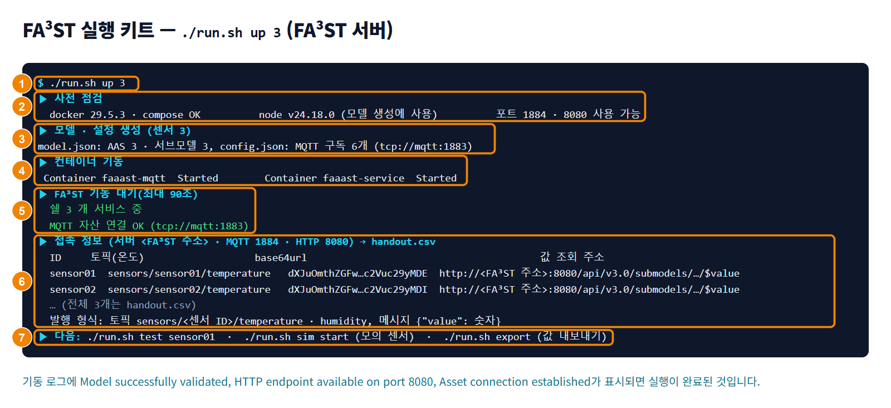

## FA³ST 실행하기

서버에서 FA³ST 실행 키트를 사용해 FA³ST Service와 MQTT 브로커를 Docker 컨테이너로 실행합니다. 모델 파일과 설정 파일 생성부터 기동 확인까지 명령 하나로 진행됩니다.

### 화면 구성

FA³ST 실행 키트 `run.sh`의 출력 화면은 다음과 같이 구성됩니다.

| 번호 | 항목 | 설명 |
|---|---|---|
| 1 | `./run.sh up 3` | 실행 키트 폴더에서 실행하는 명령입니다. 숫자는 만들 센서 수입니다. |
| 2 | 사전 점검 | Docker, Docker Compose, Node.js 버전을 확인합니다. MQTT 포트 `MQTT_PORT`와 HTTP 포트 `FAAAST_PORT`를 쓸 수 있는지도 점검합니다. |
| 3 | 모델 · 설정 생성 | 센서 수만큼 쉘과 서브모델을 담은 `model.json`과 센서마다 MQTT 구독 2개를 담은 `config.json`을 만듭니다. 자산 연결의 브로커 주소는 `tcp://mqtt:1883`입니다. |
| 4 | 컨테이너 기동 | `faaast-mqtt`와 `faaast-service` 컨테이너를 실행합니다. 실행되면 컨테이너마다 Started가 표시됩니다. |
| 5 | FA³ST 기동 대기 | FA³ST가 기동될 때까지 기다립니다. 기동되면 서비스 중인 쉘 수와 MQTT 자산 연결 결과(OK)를 표시합니다. |
| 6 | 접속 정보 → handout.csv | 센서별 ID, 토픽, base64url, 값 조회 주소와 발행 형식을 표시하고, 전체 목록을 `handout.csv`에 저장합니다. |
| 7 | 다음 | 이어서 쓸 명령을 안내합니다. `./run.sh test`는 값을 발행해 프로퍼티에 반영되는지 확인하고, `sim start`는 모의 센서를 켜고, `export`는 모든 센서의 현재 값을 JSON으로 저장합니다. |

### FA³ST 실행하기

FA³ST를 실행하려면 다음 순서대로 진행하세요.

1. 실행 키트 폴더에서 `./run.sh up <센서 수>`를 실행하세요.
   - 모델 파일과 설정 파일 생성, 컨테이너 실행, 기동 확인, 접속 정보 출력이 차례로 진행됩니다.
   - 센서 ID는 일련번호로 만들어지며, 센서별 ID와 값 조회 주소는 `handout.csv`에 저장됩니다.
2. `docker logs -f faaast-service`를 실행해 기동 로그를 확인하세요.
   - **Model successfully validated** → **Starting FA³ST Service...** → **HTTP endpoint available on port 8080** → **Asset connection established (endpoint: tcp://mqtt:1883)** 순서로 표시됩니다. 마지막 메시지가 표시되기까지 10~20초가 걸립니다.
   - SSL을 끈 설정에서는 **Using HTTP endpoint with disabled SSL. Not safe for production** 경고도 표시됩니다. 운영 환경에서는 `sslEnabled`를 켜세요. ('06-04-05 설정 파일 이해하기' 참고)
3. 브라우저에서 `http://<FA³ST 주소>:8080/api/v3.0/shells`를 여세요.
   - 쉘 목록 JSON이 표시됩니다.

실행 키트와 컨테이너 설정은 다음과 같습니다.

| 항목 | 설명 | 예 |
|---|---|---|
| 실행 키트 | 운영 기관이 제공하는 파일 묶음으로, 서버에 압축을 풀어 사용합니다. 서버에 Docker와 Docker Compose가 설치되어 있어야 합니다. Node.js가 없으면 모델 파일 생성에 Node.js 컨테이너를 대신 사용합니다. | `run.sh`, `gen.mjs`, `docker-compose.yml`, `mosquitto.conf`, `sim.sh`, `test.sh` |
| Docker 이미지 | 안정 버전 태그 `1.3`을 사용합니다. `latest` 태그는 최신 릴리스를 가리킵니다. | `fraunhoferiosb/faaast-service:1.3` |
| 마운트 | 모델 파일과 설정 파일을 컨테이너 안에 마운트하는 경로입니다. | `/app/resources/model.json`, `/app/resources/config.json` |
| 환경변수 | 모델 파일 경로, 설정 파일 경로, 로그 수준을 지정합니다. | `faaast_model`, `faaast_config`, `faaast_loglevel_faaast=INFO` |
| 포트 | HTTP API 포트와 MQTT 브로커 포트입니다. 서버에서 쓰는 포트는 실행 키트 `.env`의 `FAAAST_PORT`와 `MQTT_PORT`로 바꿀 수 있습니다. | HTTP 8080, MQTT 1884(컨테이너 안에서는 1883) |

> **주의 -** 설정 파일을 고친 뒤에는 컨테이너를 다시 만들어야 변경 내용이 반영됩니다. `docker compose up -d --force-recreate faaast` 또는 `./run.sh reset`을 실행하세요.
