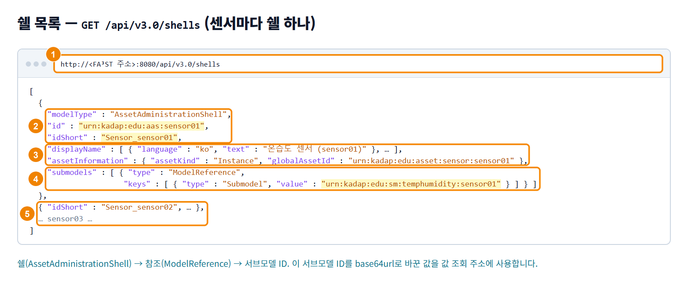

## AAS API로 값 조회하기

FA³ST Service의 HTTP 엔드포인트가 제공하는 AAS v3 API로 쉘, 서브모델, 값을 조회합니다. 이 API는 AAS 규격 Part 2에 정해진 표준 API입니다.

### 화면 구성

쉘 목록 조회 화면은 다음과 같이 구성됩니다.

| 번호 | 항목 | 설명 |
|---|---|---|
| 1 | 주소창 | 쉘 목록 조회 주소 `http://<FA³ST 주소>:8080/api/v3.0/shells`입니다. |
| 2 | `modelType` · `id` · `idShort` | 모델 종류 `AssetAdministrationShell`, 쉘 ID `urn:kadap:edu:aas:<센서 ID>`, 짧은 이름 `Sensor_<센서 ID>`가 표시됩니다. |
| 3 | `displayName` · `assetInformation` | 표시 이름과 자산 정보입니다. 자산 정보에는 자산 종류 Instance와 `globalAssetId`가 들어 있습니다. |
| 4 | `submodels` | 쉘에 연결된 서브모델입니다. ModelReference로 서브모델 ID `urn:kadap:edu:sm:temphumidity:<센서 ID>`를 참조합니다. |
| 5 | 나머지 쉘 | 센서마다 쉘이 하나씩 표시됩니다. |

### 값 조회하기

서브모델 값을 조회하려면 다음 순서대로 진행하세요.

1. 쉘 목록에서 조회할 센서 쉘의 `submodels` 참조에 있는 서브모델 ID를 확인하세요.
2. 서브모델 ID를 base64url로 바꾸세요.
   - base64로 인코딩한 뒤 끝의 `=`를 지우고, `+`는 `-`로, `/`는 `_`로 바꿉니다.
   - 명령으로는 `printf '<서브모델 ID>' | base64 -w0 | tr -d '=' | tr '/+' '_-'`를 실행해 바꿀 수 있습니다.
   - 실행 키트를 쓰면 `handout.csv`에서, 장치의 faaast 모듈을 쓰면 기동 로그에서 바꾼 값을 확인할 수 있습니다.
3. 바꾼 값을 넣은 값 조회 주소 `…/submodels/<base64url>/$value`를 열어, 표시된 값이 센서가 발행한 값과 같은지 확인하세요.

자주 쓰는 API는 다음과 같습니다.

| 할 일 | 주소 | 결과 |
|---|---|---|
| 쉘과 서브모델 목록 | `GET /api/v3.0/shells`, `GET /api/v3.0/submodels` | 쉘 배열과 서브모델 배열을 돌려줍니다. |
| 서브모델 하나 | `GET /api/v3.0/submodels/<base64url(id)>` | 서브모델의 구조와 값을 돌려줍니다. |
| 서브모델 값만 | `GET /api/v3.0/submodels/<base64url(id)>/$value` | `{"Temperature": 24.5, "Humidity": 51.2, "SensorId": "sensor01"}` |
| 프로퍼티 값만 | `GET …/submodels/<base64url(id)>/submodel-elements/Temperature/$value` | `{"Temperature": 24.5}` |
| 값 쓰기 | `PATCH …/submodel-elements/Temperature/$value` | 값 제공자가 지정된 프로퍼티라면 값이 장비로 전달됩니다. MQTT 연결에서는 토픽으로 발행됩니다. |
| 모델 전체 | `GET /api/v3.0/serialization?aasIds=…&submodelIds=…&includeConceptDescriptions=true` | Accept 헤더에 맞춰 환경 JSON, XML, AASX 중 한 형식으로 돌려줍니다. |
| 모델 올리기와 초기화(FA³ST 전용) | `POST /import`, `DELETE /reset` | 올리기는 추가된 요소와 오류 목록을 돌려줍니다. 초기화는 모든 쉘과 서브모델을 삭제합니다. |

> **주의 -** FA³ST에는 인증이 없어 접속할 수 있는 누구나 HTTP API로 쓰기 요청(PUT, PATCH, POST, DELETE)을 보낼 수 있습니다. 여러 사람이 함께 쓰는 FA³ST에서는 조회(GET)만 하세요. 외부에 공개할 때의 설정은 '06-04-11 KADaP-X Edge와 연계하기'의 주의를 참고하세요.
