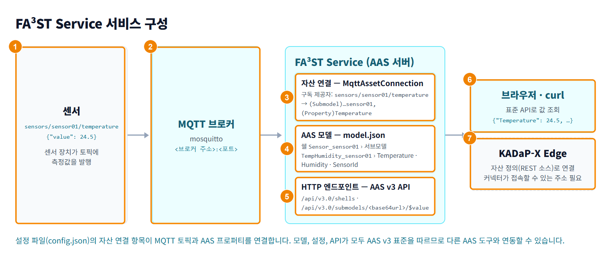
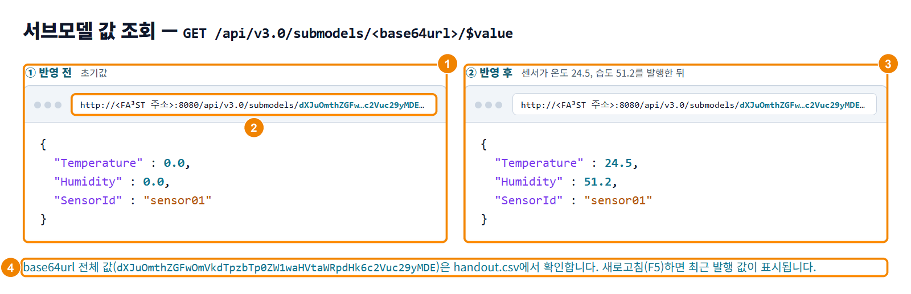

# AAS 연동 (FA³ST Service)

[TOC]

자산 관리 쉘(AAS, Asset Administration Shell)은 장비, 부품, 센서 같은 자산의 정보를 쉘, 서브모델, 프로퍼티로 이어지는 정해진 구조에 담는 디지털 트윈 표준입니다. 이 절에서는 오픈소스 AAS 서버인 **FA³ST Service**로 센서 값을 AAS 프로퍼티에 실시간으로 반영하고, 표준 API로 조회한 뒤 KADaP-X Edge 자산으로 제공하는 방법을 설명합니다. FA³ST Service는 Fraunhofer IOSB가 개발한 Eclipse 프로젝트입니다.

# 06-04-01 사용 순서

AAS 연동 방식은 FA³ST를 실행하는 위치에 따라 두 가지로 나뉩니다. 어느 방식이든 **센서 → MQTT 브로커 → FA³ST Service(MQTT 자산 연결) → AAS v3 API 조회** 흐름은 같습니다. 방식별 흐름과 용도는 다음과 같습니다.

| 구성 방식 | 흐름 | 용도 |
|---|---|---|
| ① 서버에서 FA³ST 실행 | 센서 → 서버의 MQTT 브로커 → 서버의 FA³ST(Docker) → AAS API | 여러 센서의 값을 FA³ST 하나에 모으거나, FA³ST 주소를 KADaP-X Edge 자산의 데이터 주소로 쓸 때 적합합니다. 제공자 커넥터가 접속할 수 있는 서버에 FA³ST를 두기 쉽습니다. |
| ② KADaP-X IoT 장치에 모듈로 배포 | 장치의 mqtt-client 모듈(내장 브로커와 모의 센서) → 장치의 faaast 모듈 → AAS API | 장치 한 대의 센서 값을 장치 안에서 바로 AAS로 제공할 때 적합합니다. 장치의 FA³ST 주소를 KADaP-X Edge 자산의 데이터 주소로 쓰려면 제공자 커넥터가 그 주소에 접속할 수 있어야 합니다. |

KADaP-X Edge 자산의 REST 소스는 제공자 커넥터의 데이터플레인이 직접 호출합니다. 따라서 공인 주소가 없거나 방화벽 뒤에 있는 장치의 FA³ST는 REST 소스로 쓸 수 없습니다. 이때는 ① 방식으로 커넥터가 접속할 수 있는 서버에 FA³ST를 두고, 센서 값을 그 서버의 브로커로 발행합니다.

AAS를 연동하려면 다음 순서대로 진행하세요.

1. 구성 요소, 모델 파일, 설정 파일의 역할을 확인하세요. ('06-04-02 서비스 구성', '06-04-04 AAS 모델 파일 이해하기', '06-04-05 설정 파일 이해하기' 참고)
2. FA³ST를 실행하세요. ① 방식은 서버에서 Docker로 실행하고, ② 방식은 장치에 mqtt-client 모듈과 faaast 모듈을 배포합니다. ('06-04-03 FA³ST 실행하기', '06-04-10 장치에 모듈로 배포하기' 참고)
3. 센서 값이 프로퍼티에 반영되는지 확인하세요. ('06-04-06 MQTT 자산 연결하기' 참고)
4. 표준 API로 쉘과 서브모델 값을 조회하세요. ('06-04-08 AAS API로 값 조회하기' 참고)
5. 재시작한 뒤에도 값을 유지하려면 값 저장 방식을 파일 저장으로 바꾸세요. ('06-04-09 값 저장 방식 바꾸기' 참고)
6. FA³ST의 값 조회 주소로 KADaP-X Edge 자산을 정의하고 오퍼링으로 게시하세요. ('06-04-11 KADaP-X Edge와 연계하기' 참고)

# 06-04-02 서비스 구성

센서 값이 MQTT 브로커와 FA³ST Service를 거쳐 AAS 프로퍼티에 담기고, 표준 API와 KADaP-X Edge로 제공되는 흐름을 설명합니다.

### 화면 구성

AAS 연동 서비스는 다음과 같이 구성됩니다.



| 번호 | 항목 | 설명 |
|---|---|---|
| 1 | 센서 | 센서 장치가 `sensors/<센서 ID>/temperature` 토픽에 `{"value": 24.5}` 형식으로 측정값을 발행합니다. |
| 2 | MQTT 브로커 | mosquitto 브로커입니다. ① 방식은 FA³ST와 함께 실행한 브로커 `<브로커 주소>:<포트>`를, ② 방식은 mqtt-client 모듈의 내장 브로커(1883)를 사용합니다. |
| 3 | 자산 연결 — MqttAssetConnection | FA³ST의 MQTT 자산 연결입니다. 구독 제공자(subscription provider)가 토픽에 들어온 값을 `(Submodel)<서브모델 ID>, (Property)Temperature` 참조가 가리키는 프로퍼티에 반영합니다. |
| 4 | AAS 모델 — model.json | 쉘 `Sensor_<센서 ID>`, 서브모델 `TempHumidity_<센서 ID>`, 프로퍼티 `Temperature`, `Humidity`, `SensorId`로 이어지는 구조에 값을 담습니다. |
| 5 | HTTP 엔드포인트 — AAS v3 API | AAS v3 API를 제공합니다. 쉘 목록은 `/api/v3.0/shells`, 서브모델 값은 `/api/v3.0/submodels/<base64url>/$value` 주소로 조회합니다. |
| 6 | 브라우저 · curl | 표준 API로 `{"Temperature": 24.5, …}` 같은 값을 조회합니다. |
| 7 | KADaP-X Edge | FA³ST의 값 조회 주소를 자산 정의의 REST 소스로 연결합니다. 제공자 커넥터가 이 주소에 접속할 수 있어야 합니다. |

### 구성 요소 살펴보기

설정 파일의 구독 항목 하나가 토픽 하나를 프로퍼티 하나에 연결합니다. 모델 파일, 설정 파일, FA³ST Service가 모두 AAS v3 규격을 따르므로 뷰어, 레지스트리, 커넥터 같은 다른 AAS 도구와 표준 주소로 연동할 수 있습니다. 구성 요소별 역할은 다음과 같습니다.

| 구성 요소 | 하는 일 | 예 |
|---|---|---|
| AAS 모델 파일 | 쉘, 서브모델, 프로퍼티의 구조와 초기값을 담습니다. JSON, XML, AASX 형식을 쓸 수 있습니다. | `model.json` |
| 설정 파일 | 엔드포인트, 값 저장 방식, 자산 연결을 지정합니다. 자산 연결에는 MQTT, OPC UA, HTTP를 쓸 수 있습니다. | `config.json` |
| FA³ST Service | 모델을 AAS v3 API로 제공하고, 자산 연결로 들어온 값을 프로퍼티에 반영합니다. | 이미지 `fraunhoferiosb/faaast-service:1.3` |
| MQTT 브로커 | 센서 값을 FA³ST에 전달합니다. | mosquitto |
| 조회 도구 | 브라우저나 curl로 API 응답 JSON을 확인합니다. FA³ST에는 별도의 관리 화면이 없습니다. | `http://<FA³ST 주소>:8080/api/v3.0/…` |

# 06-04-03 FA³ST 실행하기

서버에서 FA³ST 실행 키트를 사용해 FA³ST Service와 MQTT 브로커를 Docker 컨테이너로 실행합니다. 모델 파일과 설정 파일 생성부터 기동 확인까지 명령 하나로 진행됩니다.

### 화면 구성

FA³ST 실행 키트 `run.sh`의 출력 화면은 다음과 같이 구성됩니다.


| 번호 | 항목 | 설명 |
|---|---|---|
| 1 | `./run.sh up 3` | 실행 키트 폴더에서 실행하는 명령입니다. 숫자는 만들 센서 수입니다. |
| 2 | 사전 점검 | Docker, Docker Compose, Node.js 버전을 확인합니다. MQTT 포트 `MQTT_PORT`와 HTTP 포트 `FAAAST_PORT`를 쓸 수 있는지도 점검합니다. |
| 3 | 모델 · 설정 생성 | 센서 수만큼 쉘과 서브모델을 담은 `model.json`과 센서마다 MQTT 구독 2개를 담은 `config.json`을 만듭니다. 자산 연결의 브로커 주소는 `tcp://mqtt:1883`입니다. |
| 4 | 컨테이너 기동 | `faaast-mqtt`와 `faaast-service` 컨테이너를 실행합니다. 실행되면 컨테이너마다 Started가 표시됩니다. |
| 5 | FA³ST 기동 대기 | FA³ST가 기동될 때까지 기다립니다. 기동되면 서비스 중인 쉘 수와 MQTT 자산 연결 결과(OK)를 표시합니다. |
| 6 | 접속 정보 → handout.csv | 센서별 ID, 토픽, base64url, 값 조회 주소와 발행 형식을 표시하고, 전체 목록을 `handout.csv`에 저장합니다. |
| 7 | 다음 | 이어서 쓸 명령을 안내합니다. `./run.sh test`는 값을 발행해 프로퍼티에 반영되는지 확인하고, `sim start`는 모의 센서를 켜고, `export`는 모든 센서의 현재 값을 JSON으로 저장합니다. |

### FA³ST 실행하기

FA³ST를 실행하려면 다음 순서대로 진행하세요.

1. 실행 키트 폴더에서 `./run.sh up <센서 수>`를 실행하세요.
   - 모델 파일과 설정 파일 생성, 컨테이너 실행, 기동 확인, 접속 정보 출력이 차례로 진행됩니다.
   - 센서 ID는 일련번호로 만들어지며, 센서별 ID와 값 조회 주소는 `handout.csv`에 저장됩니다.
2. `docker logs -f faaast-service`를 실행해 기동 로그를 확인하세요.
   - **Model successfully validated** → **Starting FA³ST Service...** → **HTTP endpoint available on port 8080** → **Asset connection established (endpoint: tcp://mqtt:1883)** 순서로 표시됩니다. 마지막 메시지가 표시되기까지 10~20초가 걸립니다.
   - SSL을 끈 설정에서는 **Using HTTP endpoint with disabled SSL. Not safe for production** 경고도 표시됩니다. 운영 환경에서는 `sslEnabled`를 켜세요. ('06-04-05 설정 파일 이해하기' 참고)
3. 브라우저에서 `http://<FA³ST 주소>:8080/api/v3.0/shells`를 여세요.
   - 쉘 목록 JSON이 표시됩니다.

실행 키트와 컨테이너 설정은 다음과 같습니다.

| 항목 | 설명 | 예 |
|---|---|---|
| 실행 키트 | 운영 기관이 제공하는 파일 묶음으로, 서버에 압축을 풀어 사용합니다. 서버에 Docker와 Docker Compose가 설치되어 있어야 합니다. Node.js가 없으면 모델 파일 생성에 Node.js 컨테이너를 대신 사용합니다. | `run.sh`, `gen.mjs`, `docker-compose.yml`, `mosquitto.conf`, `sim.sh`, `test.sh` |
| Docker 이미지 | 안정 버전 태그 `1.3`을 사용합니다. `latest` 태그는 최신 릴리스를 가리킵니다. | `fraunhoferiosb/faaast-service:1.3` |
| 마운트 | 모델 파일과 설정 파일을 컨테이너 안에 마운트하는 경로입니다. | `/app/resources/model.json`, `/app/resources/config.json` |
| 환경변수 | 모델 파일 경로, 설정 파일 경로, 로그 수준을 지정합니다. | `faaast_model`, `faaast_config`, `faaast_loglevel_faaast=INFO` |
| 포트 | HTTP API 포트와 MQTT 브로커 포트입니다. 서버에서 쓰는 포트는 실행 키트 `.env`의 `FAAAST_PORT`와 `MQTT_PORT`로 바꿀 수 있습니다. | HTTP 8080, MQTT 1884(컨테이너 안에서는 1883) |

> **주의 -** 설정 파일을 고친 뒤에는 컨테이너를 다시 만들어야 변경 내용이 반영됩니다. `docker compose up -d --force-recreate faaast` 또는 `./run.sh reset`을 실행하세요.

# 06-04-04 AAS 모델 파일 이해하기

FA³ST Service가 읽는 모델 파일의 구조와 작성 방법을 설명합니다. 모델 파일은 AAS v3 환경(Environment) JSON입니다. 이 절의 모델은 센서마다 쉘 하나와 서브모델 하나를 두고, 의미 정의(ConceptDescription) 3개를 함께 담습니다. 아래는 센서 `sensor01` 부분을 발췌한 예입니다.

```json
{ "assetAdministrationShells": [ {
    "modelType": "AssetAdministrationShell", "id": "urn:kadap:edu:aas:sensor01", "idShort": "Sensor_sensor01",
    "assetInformation": { "assetKind": "Instance", "globalAssetId": "urn:kadap:edu:asset:sensor:sensor01" },
    "submodels": [ { "type": "ModelReference", "keys": [ { "type": "Submodel", "value": "urn:kadap:edu:sm:temphumidity:sensor01" } ] } ] } ],
  "submodels": [ { "modelType": "Submodel", "kind": "Instance", "id": "urn:kadap:edu:sm:temphumidity:sensor01", "idShort": "TempHumidity_sensor01",
    "semanticId": { "type": "ExternalReference", "keys": [ { "type": "GlobalReference", "value": "urn:kadap:edu:semantic:TempHumidity:1.0" } ] },
    "submodelElements": [
      { "modelType": "Property", "idShort": "Temperature", "valueType": "xs:double", "value": "0.0",
        "semanticId": { "type": "ExternalReference", "keys": [ { "type": "GlobalReference", "value": "urn:kadap:edu:semantic:Temperature:1.0" } ] } },
      { "modelType": "Property", "idShort": "Humidity", "valueType": "xs:double", "value": "0.0",
        "semanticId": { "type": "ExternalReference", "keys": [ { "type": "GlobalReference", "value": "urn:kadap:edu:semantic:Humidity:1.0" } ] } },
      { "modelType": "Property", "idShort": "SensorId", "valueType": "xs:string", "value": "sensor01",
        "semanticId": { "type": "ExternalReference", "keys": [ { "type": "GlobalReference", "value": "urn:kadap:edu:semantic:SensorId:1.0" } ] } } ] } ],
  "conceptDescriptions": [ { "modelType": "ConceptDescription", "id": "urn:kadap:edu:semantic:Temperature:1.0", "idShort": "Temperature", "embeddedDataSpecifications": [ … ] },
    { "id": "urn:kadap:edu:semantic:Humidity:1.0", … }, { "id": "urn:kadap:edu:semantic:SensorId:1.0", … } ] }
```

### 구성

| 항목 | 설명 |
|---|---|
| `assetAdministrationShells[]` | 쉘입니다. `id`, `idShort`, 자산 정보 `assetInformation`, 서브모델 참조 `submodels`로 이루어집니다. |
| `submodels[]` | 서브모델입니다. `id`, `idShort`, `kind`, `semanticId`, `submodelElements[]`로 이루어집니다. |
| `submodelElements[]` | 프로퍼티입니다. `modelType`이 Property이며, `idShort`, `valueType`, `value`, `semanticId`로 이루어집니다. |
| `conceptDescriptions[]` | IEC 61360 형식의 의미 정의입니다. `Temperature`, `Humidity`, `SensorId` 3개를 담으며, 각 ID는 프로퍼티의 `semanticId`와 같은 `urn:kadap:edu:semantic:<이름>:1.0`입니다. |

### 모델 파일 작성하기

실행 키트에서는 `gen.mjs`가, 장치에서는 faaast 모듈이 기동할 때 모델 파일을 자동으로 만듭니다. 모델 파일을 직접 작성하려면 다음 순서대로 진행하세요.

1. 센서마다 쉘 ID는 `urn:kadap:edu:aas:<센서 ID>`, 서브모델 ID는 `urn:kadap:edu:sm:temphumidity:<센서 ID>`로 정해 쉘과 서브모델을 작성하세요.
2. 숫자 프로퍼티는 `valueType`을 `xs:double` 또는 `xs:int`로 지정하세요. `xs:string`으로 지정하면 값이 문자열로 표시됩니다.
3. FA³ST를 실행한 뒤 `/api/v3.0/submodels/<서브모델 ID의 base64url>`을 열어, 모델 파일의 서브모델이 그대로 표시되는지 확인하세요.

모델 파일에 쓰는 주요 속성은 다음과 같습니다.

| 항목 | 설명 | 예 |
|---|---|---|
| `id` | 환경 전체에서 유일한 IRI 또는 URN입니다. | `urn:kadap:edu:aas:sensor01` |
| `idShort` | 사람이 읽기 쉬운 짧은 이름입니다. 같은 상위 요소 안에서는 중복될 수 없습니다. | `Sensor_sensor01`, `TempHumidity_sensor01` |
| `semanticId` | 서브모델 템플릿을 가리키는 시맨틱 ID입니다. Catena-X PCF 같은 표준 템플릿을 쓸 때는 그 템플릿에 정해진 값을 씁니다. | `urn:kadap:edu:semantic:TempHumidity:1.0` |
| 프로퍼티 | `idShort`, `valueType`, 초기값을 지정합니다. | `Temperature`(xs:double, 0.0), `Humidity`(xs:double, 0.0), `SensorId`(xs:string, 센서 ID) |

> **참고 -** FA³ST는 AAS v3 형식의 모델만 읽을 수 있습니다. `id`나 `idShort`가 중복되면 시작하지 않습니다.

# 06-04-05 설정 파일 이해하기

설정 파일 `config.json`으로 FA³ST Service의 엔드포인트, 값 저장 방식, 자산 연결을 지정합니다. 설정 파일은 `core`, `endpoints`, `persistence`, `fileStorage`, `messageBus`, `assetConnections`의 여섯 항목으로 이루어지며, 아래 예에서는 `fileStorage`를 생략했습니다. 구현을 고르는 항목에는 구현 클래스 이름 `@class`와 그 구현의 속성을 씁니다.

```json
{ "core": { "requestHandlerThreadPoolSize": 4 },
  "endpoints": [ { "@class": "de.fraunhofer.iosb.ilt.faaast.service.endpoint.http.HttpEndpoint",
      "port": 8080, "sslEnabled": false, "httpVersion": "HTTP_1_1", "corsEnabled": true, "includeErrorDetails": true } ],
  "persistence": { "@class": "de.fraunhofer.iosb.ilt.faaast.service.persistence.memory.PersistenceInMemory",
      "initialModelFile": "/app/resources/model.json" },
  "messageBus": { "@class": "de.fraunhofer.iosb.ilt.faaast.service.messagebus.internal.MessageBusInternal" },
  "assetConnections": [ { "@class": "de.fraunhofer.iosb.ilt.faaast.service.assetconnection.mqtt.MqttAssetConnection",
      "serverUri": "tcp://mqtt:1883", "clientId": "faaast-edu",
      "subscriptionProviders": { "…": "'MQTT 자산 연결하기' 참고" } } ] }
```

### 구성

| 항목 | 설명 |
|---|---|
| `core` | API 요청을 동시에 처리할 스레드 수 `requestHandlerThreadPoolSize`를 지정합니다. |
| `endpoints[0]` | HTTP 엔드포인트입니다. `port`, `sslEnabled`, `httpVersion`, `corsEnabled`, `includeErrorDetails`를 지정합니다. |
| `persistence` | 값 저장 방식입니다. 이 예는 메모리 저장을 쓰고, 처음 읽을 모델 파일을 `initialModelFile`로 지정합니다. |
| `messageBus` | FA³ST 내부에서 이벤트를 전달하는 메시지 버스입니다. |
| `assetConnections[0]` | MQTT 자산 연결입니다. `serverUri`, `clientId`, `subscriptionProviders`를 지정합니다. |

### 설정 파일 작성하기

설정 파일을 작성하려면 다음 순서대로 진행하세요.

1. `@class`에 쓸 클래스 이름은 공식 문서에서 복사하세요. 클래스 이름은 모두 `de.fraunhofer.iosb.ilt.faaast.service`로 시작합니다.
2. SSL을 껐다면 `httpVersion`을 반드시 `HTTP_1_1`로 지정하세요. 기본값 HTTP_2로 두면 브라우저와 curl이 빈 응답을 받습니다.
3. 설정 파일을 고치지 않고 값만 바꾸려면 명령줄이나 환경변수로 덮어쓰세요. 형식은 아래 표를 참고하세요.
4. 기동 로그 첫 줄의 **Config: /app/resources/config.json (ENV)**와 **Model: … (ENV)**를 보고, 마운트한 파일 경로와 환경변수가 맞는지 확인하세요.

엔드포인트 기본값과 덮어쓰기 방법은 다음과 같습니다.

| 항목 | 설명 | 예 |
|---|---|---|
| 엔드포인트 기본값 | 포트 443, HTTPS(자체 서명 인증서), HTTP_2, CORS 끔이 기본값입니다. | 이 절의 설정은 8080, `false`, `HTTP_1_1`, `true` |
| 명령줄 덮어쓰기 | `<JSONPath>=<값>` 형식으로 씁니다. JSONPath 앞의 `$.`은 생략합니다. | `endpoints[0].port=8081` |
| 환경변수 덮어쓰기 | `faaast_config_extension_` 뒤에 경로를 붙입니다. 경로의 `.`은 `_`로 바꿉니다. | `faaast_config_extension_endpoints[0]_port=8081` |

# 06-04-06 MQTT 자산 연결하기

MQTT 자산 연결로 토픽에 들어온 센서 값을 AAS 프로퍼티에 반영합니다. 반영된 값은 값 조회 주소에서 확인합니다.

### 화면 구성

센서 값이 반영되기 전후의 값 조회 화면은 다음과 같이 구성됩니다.



| 번호 | 항목 | 설명 |
|---|---|---|
| 1 | ① 반영 전 | 초기값 `{"Temperature": 0.0, "Humidity": 0.0, "SensorId": "<센서 ID>"}`가 표시됩니다. |
| 2 | 주소창 | 값 조회 주소 `http://<FA³ST 주소>:8080/api/v3.0/submodels/<base64url>/$value`입니다. |
| 3 | ② 반영 후 | 센서가 온도 `24.5`, 습도 `51.2`를 발행한 뒤 새로고침(F5)한 화면입니다. Temperature에 `24.5`, Humidity에 `51.2`가 표시됩니다. |
| 4 | 각주 | base64url 전체 값은 실행 키트의 `handout.csv`나 장치 faaast 모듈의 기동 로그에서 확인할 수 있습니다. |

### MQTT 자산 연결하기

MQTT 자산을 연결하려면 다음 순서대로 진행하세요.

1. 설정 파일을 직접 작성한다면 `subscriptionProviders`에 측정값마다 구독 항목을 하나씩 추가하세요.
   - 항목의 키는 프로퍼티 참조 문자열이고, 값은 구독 설정입니다. 센서 하나에 온도와 습도 항목 2개를 씁니다.
   - 실행 키트를 쓰면 `gen.mjs`가 이 항목을 만듭니다.
2. 센서가 `sensors/<센서 ID>/temperature`와 `sensors/<센서 ID>/humidity` 토픽에 `{"value": 숫자}` 형식으로 측정값을 발행하는지 확인하세요.
   - 실제 센서가 없으면 실행 키트의 모의 센서(`./run.sh sim start`)나 mqtt-client 모듈의 모의 센서로 값을 발행할 수 있습니다.
3. 그 센서의 값 조회 주소를 새로고침하세요.
   - 1초 안에 Temperature와 Humidity가 센서가 발행한 값으로 바뀝니다.
4. 다른 센서의 값 조회 주소를 열어, 그 센서의 값이 반영되지 않았는지 확인하세요.
   - 토픽과 프로퍼티는 센서별로 따로 연결되므로 다른 센서의 값은 바뀌지 않습니다.

이 연결에 쓰는 속성은 다음과 같습니다.

| 항목 | 설명 | 예 |
|---|---|---|
| `serverUri` | 브로커 주소입니다. `clientId`, `username`, `password`는 선택 항목입니다. | `tcp://mqtt:1883` |
| 참조 문자열(키) | 값을 반영할 프로퍼티를 가리킵니다. `[ModelRef](Submodel)<서브모델 ID>, (Property)<idShort>` 형식으로 쓰고, 쉼표 뒤에 공백 한 칸을 둡니다. | `[ModelRef](Submodel)urn:kadap:edu:sm:temphumidity:sensor01, (Property)Temperature` |
| `topic` | 구독할 토픽입니다. 이 절의 예는 `sensors/<센서 ID>/<항목>`을 씁니다. | `sensors/sensor01/temperature` |
| `format`, `query` | 메시지 형식과 값을 꺼낼 위치를 지정합니다. 형식은 JSON 또는 XML이고, 위치는 JSONPath로 씁니다. | `JSON`, `$.value` |
| 메시지 | 센서가 보내는 메시지는 `{"value": 숫자}` 형식이어야 합니다. 숫자만 보내면 값이 반영되지 않습니다. | `{"value": 24.5}` |

> **주의 -** 실행 키트의 브로커와 mqtt-client 모듈의 내장 브로커는 `allow_anonymous true` 설정으로 익명 접속을 허용합니다. 브로커에 접속할 수 있는 누구나 어느 토픽에든 발행할 수 있으므로, 다른 센서 ID의 토픽으로 잘못 발행하면 그 센서의 값이 덮어써집니다. 센서가 발행하는 토픽의 센서 ID가 맞는지 확인하세요. 외부에 공개하는 브로커에는 mosquitto 설정 파일의 `password_file`로 계정을 설정하고, 자산 연결에 `username`과 `password`를 지정하세요.

# 06-04-07 OPC UA · HTTP · Modbus 연결하기

`assetConnections` 배열에 연결 항목을 추가해 여러 프로토콜의 장비를 하나의 AAS에 함께 연결할 수 있습니다. 지원하는 제공자는 프로토콜마다 다릅니다.

### 지원 범위

프로토콜별 지원 범위는 다음과 같습니다.

| 연결(`@class` 끝부분) | 값 읽기 | 값 쓰기 | 구독 | 연산 | 핵심 속성 |
|---|---|---|---|---|---|
| `mqtt.MqttAssetConnection` | ✕ | ○ | ○ | ✕ | `serverUri`, `topic`, `format`, `query` |
| `opcua.OpcUaAssetConnection` | ○ | ○ | ○ | ○ | `host`(opc.tcp://…), `nodeId`, 인증서, 사용자 |
| `http.HttpAssetConnection` | ○ | ○ | ○(폴링) | ○ | `baseUrl`, `path`, `method`, `format`, `query`, 헤더 |
| `modbus.ModbusAssetConnection` | ○ | ○ | ○(폴링) | ✕ | `hostname`, `port`(기본 502), 레지스터 종류(`dataType`), 주소(`address`), 워드 순서(`mostSignificantWord`) |
| `lambda.LambdaAssetConnection` | ○ | ○ | ○ | ○ | Java 코드로 직접 구현(FA³ST를 라이브러리로 내장할 때) |

> **참고 -** Modbus 연결은 이 절에서 쓰는 이미지 `faaast-service:1.3`에 들어 있지 않아 사용할 수 없습니다.

### 다른 프로토콜 연결하기

OPC UA, HTTP, Modbus 장비를 연결하려면 다음 순서대로 진행하세요.

1. 설정 파일의 `assetConnections` 배열에 연결 항목을 추가하세요.
2. 프로퍼티 참조 문자열은 MQTT와 같은 형식인 `[ModelRef](Submodel)<서브모델 ID>, (Property)<idShort>`로 쓰세요.
3. 장비 값을 AAS에 실시간으로 반영하면서 AAS API로 장비에 값도 쓰려면, 프로퍼티 하나에 구독 제공자와 값 제공자를 함께 지정하세요.
4. AAS를 OPC UA 서버로도 제공하려면 `endpoints`에 `opcua.OpcUaEndpoint`를 추가하세요.
   - OPC UA 엔드포인트는 4840 포트를 씁니다.

제공자 종류는 다음과 같습니다.

| 제공자 | 하는 일 | 설정 키 |
|---|---|---|
| 값 제공자 | 장비에서 값을 읽거나 장비에 값을 씁니다. | `valueProviders` |
| 구독 제공자 | 장비 값이 바뀌면 프로퍼티에 반영합니다. | `subscriptionProviders` |
| 연산 제공자 | AAS 연산을 실행하면 장비 기능을 호출합니다. | `operationProviders` |

이 절에서는 MQTT 연결만 자세히 다룹니다. 다른 프로토콜의 상세 속성은 FA³ST 공식 문서의 interfaces/asset-connection 항목을 참고하세요.

# 06-04-08 AAS API로 값 조회하기

FA³ST Service의 HTTP 엔드포인트가 제공하는 AAS v3 API로 쉘, 서브모델, 값을 조회합니다. 이 API는 AAS 규격 Part 2에 정해진 표준 API입니다.

### 화면 구성

쉘 목록 조회 화면은 다음과 같이 구성됩니다.


| 번호 | 항목 | 설명 |
|---|---|---|
| 1 | 주소창 | 쉘 목록 조회 주소 `http://<FA³ST 주소>:8080/api/v3.0/shells`입니다. |
| 2 | `modelType` · `id` · `idShort` | 모델 종류 `AssetAdministrationShell`, 쉘 ID `urn:kadap:edu:aas:<센서 ID>`, 짧은 이름 `Sensor_<센서 ID>`가 표시됩니다. |
| 3 | `displayName` · `assetInformation` | 표시 이름과 자산 정보입니다. 자산 정보에는 자산 종류 Instance와 `globalAssetId`가 들어 있습니다. |
| 4 | `submodels` | 쉘에 연결된 서브모델입니다. ModelReference로 서브모델 ID `urn:kadap:edu:sm:temphumidity:<센서 ID>`를 참조합니다. |
| 5 | 나머지 쉘 | 센서마다 쉘이 하나씩 표시됩니다. |

### 값 조회하기

서브모델 값을 조회하려면 다음 순서대로 진행하세요.

1. 쉘 목록에서 조회할 센서 쉘의 `submodels` 참조에 있는 서브모델 ID를 확인하세요.
2. 서브모델 ID를 base64url로 바꾸세요.
   - base64로 인코딩한 뒤 끝의 `=`를 지우고, `+`는 `-`로, `/`는 `_`로 바꿉니다.
   - 명령으로는 `printf '<서브모델 ID>' | base64 -w0 | tr -d '=' | tr '/+' '_-'`를 실행해 바꿀 수 있습니다.
   - 실행 키트를 쓰면 `handout.csv`에서, 장치의 faaast 모듈을 쓰면 기동 로그에서 바꾼 값을 확인할 수 있습니다.
3. 바꾼 값을 넣은 값 조회 주소 `…/submodels/<base64url>/$value`를 열어, 표시된 값이 센서가 발행한 값과 같은지 확인하세요.

자주 쓰는 API는 다음과 같습니다.

| 할 일 | 주소 | 결과 |
|---|---|---|
| 쉘과 서브모델 목록 | `GET /api/v3.0/shells`, `GET /api/v3.0/submodels` | 쉘 배열과 서브모델 배열을 돌려줍니다. |
| 서브모델 하나 | `GET /api/v3.0/submodels/<base64url(id)>` | 서브모델의 구조와 값을 돌려줍니다. |
| 서브모델 값만 | `GET /api/v3.0/submodels/<base64url(id)>/$value` | `{"Temperature": 24.5, "Humidity": 51.2, "SensorId": "sensor01"}` |
| 프로퍼티 값만 | `GET …/submodels/<base64url(id)>/submodel-elements/Temperature/$value` | `{"Temperature": 24.5}` |
| 값 쓰기 | `PATCH …/submodel-elements/Temperature/$value` | 값 제공자가 지정된 프로퍼티라면 값이 장비로 전달됩니다. MQTT 연결에서는 토픽으로 발행됩니다. |
| 모델 전체 | `GET /api/v3.0/serialization?aasIds=…&submodelIds=…&includeConceptDescriptions=true` | Accept 헤더에 맞춰 환경 JSON, XML, AASX 중 한 형식으로 돌려줍니다. |
| 모델 올리기와 초기화(FA³ST 전용) | `POST /import`, `DELETE /reset` | 올리기는 추가된 요소와 오류 목록을 돌려줍니다. 초기화는 모든 쉘과 서브모델을 삭제합니다. |

> **주의 -** FA³ST에는 인증이 없어 접속할 수 있는 누구나 HTTP API로 쓰기 요청(PUT, PATCH, POST, DELETE)을 보낼 수 있습니다. 여러 사람이 함께 쓰는 FA³ST에서는 조회(GET)만 하세요. 외부에 공개할 때의 설정은 '06-04-11 KADaP-X Edge와 연계하기'의 주의를 참고하세요.

# 06-04-09 값 저장 방식 바꾸기

값 저장 방식을 파일 저장으로 바꿔, FA³ST를 재시작한 뒤에도 마지막 값을 유지합니다. 기본 메모리 저장(`PersistenceInMemory`)은 재시작하면 값이 초기값으로 돌아갑니다. 파일 저장을 쓰려면 설정 파일의 `persistence` 항목을 다음과 같이 바꿉니다.

```json
"persistence": {
  "@class": "de.fraunhofer.iosb.ilt.faaast.service.persistence.file.PersistenceFile",
  "initialModelFile": "/app/resources/model.json",
  "dataDir": "/app/output/aas",
  "keepInitial": true,
  "dataformat": "JSON"
}
```

### 구성

| 항목 | 설명 |
|---|---|
| `@class` | 파일 저장 구현 `persistence.file.PersistenceFile`을 지정합니다. |
| `initialModelFile` | 처음 읽을 모델 파일을 지정합니다. |
| `dataDir` | 값이 바뀐 모델을 저장할 폴더입니다. 쓰기 가능한 볼륨이어야 하며, 읽기 전용이면 기동할 때 파일 쓰기 오류가 발생합니다. |
| `keepInitial` | `true`이면 원본 모델 파일은 그대로 두고 사본에 저장하며, `dataformat`은 사본에만 적용됩니다. `false`이면 원본 모델 파일을 직접 고칩니다. |
| `dataformat` | 저장 형식을 JSON, XML, AASX 중에서 지정합니다. |

### 파일 저장으로 바꾸기

값 저장 방식을 파일 저장으로 바꾸려면 다음 순서대로 진행하세요.

1. `persistence` 항목의 `@class`를 `PersistenceFile`로 바꾸세요.
2. `dataDir`에 쓰기 가능한 폴더를 지정하세요.
3. 컨테이너를 다시 만들어 FA³ST를 실행하세요. ('06-04-03 FA³ST 실행하기' 참고)
4. 센서 값이 반영되었는지 값 조회 주소에서 확인하세요.
5. FA³ST를 재시작하세요.
6. `dataDir`에 모델 사본 파일이 생겼는지, `$value`가 재시작 전의 마지막 값을 유지하는지 확인하세요.

장치의 faaast 모듈에서는 환경변수 `PERSIST=file`만 지정하면 파일 저장을 씁니다. 모델 사본은 `OUTPUT_PATH` 아래 `aas` 폴더에 저장됩니다. ('06-04-10 장치에 모듈로 배포하기' 참고)

# 06-04-10 장치에 모듈로 배포하기

KADaP-X IoT의 **배포 추가**로 장치에 mqtt-client 모듈과 faaast 모듈을 배포해, 장치 안에서 센서 값을 AAS로 제공합니다. 두 모듈 모두 타입 **사용자 등록 이미지**로 배포하며, 배포 추가에 입력하는 환경변수는 다음과 같습니다.

```text
# 배포 추가 ① — 모듈 mqtt-client (내장 MQTT 브로커 1883 + 모의 온습도 센서)
SENSOR_ID=<센서 ID>

# 배포 추가 ② — 모듈 faaast (FA³ST Service, AAS v3 API 포트 8080)
SENSOR_ID=<센서 ID>
MQTT_HOST=<mqtt-client 모듈 주소>
PERSIST=file          # (선택) 재시작 뒤에도 값 유지 · OUTPUT_PATH/aas 에 모델 사본
```

### 구성

| 항목 | 설명 |
|---|---|
| 배포 추가 ① | 내장 MQTT 브로커(1883)와 모의 온습도 센서를 갖춘 mqtt-client 모듈입니다. 모의 센서는 5초마다 `sensors/<센서 ID>/temperature`와 `humidity` 토픽에 값을 발행합니다. |
| `SENSOR_ID` | 센서 ID입니다. 토픽, 쉘 ID, 서브모델 ID를 만드는 데 쓰입니다. |
| 배포 추가 ② | faaast 모듈입니다. 센서 ID로 AAS 모델 파일과 설정 파일을 만들고 FA³ST Service를 실행합니다. |
| `MQTT_HOST` | 브로커로 쓸 mqtt-client 모듈의 주소입니다. |
| `PERSIST` | 값 저장 방식입니다. `file`이면 값을 파일에 저장해 재시작한 뒤에도 유지합니다. |

### 모듈 배포하기

장치에 mqtt-client 모듈과 faaast 모듈을 배포하려면 다음 순서대로 진행하세요.

1. **사용자 이미지 관리**에 mqtt-client 이미지와 faaast 이미지가 등록되어 있는지 확인하세요.
   - 이미지가 없으면 먼저 등록하세요. ('06-03-18 이미지 추가하기' 참고)
2. 장치 설정 > **정보** > K8s 배포 이미지에서 **배포 추가**를 클릭하세요.
   - 배포 추가 창이 표시됩니다. 창의 항목은 '06-03-10 배포 추가하기(가공 - 전처리)'를 참고하세요.
3. mqtt-client 모듈의 정보를 입력하세요.
   - **모듈 이름**: `mqtt-client`를 입력합니다.
   - **타입**: **사용자 등록 이미지**를 선택합니다.
   - **레지스트리 이미지 (Repository)**: 사용자 이미지 관리에 등록한 mqtt-client 이미지를 선택합니다. (예: `quantumsurf/mqtt-client:0.1.0`)
4. 두 모듈은 입력과 출력 연결이 없으므로 **필수설정 유형**에서 **선택 없음**을 선택하세요.
   - 입력 선택 칸과 출력 선택 칸이 사라집니다.
   - 기본값 '가공 - 전처리, AI 모델'로 두면 **등록**을 클릭할 때 **입력을 선택하세요.** 오류가 표시됩니다.
5. **환경변수**에 `SENSOR_ID=<센서 ID>`를 추가하세요.
   - **`SENSOR_ID`**: 센서 ID를 입력합니다. 두 모듈에 같은 값을 씁니다. (예: `sensor01`)
6. **등록**을 클릭하세요.
7. 목록의 mqtt-client 행에서 **배포**를 클릭하세요.
8. 2~7단계와 같은 방법으로 faaast 모듈을 배포하세요. 모듈 이름, 이미지, 환경변수는 다음과 같이 입력합니다.
   - **모듈 이름**: `faaast`를 입력합니다.
   - **레지스트리 이미지 (Repository)**: faaast 이미지를 선택합니다. (예: `quantumsurf/faaast:0.1.0`)
   - **`SENSOR_ID`**: mqtt-client 모듈과 같은 값을 입력합니다.
   - **`MQTT_HOST`**: mqtt-client 모듈 주소를 입력합니다. faaast 모듈에만 씁니다. (예: `<mqtt-client 모듈 주소>`)
   - **`PERSIST`**: 값 저장 방식을 입력합니다. 기본값 `memory` 대신 `file`을 입력하면 재시작한 뒤에도 값이 유지되고, 출력 폴더에 `aas/model_persistence.json`이 생깁니다. (예: `file`)
   - **그 밖의 환경변수(선택)**: 브로커 포트와 계정은 두 모듈에서, API 포트는 faaast 모듈에서 지정할 수 있습니다. (예: `MQTT_PORT=1883`, `MQTT_USER`, `MQTT_PASS`, `HTTP_PORT=8080`)
9. faaast 행의 **로그 보기**를 클릭하세요.
   - **Asset connection established**와 값 조회 주소 `/api/v3.0/submodels/<base64url>/$value`가 표시됩니다.
   - 로그에는 값 조회 주소의 앞부분이 `http://<host>:8080`으로 표시됩니다.
10. 브라우저에서 값 조회 주소 `http://<FA³ST 주소>:8080/api/v3.0/submodels/<base64url>/$value`를 열어, Temperature와 Humidity가 5초마다 바뀌는지 확인하세요.
    - 값은 mqtt-client 모듈의 모의 센서가 발행합니다.

> **참고 -** 두 모듈의 `SENSOR_ID`가 다르면 토픽과 참조 문자열이 어긋나 값이 반영되지 않습니다.

> **참고 -** mqtt-client 모듈은 내장 브로커와 모의 센서를 함께 실행하는 시연용 모듈입니다. 실제 센서가 값을 발행하는 브로커가 있으면 mqtt-client 모듈은 배포하지 않고, faaast 모듈만 배포해 `MQTT_HOST`와 `MQTT_PORT`에 그 브로커를 지정하세요. 센서는 `sensors/<센서 ID>/temperature`와 `humidity` 토픽에 `{"value": 숫자}` 형식으로 발행해야 하며, 토픽 앞부분이 `sensors`가 아니면 faaast 모듈의 `TOPIC_PREFIX`로 바꿀 수 있습니다. 브로커에 계정이 있으면 `MQTT_USER`와 `MQTT_PASS`도 지정하세요.

# 06-04-11 KADaP-X Edge와 연계하기

FA³ST의 값 조회 주소를 KADaP-X Edge 자산의 REST 소스로 등록해, 센서 값을 AAS를 거쳐 데이터스페이스로 교환합니다. 제공자 커넥터의 데이터플레인이 이 주소에 HTTP/1.1로 접속할 수 있어야 하므로, 보통 ① 방식으로 서버에서 실행한 FA³ST를 씁니다.

자산 정의에 입력하는 값과 소비자가 받는 데이터는 다음과 같습니다.

```text
# Edge > 공유 자산 > 자산 정의 > 소스 정보 (소스 유형 REST)
엔드포인트 : http://<FA³ST 주소>:8080/api/v3.0/submodels/<base64url>/$value   (GET)
인증       : OAuth2 — Token URL · Client ID · Client Secret 별칭 = 기존 기술 사용자 값 그대로

# 소비자가 다운로드하는 데이터
{"Temperature": 24.5, "Humidity": 51.2, "SensorId": "sensor01"}
```

### 구성

| 항목 | 설명 |
|---|---|
| 엔드포인트 | FA³ST의 값 조회 주소입니다. 제공자 커넥터의 데이터플레인이 소비자의 요청을 받으면 이 주소를 호출합니다. |
| 인증 | 자산 정의 양식에서 요구하는 OAuth2 값입니다. FA³ST는 이 토큰을 검사하지 않습니다. |
| 다운로드 데이터 | 소비자는 `$value` 응답 JSON을 그대로 받습니다. |

### Edge 자산으로 연계하기

FA³ST 값을 KADaP-X Edge 자산으로 연계하려면 다음 순서대로 진행하세요.

1. 브라우저에서 FA³ST(`http://<FA³ST 주소>:8080`)의 값 조회 주소를 열어 값이 표시되는지 확인하세요.
   - FA³ST 주소는 제공자 커넥터가 접속할 수 있는 주소여야 합니다.
2. Edge에서 **공유 자산** > **자산 정의** > **+ 생성**을 클릭하세요. ('06-05-05 자산 생성하기' 참고)
   - 자산 생성 화면이 표시됩니다.
3. 자산에 쓸 서브모델을 선택하고 소스 정보를 입력하세요.
   - **소스 유형**: **REST**를 선택합니다. 커넥터가 지정한 API 주소에서 데이터를 가져오는 방식입니다.
   - **엔드포인트**: FA³ST의 값 조회 주소를 입력하고, 호출 방식은 GET으로 지정합니다. (예: `http://<FA³ST 주소>:8080/api/v3.0/submodels/<base64url>/$value`)
   - **Token URL**, **Client ID**, **Client Secret**: 차례로 데이터스페이스 Keycloak의 토큰 주소, 회사 기술 사용자, Vault 시크릿 별칭을 입력합니다. 기존 기술 사용자 값을 그대로 씁니다.
4. **생성**을 클릭하세요.
5. **정책 정의**, **계약 정의**, **오퍼링 업로드**를 차례로 진행해 자산을 게시하세요.
6. 소비자 Edge의 **카탈로그**에서 자산을 찾아 구독하세요.
   - 계약이 자동으로 체결됩니다.
7. 소비자 Edge에서 자산을 **다운로드**해 `{"Temperature": …}` JSON을 받으세요.

> **주의 -** FA³ST에는 인증이 없어 접속할 수 있는 누구나 PUT, PATCH, POST, DELETE 요청으로 값을 바꾸거나 지울 수 있습니다. 외부에 공개할 때는 GET 요청만 통과시키는 프록시를 FA³ST 앞에 두고, 그 프록시 주소를 엔드포인트로 쓰세요. nginx에서는 `location / { limit_except GET { deny all; } proxy_pass http://<FA³ST 내부 주소>:8080; proxy_http_version 1.1; }`처럼 설정하면 GET과 HEAD 외의 요청을 거부합니다.

# 06-04-12 문제 해결하기

FA³ST Service를 실행하거나 Edge와 연계하는 중에 문제가 생기면 아래 표에서 증상을 찾아 조치하세요.

| 단계 | 증상 | 조치 |
|---|---|---|
| 기동 | **Model validation failed** | 모델이 AAS v3 형식에 맞는지, 센서마다 `id`와 `idShort`가 겹치지 않는지 확인하세요. 검사를 잠시 건너뛰려면 `--no-validation` 옵션을 쓸 수 있습니다. |
| 기동 | 포트 충돌 | 다른 프로그램이 8080 포트나 MQTT 포트를 쓰고 있는 경우입니다. 실행 키트 `.env`의 `FAAAST_PORT`나 `MQTT_PORT`를 비어 있는 포트로 바꾸세요. |
| 기동 | 설정 파싱 오류 | 설정 파일의 `@class` 이름에 오타가 없는지, JSON 쉼표가 빠지거나 남지 않았는지 확인하세요. |
| 접속 | 연결은 되지만 응답이 비어 있음 | SSL을 끈 설정에서 HTTP_2를 쓰는 경우입니다. 엔드포인트의 `httpVersion`을 `HTTP_1_1`로 바꾸세요. |
| 접속 | `localhost:8080`으로는 접속되지 않고 `127.0.0.1:8080`으로는 접속됨 | `localhost`가 IPv6 주소 ::1로 해석되는 경우입니다. `127.0.0.1`이나 서버 IP로 접속하세요. |
| 자산 연결 | **Asset connection established**가 표시되지 않고 재시도를 반복함 | 브로커가 실행 중인지, `serverUri`가 맞는지 확인하세요. 브로커가 익명 접속을 막고 있다면 `allow_anonymous` 설정이나 `username`과 `password`를 확인하세요. |
| 자산 연결 | 센서가 발행해도 값이 바뀌지 않음 | 토픽, 참조 문자열, `query`(`$.value`)가 맞는지, 메시지가 `{"value": …}` 형식인지 확인하세요. |
| 자산 연결 | 값이 다른 센서에 반영됨 | 참조 문자열과 토픽의 센서 ID가 같은지, 센서가 다른 센서 ID의 토픽으로 발행하고 있지 않은지 확인하세요. 설정이 어긋났다면 `gen.mjs`로 설정 파일을 다시 만드세요. |
| 자산 연결 | 센서 값이 곧 다른 값으로 바뀜 | 실행 키트의 모의 센서(`./run.sh sim`)나 mqtt-client 모듈 같은 다른 발행자가 같은 토픽에 발행하고 있는지 확인하세요. |
| 조회 | 404 Not Found | base64url로 바꿀 때 `=`를 지웠는지, `+`와 `/`를 바꿨는지 확인하세요. 서브모델 ID에 오타가 없는지도 확인하세요. |
| 조회 | 웹 뷰어 CORS 오류 | 엔드포인트 설정이 `corsEnabled true`인지 확인하세요. |
| 재시작 | 재시작하면 값이 초기화됨 | 메모리 저장을 쓰는 경우입니다. 값을 유지하려면 파일 저장(`PersistenceFile`)으로 바꾸고, 장치 모듈에서는 `PERSIST=file`을 지정하세요. |
| 모듈 | faaast 로그에 브로커 연결 실패가 반복됨 | `MQTT_HOST` 값이 맞는지, mqtt-client 모듈이 실행 중인지 확인하세요. |
| 모듈 | 브로커에 연결되지만 값이 바뀌지 않음 | 두 모듈의 `SENSOR_ID`가 같은지 확인하세요. |
| Edge 연계 | 다운로드가 실패하거나 내용이 빠짐 | 제공자 커넥터의 데이터플레인이 FA³ST나 앞단 프록시에 접속할 수 있는지 확인하세요. 자산 정의의 엔드포인트, 인증 값, 서브모델이 맞는지도 확인하세요. |
