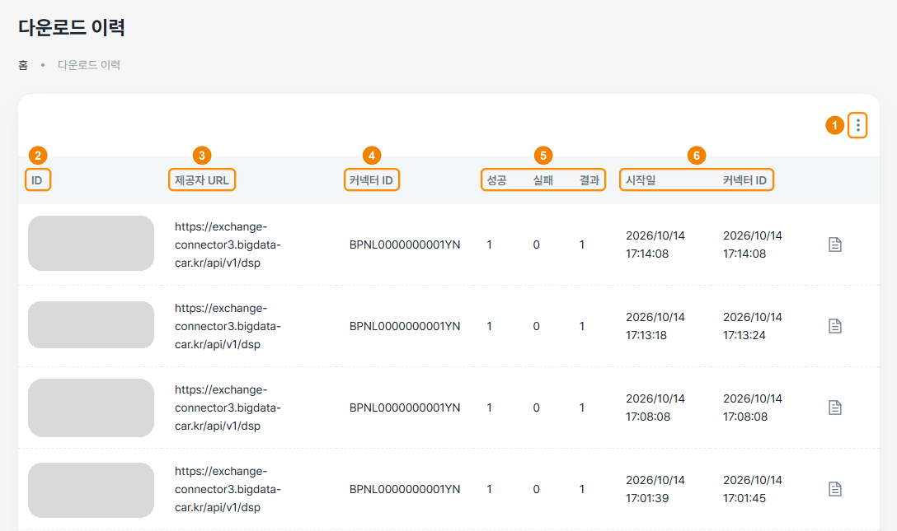

## 다운로드 이력 확인하기

다운로드 이력 화면에서 데이터를 다운로드한 기록과 결과를 확인할 수 있습니다.

### 화면 구성

다운로드 이력 화면은 다음과 같이 구성됩니다.

| 번호 | 항목 | 설명 |
|---|---|---|
| 1 | 다운로드 목록 새로고침 | 더 보기(⋮) 아이콘을 클릭해 다운로드 이력 목록을 새로고침할 수 있습니다. |
| 2 | ID | 다운로드를 식별하는 ID로, 상세 내역을 조회할 때 사용합니다. |
| 3 | 제공자 URL | 제공자 커넥터의 주소(…/api/v1/dsp)를 표시합니다. |
| 4 | 커넥터 ID | 제공자 커넥터의 BPN(BPNL…)을 표시합니다. |
| 5 | 성공 · 실패 · 결과 | 성공은 정상 전송 건수, 실패는 전송 실패 건수, 결과는 전체 처리 건수(성공 + 실패)를 표시합니다. |
| 6 | 시작일 · 종료 일시 | 다운로드가 시작된 일시와 끝난 일시를 표시합니다. 종료 일시 열은 머리글이 **커넥터 ID**로 표시되지만 값은 종료 일시입니다. |

### 다운로드 결과 확인하기

다운로드 결과를 확인하려면 다음 순서대로 진행하세요.

1. KADaP-X Edge 홈 화면에서 **커넥터 목록** > **consumer [소비자]** > **다운로드 이력**을 클릭하세요.
   - 다운로드 이력 화면이 표시됩니다.
2. 시작일을 보고 방금 다운로드한 행을 찾으세요. 보통 맨 위 행입니다.
3. 그 행의 성공이 1, 실패가 0인지 확인하세요.
4. 그 행 끝의 상세 보기 아이콘을 클릭해 다운로드한 데이터를 확인하세요.
   - 예를 들어 온습도 자산이면 Temperature, Humidity, SensorId 값이 표시됩니다.
