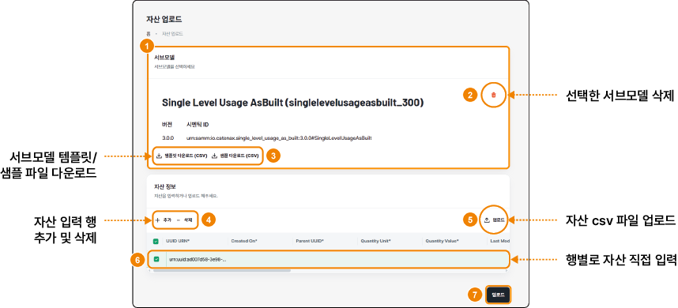

## 자산 업로드하기

KADaP-X Edge의 **공유 자산** > **자산 업로드** 메뉴에서 서브모델 템플릿에 맞춘 자산 데이터를 업로드할 수 있습니다.

### 화면 구성

자산 업로드 화면은 다음과 같이 구성됩니다.

| 번호 | 항목 | 설명 |
|---|---|---|
| 1 | 서브모델 | 자산에 적용할 서브모델을 선택하는 영역입니다. 서브모델을 선택해야 자산을 입력하거나 업로드할 수 있습니다. |
| 2 | 선택한 서브모델 삭제 | 휴지통 아이콘을 클릭하면 선택한 서브모델을 지우고 다시 선택할 수 있습니다. |
| 3 | 서브모델 템플릿 · 샘플 파일 다운로드 | 서브모델의 템플릿이나 샘플 CSV 파일을 다운로드해 입력 항목을 확인할 수 있습니다. |
| 4 | 자산 입력 행 추가 · 삭제 | **+ 추가**를 클릭해 자산 입력 행을 추가하거나, 선택한 행을 **삭제**할 수 있습니다. |
| 5 | 자산 csv 파일 업로드 | 템플릿에 맞춰 작성한 CSV 파일을 올려 자산을 한꺼번에 업로드할 수 있습니다. |
| 6 | 행별 자산 직접 입력 | 행마다 세부 항목을 직접 입력하거나 수정할 수 있습니다. |
| 7 | 업로드 | 입력한 자산 정보를 업로드합니다. |

### 자산 업로드하기

자산을 업로드하려면 다음 순서대로 진행하세요.

1. KADaP-X Edge 홈 화면에서 **공유 자산** > **자산 업로드**를 클릭하세요.
   - 자산 업로드 화면이 표시됩니다.
2. **+ 생성**을 클릭하세요.
   - 서브모델 선택 창이 표시됩니다.
3. 자산에 적용할 서브모델을 선택하고 **+ 선택**을 클릭하세요. 서브모델의 버전 등 상세 정보는 행의 상세 보기 아이콘으로 확인할 수 있습니다.
   - 선택한 서브모델이 표시됩니다.
4. 자산 입력 행을 추가해 자산 정보를 입력하거나, 템플릿에 맞춰 작성한 CSV 파일을 올리세요.
5. **업로드**를 클릭하세요.

> **참고 -** '06-05-03 서브모델 등록하기'에서 직접 등록한 서브모델(예: 온습도)로는 자산을 업로드할 수 없습니다. 이런 서브모델은 '06-05-05 자산 생성하기'에서 바로 선택하고 소스 유형을 **REST**로 지정하세요.
