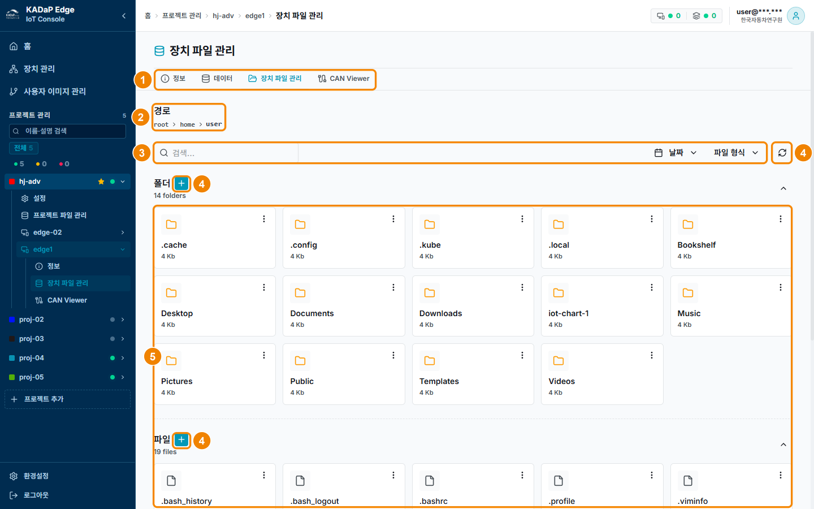
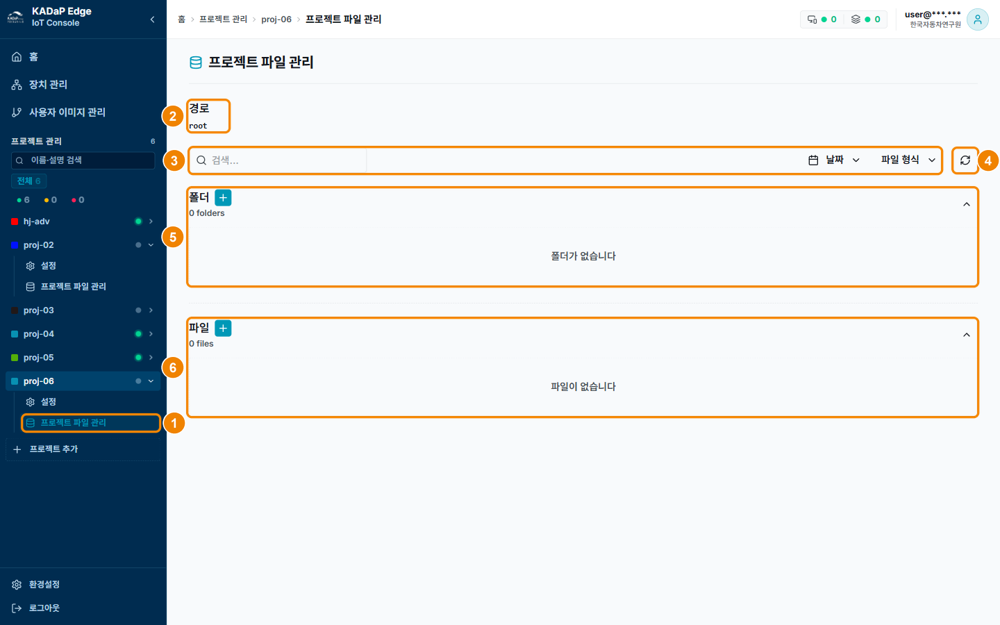
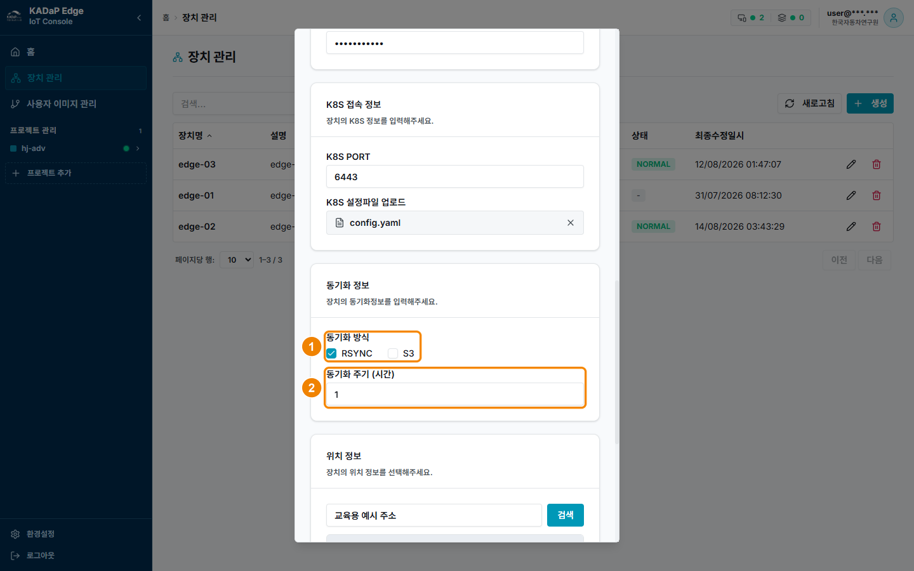
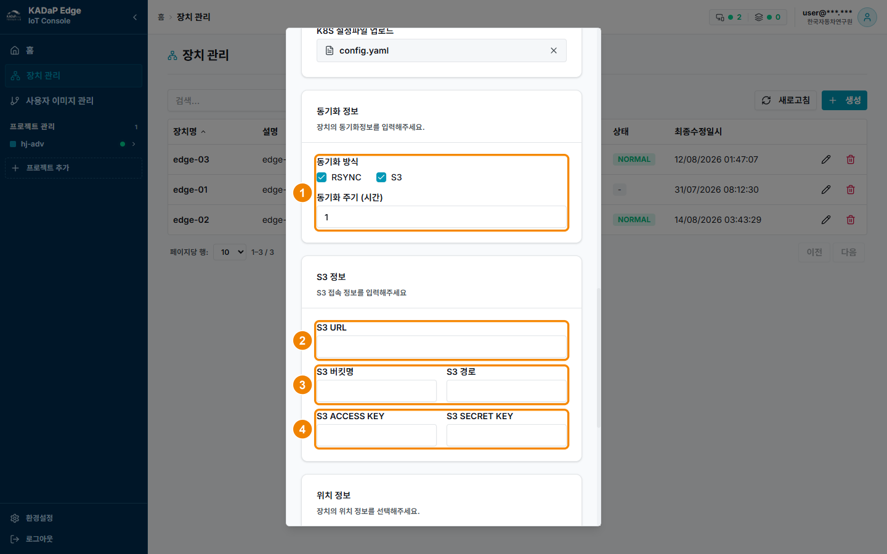
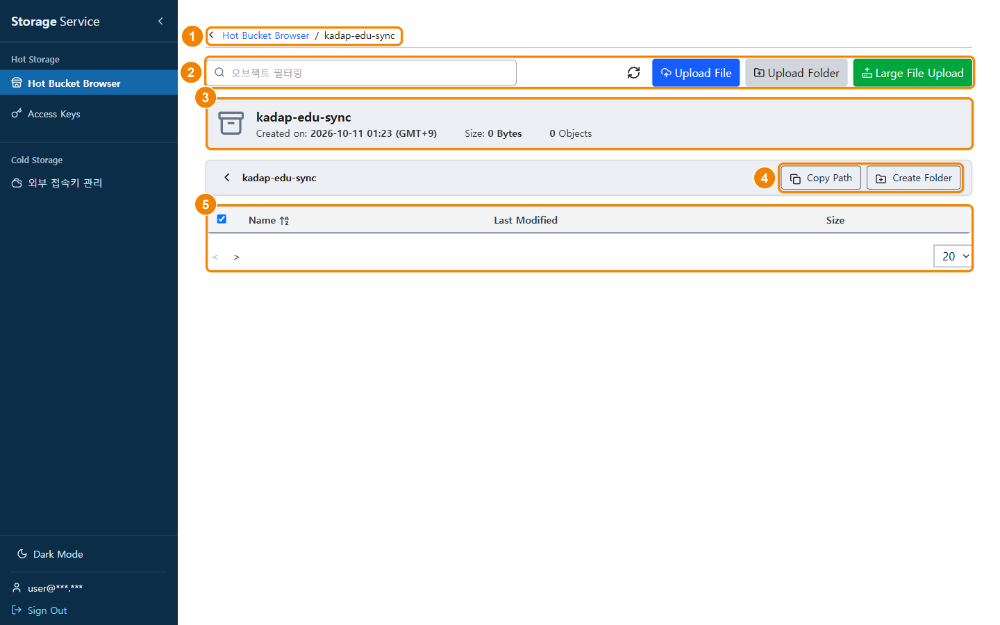

# 데이터 수집 기능 (KADaP-X IoT) - C. 수집 파일 관리와 동기화

[TOC]

수집 모듈과 가공 모듈이 만든 출력 파일을 확인하고, RSYNC나 S3로 클라우드 스토리지에 동기화하는 방법을 설명합니다.

# 장치 파일 관리

장치 파일 관리 화면에서 장치의 폴더와 파일을 탐색하고 파일을 다운로드, 업로드, 삭제할 수 있습니다. 수집 모듈과 가공 모듈의 출력 파일도 이 화면에서 확인합니다.

### 화면 구성

장치 파일 관리 화면은 다음과 같이 구성됩니다.

| 번호 | 항목 | 설명 |
|---|---|---|
| 1 | 탭 | 정보, 데이터, **장치 파일 관리**, CAN Viewer 탭을 표시합니다. |
| 2 | 경로 | 현재 폴더의 경로를 표시하며, 경로를 클릭해 상위 폴더로 이동할 수 있습니다. root는 장치의 최상위 폴더(`/`)입니다. |
| 3 | 검색 · 날짜 · 파일 형식 | 이름으로 검색하고, 수정일 범위와 파일 형식으로 필터링할 수 있습니다. **Apply**를 클릭하면 필터가 적용되고, **초기화**를 클릭하면 필터가 해제됩니다. |
| 4 | 새로고침 · 폴더 생성 · 업로드 | 목록을 새로 불러오거나, 폴더를 만들거나, 파일을 업로드할 수 있습니다. |
| 5 | 폴더 · 파일 목록 | 폴더와 파일을 이름과 크기가 적힌 카드로 표시합니다. 카드의 더 보기(⋮)에서 파일을 다운로드하거나 폴더와 파일을 삭제할 수 있습니다. |

### 출력 파일 확인하기

모듈의 출력 파일을 확인하려면 다음 순서대로 진행하세요.

1. 왼쪽 프로젝트 트리에서 장치를 펼치고 **장치 파일 관리**를 클릭하세요.
2. 폴더를 차례로 클릭해 배포설정의 출력 경로로 이동하세요. (예: `data/raw`, `data/output`)
   - **수집 출력**: `collect-mqtt` 같은 수집 모듈이 저장한 원시 CAN 파일입니다. (예: `data/raw/raw_<일시>.csv`, `latest.json`)
   - **가공 출력**: `preproc-can` 같은 전처리 모듈이 물리량으로 변환한 파일입니다. (예: `data/output/decoded_raw_<일시>.csv`)
   - **AAS 출력**: `faaast` 모듈이 저장한 AAS 모델 파일과 `mqtt-client` 모듈이 마지막으로 받은 값입니다. (예: `aas/model_persistence.json`, `sensor-latest.json`)
3. 파일 카드의 더 보기(**⋮**)에서 **다운로드**를 클릭하세요.
4. 다운로드한 파일을 열어 내용을 확인하세요.

# 프로젝트 파일 관리

프로젝트 파일 관리 화면에서 KADaP-X IoT 서버에 있는 프로젝트 폴더를 확인할 수 있습니다. RSYNC로 동기화된 장치별 출력 파일도 이 화면에서 확인합니다.

### 화면 구성

프로젝트 파일 관리 화면은 다음과 같이 구성됩니다.

| 번호 | 항목 | 설명 |
|---|---|---|
| 1 | 프로젝트 파일 관리 | 왼쪽 프로젝트 트리에서 프로젝트를 펼치면 표시되는 메뉴입니다. |
| 2 | 경로 | 현재 폴더의 경로를 표시합니다. 맨 위 폴더는 root입니다. |
| 3 | 검색 · 날짜 · 파일 형식 | 이름으로 검색하고, 수정 날짜와 파일 형식으로 필터링할 수 있습니다. |
| 4 | 새로고침 | 폴더 목록과 파일 목록을 새로 불러옵니다. |
| 5 | 폴더 | 폴더 목록을 표시합니다. 추가(+)를 클릭하면 폴더를 만들 수 있습니다. |
| 6 | 파일 | 파일 목록을 표시하며, 추가(+)를 클릭해 파일을 업로드할 수 있습니다. 파일의 더 보기(⋮)에서 파일을 다운로드하거나 삭제할 수 있습니다. |

### 동기화 파일 확인하기

RSYNC로 동기화된 파일을 확인하려면 다음 순서대로 진행하세요.

1. 왼쪽 **프로젝트 관리**에서 프로젝트를 펼치고 **프로젝트 파일 관리**를 클릭하세요.
2. RSYNC 동기화를 설정한 장치의 폴더를 열고 출력 파일이 업로드되었는지 확인하세요.

# RSYNC 동기화 설정하기

장치 편집 창에서 RSYNC 동기화를 설정할 수 있습니다. RSYNC 동기화를 설정하면 출력 선택을 RSYNC로 지정한 가공 모듈의 출력 폴더가 rsync 서버로 주기적으로 동기화됩니다.

### 화면 구성

RSYNC 동기화 설정 화면은 다음과 같이 구성됩니다.

| 번호 | 항목 | 설명 |
|---|---|---|
| 1 | 동기화 방식 | RSYNC와 S3 중에서 선택합니다. |
| 2 | 동기화 주기 (시간) | 동기화를 반복할 주기를 시간 단위로 입력합니다. |

### RSYNC 동기화 설정하기

RSYNC 동기화를 설정하려면 다음 순서대로 진행하세요.

1. 장치 관리에서 장치 행의 **연필**을 클릭하세요.
   - 장치 편집 창이 표시됩니다.
2. **부가설정**에서 **동기화**를 선택하세요.
   - 동기화 정보가 표시됩니다.
3. 동기화 방식에서 **RSYNC**를 선택하고 동기화 주기를 입력하세요.
   - **동기화 주기**: 동기화를 반복할 주기를 시간 단위로 입력합니다. (예: `1`(1시간))
   - **rsync 대상 서버**: 화면에서 입력하지 않습니다. 운영 기관이 서버에서 설정합니다.
4. **저장**을 클릭하세요.
5. 가공 모듈의 K8s 배포 이미지 등록 창에서 **출력 선택**에 **RSYNC**가 표시되는지 확인하세요.

동기화된 파일은 '프로젝트 파일 관리'에서 확인합니다.

> **참고 -** 동기화 설정은 모듈을 배포할 때 적용됩니다. 장치 편집에서 주기를 바꿨다면 모듈을 다시 배포하세요.

# S3 동기화 설정하기

장치 추가 창이나 장치 편집 창에서 S3 동기화를 설정할 수 있습니다. S3 동기화를 설정하면 출력 선택을 S3로 지정한 가공 모듈의 출력 폴더가 S3 버킷으로 주기적으로 동기화됩니다.

### 화면 구성

S3 동기화 설정 화면은 다음과 같이 구성됩니다.

| 번호 | 항목 | 설명 |
|---|---|---|
| 1 | 동기화 방식 · 동기화 주기 (시간) | 동기화 방식에서 S3를 선택하고, 주기를 시간 단위로 입력합니다. 그림은 RSYNC와 S3를 모두 선택한 예입니다. |
| 2 | S3 URL | S3 API 주소를 입력합니다. |
| 3 | S3 버킷명 · S3 경로 | 버킷 이름과 버킷 안의 경로를 입력합니다. |
| 4 | S3 ACCESS KEY · S3 SECRET KEY | S3 접근 키를 입력합니다. 저장된 키는 가려서 표시됩니다. |

### S3 동기화 설정하기

S3 동기화를 설정하려면 다음 순서대로 진행하세요.

1. 장치 추가 창이나 장치 편집 창의 **부가설정**에서 **동기화**를 선택하세요.
   - 동기화 정보가 표시됩니다.
2. 동기화 방식에서 **S3**를 선택하세요.
   - S3 정보가 표시됩니다.
3. 동기화 주기와 S3 정보를 입력하세요.
   - **동기화 주기**: 출력 파일을 버킷에 업로드하는 간격을 시간 단위로 입력합니다. (예: `1`(1시간))
   - **S3 URL**: 한국자동차연구원 스토리지의 S3 API 주소를 입력합니다. 스토리지 콘솔 주소와 다르며, HTTP 8085 포트를 사용합니다. (예: `http://storage-api.bigdata-car.kr:8085`)
   - **S3 버킷명과 S3 경로**: 파일을 업로드할 버킷과 버킷 안의 폴더를 입력합니다. 여러 장치가 한 버킷을 함께 쓰면 장치마다 폴더를 다르게 지정합니다. (예: `<버킷명>`, `<이름>/`)
   - **S3 ACCESS KEY와 SECRET KEY**: 스토리지 콘솔의 **Access Keys** 메뉴에서 발급한 키를 입력합니다. 키를 직접 발급할 수 없다면 운영 기관에 요청합니다.
4. 장치 추가 창에서는 **생성**을, 장치 편집 창에서는 **저장**을 클릭하세요.
5. 가공 모듈을 등록할 때 **출력 선택**을 **S3**로 지정하고 배포하세요.
   - 동기화 주기가 지나면 버킷의 지정한 경로에 출력 파일이 업로드됩니다.

동기화된 파일은 스토리지 콘솔에서 확인합니다. 자세한 내용은 '버킷 확인하기'를 참고하세요.

> **참고 -** 동기화 설정은 모듈을 **배포**할 때의 S3 정보와 동기화 주기로 적용됩니다. 장치 편집에서 S3 정보나 주기를 바꿨다면 휴지통을 클릭해 모듈을 미배포 상태로 되돌린 뒤 다시 **배포**하세요. **정지**와 **시작**만으로는 바뀐 값이 반영되지 않습니다.

> **주의 -** 액세스 키는 해당 버킷에만 접근할 수 있는 최소 권한으로 발급하고, 유출되면 바로 다시 발급하세요. 동기화는 버킷을 출력 폴더와 같게 맞추므로, 장치에서 파일을 지우면 버킷의 파일도 지워지는지 먼저 확인하세요.

# 버킷 확인하기

스토리지 콘솔의 버킷 화면에서 장치가 동기화한 파일이 KADaP 오브젝트 스토리지의 버킷에 업로드되었는지 확인할 수 있습니다.

### 화면 구성

버킷 화면은 다음과 같이 구성됩니다.

| 번호 | 항목 | 설명 |
|---|---|---|
| 1 | 경로(Hot Bucket Browser / 버킷) | 현재 위치를 표시합니다. 클릭하면 버킷 목록으로 돌아갑니다. |
| 2 | 오브젝트 필터링 · 새로고침 · Upload File · Upload Folder · Large File Upload | 이름으로 오브젝트를 검색하거나, 목록을 새로 불러오거나, 파일과 폴더를 업로드할 수 있습니다. |
| 3 | 버킷 정보 | 생성일, 크기, 객체 수를 표시합니다. |
| 4 | Copy Path · Create Folder | 현재 경로를 복사하거나 폴더를 만들 수 있습니다. |
| 5 | 폴더 · 파일 목록 | Name, Last Modified, Size를 표시합니다. 각 항목을 선택할 수 있습니다. |

### 동기화 결과 확인하기

버킷에서 동기화 결과를 확인하려면 다음 순서대로 진행하세요.

1. `https://storage.bigdata-car.kr`에 접속하세요.
   - 포털 계정으로 자동 로그인됩니다.
2. **Hot Bucket Browser**에서 S3 동기화에 지정한 버킷을 클릭하세요.
3. S3 경로로 지정한 폴더를 열고 동기화된 파일이 있는지 확인하세요.
4. **Last Modified**가 동기화 주기마다 바뀌는지 확인하세요.

버킷 확인에 쓰는 주소와 값은 다음과 같습니다.

- **콘솔 주소**: 스토리지 콘솔의 버킷 화면 주소입니다. (예: `https://storage.bigdata-car.kr/buckets`)
- **S3 URL**: 장치의 S3 URL에 입력하는 API 주소이며, 콘솔 주소와 다릅니다. (예: `http://storage-api.bigdata-car.kr:8085`)
- **버킷과 경로**: 장치의 S3 버킷명과 S3 경로에 입력한 값입니다. (예: `<버킷명>`, `<이름>/`)
- **액세스 키**: 스토리지 콘솔의 **Access Keys** 메뉴에서 발급한 키입니다. 장치의 S3 ACCESS KEY와 SECRET KEY에 입력합니다.

> **주의 -** 여러 사용자나 장치가 함께 쓰는 버킷에서는 다른 사람의 폴더에 있는 파일을 지우지 마세요. 동기화 결과만 확인할 때는 **Create Bucket**이나 **Delete**를 클릭할 필요가 없습니다.

# 문제 해결하기

KADaP-X IoT를 사용하는 중에 문제가 생기면 아래 표에서 증상을 찾아 조치하세요.

| 단계 | 증상 | 조치 |
|---|---|---|
| 장치 추가 | 연결 테스트 실패(K8S) | kubeconfig의 `server:` 주소와 K8S PORT(6443)를 확인하세요. KADaP-X IoT 서버에서 장치의 6443 포트에 접속할 수 있는지도 확인하세요. |
| 장치 추가 | 연결 테스트 실패(SFTP) | 장치의 SSH 서버가 실행 중인지, 계정과 비밀번호, SFTP PORT(22)가 맞는지 확인하세요. |
| 장치 관리 | 상태가 계속 "-" | 30초 뒤 **새로고침**을 클릭하세요. 그래도 같으면 장치에서 `sudo k3s kubectl get nodes`를 실행해 k3s가 동작하는지 확인하세요. |
| 장치 설정 | CAN Viewer 탭이 표시되지 않음 | 장치 편집에서 수집대상 **차량데이터 수집**이 선택되어 있는지 확인하세요. |
| 배포 추가 | 타입 목록에 원하는 타입이 없음 | 장치 편집에서 수집대상과 데이터 처리 유형에 필요한 항목이 선택되어 있는지 확인하세요. |
| 배포 | 대기 상태가 계속되거나 ErrImagePull 표시 | Image와 Tag에 오타가 없는지, 레지스트리 프로젝트가 공개되어 있는지 확인하세요. 비공개 프로젝트라면 사용자 이미지의 User ID와 Secret Key를 확인하세요. |
| 배포 | 실행중인데 출력 파일이 생기지 않음 | Pod 로그에 브로커 연결 오류가 있으면 환경변수(`MQTT_*`)를 확인하세요. 차량 데이터 수집 모듈이라면 CAN 인터페이스 이름이 `ip link` 결과와 같은지 확인하세요. |
| 배포 | 잘못된 값으로 배포한 경우 | 휴지통을 클릭해 미배포 상태로 되돌린 뒤 배포설정을 수정하고 다시 배포하세요. 이미지와 필수 설정값을 바꾸려면 모듈을 삭제하고 다시 등록하세요. |
| 파일 관리 | "장치 접근에 실패했습니다" | 장치 부가설정에서 SFTP가 선택되어 있는지, 장치가 온라인인지 확인한 뒤 **새로고침**을 클릭하세요. |
| CAN Viewer | 신호가 표시되지 않고 원시 프레임만 저장됨(수집 - 차량 데이터) | CAN 필터링에서 DBC 파일을 업로드하고 신호를 선택한 뒤 차량 데이터 수집 모듈을 다시 배포하세요. **수집 - 설비 데이터** 타입의 `collect-mqtt`는 원시 프레임을 저장하는 것이 정상이며, 신호는 전처리 모듈이 해석합니다. |
| 동기화 | 동기화 대상에 파일이 생기지 않음 | 동기화 주기가 지났는지, 가공 모듈의 출력 선택과 S3 키, 버킷, 경로가 맞는지 확인하세요. 장치의 동기화 값을 바꿨다면 해당 모듈을 다시 배포했는지도 확인하세요. |
| 상태정보 | No data | Telegraf가 설치되어 있는지, `--telegraf-hostname`으로 지정한 host 태그가 장치명과 같은지 확인하세요. |
| 프로젝트 | 프로젝트가 삭제되지 않거나 장치가 제거되지 않음 | 장치의 배포를 모두 삭제하고, 프로젝트에서 장치를 제거한 뒤 프로젝트를 삭제하세요. |
