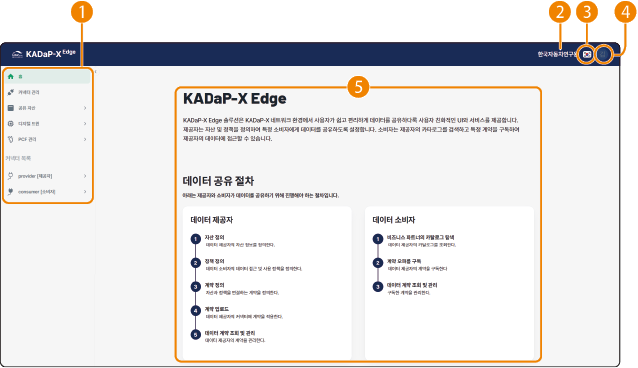
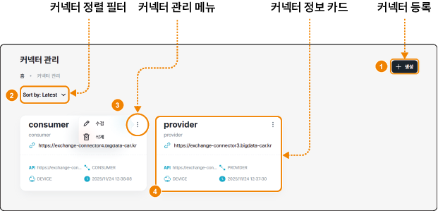
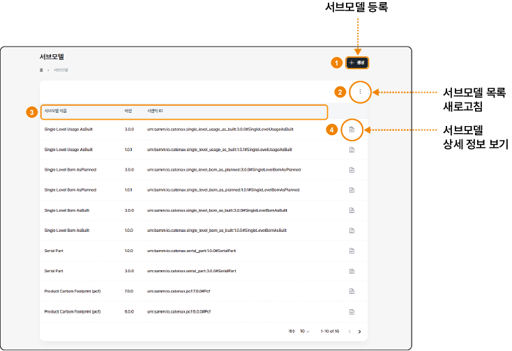
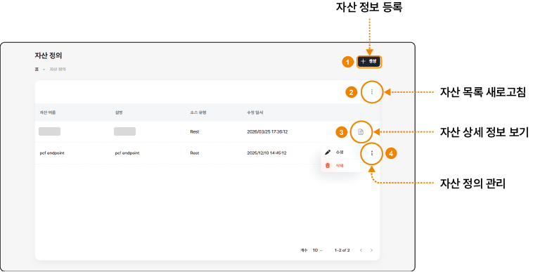
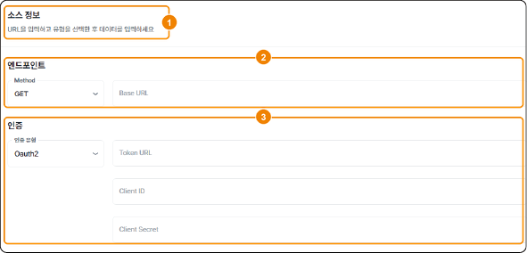

# 데이터 전송 기능 (KADaP-X Edge) - A. 시작하기와 자산 등록

[TOC]

KADaP-X Edge는 커넥터(EDC)를 이용해 다른 회사와 계약을 맺고 데이터를 주고받는 앱입니다. 제공자는 자산, 정책, 계약을 정의해 오퍼링을 업로드하고, 소비자는 카탈로그에서 계약을 구독해 데이터를 다운로드합니다.

이 절은 Edge를 시작하고 교환할 자산을 등록하는 방법을 설명합니다. 계약 게시와 관리는 'B. 계약 게시와 관리(제공자)', 데이터 구독과 다운로드, PCF는 'C. 구독과 다운로드(소비자) · PCF'에서 설명합니다.

# 사용 순서

Edge 작업은 데이터를 제공하는 제공자 회사와 데이터를 받는 소비자 회사가 나눠서 진행합니다. 두 회사 모두 먼저 '홈 화면 구성'에서 메뉴를 살펴보고, '커넥터 관리하기'에서 provider와 consumer 커넥터가 등록되어 있는지 확인하세요.

### 제공자 작업 순서

데이터를 제공하려면 다음 순서대로 진행하세요.

1. 교환할 데이터의 형식을 정의한 서브모델을 등록하세요.
2. 서브모델과 데이터 소스를 지정해 자산을 정의하세요.
3. 접근 정책에 소비자 회사의 BPN을 지정해 정책을 정의하세요.
4. 자산과 정책을 묶어 계약을 정의하세요.
5. 계약을 오퍼링으로 업로드해 카탈로그에 게시하고, 디지털 트윈(쉘)이 등록되었는지 확인하세요.
6. 소비자가 구독한 계약과 전송 이력을 확인하세요.

### 소비자 작업 순서

데이터를 받으려면 다음 순서대로 진행하세요.

1. 제공자 BPN으로 카탈로그를 조회하고 필요한 계약을 구독하세요.
2. 계약이 체결되었는지 확인하고 데이터를 다운로드하세요.
3. 다운로드 결과와 받은 데이터를 확인하세요.

CSV 파일로 자산을 한꺼번에 업로드할 때는 '자산 업로드하기'를, 제품 탄소 발자국(PCF) 정보를 주고받을 때는 'PCF 요청하기'와 'PCF 응답 확인하기'를 참고하세요.

# 홈 화면 구성

KADaP-X Edge 홈 화면에서 각 메뉴로 이동하고 데이터 공유 절차 안내를 확인할 수 있습니다.

### 화면 구성

KADaP-X Edge 홈 화면은 다음과 같이 구성됩니다.

| 번호 | 항목 | 설명 |
|---|---|---|
| 1 | 메뉴 | KADaP-X Edge의 메뉴를 선택할 수 있습니다. 메뉴별 기능은 표 아래에서 설명합니다. |
| 2 | 조직 정보 | 로그인한 사용자가 속한 회사나 조직 이름을 표시합니다. |
| 3 | 언어 설정 | 화면에 표시되는 언어를 한국어와 영어 중에서 선택할 수 있습니다. |
| 4 | 내 정보 | 로그인한 사용자 정보를 확인하고 로그아웃할 수 있습니다. |
| 5 | 데이터 공유 절차 안내 | 데이터 제공자와 소비자가 데이터를 공유하는 절차를 안내합니다. |

메뉴의 기능은 다음과 같습니다.

- **홈**: 홈 화면으로 이동합니다.
- **커넥터 관리**: 제공자용과 소비자용 커넥터를 등록하고 관리할 수 있습니다.
- **공유 자산**: 자산을 업로드하고, 데이터 교환에 쓸 자산, 정책, 계약을 정의해 관리할 수 있습니다.
- **디지털 트윈**: AAS 표준에 따른 디지털 트윈 레지스트리를 확인하고 서브모델을 등록할 수 있습니다.
- **PCF 관리**: 계약이 체결된 뒤 제공자에게 PCF(Product Carbon Footprint, 제품 탄소 발자국) 정보를 요청하고 응답을 확인할 수 있습니다.
- **커넥터 목록**: 커넥터별로 오퍼링 업로드, 카탈로그 조회, 계약 관리, 이력 확인 메뉴를 사용할 수 있습니다.

# 커넥터 관리하기

KADaP-X Edge의 **커넥터 관리** 메뉴에서 커넥터를 등록하고 관리할 수 있습니다.

### 화면 구성

커넥터 관리 화면은 다음과 같이 구성됩니다.

| 번호 | 항목 | 설명 |
|---|---|---|
| 1 | 커넥터 등록 | **+ 생성**을 클릭하면 커넥터 생성 화면으로 이동합니다. |
| 2 | 커넥터 정렬 필터 | **Sort by**에서 커넥터 카드의 정렬 순서를 선택합니다. |
| 3 | 커넥터 관리 메뉴 | 카드의 더 보기(⋮) 아이콘을 클릭하면 **수정**과 **삭제** 메뉴가 표시됩니다. **수정**을 클릭하면 커넥터 수정 화면으로 이동하고, **삭제**한 커넥터는 복구할 수 없습니다. |
| 4 | 커넥터 정보 카드 | 등록한 커넥터의 이름, 설명, 커넥터 주소, API 주소, 유형(PROVIDER 또는 CONSUMER), 등록 일시를 표시합니다. |

### 커넥터 확인하고 등록하기

커넥터를 확인하고 새로 등록하려면 다음 순서대로 진행하세요.

1. KADaP-X Edge 홈 화면에서 **커넥터 관리**를 클릭하세요.
   - 커넥터 관리 화면이 표시됩니다.
2. **provider**와 **consumer** 커넥터 카드가 모두 있는지 확인하세요. 데이터를 공유하려면 두 커넥터가 모두 등록되어 있어야 합니다.
3. 등록되지 않은 커넥터가 있으면 **+ 생성**을 클릭하세요.
   - 커넥터 생성 화면이 표시됩니다.
4. 커넥터 생성 화면의 항목을 입력하세요.
   - **커넥터명**: 커넥터 이름을 입력합니다. 제공자 커넥터는 provider, 소비자 커넥터는 consumer처럼 유형과 같게 정하면 구분하기 쉽습니다.
   - **설명**: 커넥터 설명을 입력합니다.
   - **Dataspace**: 데이터스페이스를 선택합니다. **KADaP-X**를 선택하면 KADaP-X 데이터스페이스의 다른 커넥터와 데이터를 교환할 수 있습니다.
   - **커넥터 유형**: 데이터 제공자는 **Provider**, 소비자는 **Consumer**를 선택합니다.
   - **서비스 형식**: 커넥터 운영 방식을 선택합니다. **Self Hosted**는 회사가 커넥터를 직접 설치해 운영하는 방식으로, 보안이 중요할 때 선택합니다. **CaaS**(Connector as a Service)는 KADaP이 클라우드에서 커넥터를 대신 운영하는 방식으로, 따로 서버를 구축하지 않아도 됩니다.
   - **Base URL**: 커넥터의 프로토콜 주소를 입력합니다. 다른 회사의 커넥터가 카탈로그 조회, 계약 협상, 전송 요청에 사용하는 주소입니다.
   - **데이터플레인 URL**: 계약이 체결된 뒤 실제 데이터를 주고받는 데 쓰는 커넥터 주소를 입력합니다.
   - **API Header**와 **API Value**: 커넥터 관리 API를 호출할 때 쓰는 인증 헤더의 이름과 값(토큰)을 입력합니다. 두 값은 커넥터 운영 담당자에게 받아 입력합니다.
5. **생성**을 클릭하세요.

> **주의 -** 운영 중인 커넥터를 **수정**하거나 **삭제**하면 그 커넥터를 쓰는 데이터 교환이 모두 멈출 수 있습니다. 커넥터 정보는 커넥터 운영 담당자와 협의한 뒤에 변경하세요.

# 서브모델 등록하기

KADaP-X Edge의 **디지털 트윈** > **서브모델** 메뉴에서 서브모델을 등록할 수 있습니다.

### 화면 구성

서브모델 화면은 다음과 같이 구성됩니다.

| 번호 | 항목 | 설명 |
|---|---|---|
| 1 | 서브모델 등록 | **+ 생성**을 클릭하면 서브모델 생성 화면으로 이동합니다. |
| 2 | 서브모델 목록 새로고침 | 더 보기(⋮) 아이콘을 클릭해 서브모델 목록을 새로고침할 수 있습니다. |
| 3 | 서브모델 목록 | 등록된 서브모델의 이름, 버전, 시맨틱 ID를 표시합니다. |
| 4 | 서브모델 상세 정보 보기 | 상세 보기 아이콘을 클릭하면 서브모델 상세 정보 창에서 버전, 시맨틱 ID 등을 확인할 수 있습니다. |

### 서브모델 등록하기

서브모델을 등록하려면 다음 순서대로 진행하세요.

1. KADaP-X Edge 홈 화면에서 **디지털 트윈** > **서브모델**을 클릭하세요.
   - 서브모델 화면이 표시됩니다.
2. **+ 생성**을 클릭하세요.
   - 서브모델 생성 화면이 표시됩니다.
3. **Upload file**을 클릭해 서브모델 스키마 파일(.json)을 업로드하세요.
   - 파일의 title, version, semantic_id 값이 이름, 버전, 시맨틱 ID 칸에 자동으로 입력됩니다.
4. 이름, 버전, 시맨틱 ID가 채워졌는지 확인하고 ID를 입력하세요.
   - **ID**: 영문 소문자, 숫자, 밑줄로 된 ID를 입력합니다. (예: `temphumidity_100`)
5. **업로드**를 클릭하세요.

> **참고 -** 서브모델은 .json 형식의 서브모델 스키마 파일로 등록합니다. 쉘이나 서브모델 인스턴스 같은 AAS 형식의 JSON 파일을 올리면 이름, 버전, 시맨틱 ID가 채워지지 않습니다.

# 자산 정의하기

KADaP-X Edge의 **공유 자산** > **자산 정의** 메뉴에서 자산을 정의하고 관리할 수 있습니다.

### 화면 구성

자산 정의 화면은 다음과 같이 구성됩니다.

| 번호 | 항목 | 설명 |
|---|---|---|
| 1 | 자산 정보 등록 | **+ 생성**을 클릭하면 자산 생성 화면으로 이동합니다. 자세한 내용은 '자산 생성하기'를 참고하세요. |
| 2 | 자산 목록 새로고침 | 더 보기(⋮) 아이콘을 클릭해 자산 목록을 새로고침할 수 있습니다. |
| 3 | 자산 상세 정보 보기 | 상세 보기 아이콘을 클릭하면 등록한 자산 정보를 확인할 수 있습니다. |
| 4 | 자산 정의 관리 | 행의 더 보기(⋮) 아이콘을 클릭하면 **수정**과 **삭제** 메뉴가 표시됩니다. **수정**을 클릭하면 자산 편집 화면으로 이동하고, **삭제**한 자산은 복구할 수 없습니다. |

# 자산 생성하기

자산 생성 화면에서 자산 이름, 서브모델, 데이터 소스를 지정해 자산을 등록할 수 있습니다.

### 화면 구성

자산 생성 화면 아래쪽의 소스 정보 영역은 다음과 같이 구성됩니다. 위쪽의 자산, 서브모델, 소스 유형은 아래 절차에서 설명합니다.

| 번호 | 항목 | 설명 |
|---|---|---|
| 1 | 소스 정보 | 자산 데이터를 가져올 곳의 엔드포인트와 인증 정보를 입력하는 영역입니다. |
| 2 | 엔드포인트 | **Method**에서 API 호출 방식을 선택하고, **Base URL**에 데이터를 가져올 API 주소를 입력합니다. |
| 3 | 인증 | **인증 유형**(예: **Oauth2**)을 선택하고 **Token URL**, **Client ID**, **Client Secret**을 입력합니다. |

### 자산 생성하기

자산을 생성하려면 다음 순서대로 진행하세요.

1. KADaP-X Edge 홈 화면에서 **공유 자산** > **자산 정의**를 클릭하세요.
   - 자산 정의 화면이 표시됩니다.
2. **+ 생성**을 클릭하세요.
   - 자산 생성 화면이 표시됩니다.
3. 자산 생성 화면 위쪽의 항목을 입력하세요.
   - **자산**: 자산 이름과 설명을 입력합니다.
   - **서브모델**: **+ 생성**을 클릭해 자산에 적용할 서브모델을 선택합니다. 자산을 업로드했다면 업로드할 때와 같은 서브모델이어야 합니다. 선택한 서브모델은 상세 보기 아이콘으로 확인하고, 변경 아이콘으로 바꿀 수 있습니다.
   - **소스 유형**: **REST**와 **CSV** 중에서 선택합니다. **REST**는 외부 API에서 데이터를 가져오는 방식으로, 연결 정보와 인증 정보를 그림의 소스 정보에 입력합니다. **CSV**는 업로드한 CSV 파일을 데이터 소스로 사용합니다.
4. 그림의 소스 정보에 엔드포인트와 인증 정보를 입력하세요.
5. **생성**을 클릭하세요.

# 자산 업로드하기

KADaP-X Edge의 **공유 자산** > **자산 업로드** 메뉴에서 서브모델 템플릿에 맞춘 자산 데이터를 업로드할 수 있습니다.

### 화면 구성

자산 업로드 화면은 다음과 같이 구성됩니다.

| 번호 | 항목 | 설명 |
|---|---|---|
| 1 | 서브모델 | 자산에 적용할 서브모델을 선택하는 영역입니다. 서브모델을 선택해야 자산을 입력하거나 업로드할 수 있습니다. |
| 2 | 선택한 서브모델 삭제 | 휴지통 아이콘을 클릭하면 선택한 서브모델을 지우고 다시 선택할 수 있습니다. |
| 3 | 서브모델 템플릿 · 샘플 파일 다운로드 | 서브모델의 템플릿이나 샘플 CSV 파일을 다운로드해 입력 항목을 확인할 수 있습니다. |
| 4 | 자산 입력 행 추가 · 삭제 | **+ 추가**를 클릭해 자산 입력 행을 추가하거나, 선택한 행을 **삭제**할 수 있습니다. |
| 5 | 자산 csv 파일 업로드 | 템플릿에 맞춰 작성한 CSV 파일을 올려 자산을 한꺼번에 업로드할 수 있습니다. |
| 6 | 행별 자산 직접 입력 | 행마다 세부 항목을 직접 입력하거나 수정할 수 있습니다. |
| 7 | 업로드 | 입력한 자산 정보를 업로드합니다. |

### 자산 업로드하기

자산을 업로드하려면 다음 순서대로 진행하세요.

1. KADaP-X Edge 홈 화면에서 **공유 자산** > **자산 업로드**를 클릭하세요.
   - 자산 업로드 화면이 표시됩니다.
2. **+ 생성**을 클릭하세요.
   - 서브모델 선택 창이 표시됩니다.
3. 자산에 적용할 서브모델을 선택하고 **+ 선택**을 클릭하세요. 서브모델의 버전 등 상세 정보는 행의 상세 보기 아이콘으로 확인할 수 있습니다.
   - 선택한 서브모델이 표시됩니다.
4. 자산 입력 행을 추가해 자산 정보를 입력하거나, 템플릿에 맞춰 작성한 CSV 파일을 올리세요.
5. **업로드**를 클릭하세요.

> **참고 -** '서브모델 등록하기'에서 직접 등록한 서브모델(예: 온습도)로는 자산을 업로드할 수 없습니다. 이런 서브모델은 '자산 생성하기'에서 바로 선택하고 소스 유형을 **REST**로 지정하세요.
