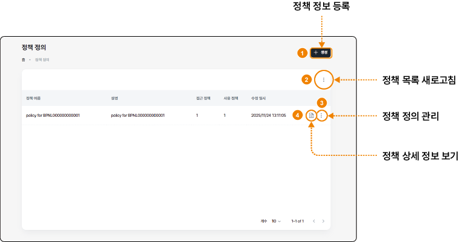
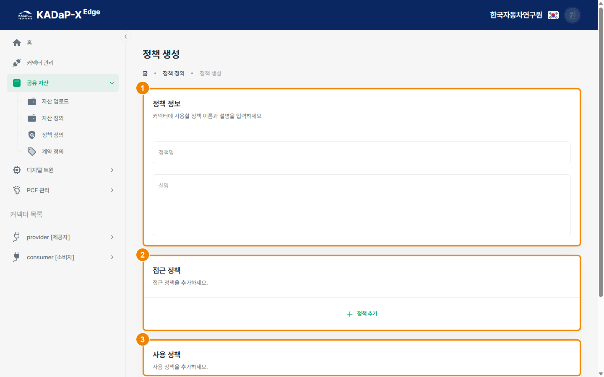
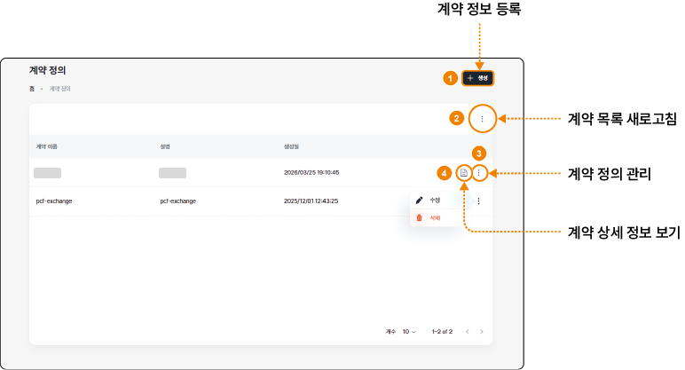
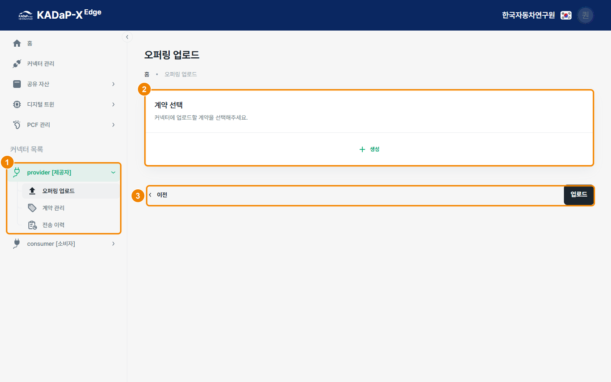
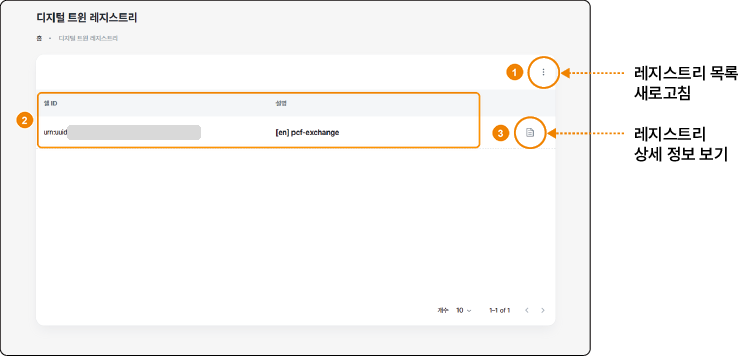
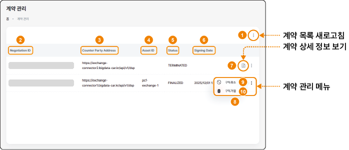
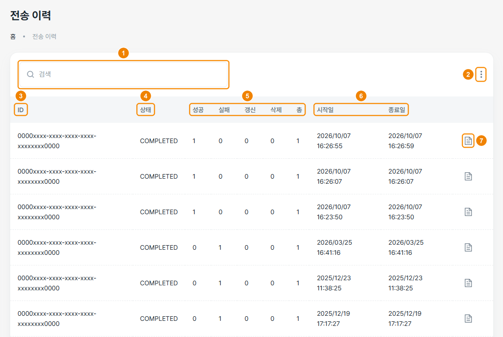

# 데이터 전송 기능 (KADaP-X Edge) - B. 계약 게시와 관리(제공자)

[TOC]

제공자가 정책과 계약을 정의해 오퍼링으로 게시하고, 소비자와 맺은 계약과 데이터 전송 결과를 관리하는 방법을 설명합니다.

# 정책 정의하기

KADaP-X Edge의 **공유 자산** > **정책 정의** 메뉴에서 데이터 사용 정책을 정의하고 관리할 수 있습니다.

### 화면 구성

정책 정의 화면은 다음과 같이 구성됩니다.

| 번호 | 항목 | 설명 |
|---|---|---|
| 1 | 정책 정보 등록 | **+ 생성**을 클릭하면 정책 생성 화면으로 이동합니다. 자세한 내용은 '정책 생성하기'를 참고하세요. |
| 2 | 정책 목록 새로고침 | 더 보기(⋮) 아이콘을 클릭해 정책 목록을 새로고침할 수 있습니다. |
| 3 | 정책 정의 관리 | 행의 더 보기(⋮) 아이콘을 클릭하면 **수정**과 **삭제** 메뉴가 표시됩니다. **수정**을 클릭하면 정책 편집 화면으로 이동하고, **삭제**한 정책은 복구할 수 없습니다. |
| 4 | 정책 상세 정보 보기 | 상세 보기 아이콘을 클릭하면 등록한 정책의 접근 정책과 사용 정책을 확인할 수 있습니다. |

# 정책 생성하기

정책 생성 화면에서 계약에 적용할 접근 정책과 사용 정책을 등록할 수 있습니다.

### 화면 구성

정책 생성 화면은 다음과 같이 구성됩니다.

| 번호 | 항목 | 설명 |
|---|---|---|
| 1 | 정책 정보 | 정책명과 설명을 입력합니다. |
| 2 | 접근 정책 | **+ 정책 추가**로 유형과 값을 추가하고, 추가한 항목은 **삭제**로 지울 수 있습니다. 이 조건에 맞는 회사만 카탈로그에서 계약을 조회할 수 있습니다. |
| 3 | 사용 정책 | **+ 정책 추가**를 클릭해 계약 체결 뒤 데이터를 사용할 수 있는 범위를 유형과 값으로 추가합니다. |

### 정책 생성하기

정책을 생성하려면 다음 순서대로 진행하세요.

1. KADaP-X Edge 홈 화면에서 **공유 자산** > **정책 정의**를 클릭하세요.
   - 정책 정의 화면이 표시됩니다.
2. **+ 생성**을 클릭하세요.
   - 정책 생성 화면이 표시됩니다.
3. 정책명과 설명을 입력하세요.
4. 접근 정책의 **+ 정책 추가**를 클릭하고, 데이터를 받을 회사를 다음과 같이 지정하세요.
   - **유형**: BPN을 선택합니다.
   - **값**: 소비자 회사의 BPN을 입력합니다.
5. 필요하면 사용 정책의 **+ 정책 추가**를 클릭해 유형과 값을 추가하세요.
6. **생성**을 클릭하세요.

> **참고 -** 접근 정책의 BPN 값은 소비자 회사의 BPN과 정확히 같아야 합니다. 값이 다르면 소비자가 카탈로그를 조회해도 결과가 표시되지 않습니다. 소비자 회사의 BPN은 포털의 '파트너 네트워크'에서 확인할 수 있습니다.

# 계약 정의하기

KADaP-X Edge의 **공유 자산** > **계약 정의** 메뉴에서 계약을 정의하고 관리할 수 있습니다.

### 화면 구성

계약 정의 화면은 다음과 같이 구성됩니다.

| 번호 | 항목 | 설명 |
|---|---|---|
| 1 | 계약 정보 등록 | **+ 생성**을 클릭하면 계약 생성 화면으로 이동합니다. |
| 2 | 계약 목록 새로고침 | 더 보기(⋮) 아이콘을 클릭해 계약 목록을 새로고침할 수 있습니다. |
| 3 | 계약 정의 관리 | 행의 더 보기(⋮) 아이콘을 클릭하면 **수정**과 **삭제** 메뉴가 표시됩니다. 이 메뉴로 계약을 수정하거나 삭제할 수 있습니다. |
| 4 | 계약 상세 정보 보기 | 상세 보기 아이콘을 클릭하면 계약에 묶인 자산과 정책 정보를 확인할 수 있습니다. |

### 계약 생성하기

계약을 생성하려면 다음 순서대로 진행하세요.

1. KADaP-X Edge 홈 화면에서 **공유 자산** > **계약 정의**를 클릭하세요.
   - 계약 정의 화면이 표시됩니다.
2. **+ 생성**을 클릭하세요.
   - 계약 생성 화면이 표시됩니다.
3. 계약 생성 화면의 항목을 입력하세요.
   - **계약 정보**: 계약 이름과 설명을 입력합니다.
   - **자산 설정**: **+ 생성**을 클릭하고, 자산 목록에서 계약에 포함할 자산을 선택한 뒤 **+ 선택**을 클릭합니다. 추가한 자산은 상세 정보와 함께 표시되며, 이름 오른쪽의 삭제(×) 아이콘으로 지우고 다시 선택할 수 있습니다.
   - **정책 설정**: **+ 생성**을 클릭하고, 정책 목록에서 계약에 적용할 정책을 선택한 뒤 **+ 선택**을 클릭합니다. 추가한 정책은 상세 정보와 함께 표시되며, 이름 오른쪽의 삭제(×) 아이콘으로 지우고 다시 선택할 수 있습니다.
4. **생성**을 클릭하세요.

# 오퍼링 업로드하기

오퍼링 업로드 화면에서는 미리 정의한 계약을 provider 커넥터에 업로드해 카탈로그에 게시할 수 있습니다.

### 화면 구성

오퍼링 업로드 화면은 다음과 같이 구성됩니다.

| 번호 | 항목 | 설명 |
|---|---|---|
| 1 | 커넥터 목록 > provider | **오퍼링 업로드**, **계약 관리**, **전송 이력** 메뉴를 선택할 수 있습니다. |
| 2 | 계약 선택 · 생성 | **+ 생성**을 클릭하면 계약 선택 창이 표시됩니다. 계약을 선택하면 그 계약의 자산과 정책 정보가 이 영역에 나타납니다. |
| 3 | 이전 · 업로드 | **업로드**를 클릭하면 선택한 계약이 provider 커넥터에 업로드되어 카탈로그에 게시됩니다. **이전**을 클릭하면 계약 정의 화면으로 돌아갑니다. |

### 오퍼링 업로드하기

오퍼링을 업로드하려면 다음 순서대로 진행하세요.

1. KADaP-X Edge 홈 화면에서 **커넥터 목록** > **provider [제공자]** > **오퍼링 업로드**를 클릭하세요.
   - 오퍼링 업로드 화면이 표시됩니다.
2. **+ 생성**을 클릭하세요.
   - 계약 선택 창이 표시됩니다.
3. 업로드할 계약을 선택하고 **선택**을 클릭하세요.
   - 선택한 계약의 자산과 정책 정보가 표시됩니다.
4. 자산과 정책 정보를 확인하고 **업로드**를 클릭하세요.
   - 자산이 커넥터에 등록되어 카탈로그에 게시되고, 디지털 트윈(쉘)도 자동으로 등록됩니다.

> **주의 -** 오퍼링을 업로드한 뒤에는 자산 정의 화면에서 엔드포인트를 **수정**해도 이미 커넥터에 등록된 자산의 데이터 주소가 바뀌지 않습니다. 주소를 바꾸려면 새 자산을 정의하고, 그 자산으로 계약을 만들어 오퍼링을 다시 업로드하세요. 또는 커넥터 운영 담당자에게 데이터 주소 변경과 소비자 커넥터의 데이터 접근 토큰 정리를 요청하세요.

# 디지털 트윈 레지스트리 확인하기

KADaP-X Edge의 **디지털 트윈** > **레지스트리** 메뉴에서 디지털 트윈 레지스트리에 등록된 쉘(디스크립터)을 확인할 수 있습니다. 쉘은 오퍼링을 업로드하면 자동으로 등록됩니다.

### 화면 구성

디지털 트윈 레지스트리 화면은 다음과 같이 구성됩니다.

| 번호 | 항목 | 설명 |
|---|---|---|
| 1 | 레지스트리 목록 새로고침 | 더 보기(⋮) 아이콘을 클릭해 쉘 목록을 새로고침할 수 있습니다. |
| 2 | 쉘 목록 | 레지스트리에 등록된 쉘의 쉘 ID와 설명을 표시합니다. |
| 3 | 레지스트리 상세 정보 보기 | 상세 보기 아이콘을 클릭하면 디지털 트윈 쉘 상세 정보 창이 표시됩니다. |

### 쉘 상세 정보 확인하기

쉘 상세 정보를 확인하려면 다음 순서대로 진행하세요.

1. KADaP-X Edge 홈 화면에서 **디지털 트윈** > **레지스트리**를 클릭하세요.
   - 디지털 트윈 레지스트리 화면이 표시됩니다.
2. 확인할 쉘 행의 상세 보기 아이콘을 클릭하세요.
   - 디지털 트윈 쉘 상세 정보 창이 표시됩니다.
3. 창에서 쉘의 상세 정보를 확인하세요.

# 계약 관리하기(제공자)

계약 관리 화면에서 소비자와 맺은 계약의 상태를 확인하고, 구독을 취소하거나 거절할 수 있습니다.

### 화면 구성

계약 관리 화면은 다음과 같이 구성됩니다.

| 번호 | 항목 | 설명 |
|---|---|---|
| 1 | 계약 목록 새로고침 | 더 보기(⋮) 아이콘을 클릭해 계약 목록을 새로고침할 수 있습니다. |
| 2 | Negotiation ID | 계약을 식별하는 고유 번호로, 시스템이 자동으로 부여합니다. |
| 3 | Counter Party Address | 계약 상대인 소비자 커넥터의 주소를 표시합니다. |
| 4 | Asset ID | 계약에 포함된 자산의 ID입니다. 제공자가 자산을 정의할 때 입력한 이름이 표시됩니다. |
| 5 | Status | 계약 상태를 표시합니다. **FINALIZED**는 계약이 체결되어 데이터를 교환할 수 있는 상태이고, **TERMINATED**는 체결되지 않고 종료된 상태입니다. |
| 6 | Signing Date | 계약이 체결된 날짜를 표시합니다. 체결되지 않은 계약은 비어 있습니다. |
| 7 | 계약 상세 정보 보기 | 상세 보기 아이콘을 클릭하면 계약 상세 창에서 자산과 정책 정보를 확인할 수 있습니다. |
| 8 | 계약 관리 메뉴 | 더 보기(⋮) 아이콘을 클릭하면 **구독취소**와 **구독거절** 메뉴가 표시됩니다. |
| 9 | 구독취소 | 체결된 계약의 구독을 제공자가 취소합니다. 소비자가 사용 정책을 위반했거나 더 이상 데이터를 제공할 수 없을 때 사용합니다. |
| 10 | 구독거절 | 계약이 체결되기 전에 소비자의 구독 요청을 거절합니다. 정책 조건에 맞지 않거나 신뢰할 수 없는 소비자일 때 사용합니다. |

### 계약 확인하기

소비자와 맺은 계약을 확인하려면 다음 순서대로 진행하세요.

1. KADaP-X Edge 홈 화면에서 **커넥터 목록** > **provider [제공자]** > **계약 관리**를 클릭하세요.
   - 계약 관리 화면이 표시됩니다.
2. 소비자가 구독한 계약의 Status를 확인하세요.
3. 계약의 자산과 정책 정보를 보려면 그 행의 상세 보기 아이콘을 클릭하세요.
   - 계약 상세 창이 표시됩니다.

# 전송 이력 확인하기

전송 이력 화면에서 소비자가 요청한 데이터 전송의 처리 결과를 확인할 수 있습니다.

### 화면 구성

전송 이력 화면은 다음과 같이 구성됩니다.

| 번호 | 항목 | 설명 |
|---|---|---|
| 1 | ID 검색창 | 전송 ID로 이력을 검색합니다. |
| 2 | 전송 이력 목록 새로고침 | 더 보기(⋮) 아이콘을 클릭해 전송 이력 목록을 새로고침할 수 있습니다. |
| 3 | ID | 데이터 전송을 식별하는 ID로, 상세 내역을 조회할 때 사용합니다. |
| 4 | 상태 | 데이터 전송의 처리 결과(예: **COMPLETED**)를 표시합니다. |
| 5 | 성공 · 실패 · 갱신 · 삭제 · 총 | 성공과 실패는 전송에 성공하거나 실패한 건수이고, 갱신과 삭제는 변경되거나 삭제된 데이터 건수입니다. 총은 전체 처리 건수입니다. |
| 6 | 시작일 · 종료일 | 데이터 전송이 시작된 일시와 완료된 일시를 표시합니다. 전송은 소비자가 다운로드를 요청하면 시작됩니다. |
| 7 | 전송 상세 정보 보기 | 상세 보기 아이콘을 클릭하면 전송된 데이터의 상세 정보를 확인할 수 있습니다. |

### 전송 결과 확인하기

전송 결과를 확인하려면 다음 순서대로 진행하세요.

1. KADaP-X Edge 홈 화면에서 **커넥터 목록** > **provider [제공자]** > **전송 이력**을 클릭하세요.
   - 전송 이력 화면이 표시됩니다.
2. 각 전송의 상태와 성공, 실패 건수를 확인하세요.
