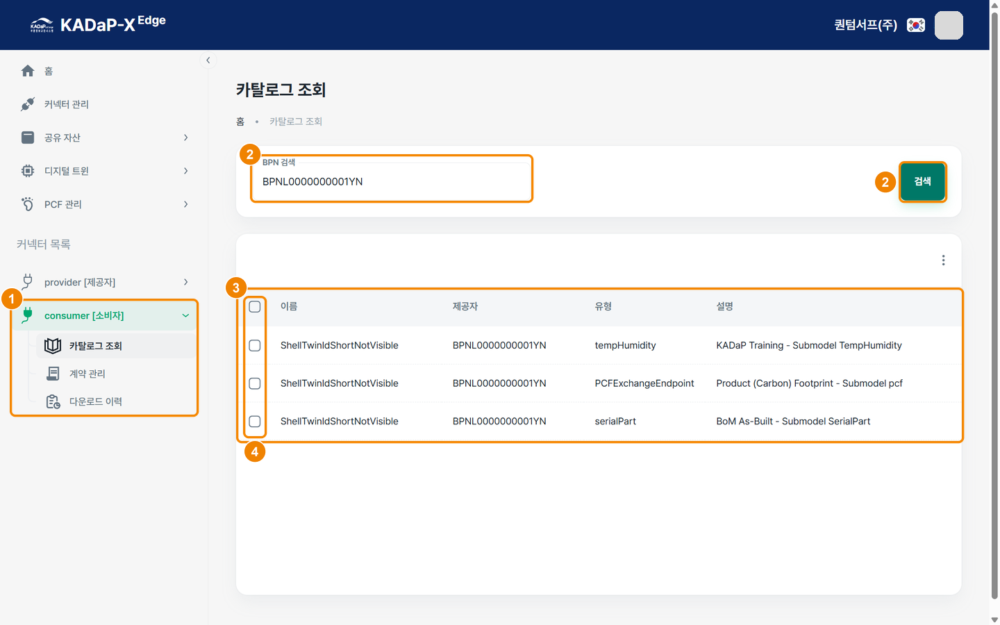
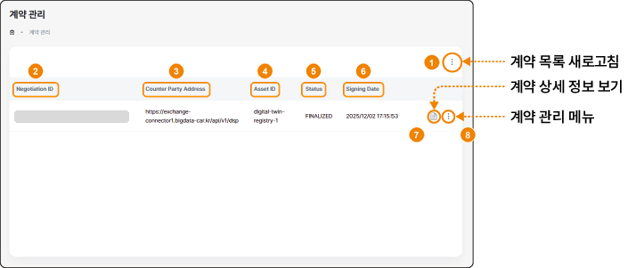
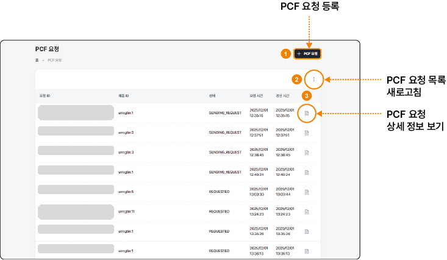
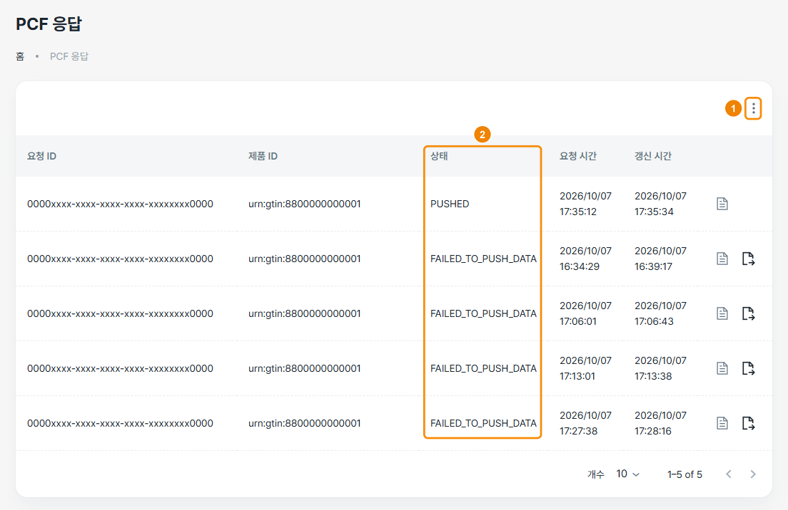

# 데이터 전송 기능 (KADaP-X Edge) - C. 구독과 다운로드(소비자) · PCF

[TOC]

소비자가 카탈로그에서 계약을 구독하고 데이터를 다운로드하는 방법과, 제품 탄소 발자국(PCF) 정보를 요청하고 응답하는 방법을 설명합니다.

# 카탈로그 조회하고 구독하기

카탈로그 조회 화면에서 제공자 BPN으로 제공자가 게시한 계약을 찾아 구독할 수 있습니다.

### 화면 구성

카탈로그 조회 화면은 다음과 같이 구성됩니다.

| 번호 | 항목 | 설명 |
|---|---|---|
| 1 | 커넥터 목록 > consumer | **카탈로그 조회**, **계약 관리**, **다운로드 이력** 메뉴를 선택할 수 있습니다. |
| 2 | BPN 검색 · 검색 | 제공자 BPN을 입력하고 **검색**을 클릭합니다. |
| 3 | 결과 목록 | 제공자가 게시한 계약의 이름, 제공자, 유형, 설명을 표시합니다. 이름은 모두 ShellTwinIdShortNotVisible로 표시되므로 유형과 설명으로 계약을 구분합니다. |
| 4 | 행 체크박스 | 구독할 계약을 선택합니다. 선택한 뒤 **구독**을 클릭하면 구독 상세정보 창이 표시됩니다. |

### 계약 구독하기

카탈로그에서 계약을 구독하려면 다음 순서대로 진행하세요.

1. KADaP-X Edge 홈 화면에서 **커넥터 목록** > **consumer [소비자]** > **카탈로그 조회**를 클릭하세요.
   - 카탈로그 조회 화면이 표시됩니다.
2. 제공자 **BPN**을 입력하고 **검색**을 클릭하세요.
   - 몇 초에서 수십 초 뒤 결과 목록이 표시됩니다.
3. 유형과 설명을 보고 구독할 계약의 체크박스를 선택한 뒤 **구독**을 클릭하세요.
   - 구독 상세정보 창이 표시됩니다.
4. 구독 상세정보 창에서 **구독**을 클릭하세요.
5. **계약 관리**에서 구독한 자산의 Asset ID로 계약 행을 찾아 Status가 REQUESTED에서 **FINALIZED**로 바뀌었는지 확인하세요. 아직 바뀌지 않았으면 10~20초 뒤 목록을 새로고침하세요.
   - 제공자 커넥터가 정책을 확인해 계약을 자동으로 체결하므로, 제공자가 따로 처리할 일은 없습니다.

> **참고 -** 제공자 BPN은 포털의 '파트너 네트워크'에서 확인할 수 있습니다.

# 계약 관리하고 다운로드하기(소비자)

계약 관리 화면에서 제공자와 맺은 계약의 상태를 확인하고, 데이터를 다운로드하거나 구독을 취소할 수 있습니다.

### 화면 구성

계약 관리 화면은 다음과 같이 구성됩니다.

| 번호 | 항목 | 설명 |
|---|---|---|
| 1 | 계약 목록 새로고침 | 더 보기(⋮) 아이콘을 클릭해 계약 목록을 새로고침할 수 있습니다. |
| 2 | Negotiation ID | 계약을 식별하는 고유 번호로, 시스템이 자동으로 부여합니다. |
| 3 | Counter Party Address | 계약 상대인 제공자 커넥터의 주소를 표시합니다. |
| 4 | Asset ID | 계약에 포함된 자산의 ID입니다. 제공자가 자산을 정의할 때 입력한 이름이 표시됩니다. |
| 5 | Status | 계약 상태를 표시합니다. **FINALIZED**는 계약이 체결된 상태로, 이 상태에서만 데이터를 교환할 수 있습니다. |
| 6 | Signing Date | 계약이 체결된 날짜를 표시합니다. 체결되지 않은 계약은 비어 있습니다. |
| 7 | 계약 상세 정보 보기 | 상세 보기 아이콘을 클릭하면 계약 상세 창에서 자산과 정책 정보를 확인할 수 있습니다. |
| 8 | 계약 관리 메뉴 | 더 보기(⋮) 아이콘을 클릭하면 **다운로드**와 **구독취소** 메뉴가 표시됩니다. **다운로드**는 체결된 계약의 데이터를 제공자에게 요청하고, **구독취소**는 체결된 계약의 구독을 취소합니다. |

### 데이터 다운로드하기

체결된 계약의 데이터를 다운로드하려면 다음 순서대로 진행하세요.

1. KADaP-X Edge 홈 화면에서 **커넥터 목록** > **consumer [소비자]** > **계약 관리**를 클릭하세요.
   - 계약 관리 화면이 표시됩니다.
2. 구독한 계약의 Status가 **FINALIZED**인지 확인하세요. 아직 REQUESTED이면 10~20초 뒤 목록을 새로고침하세요.
3. Status가 **FINALIZED**인 행의 더 보기(⋮) > **다운로드**를 클릭하세요.

결과를 보려면 '다운로드 이력 확인하기'를 참고하세요.

> **참고 -** 계약 관리에 FINALIZED 행이 여러 개이면 **Asset ID**로 원하는 자산의 행을 찾으세요.

> **주의 -** 더 보기(⋮) 메뉴의 **구독취소**를 클릭하면 계약이 취소되어, 같은 소비자 커넥터를 쓰는 모든 사용자가 그 자산을 다운로드할 수 없게 됩니다.

# 다운로드 이력 확인하기

다운로드 이력 화면에서 데이터를 다운로드한 기록과 결과를 확인할 수 있습니다.

### 화면 구성

다운로드 이력 화면은 다음과 같이 구성됩니다.

| 번호 | 항목 | 설명 |
|---|---|---|
| 1 | 다운로드 목록 새로고침 | 더 보기(⋮) 아이콘을 클릭해 다운로드 이력 목록을 새로고침할 수 있습니다. |
| 2 | ID | 다운로드를 식별하는 ID로, 상세 내역을 조회할 때 사용합니다. |
| 3 | 제공자 URL | 제공자 커넥터의 주소(…/api/v1/dsp)를 표시합니다. |
| 4 | 커넥터 ID | 제공자 커넥터의 BPN(BPNL…)을 표시합니다. |
| 5 | 성공 · 실패 · 결과 | 성공은 정상 전송 건수, 실패는 전송 실패 건수, 결과는 전체 처리 건수(성공 + 실패)를 표시합니다. |
| 6 | 시작일 · 종료 일시 | 다운로드가 시작된 일시와 끝난 일시를 표시합니다. 종료 일시 열은 머리글이 **커넥터 ID**로 표시되지만 값은 종료 일시입니다. |

### 다운로드 결과 확인하기

다운로드 결과를 확인하려면 다음 순서대로 진행하세요.

1. KADaP-X Edge 홈 화면에서 **커넥터 목록** > **consumer [소비자]** > **다운로드 이력**을 클릭하세요.
   - 다운로드 이력 화면이 표시됩니다.
2. 시작일을 보고 방금 다운로드한 행을 찾으세요. 보통 맨 위 행입니다.
3. 그 행의 성공이 1, 실패가 0인지 확인하세요.
4. 그 행 끝의 상세 보기 아이콘을 클릭해 다운로드한 데이터를 확인하세요.
   - 예를 들어 온습도 자산이면 Temperature, Humidity, SensorId 값이 표시됩니다.

# PCF 요청하기

KADaP-X Edge의 **PCF 관리** > **PCF 요청** 메뉴에서 제공자에게 PCF 데이터를 요청할 수 있습니다.

### 화면 구성

PCF 요청 목록 화면은 다음과 같이 구성됩니다.

| 번호 | 항목 | 설명 |
|---|---|---|
| 1 | PCF 요청 등록 | **+ PCF 요청**을 클릭하면 새 요청을 입력하는 화면으로 이동합니다. |
| 2 | PCF 요청 목록 새로고침 | 더 보기(⋮) 아이콘을 클릭해 PCF 요청 목록을 새로고침할 수 있습니다. |
| 3 | PCF 요청 상세 정보 보기 | 상세 보기 아이콘을 클릭하면 요청 내용을 확인할 수 있습니다. |

### PCF 요청하기

PCF 데이터를 요청하려면 다음 순서대로 진행하세요.

1. KADaP-X Edge 홈 화면에서 **PCF 관리** > **PCF 요청**을 클릭하세요.
   - PCF 요청 목록 화면이 표시됩니다.
2. **+ PCF 요청**을 클릭하세요.
   - 요청 입력 화면이 표시됩니다. 이 화면에는 **PCF 요청 정보**와 **커넥터 정보** 영역, **이전**과 **요청** 버튼이 있습니다.
3. 요청 입력 화면의 항목을 입력하세요.
   - **PCF 요청 정보**: 계약 정보에서 확인한 BPN과 제품 ID, 함께 전달할 메시지를 입력합니다.
   - **커넥터 정보**: 요청을 보낼 커넥터를 선택합니다. **+ 생성**을 클릭하고, 커넥터 목록에서 커넥터를 선택한 뒤 **+ 선택**을 클릭합니다. 추가한 커넥터는 이름 오른쪽의 삭제(×) 아이콘으로 지우고 다시 선택할 수 있습니다.
4. **요청**을 클릭하세요.

# PCF 응답 확인하기

KADaP-X Edge의 **PCF 관리** > **PCF 응답** 메뉴에서 받은 PCF 요청의 처리 상태를 확인하고, 요청에 응답해 PCF 데이터를 전송할 수 있습니다.

### 화면 구성

PCF 응답 화면은 다음과 같이 구성됩니다.

| 번호 | 항목 | 설명 |
|---|---|---|
| 1 | PCF 응답 목록 새로고침 | 더 보기(⋮) 아이콘을 클릭해 PCF 응답 목록을 새로고침할 수 있습니다. |
| 2 | 상태 | 요청 처리 상태를 표시합니다. REQUESTED는 요청 접수, PUSHED는 데이터 전송 완료, FAILED_TO_PUSH_DATA는 전송 실패를 뜻합니다. |

### PCF 응답 확인하고 전송하기

PCF 응답을 확인하고 데이터를 전송하려면 다음 순서대로 진행하세요.

1. KADaP-X Edge 홈 화면에서 **PCF 관리** > **PCF 응답**을 클릭하세요.
   - PCF 응답 화면이 표시됩니다.
2. 응답 목록에서 각 요청의 상태를 확인하세요.
3. 그 행 끝의 **PCF 데이터 전송** 아이콘을 클릭해 요청에 응답하세요.
4. 시맨틱 ID와 데이터를 보낼 provider 커넥터를 선택하고 **전송**을 클릭하세요.
   - 전송이 끝나면 상태가 **PUSHED**로 바뀝니다.

# 문제 해결하기

Edge를 사용하다 문제가 생기면 아래 표에서 증상을 찾아 조치하세요.

| 단계 | 증상 | 조치 |
|---|---|---|
| 접속 | 로그인 화면이 반복해서 표시됨 | 포털에 먼저 로그인해 회사를 선택했는지, 앱 접근 권한이 있는지 확인하세요. |
| 오퍼링 | 오퍼링을 업로드하면 500 오류가 발생함 | '커넥터 관리하기'에서 커넥터의 API 주소, **API Header**, **API Value**가 맞는지 확인하세요. 값이 맞으면 커넥터 운영 담당자에게 정책 허브(정책 템플릿 서비스) 연결 확인을 요청하세요. |
| 카탈로그 | 조회 결과가 비어 있음 | 입력한 제공자 BPN이 맞는지, 제공자 접근 정책의 BPN이 소비자 회사의 BPN과 같은지 확인하세요. 그래도 비어 있으면 커넥터 운영 담당자에게 제공자 커넥터의 디지털 트윈 레지스트리(DTR) 자산 확인을 요청하세요. |
| 카탈로그 | 조회에 몇 분씩 걸림 | 소비자 커넥터에 데이터 접근 토큰이 쌓였을 수 있습니다. 커넥터 운영 담당자에게 토큰 확인과 정리를 요청하세요. |
| 구독 | REQUESTED에서 바뀌지 않거나 TERMINATED로 바뀜 | 제공자 정책의 조건이 소비자 회사와 맞는지 확인하세요. 정책에 문제가 없으면 커넥터 운영 담당자에게 회사 지갑(MIW)의 자격 증명 상태 확인을 요청하세요. |
| 다운로드 | 계약 관리에 FINALIZED 행이 여러 개 | 같은 제공자와 계약을 여러 건 맺은 경우입니다. Asset ID로 원하는 자산의 행을 찾아 다운로드하세요. |
| 다운로드 | 다운로드 이력에 실패 1 | 제공자 자산 정의의 OAuth2 Client ID와 Secret 별칭이 맞는지, 소스 주소에 접근할 수 있는지 확인하세요. |
| 다운로드 | 실패 상세에 'Token has expired'(토큰 만료) | 소비자 커넥터에 만료된 데이터 접근 토큰이 남아 있는 경우입니다. 커넥터 운영 담당자에게 만료된 토큰 정리를 요청한 뒤 다시 다운로드하세요. |
| 다운로드 | 데이터가 빈 값 | 자산의 소스 주소가 가리키는 데이터(FA³ST 값 또는 업로드한 행)에 값이 있는지 확인하세요. |
| 다운로드 | 자산 정의에서 엔드포인트를 수정해도 결과가 같음 | 자산 정의를 수정해도 이미 커넥터에 등록된 자산의 데이터 주소는 바뀌지 않습니다. '오퍼링 업로드하기'의 주의 내용에 따라 오퍼링을 다시 업로드하거나 커넥터 운영 담당자에게 변경을 요청하세요. |
