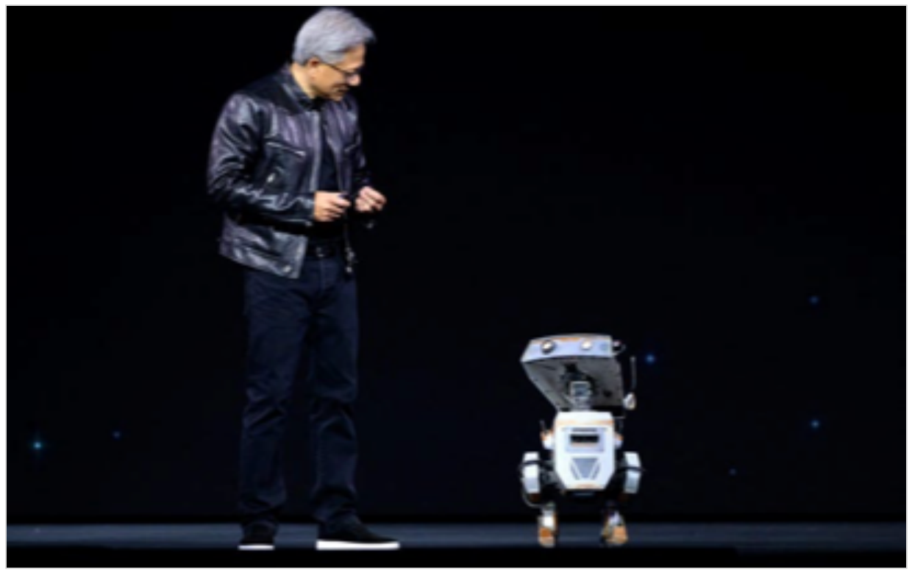
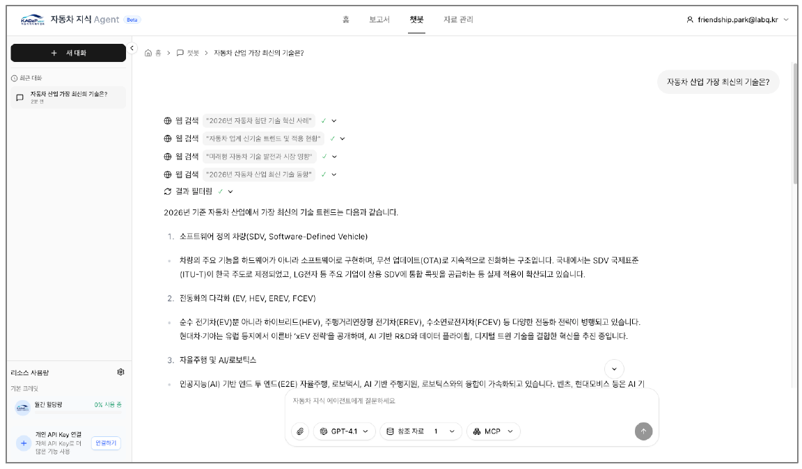
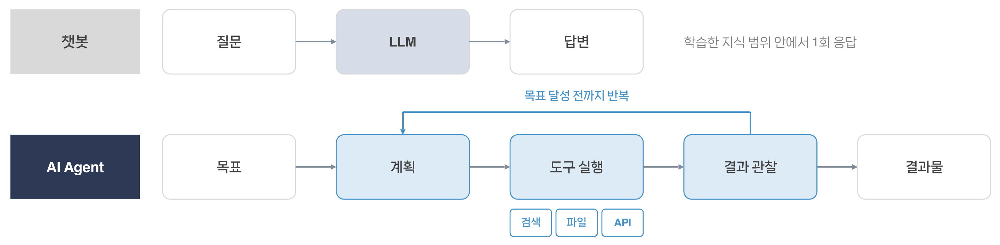
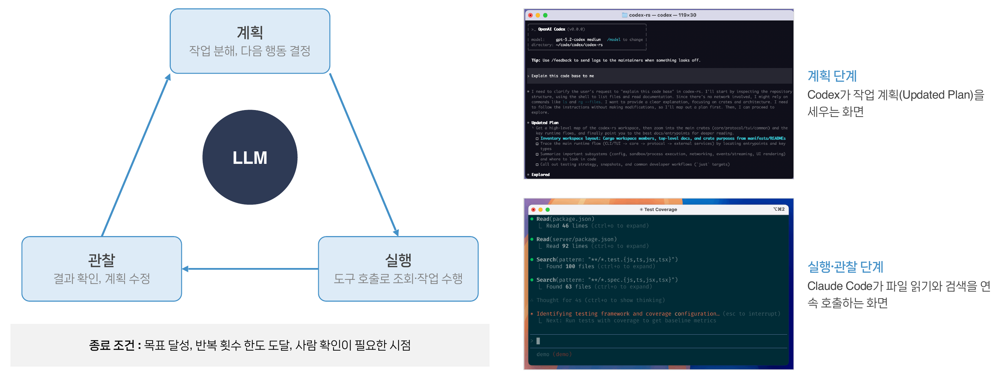
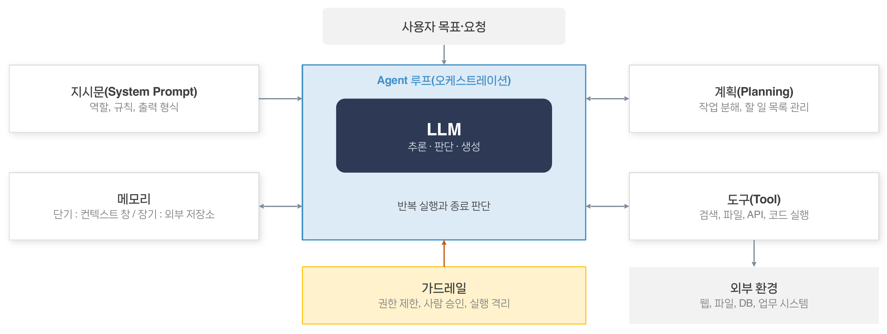
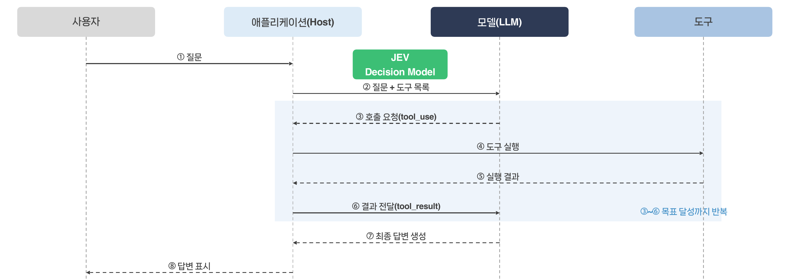
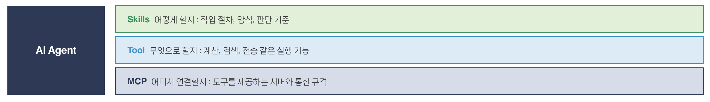
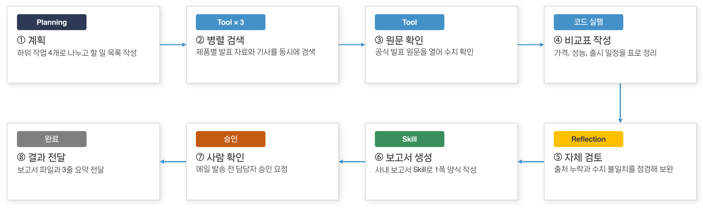
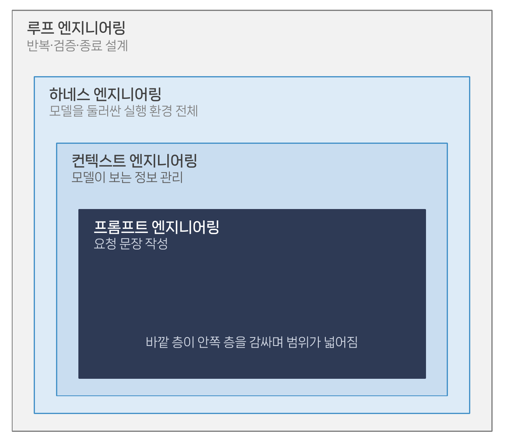

# [실습] [5교시] AI Agent 개요 및 효과적인 활용 방법

## [5교시] AI Agent 개요 및 효과적인 활용 방법

AI Agent의 구조와 도구 호출(Tool Calling) 원리를 이해하고, 작업 정의·도구 설계·결과 검증 중심의 활용 방법을 익히는 이론 교시입니다.

## 학습 목표

- AI Agent의 구조와 도구 호출(Tool Calling) 원리를 이해한다.
- 작업 정의, 도구 설계, 결과 검증 중심의 활용 방법을 이해한다.

## 학습 내용

| 순서 | 내용 |
| --- | --- |
| 01-01 | Why AI Agent? |
| 01-02 | 주요 AI Agent 서비스 |
| 01-03 | 챗봇과 AI Agent의 차이 |
| 01-04 | LLM, AI Agent, Agentic AI의 차이 |
| 01-05 | AI Agent의 동작 루프 |
| 01-06 | AI Agent의 구성 요소 |
| 01-07 | 구성 요소 상세 ① 모델·지시문·계획 |
| 01-08 | 구성 요소 상세 ② 컨텍스트 관리 |
| 01-09 | 도구 호출(Tool Calling)의 동작 원리 |
| 01-10 | Tool, MCP, Skills의 개념 |
| 01-11 | 실행 예시 : 복합 업무 처리 과정 |
| 01-12 | 어시스턴트·워크플로·Agent의 선택 |
| 01-13 | 효과적인 활용 ① 작업 정의와 분해 |
| 01-14 | 효과적인 활용 ② 도구 설계 원칙 |
| 01-15 | 효과적인 활용 ③ 검증과 사람 확인 |
| 01-16 | AI Agent의 한계와 보안 위험 |
| 01-17 | 종합 : 하네스 엔지니어링과 루프 엔지니어링 |
| 01-18 | 5교시 정리 |

## Why AI Agent?

AI Agent는 2025년 이후 AI 산업의 핵심 화두가 되었지만, 실제 성과를 내는 프로젝트는 아직 일부입니다.



[ NVIDIA CEO 젠슨 황, CES 2025 기조연설(2025. 1. 6.) ]

## 젠슨 황, CES 2025 기조연설

- "모든 기업의 IT 부서는 앞으로 AI 에이전트의 HR 부서가 될 것"
- Agentic AI를 수조 달러 규모의 기회로 평가

## Gartner 전망(2025년 6월 발표)

| 수치 | 의미 |
| --- | --- |
| **33%** | 2028년 Agent 기능을 갖춘 기업용 소프트웨어 비중(2024년 1% 미만) |
| **15%** | 2028년 Agent가 자율 수행할 일상 업무 결정 비중(2024년 0%) |
| **40%+** | 2027년 말까지 중단이 예상되는 Agent 프로젝트 비중 |

**기대는 크지만, 명확한 가치가 있는 업무를 골라 적용하는 것이 관건입니다.**

출처 : Fortune·TelecomTV CES 2025 보도(2025. 1.), Gartner 보도자료(2025. 6.)

## 주요 AI Agent 서비스

코딩, 업무, 오픈소스 영역에서 AI Agent 제품과 플랫폼이 빠르게 늘고 있습니다.

## 영역별 주요 서비스

| 영역 | 서비스 |
| --- | --- |
| **코딩 Agent** | Claude Code, OpenAI Codex, Gemini CLI, GitHub Copilot, Cursor |
| **업무 Agent** | ChatGPT agent, Claude Cowork, Microsoft 365 Copilot |
| **오픈소스·플랫폼** | OpenClaw, 카카오 PlayMCP, KADaP 지식 Agent |

## 공통 구조

목표를 받아 계획을 세우고, 도구를 호출해 검색·파일 작업·코드 실행 같은 실제 작업까지 수행합니다.



[ KADaP 자동차 지식 Agent : 자동차 산업 지식 챗봇과 보고서 작성 Agent ]

출처 : 각 사 공식 발표, KADaP 자동차 데이터 플랫폼

## 챗봇과 AI Agent의 차이

챗봇은 한 번 답하고 끝나지만, Agent는 목표를 이룰 때까지 도구를 쓰며 다음 단계를 스스로 정합니다.



## 챗봇

- 흐름 : **질문** → **LLM** → **답변**
- 학습한 지식 범위 안에서 1회 응답

## AI Agent

- 흐름 : **목표** → **계획** → **도구 실행** → **결과 관찰** → **결과물**
- 계획 → 도구 실행 → 결과 관찰을 목표 달성 전까지 반복
- 도구 예 : 검색, 파일, API

**LLM 단독의 한계(최신·내부 정보, 정확한 계산, 외부 작업 실행)를 도구 연결로 보완한 것이 AI Agent입니다.**

## LLM, AI Agent, Agentic AI의 차이

LLM은 모델, AI Agent는 도구를 쓰며 목표를 수행하는 프로그램, Agentic AI는 여러 Agent를 엮은 시스템 설계를 뜻합니다.

| 구분 | LLM | AI Agent | Agentic AI |
| --- | --- | --- | --- |
| **정체** | 텍스트를 입력받아 다음 텍스트를 생성하는 모델 | LLM에 도구·메모리·루프를 붙여 목표를 수행하는 프로그램 | 여러 Agent와 워크플로를 역할별로 엮은 시스템(설계 관점) |
| **동작 단위** | 요청 1회 → 응답 1회 | 계획 → 도구 호출 → 관찰을 목표 달성까지 반복 | Agent 간 작업 분배·협업·검증을 반복 |
| **도구·외부 작업** | 없음, 학습한 지식 범위 안에서 답변 | 있음 : 검색, 파일, API, 코드 실행 | 있음, Agent마다 다른 도구와 권한 |
| **자율성** | 없음, 사람이 매번 질문 | 목표 안에서 다음 행동을 스스로 결정 | 목표 분해·역할 배정·종료 판단까지 시스템이 수행 |
| **예** | GPT, Claude, Gemini 모델 API 호출 | Claude Code, KADaP 지식 Agent | 오케스트레이터 + 검색·작성·검토 Agent로 된 보고서 시스템 |

**이번 실습의 MCP는 AI Agent에 도구를 연결하는 층이고, Agentic AI는 그런 Agent 여러 개를 엮는 설계 관점입니다.**

참고 : Anthropic, Building Effective Agents(2024); NVIDIA Blog, What Is Agentic AI?(2025); Gartner, Agentic AI(2025)

## AI Agent의 동작 루프

AI Agent는 계획, 실행, 관찰을 반복하며 목표를 달성하거나 종료 조건에 이를 때까지 작업합니다.



## 루프의 세 단계

| 단계 | 내용 |
| --- | --- |
| **계획** | 작업 분해, 다음 행동 결정 |
| **실행** | 도구 호출로 조회·작업 수행 |
| **관찰** | 결과 확인, 계획 수정 |

세 단계의 중심에 **LLM**이 있으며, 계획 → 실행 → 관찰 → 계획 순으로 돕니다.

## 실제 화면 예

- **계획 단계** : Codex가 작업 계획(Updated Plan)을 세우는 화면
- **실행·관찰 단계** : Claude Code가 파일 읽기와 검색을 연속 호출하는 화면

**종료 조건 : 목표 달성, 반복 횟수 한도 도달, 사람 확인이 필요한 시점**

## AI Agent의 구성 요소

AI Agent는 LLM을 중심으로 지시문, 메모리, 계획, 도구, 가드레일이 결합된 시스템입니다.



## 구성 요소

| 구성 요소 | 역할 |
| --- | --- |
| **사용자 목표·요청** | Agent 루프의 입력 |
| **Agent 루프(오케스트레이션)** | LLM(추론·판단·생성)을 중심으로 반복 실행과 종료 판단을 수행 |
| **지시문(System Prompt)** | 역할, 규칙, 출력 형식 |
| **메모리** | 단기 : 컨텍스트 창 / 장기 : 외부 저장소 |
| **계획(Planning)** | 작업 분해, 할 일 목록 관리 |
| **도구(Tool)** | 검색, 파일, API, 코드 실행 |
| **가드레일** | 권한 제한, 사람 승인, 실행 격리 |
| **외부 환경** | 웹, 파일, DB, 업무 시스템 |

## 구성 요소 상세 ① 모델·지시문·계획

같은 모델이라도 지시문과 계획 방식에 따라 Agent의 행동과 결과가 크게 달라집니다.

## 모델(LLM)

- **역할** : 상황 판단, 다음 행동 선택, 답변 생성
- **선택 기준** : 추론 성능, 컨텍스트 창 크기, 도구 호출 정확도, 비용·속도
- **실무** : 복잡한 판단은 상위 모델, 단순 분류·요약은 경량 모델로 나누어 사용

## 지시문(System Prompt)

- **구성** : 역할, 목표, 행동 규칙, 출력 형식, 예시
- **구분** : 항상 적용되는 고정 지시와 매번 바뀌는 작업 지시를 분리
- **실무** : 규칙만 나열하기보다 이유와 판단 기준을 함께 설명

## 계획(Planning)

- **ReAct** : 생각과 행동을 번갈아 수행하며 결과에 따라 다음 단계 결정
- **Plan-and-Execute** : 전체 계획을 먼저 세운 뒤 단계별로 실행
- **실무** : 할 일 목록으로 진행 상황을 관리하고 결과에 따라 계획 수정

## 지시문 예시

```
당신은 사내 데이터 분석 Agent다. 수치는 반드시 도구 실행 결과에서 인용하고, 확인되지 않은 내용은 "확인 필요"로 표시한다.
작업 전에 할 일 목록을 먼저 작성하고, 결과는 표 1개와 3줄 요약으로 정리한다. 데이터 수정이나 외부 발송은 실행 전에 사용자에게 확인한다.
```

참고 : Yao et al., ReAct: Synergizing Reasoning and Acting in Language Models(2022)

## 구성 요소 상세 ② 컨텍스트 관리

컨텍스트 창이 커져도, 무엇을 넣고 빼느냐가 Agent의 정확도와 비용을 좌우합니다.

## 세 가지 문제

### Agent 루프의 누적 : 긴 작업에서는 큰 창도 찬다

- **원인** : 단계마다 파일·검색 결과·로그가 쌓임
- **대응** : 코딩 Agent의 대화 자동 요약(compaction)

### 길이와 정확도·비용 : 넘치지 않아도 길면 손해

- **정확도** : 입력이 길수록 떨어지는 현상(context rot) 보고
- **비용** : 호출마다 전체를 다시 보내 비용·지연 증가

### 출력 한도와 데이터 : 7교시 실습과 직접 연결

- **한도** : 도구 인자(출력) 한도는 입력 창보다 훨씬 작음
- **원칙** : 데이터는 서버에, 모델에는 이름·요약만

## 관리 방법 : 컨텍스트 엔지니어링(Context Engineering)

- **선별** : 작업과 관련된 자료만 골라 넣기
- **요약·압축** : 긴 대화와 도구 결과는 요약해 유지
- **외부 저장** : 오래 남길 정보는 파일·DB·문서 검색(RAG)에 두고 필요할 때 불러오기(장기 메모리)
- **분리** : 큰 작업은 하위 Agent에 나눠 맡기고 결과만 받기

참고 : Anthropic, Effective context engineering for AI agents(2025); Chroma, Context Rot(2025)

## 도구 호출(Tool Calling)의 동작 원리

모델은 어떤 도구를 어떤 값으로 부를지 요청만 만들고, 실제 실행은 애플리케이션이 담당합니다.



## 참여자

- **사용자**
- **애플리케이션(Host)** : 도구 목록을 모델에 전달하고, 모델의 호출 요청을 실제로 실행
- **모델(LLM)**
- **도구**

## 메시지 순서

1. **① 질문** : 사용자 → 애플리케이션
2. **② 질문 + 도구 목록** : 애플리케이션 → 모델
3. **③ 호출 요청(tool_use)** : 모델 → 애플리케이션. 어떤 도구를 어떤 값으로 부를지 요청
4. **④ 도구 실행** : 애플리케이션 → 도구
5. **⑤ 실행 결과** : 도구 → 애플리케이션
6. **⑥ 결과 전달(tool_result)** : 애플리케이션 → 모델
7. **⑦ 최종 답변 생성** : 모델 → 애플리케이션
8. **⑧ 답변 표시** : 애플리케이션 → 사용자

③~⑥은 목표를 달성할 때까지 반복됩니다.

참고 : Anthropic API 문서(Tool use)

## Tool, MCP, Skills의 개념

Tool은 실행 기능, MCP는 연결 규격, Skills는 작업 노하우로, 서로 다른 층위에서 Agent를 확장합니다.

## Tool : Agent가 호출하는 개별 기능

- **정의** : 이름, 설명, 입력 형식으로 구성된 함수
- **예** : `predict_fuel_efficiency`(연비 예측), `search_news`(뉴스 검색), `send_to_kakao`(메시지 전송)
- **역할** : Agent에게 행동 능력을 부여

## MCP : 도구를 Agent 앱에 연결하는 표준 규약

- **정의** : AI 앱과 외부 도구·데이터를 잇는 개방형 프로토콜
- **예** : mobility-ai 서버(도구 6개), daily-news 서버(도구 2개)
- **효과** : 한 번 만든 서버를 여러 Agent 앱에서 재사용

## Skills : 작업 절차·기준·양식을 담은 지침 묶음

- **정의** : SKILL.md와 스크립트·양식 파일로 구성된 폴더
- **예** : 월간 비용 분석 보고서 : 분석 순서, 표 양식, 검증 규칙
- **동작** : 필요할 때만 본문을 불러와 컨텍스트 절약

## 세 가지의 관계



| 구분 | 질문 | 내용 |
| --- | --- | --- |
| **Skills** | 어떻게 할지 | 작업 절차, 양식, 판단 기준 |
| **Tool** | 무엇으로 할지 | 계산, 검색, 전송 같은 실행 기능 |
| **MCP** | 어디서 연결할지 | 도구를 제공하는 서버와 통신 규격 |

## 실행 예시 : 복합 업무 처리 과정

"경쟁 제품 3종의 최근 발표를 비교해 임원 보고용 1쪽 요약을 만들어 줘"를 Agent가 처리하는 과정입니다.



| 순서 | 단계 | 동작 | 사용 요소 |
| --- | --- | --- | --- |
| ① | **계획** | 하위 작업 4개로 나누고 할 일 목록 작성 | Planning |
| ② | **병렬 검색** | 제품별 발표 자료와 기사를 동시에 검색 | Tool × 3 |
| ③ | **원문 확인** | 공식 발표 원문을 열어 수치 확인 | Tool |
| ④ | **비교표 작성** | 가격, 성능, 출시 일정을 표로 정리 | 코드 실행 |
| ⑤ | **자체 검토** | 출처 누락과 수치 불일치를 점검해 보완 | Reflection |
| ⑥ | **보고서 생성** | 사내 보고서 Skill로 1쪽 양식 작성 | Skill |
| ⑦ | **사람 확인** | 메일 발송 전 담당자 승인 요청 | 승인 |
| ⑧ | **결과 전달** | 보고서 파일과 3줄 요약 전달 | 완료 |

**같은 요청이라도 Agent는 중간 결과에 따라 검색을 추가하거나 순서를 바꿉니다.**

## 어시스턴트·워크플로·Agent의 선택

의사결정이 필요한 일에만 Agent를 쓰고, 정해진 절차는 워크플로로 처리합니다.

| 구분 | 어시스턴트 | 워크플로(자동화) | 에이전트(Agent) |
| --- | --- | --- | --- |
| **적합한 일** | 단순 질의·조회 | 정해진 절차의 반복 처리 | 상황 판단이 필요한 복합 업무 |
| **실행 순서 결정** | 사람이 질문할 때마다 | 사람이 미리 정의 | 모델이 상황에 따라 결정 |
| **결과 예측 가능성** | 높음 | 높음 | 상대적으로 낮음 |
| **비용과 속도** | 적게 들고 빠름 | 적게 들고 빠름 | 반복 호출로 많이 들고 느림 |

**단순한 방식으로 해결된다면 Agent를 쓰지 않는 것이 원칙입니다.**

출처 : Anthropic, Building Effective Agents(2024), Gartner 보도자료(2025. 6.)

## 효과적인 활용 ① 작업 정의와 분해

목표, 입력, 완료 조건, 제약을 분명히 줄수록 Agent의 결과가 안정됩니다.

## 작업 정의의 네 요소

- **목표** : 무엇을 왜 하는지
- **입력** : 사용할 자료와 범위
- **완료 조건** : 결과물의 형식과 분량
- **제약** : 하지 말아야 할 것, 확인이 필요한 지점

## 모호한 지시

> "경쟁사 동향 정리해줘"

## 구체적 지시

- **목표** : 다음 주 임원회의용으로 A·B·C사의 최근 3개월 신제품 발표 비교
- **입력** : 각 사 공식 보도자료와 주요 언론 기사
- **완료 조건** : 1쪽 비교표(가격, 핵심 기능, 출시 일정)와 시사점 3줄
- **제약** : 출처 없는 수치 금지, 추정은 '추정'으로 표시, 확인 안 된 항목은 빈칸

**큰 작업은 검증 가능한 단계로 나누고, 단계별 결과를 확인한 뒤 다음 지시로 넘어갑니다.**

## 효과적인 활용 ② 도구 설계 원칙

Agent는 도구의 이름과 설명을 보고 선택하므로, 도구 설계가 Agent 성능을 좌우합니다.

## 설계 원칙

- **한 도구 한 기능** : 목적이 분명한 도구일수록 정확히 선택됨
- **명확한 이름·설명** : 언제 쓰는지, 무엇을 넣고 무엇을 받는지 기술
- **입력 형식 제한** : 허용 값과 형식을 정해 잘못된 호출을 막음
- **간결한 결과 반환** : 필요한 정보만 돌려주고 긴 원문은 요청 시 제공
- **고칠 수 있는 오류** : 무엇이 틀렸고 어떻게 고칠지 알려주는 오류 메시지

## 나쁜 예

- **이름** : `data_tool`
- **설명** : 데이터 처리

## 좋은 예

- **이름** : `search_news`
- **설명** : 국내 뉴스 기사를 검색한다. 최신 동향이 필요할 때 사용한다. query에 핵심어 2~3개를 넣으면 기사 제목, 요약, 링크를 돌려준다.

## 효과적인 활용 ③ 검증과 사람 확인

결과의 근거를 확인하고, 데이터 변경·외부 실행 전에는 사람이 승인하는 단계를 둡니다.

## 작업 유형별 확인 방식

| 작업 유형 | 예시 | 확인 방식 |
| --- | --- | --- |
| **조회** | 검색, 문서·파일 읽기 | 자동 실행 허용 |
| **생성** | 보고서 초안, 새 파일 작성 | 결과를 검토한 뒤 사용 |
| **변경·실행** | 메일 발송, 데이터 수정·삭제, 결제 | 실행 전 사람이 승인 |

## 결과 검증 방법

- **도구 호출 기록** : 어떤 도구를 어떤 값으로 호출했는지 확인
- **원본 대조** : 요약과 수치를 원본 자료와 비교
- **출처 확인** : 답변에 근거 링크나 파일 위치를 요구

## AI Agent의 한계와 보안 위험

환각, 잘못된 도구 선택, 프롬프트 인젝션, 과도한 권한이 대표적인 위험입니다.

| 위험 | 내용 | 대응 |
| --- | --- | --- |
| **환각** | 근거 없는 사실이나 수치를 생성 | 도구 결과에 근거한 답변 요구, 출처 확인 |
| **잘못된 도구 선택** | 비슷한 도구를 혼동하거나 입력값을 잘못 넣음 | 도구 수 최소화, 설명 명확화 |
| **프롬프트 인젝션** | 웹페이지나 문서 속에 숨은 지시를 따름 | 외부 내용은 자료로만 취급, 실행 권한 분리 |
| **과도한 권한** | 필요 이상의 접근으로 피해가 커짐 | 최소 권한, 읽기 전용 우선 |

## 종합 : 하네스 엔지니어링과 루프 엔지니어링

앞서 다룬 요소를 묶어 설계하는 관점이 하네스 엔지니어링, 반복과 검증 구조를 설계하는 관점이 루프 엔지니어링입니다.



## 설계 관점의 층 구조

바깥 층이 안쪽 층을 감싸며 범위가 넓어집니다.

| 층 | 범위 |
| --- | --- |
| **루프 엔지니어링** | 반복·검증·종료 설계 |
| **하네스 엔지니어링** | 모델을 둘러싼 실행 환경 전체 |
| **컨텍스트 엔지니어링** | 모델이 보는 정보 관리 |
| **프롬프트 엔지니어링** | 요청 문장 작성 |

## 하네스 엔지니어링(Harness Engineering)

- **정의** : Agent = 모델 + 하네스. 지시문, 도구, 컨텍스트 관리, 권한·샌드박스, 검증 장치처럼 모델을 뺀 나머지 전부를 설계
- **의미** : 모델을 바꾸지 않고 하네스만 고쳐도 성능이 크게 달라짐(LangChain은 같은 모델로 벤치마크 30위권에서 5위권 진입)
- **연결** : 2일차의 'AI 하네스(안전 고삐)'는 하네스의 가드레일 요소에 해당

## 루프 엔지니어링(Loop Engineering)

- **정의** : Agent가 실행하고, 결과를 증거로 검증하고, 실패하면 피드백을 반영해 다시 시도하며, 안전하게 멈추도록 반복 구조를 설계
- **구성** : 트리거, 실행, 검증, 피드백, 진행 상태 저장, 종료 조건·예산, 사람 이관
- **원칙** : Agent가 "끝났다"고 답한 것만으로 완료를 판단하지 않음

참고 : OpenAI·LangChain 하네스 엔지니어링 자료, Addy Osmani 루프 엔지니어링(2026)

## 5교시 정리

Agent 활용의 핵심은 도구 연결이며, 이 연결 방식을 표준화한 것이 다음 교시의 MCP입니다.

1. AI Agent는 LLM을 중심으로 지시문, 메모리, 계획, 도구, 가드레일이 결합되어 도구 호출과 결과 확인을 반복한다.
2. Tool은 실행 기능, MCP는 연결 규격, Skills는 작업 노하우를 담당한다.
3. Agent의 성능은 작업 정의, 컨텍스트, 도구, 검증 장치를 아우르는 하네스·루프 설계에 크게 좌우된다.
4. 조회는 자동으로 맡기고, 변경·실행은 사람이 승인한 뒤 진행한다.

**이어서 다음 교시 : MCP(Model Context Protocol)**
