# [실습] [6교시] MCP 개요 및 실습 준비

## [6교시] MCP 개요 및 실습 준비

MCP의 구조와 통신 방식(stdio, Streamable HTTP)을 이해하고, 실습 환경을 구성해 예제 MCP Server 동작을 확인하는 교시입니다.

## 학습 목표

- MCP의 구조와 통신 방식(stdio, Streamable HTTP)을 이해한다.
- 실습 환경을 구성하고 예제 MCP Server 동작을 확인한다.

## 학습 내용

| 순서 | 내용 |
| --- | --- |
| 02-01 | 지난 교시 연결 : Tool, MCP, Skills 비교 |
| 02-02 | 도구 연결 방식의 파편화 문제 |
| 02-03 | MCP(Model Context Protocol) 개요 |
| 02-04 | MCP 구조 : Host, Client, Server |
| 02-05 | MCP Server의 제공 기능 |
| 02-06 | MCP 통신 방식 : stdio와 Streamable HTTP |
| 02-07 | REST API와 MCP의 관계 |
| 02-08 | MCP 호출 흐름 |
| 02-09 | MCP 사용 시 보안 유의사항 |
| 02-10 | [실습 준비] 실습 환경 구성 |
| 02-11 | [실습 준비] 준비물 점검 |
| 02-12 | [실습 준비] 예제 MCP 연동 ① Smithery에서 도구 고르고 API 키 받기 |
| 02-13 | [실습 준비] 예제 MCP 연동 ② KADaP 등록과 챗봇 확인 |

## 지난 교시 연결 : Tool, MCP, Skills 비교

세 가지 중 이번 교시에서는 도구 연결 규격인 MCP를 자세히 다룹니다.

| 구분 | Tool | MCP | Skills |
| --- | --- | --- | --- |
| **정체** | 호출 가능한 함수 하나 | 앱과 도구를 잇는 통신 규약 | 지침과 자료를 담은 폴더 |
| **구성** | 이름, 설명, 입력 스키마 | 서버가 제공하는 Tools·Resources·Prompts | SKILL.md, 스크립트, 양식 파일 |
| **모델 전달 방식** | 도구 정의가 요청마다 포함 | 연결 시 받은 도구 목록을 Tool로 전달 | 이름·설명만 먼저, 필요할 때 본문 로딩 |
| **해결하는 문제** | 행동 능력 부여 | 연결 방식 통일과 재사용 | 반복 업무 노하우 전달 |
| **예시** | `predict_fuel_efficiency`(연비 예측) | mobility-ai 서버(도구 6개) | 월간 비용 분석 보고서 Skill |

## SKILL.md 예시

```
---
name: monthly-cost-report
description: 비용 표로 월간 보고서를 작성할 때 사용
---
1) 표 등록 후 행 수·합계 대조
2) 월별 합계·부서별 평균 계산  3) 사내 양식으로 작성
```

## Agent Skills 표준

- Anthropic이 2025년 12월 공개 표준(agentskills.io)으로 공개, OpenAI Codex·GitHub Copilot·Cursor·Gemini CLI 등이 지원
- Skill을 지원하지 않는 Host에서는 시스템 지시문으로 대신

출처 : agentskills.io, Anthropic Agent Skills 문서

## 도구 연결 방식의 파편화 문제

Agent 앱마다 도구 연결 방식이 달라, 같은 도구를 앱별로 다시 개발해야 했습니다.

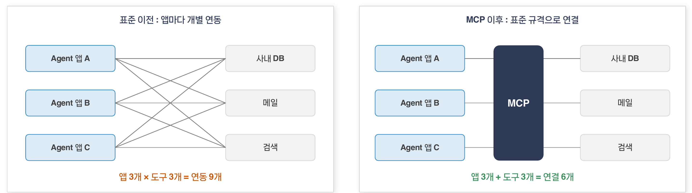

## 표준 이전 : 앱마다 개별 연동

- Agent 앱 A·B·C가 사내 DB, 메일, 검색 도구 각각에 개별 연동
- **앱 3개 × 도구 3개 = 연동 9개**

## MCP 이후 : 표준 규격으로 연결

- Agent 앱 A·B·C가 MCP 규격 하나로 사내 DB, 메일, 검색 도구에 연결
- **앱 3개 + 도구 3개 = 연결 6개**

**도구는 MCP 서버로 한 번 만들고, MCP를 지원하는 모든 Agent 앱에서 재사용합니다.**

## MCP(Model Context Protocol) 개요

MCP는 AI 애플리케이션과 외부 도구·데이터의 연결 방식을 표준화한 개방형 프로토콜입니다.

AI 애플리케이션이 외부 도구와 데이터에 연결하는 방식을 정한 개방형 표준으로, 공식 문서는 이를 'AI 애플리케이션을 위한 USB-C 포트'에 비유합니다.

## 연혁

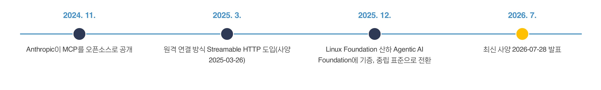

| 시기 | 내용 |
| --- | --- |
| **2024. 11.** | Anthropic이 MCP를 오픈소스로 공개 |
| **2025. 3.** | 원격 연결 방식 Streamable HTTP 도입(사양 2025-03-26) |
| **2025. 12.** | Linux Foundation 산하 Agentic AI Foundation에 기증, 중립 표준으로 전환 |
| **2026. 7.** | 최신 사양 2026-07-28 발표 |

## 주요 지원 Host

Claude, ChatGPT, OpenAI Codex, Gemini, Microsoft Copilot, VS Code, Cursor, Open WebUI

**2025년 12월 기준 : 월 9,700만 회 이상 SDK 다운로드, 활성 서버 약 1만 개**

출처 : Anthropic 발표(2024. 11., 2025. 12.), modelcontextprotocol.io 블로그(2025. 12. 9.)

## MCP 구조 : Host, Client, Server

Host(Agent 앱)는 연결할 Server마다 Client를 하나씩 두고, Server는 도구와 데이터를 제공합니다.

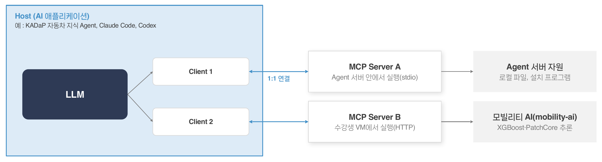

## 구조 설명

- **Host(AI 애플리케이션)** : 예 : KADaP 자동차 지식 Agent, Claude Code, Codex. 안에 LLM과 Client 1, Client 2를 둠
- **Client 1 ↔ MCP Server A** : Agent 서버 안에서 실행(stdio) → Agent 서버 자원(로컬 파일, 설치 프로그램) 접근
- **Client 2 ↔ MCP Server B** : 수강생 VM에서 실행(HTTP) → 모빌리티 AI(mobility-ai) : XGBoost·PatchCore 추론
- Client와 Server는 **1:1 연결**

## 역할 정리

- **Host** : 사용자가 쓰는 AI 앱, 서버마다 Client를 만들어 관리
- **Client** : Host 안에서 Server 하나와 1:1 연결을 유지
- **Server** : Tools, Resources, Prompts를 제공하는 프로그램

## MCP Server의 제공 기능

Server는 Tools(실행), Resources(데이터 제공), Prompts(작업 템플릿) 세 가지 기능을 제공합니다.

| 기능 | 설명 | 사용 주체 | 예 |
| --- | --- | --- | --- |
| **Tools** | 모델이 호출해 실행하는 함수 | 모델(LLM)이 판단 | 검색, 계산, 파일 저장 |
| **Resources** | 읽기 전용으로 제공하는 데이터 | 애플리케이션이 선택 | 문서, 설정값, 데이터 사전 |
| **Prompts** | 미리 정의한 작업 템플릿 | 사용자가 선택 | 요약 요청, 보고서 양식 |

## MCP Inspector CLI로 확인한 실제 응답

아래 화면은 MCP Inspector 2.10.1 CLI(`npx @modelcontextprotocol/inspector --cli …`)로 7교시 실습 서버 mobility-ai(로컬 실행)에 요청한 결과입니다.

### Tools : tools/list

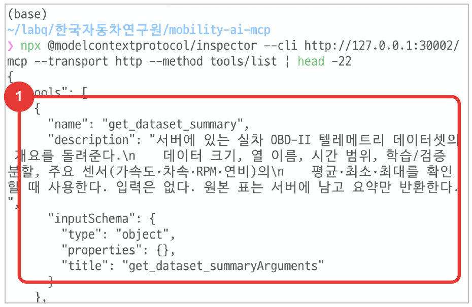

Tools : `tools/list` → ① name·description·inputSchema

### Resources : resources/read

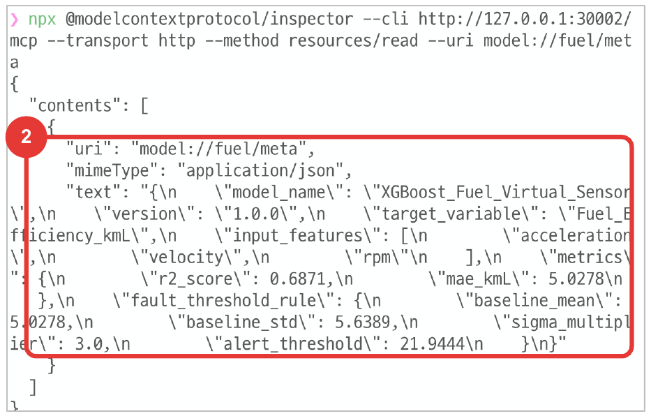

Resources : `resources/read` → ② uri·mimeType·text(JSON)

### Prompts : prompts/get

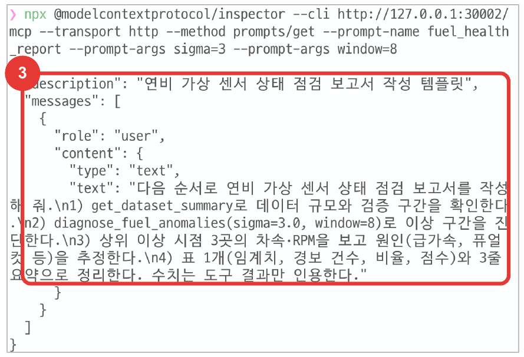

Prompts : `prompts/get` → ③ description·messages

참고 : Client 쪽 기능으로 Roots(작업 범위 지정), Sampling(서버의 모델 호출 요청), Elicitation(사용자 추가 입력 요청)도 있습니다.

## MCP 통신 방식 : stdio와 Streamable HTTP

로컬 실행에는 stdio, 원격·웹 연결에는 Streamable HTTP를 쓰며, 기존 HTTP+SSE 방식은 폐기되었습니다.

| 구분 | stdio | Streamable HTTP |
| --- | --- | --- |
| **실행 위치** | Host와 같은 컴퓨터 | 원격 서버(클라우드 VM, 사내 서버) |
| **연결 방법** | Host가 서버 프로그램을 직접 실행 | URL(HTTP 엔드포인트)로 접속 |
| **인증** | 실행 계정 권한을 그대로 사용 | 헤더의 토큰 같은 별도 인증 필요 |
| **적합 용도** | Host 서버 안의 자원 활용 | 여러 사용자 공유, 웹 기반 Host 연결 |

## KADaP 지식 Agent의 MCP 서버 등록 화면

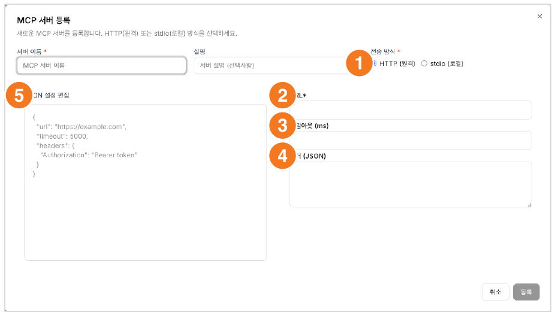

화면 : KADaP 자동차 지식 Agent > 관리자 > MCP 서버 관리 > MCP 서버 등록

1. **전송 방식** : HTTP(원격) 또는 stdio(로컬)를 선택합니다.
2. **URL** : 원격 MCP 서버 주소를 입력합니다.
3. **타임아웃** : 서버 응답을 기다리는 시간(ms)입니다.
4. **헤더** : 인증 토큰처럼 요청에 함께 보낼 값을 JSON으로 입력합니다.
5. **JSON 설정 편집** : 같은 내용을 JSON 한 번에 입력합니다.

KADaP 지식 Agent의 stdio(로컬)는 Agent 서버 안에서 실행하는 방식으로, 수강생 PC를 뜻하지 않습니다. 기존 HTTP+SSE 방식은 2025-03-26 사양에서 Streamable HTTP로 대체되었습니다.

## REST API와 MCP의 관계

MCP는 API를 대체하지 않고, 기존 API를 AI Agent가 이해하고 호출할 수 있게 감싸는 연결 층입니다.

| 구분 | REST API | MCP |
| --- | --- | --- |
| **호출 주체** | 개발자가 작성한 코드 | AI Agent(모델이 판단) |
| **사용법 전달** | API 문서를 사람이 읽고 구현 | 연결 시 이름·설명·입력 스키마를 자동 조회 |
| **연결 범위** | 서비스마다 개별 연동 | MCP를 지원하는 모든 Host에서 같은 방식 |

## 연결 구성

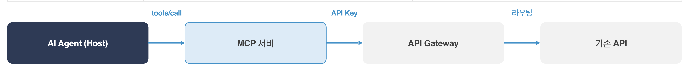

**AI Agent(Host)** → (tools/call) → **MCP 서버** → (API Key) → **API Gateway** → (라우팅) → **기존 API**

**MCP 서버가 내부에서 기존 API를 호출하는 구성이 흔하며, 오전에 만든 API도 같은 방식으로 Agent의 도구가 될 수 있습니다.**

## MCP 호출 흐름

연결 초기화, 도구 목록 조회, 도구 호출, 결과 반환 순서로 메시지를 주고받습니다.

## 메시지 순서

- **① initialize** : 프로토콜 버전과 지원 기능을 서로 확인
- **② tools/list** : 서버의 도구 목록과 입력 스키마 조회
- **③ tools/call** : 도구 이름과 인자를 보내 실행 요청
- **④ result** : 결과를 content 배열로 반환, 오류는 isError로 표시

모든 메시지는 JSON-RPC 2.0 형식이며, 아래 화면은 MCP Inspector로 mobility-ai 서버에 실제 연결한 기록입니다.

## MCP Inspector 연결 기록

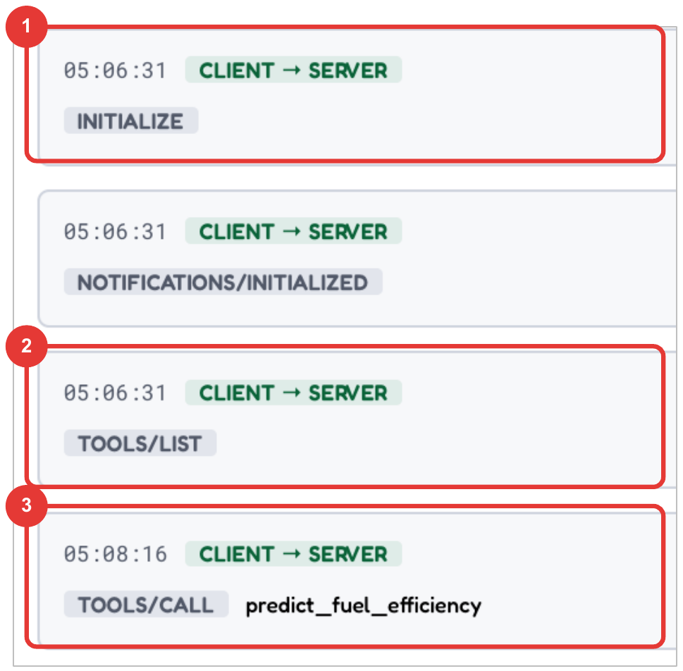

연결 직후 순서 : ① initialize → ② tools/list → ③ tools/call

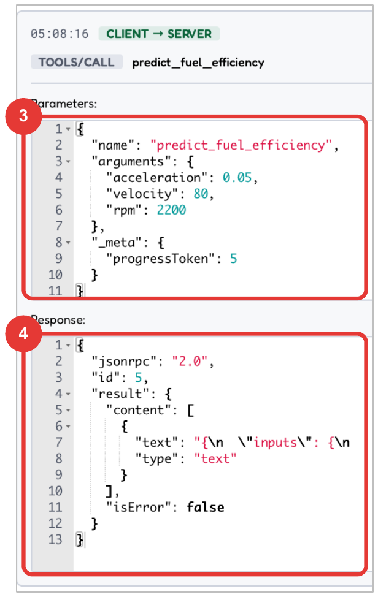

tools/call : ③ 요청 name·arguments → ④ 응답 result·isError

화면 : MCP Inspector 2.10.1 > mobility-ai 서버(7교시 실습 서버를 로컬 실행, 프로토콜 2025-11-25) 연결 기록, 카드 1개가 JSON-RPC 메시지 1건

## MCP 사용 시 보안 유의사항

MCP Server는 내 PC와 데이터에 접근하는 프로그램이므로 출처와 권한을 확인하고 연결합니다.

| 위험 | 내용 | 대응 |
| --- | --- | --- |
| **출처 불명 서버** | 서버 코드가 PC와 데이터에 직접 접근 | 공식·검증된 서버 사용, 버전 고정, 코드 확인 |
| **도구 설명 오염(Tool Poisoning)** | tool 설명이나 결과에 숨긴 지시로 Agent를 조작 | 설명 검토, 외부 내용은 자료로만 취급 |
| **과도한 권한** | 필요 이상의 파일·시스템 접근 | 읽기 전용 우선, 접근 범위 최소화 |
| **API Key 노출** | X-Api-Key를 코드·설정·대화에 그대로 기록 | 환경변수 사용, 노출 시 즉시 재발급 |
| **인증 없는 원격 서버** | 누구나 호출할 수 있는 MCP 서버 공개 | 등록 화면의 헤더로 토큰 인증, 게이트웨이 경유 |

**사내 도입 시 승인된 MCP 서버 목록을 정해 두고 그 안에서만 연결합니다.**

## [실습 준비] 실습 환경 구성

실습 목적 : 내 VM에 MCP 서버를 실행하고 KADaP 지식 Agent 연결을 준비합니다.

제공된 모빌리티 AI MCP 서버를 VM에서 실행하고, KADaP 지식 Agent가 이를 도구로 호출합니다.

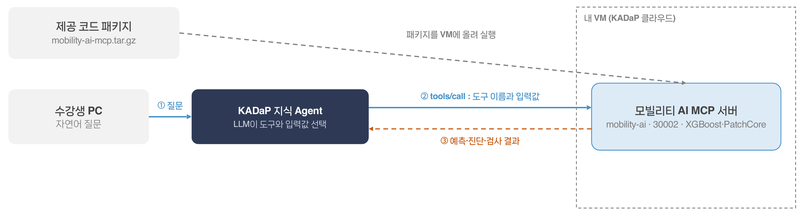

## 구성 요소

- **제공 코드 패키지** : `mobility-ai-mcp.tar.gz` → 패키지를 VM에 올려 실행
- **수강생 PC** : 자연어 질문
- **KADaP 지식 Agent** : LLM이 도구와 입력값 선택
- **내 VM(KADaP 클라우드)** : 모빌리티 AI MCP 서버(mobility-ai · 30002 · XGBoost·PatchCore)

## 호출 흐름

1. **① 질문** : 수강생 PC → KADaP 지식 Agent
2. **② tools/call** : 도구 이름과 입력값을 KADaP 지식 Agent → 모빌리티 AI MCP 서버로 전달
3. **③ 예측·진단·검사 결과** : 모빌리티 AI MCP 서버 → KADaP 지식 Agent

## 실습 순서

- **받기** : 제공된 `mobility-ai-mcp.tar.gz`를 PC에 내려받기
- **올리기** : VM 가상환경에서 `mobility_ai_server.py` 실행
- **연동** : 관리자 페이지 MCP 서버 관리에 주소 등록
- **사용** : 챗봇에서 자연어로 질문

## [실습 준비] 준비물 점검

VM 가상환경, 제공 코드 패키지, KADaP 지식 Agent 관리자 계정을 준비하고, 8교시용 카카오 REST API 키는 미리 발급해 둡니다.

| 항목 | 확인 방법 | 사용 단계 |
| --- | --- | --- |
| **클라우드 VM** | `ssh <계정>@user.bigdata-car.kr -p <SSH 포트>`로 접속 | 3일차 |
| **가상환경** | `~/mcp/venv`에 mcp, xgboost, scikit-learn, torch 설치(`setup_venv.sh`, 최초 1회) | Step 2 |
| **제공 코드** | `mobility-ai-mcp.tar.gz`(서버 코드, 5·6교시 모델 산출물, 데이터 포함, 약 16MB) | Step 1 |
| **KADaP 지식 Agent** | agent.bigdata-car.kr 로그인(구글 간편 로그인), 관리자 대시보드 > MCP 서버 관리 권한 | Step 3 |
| **실습 데이터·모델** | 패키지 안 `data/`(OBD-II 49,602행, 부품 이미지 70장), `saved_models/`(pkl, npy, json) | 포함 |
| **카카오 REST API 키** | developers.kakao.com > 앱 생성 > [앱] > [플랫폼 키] > REST API 키 복사(개인 계정, 사전 과제 권장) | 8교시 준비 ② |

## 가상환경 준비(VM, 최초 1회) : setup_venv.sh의 내용

```bash
python3 -m venv ~/mcp/venv
source ~/mcp/venv/bin/activate
pip install "mcp>=2.0" pandas scikit-learn==1.7.2 xgboost==3.2.0 pillow
pip install torch torchvision \
    --index-url https://download.pytorch.org/whl/cpu
pip list | grep -iE "^(mcp|xgboost|scikit-learn|torch) "
```

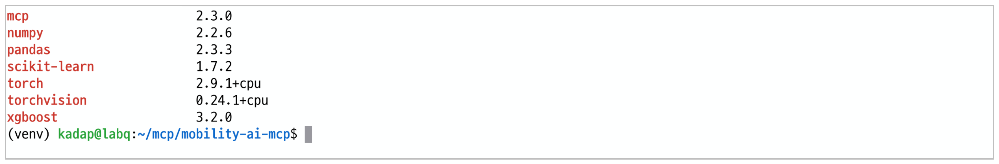

화면 : VM 가상환경(venv)에 설치된 패키지 버전. 서버 코드는 mcp 2.x 기준이며 1.x에서도 동작합니다.

## [실습 준비] 예제 MCP 연동 ① Smithery에서 도구 고르고 API 키 받기

공개 MCP 마켓(Smithery)에서 서버를 고르고 API 키를 발급받으면, 서버 URL에 키만 붙여 바로 연결할 수 있습니다.

## 진행 순서(smithery.ai, 구글 로그인)

1. smithery.ai 검색창에 서버 이름 입력(예 : arxiv, exa) > 서버 페이지에서 도구 목록 확인
2. **Add to toolbox**로 내 Toolbox에 담기(Toolbox 엔드포인트 `https://mcp.smithery.ai/<핸들>`도 생김)
3. 우측 상단 계정 > **API keys** > **Create API key** > 이름 입력
4. 키 값은 이때 한 번만 표시 : 복사해 보관
5. 연결 URL : `https://server.smithery.ai/<서버>/mcp?api_key=<키>` (예 : `…/arxiv/mcp?api_key=…`)

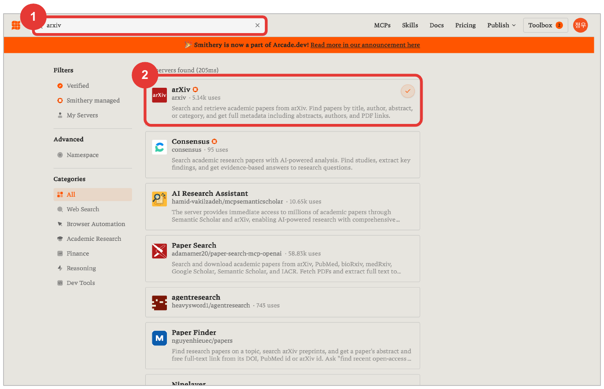

smithery.ai : ① 검색창에 arxiv 입력 → ② 결과 맨 위 arXiv(Smithery 관리 서버) 클릭

## 알아둘 점

- **두 가지 주소** : 서버별 URL(api_key 쿼리)은 도구 이름이 그대로(`search_papers`). Toolbox 엔드포인트(Bearer 헤더)는 `arxiv.search_papers`처럼 점이 붙어 GPT 계열 Host가 거부 → KADaP에는 서버별 URL
- **예제 선택** : arXiv(도구 2개)는 Smithery 키만으로 동작. Exa Search는 Exa 자체 키를 더 연결해야 도구가 뜸(0 tools)
- **Exa는** : KADaP에 이미 Exa 공식 호스팅 MCP(키 불필요)가 등록돼 있어 그대로 사용
- **보안** : 키가 URL에 들어가므로 등록 화면·캡쳐·대화에 남기지 않음

## Smithery 화면 : 서버 페이지와 Toolbox

서버 페이지에서 도구 목록을 확인하고 Add to toolbox를 누르면, 내 Toolbox에 서버가 연결되고 엔드포인트 주소가 생깁니다.

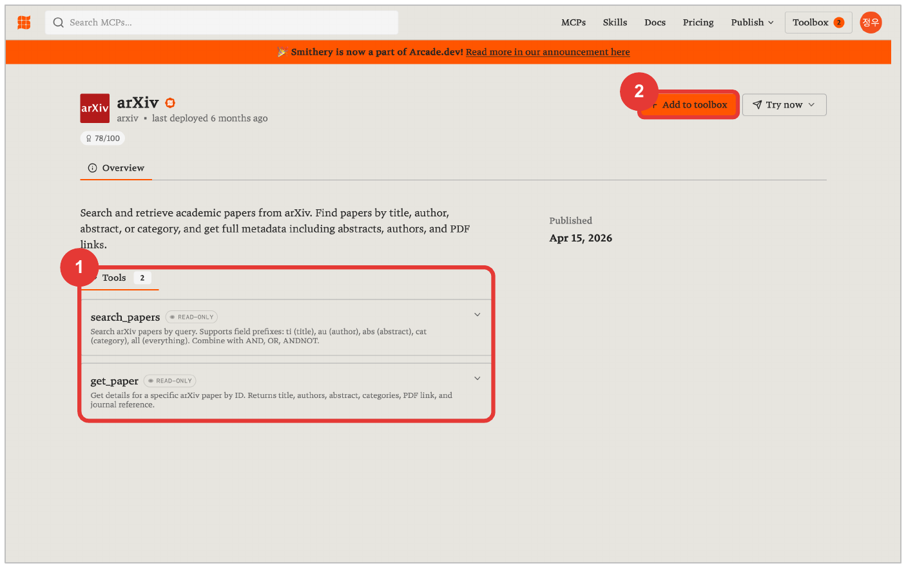

서버 페이지 : ① Tools 2(search_papers, get_paper) 확인 → ② Add to toolbox

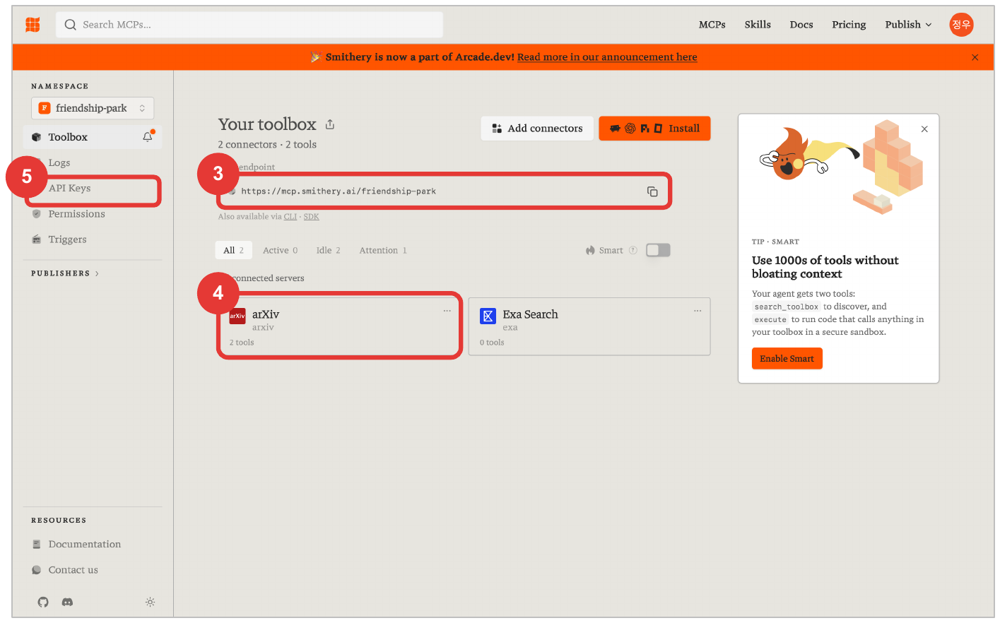

내 Toolbox : ③ 엔드포인트(헤더 인증용) · ④ 연결된 arXiv 2 tools · ⑤ 다음 단계 API Keys 메뉴

## Smithery 화면 : API 키 발급

API Keys 메뉴에서 키를 만들면 값이 한 번만 표시되므로 바로 복사해 보관하고, 서버 URL 뒤에 `?api_key=`로 붙입니다.

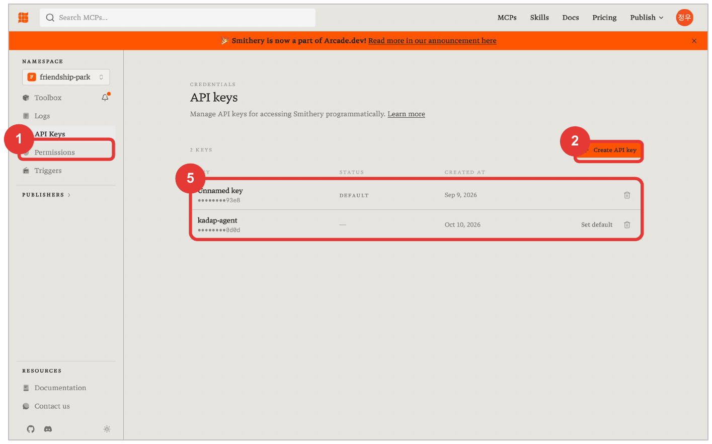

API Keys : ① 왼쪽 메뉴 → ② Create API key → ⑤ 목록에는 이름과 끝 4자리만 남음

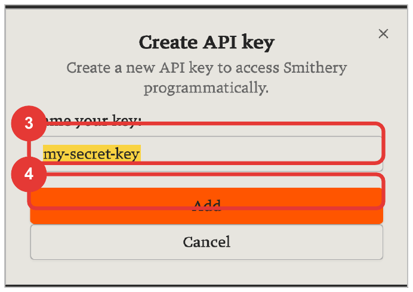

③ 키 이름 입력 → ④ Add

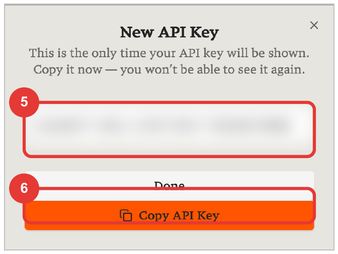

⑤ 값은 이때 한 번만 표시(가림) → ⑥ Copy API Key

### 진행 순서

- ① 왼쪽 메뉴 **API Keys**
- ② **Create API key** 클릭
- ③ 키 이름 입력(예 : kadap-agent) → ④ **Add**
- ⑤ New API Key 창의 값을 복사(이때 한 번만 표시) → ⑥ **Copy API Key**
- ⑦ 연결 URL : `https://server.smithery.ai/arxiv/mcp?api_key=<복사한 키>`

**키는 비밀번호와 같습니다 : 등록 화면·캡쳐·대화에 남기지 않고, 유출되면 목록의 휴지통으로 삭제 후 재발급합니다.**

## [실습 준비] 예제 MCP 연동 ② KADaP 등록과 챗봇 확인

서버 URL에 api_key를 붙여 KADaP 지식 Agent에 HTTP(원격)로 등록하고, 챗봇에서 arXiv 도구 호출을 확인합니다.

## KADaP 지식 Agent > 관리자 > MCP 서버 관리 > MCP 서버 등록

| 번호 | 항목 | 입력값 |
| --- | --- | --- |
| 1 | 서버 이름 | `smithery-arxiv` |
| 2 | 설명 | arXiv 논문 검색(Smithery) |
| 3 | 전송 방식 | HTTP(원격) |
| 4 | URL | `https://server.smithery.ai/arxiv/mcp?api_key=<발급받은 키>` |
| 5 | 타임아웃 | 30000 |
| 6 | 헤더(JSON) | 비움 |
| 7 | 등록 | 목록에 추가, 활성화 토글 확인 |

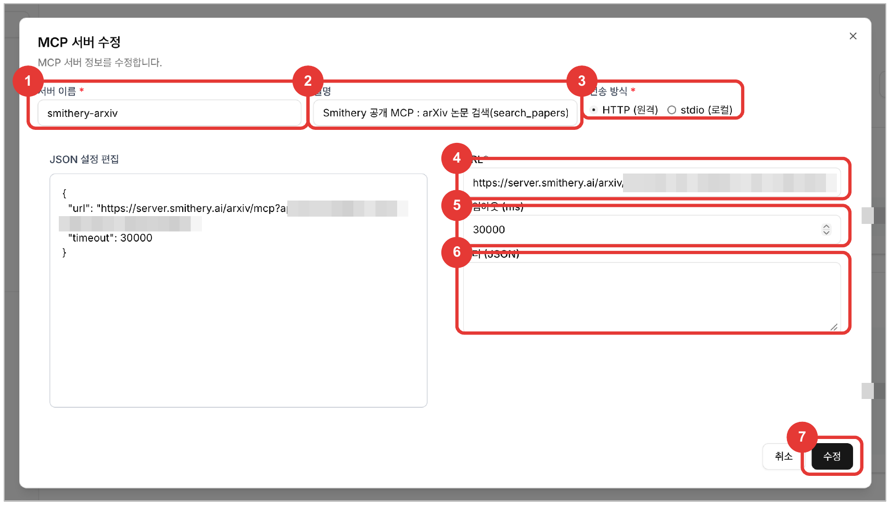

관리자 > MCP 서버 관리 > MCP 서버 등록 폼(번호는 위 표의 항목과 대응, api_key 값은 가림)

## KADaP 화면 : 목록 확인과 챗봇 선택

등록되면 MCP 서버 목록에 smithery-arxiv가 활성 상태로 추가되고, 챗봇 입력창의 MCP 버튼에서 골라야 그 대화에서 도구를 씁니다.

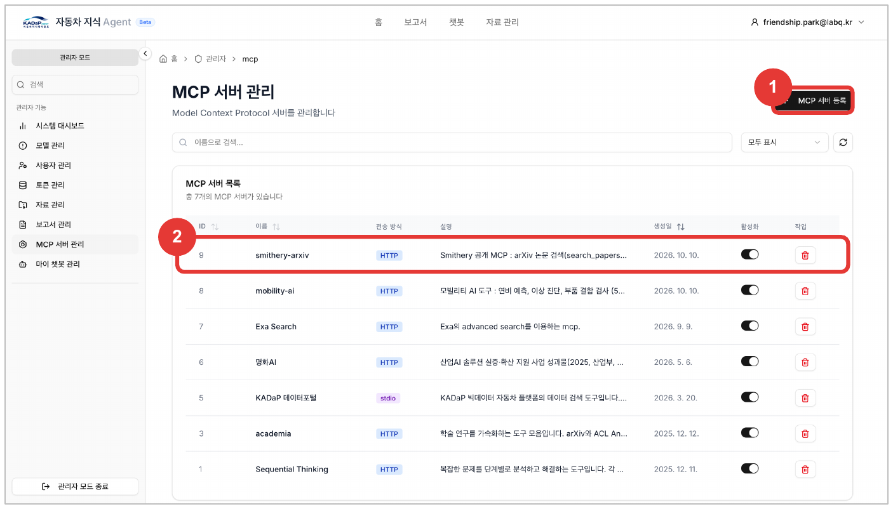

① MCP 서버 등록 버튼 → ② 목록 맨 위에 smithery-arxiv(HTTP, 활성화)

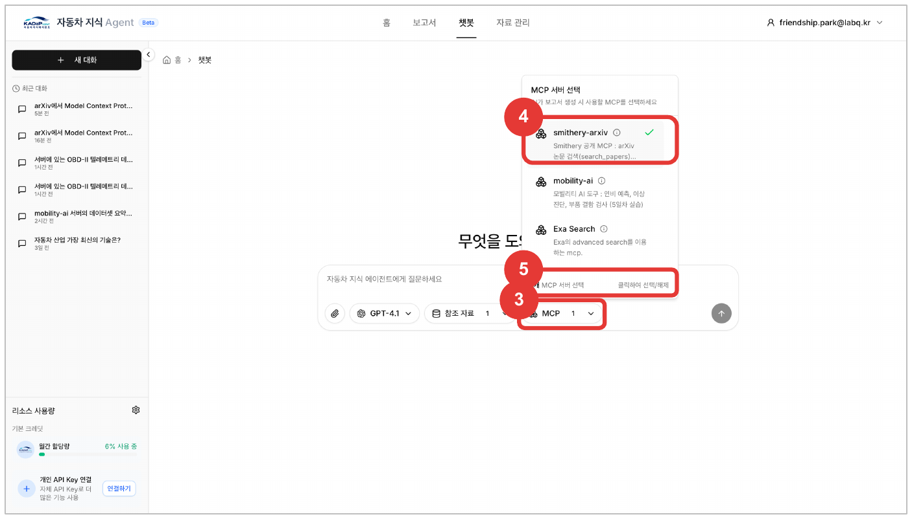

챗봇 > 새 대화 : ③ MCP 버튼 → ④ smithery-arxiv 클릭 → ⑤ 1개 MCP 서버 선택

## KADaP 화면 : 도구 호출 결과

질문하면 답변 위에 서버·도구 이름과 ✓가 표시되고, arXiv에서 받아온 논문 3편을 제목·저자·요약으로 정리해 줍니다.

### 질문과 확인 포인트

- **질문** : arXiv에서 PatchCore 기반 산업 이상 탐지 논문 3편을 찾아 제목·저자·한 줄 요약을 알려줘
1. 답변 위 **smithery-arxiv search_papers ✓** : 도구가 호출된 증거, 펼치면 서버가 돌려준 원문
2. 논문 3편의 제목·저자·요약 : 도구 결과를 모델이 정리한 것
3. 출처 목록 : 결과 안의 링크를 그대로 인용

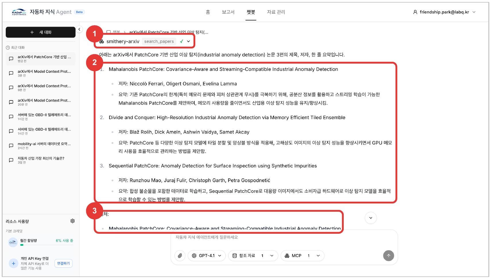

챗봇 : search_papers ✓ 호출과 논문 3편 답변(2026-10-11)

**✓ 표시가 없고 '웹 검색'만 하면 도구 목록을 못 받은 것입니다 → URL의 api_key, 활성화 토글, MCP 선택을 확인합니다.**
