# [실습] [7교시] MCP Server 구축 및 Tool 연동 실습

## [7교시] MCP Server 구축 및 Tool 연동 실습

모빌리티 AI MCP 서버 실행과 연동 실습입니다. 제공된 MCP 서버 코드를 이해하고 VM에서 실행한 뒤, KADaP 지식 Agent에서 연비 예측·이상 진단·결함 검사를 자연어로 수행합니다.

## 학습 목표

- 제공된 모빌리티 AI MCP 서버(mobility-ai)를 VM에서 실행하고 코드 구조를 확인한다.
- KADaP 지식 Agent에 연동해 연비 예측·이상 진단·부품 검사를 자연어로 수행한다.

## 학습 내용

| 순서 | 내용 |
| --- | --- |
| 03-01 | 실습 흐름과 완성 모습 |
| 03-02 | Step 1. 제공 코드 패키지 구조 |
| 03-03 | Step 1. 패키지 내려받기와 도구 점검 |
| 03-04 | Step 1. 코드 확인 ① 서버 골격 |
| 03-05 | Step 1. 코드 확인 ② 로그 데코레이터와 데이터 요약 도구 |
| 03-06 | Step 1. 코드 확인 ③ 연비 예측 도구와 입력 검증 |
| 03-07 | Step 1. 코드 확인 ④ 이상 진단·조건 조회 도구 |
| 03-08 | Step 1. 코드 확인 ⑤ 이상 진단 계산(anomaly.py) |
| 03-09 | Step 1. 코드 확인 ⑥ 부품 검사 도구 |
| 03-10 | Step 1. 코드 확인 ⑦ PatchCore 계산(vision.py) |
| 03-11 | Step 1. 코드 확인 ⑧ Resources와 Prompts |
| 03-12 | Step 1. 코드 확인 ⑨ 실행 진입점 |
| 03-13 | Step 2. 복사·접속·설치 |
| 03-14 | Step 2. 서버 실행과 접속 확인 |
| 03-15 | Step 3-1. KADaP 지식 Agent 로그인과 관리자 메뉴 |
| 03-16 | Step 3-2. MCP 서버 등록 |
| 03-17 | Step 3-3. VM 내부 주소 확인과 등록 결과 |
| 03-18 | Step 4-1. 챗봇에서 MCP 선택 |
| 03-19 | Step 4-2. 첫 질문 : 데이터셋 요약 |
| 03-20 | Step 5. 질문과 최종 결과 |
| 03-21 | 결과 검증과 한계 |
| 03-22 | 자주 발생하는 오류와 해결 |

## 실습 흐름과 완성 모습

제공된 MCP 서버를 VM에 올리고, KADaP 지식 Agent에 연결해 연비 예측·이상 진단·부품 검사를 자연어로 수행합니다.

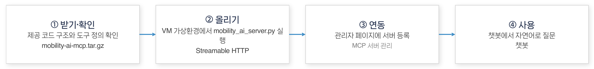

| 단계 | 내용 | 대상 |
| --- | --- | --- |
| **① 받기·확인** | 제공 코드 구조와 도구 정의 확인 | `mobility-ai-mcp.tar.gz` |
| **② 올리기** | VM 가상환경에서 `mobility_ai_server.py` 실행 | Streamable HTTP |
| **③ 연동** | 관리자 페이지에 서버 등록 | MCP 서버 관리 |
| **④ 사용** | 챗봇에서 자연어로 질문 | 챗봇 |

## 완성 모습 : 질문, Agent가 고르는 도구, 서버가 돌려준 실제 결과

| 질문 | Agent가 고르는 도구 | 결과 |
| --- | --- | --- |
| **가속도 0.05g, 시속 80km, 2200rpm일 때 연비는?** | `predict_fuel_efficiency` | 15.82 km/L |
| **검증 구간에서 연비 이상 구간을 찾아줘** | `diagnose_fuel_anomalies` | 경보 224건(1.5%), 임계치 21.94 km/L |
| **bracket_defect_001.png 부품을 검사해줘** | `inspect_part_image` | 결함 점수 0.869, NG(결함) |

## Step 1. 제공 코드 패키지 구조

제공된 mobility-ai-mcp 패키지는 서버 파일 1개, 도구별 모듈 4개, 5·6교시 산출물과 데이터로 구성됩니다.

## 패키지 구조(mobility-ai-mcp.tar.gz 압축 해제)

```
mobility-ai-mcp/
├─ mobility_ai_server.py   도구 6개·리소스 3개·프롬프트 1개 정의, 실행(HTTP / stdio)
├─ mobility_ai/            fuel.py 연비 예측 · anomaly.py 3σ 진단 · vision.py 결함 검사
│                          telemetry.py 데이터 요약·조회 · config.py 경로·환경변수
├─ saved_models/           5·6교시 산출물(pkl, npy, json) + 결함 점수 정규화 기준
├─ data/                   OBD-II CSV(49,602행), 르노 AutoVI 부품 이미지 70장
├─ setup_venv.sh · run_server.sh · test_tools.py · client_check.py
└─ requirements.txt · README.md
```

## 도구 목록

| 도구 | 역할 |
| --- | --- |
| `get_dataset_summary` | 데이터셋 개요(행 수, 열, 시간 범위, 센서 통계) |
| `predict_fuel_efficiency` | 가속도·차속·RPM → 순간 연비(km/L) |
| `diagnose_fuel_anomalies` | 잔차 3σ 관리도 이상 진단(sigma, window, 구간) |
| `query_telemetry` | 열·연산자·값 조건으로 행 수·통계·샘플 조회 |
| `inspect_part_image` | 부품 이미지 1장 결함 점수(0~1)와 OK/NG |
| `evaluate_inspection_threshold` | 임계치별 미검·과검 건수와 트랙 B 점수 |

## 확인 항목

- **SDK 호환** : mcp 2.x(MCPServer), 1.x(FastMCP) 모두 import 가능
- **실행 주소** : `MCP_HOST` 기본 0.0.0.0, `MCP_PORT` 기본 30002, `MCP_TRANSPORT`로 stdio 전환
- **도구 설명** : 용도·입력 단위·반환값·오류 시 행동을 docstring에 한국어로 기술
- **입력 처리** : 범위 검증(g, km/h, rpm), 조건은 열·연산자·값으로 받고 코드 실행 없음
- **오류 응답** : 열 목록·이미지 목록처럼 다음 할 일을 담은 dict 반환
- **로그** : 도구 이름과 소요 시간만 기록, 데이터·입력값은 기록하지 않음
- **데이터 위치** : CSV·모델·이미지는 서버에, 모델(LLM)에는 요약과 결과만 전달

## Step 1. 패키지 내려받기와 도구 점검

압축을 풀고 폴더 구조를 확인한 뒤, 서버 없이 도구 함수를 실행해 모델·데이터가 정상인지 점검합니다.

## PC 또는 VM에서(가상환경 활성화 후)

```bash
tar -xzf mobility-ai-mcp.tar.gz && cd mobility-ai-mcp
find . -maxdepth 2 | sort            # 폴더 구조 확인
python test_tools.py                 # 도구 함수 직접 실행(서버 없이)
python test_tools.py --no-vision     # torch가 없는 PC에서는 비전 검사 제외
```

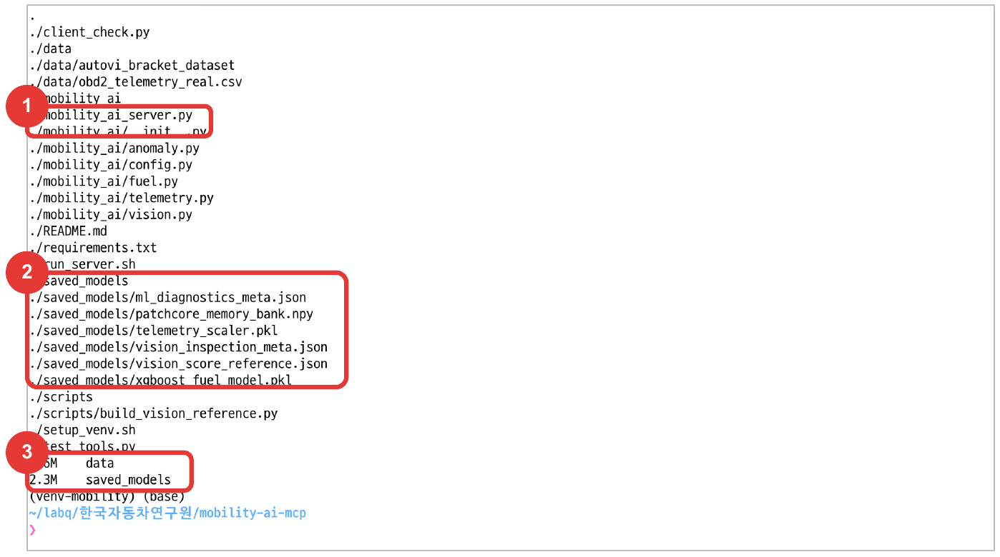

find 결과 : ① 서버 파일 ② saved_models(5·6교시 산출물) ③ 용량(data 16M, saved_models 2.3M)

## 확인 포인트

- **구조** : 서버 1개 파일 + mobility_ai 패키지, data와 saved_models 포함(약 18MB)
- **점검** : 예측 15.82 km/L, 3σ 임계치 21.94 km/L·경보 224건, 결함 점수 0.869가 5·6교시 노트북 값과 같음
- **시간** : 전체 2~5초, 첫 비전 검사만 모델 로딩으로 수 초
- **의미** : MCP 서버는 이 함수들을 그대로 도구로 노출하는 얇은 층

## 도구 점검 결과(화면)

`test_tools.py`는 서버 없이 도구 함수를 차례로 실행하므로, 5·6교시 노트북의 값과 같은지 여기서 먼저 확인합니다.

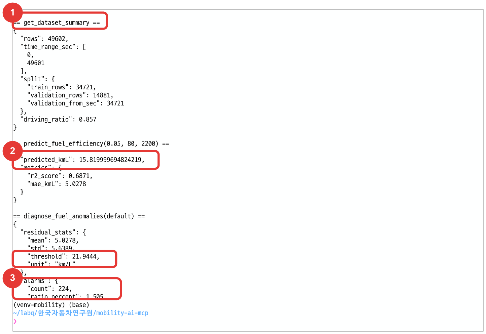

`python test_tools.py` 출력(앞부분)

### 출력 읽는 법

1. `get_dataset_summary` : rows 49602, 검증 14,881행(34,721초부터)
2. `predict_fuel_efficiency(0.05, 80, 2200)` : predicted_kmL 15.82, R² 0.687, MAE 5.03
3. `diagnose_fuel_anomalies` : threshold 21.9444 km/L, alarms count 224(1.505%)
4. (아래로 이어짐) `inspect_part_image` : bracket_defect_001 점수 0.869, NG

값이 다르면 `saved_models/` 누락이나 패키지 버전 문제입니다. 경고(InconsistentVersionWarning)는 무시해도 됩니다.

## Step 1. 코드 확인 ① 서버 골격

SDK 2.x/1.x 호환 import, stderr·파일 로그, MCPServer 생성과 instructions가 서버의 뼈대입니다.

## mobility_ai_server.py 10~45행

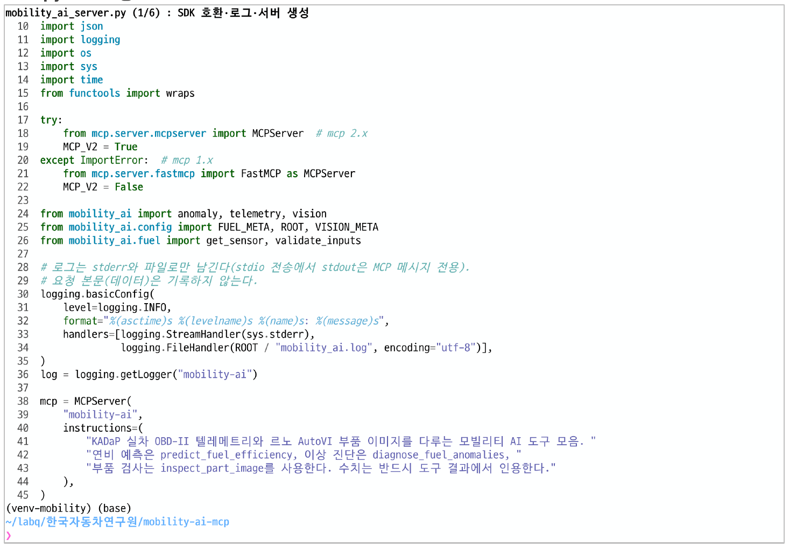

## 포인트

- **import** : mcp 2.x의 `MCPServer`, 없으면 1.x `FastMCP`로 대체(ImportError 분기)
- **로그** : stdout은 stdio 전송의 MCP 메시지 전용이라 stderr와 파일(`mobility_ai.log`)에만 기록
- **MCPServer("mobility-ai")** : Host에 보이는 서버 이름
- **instructions** : Host가 모델에 전달하는 서버 사용 안내(어떤 도구를 언제 쓰는지, 수치는 도구 결과만 인용)

## Step 1. 코드 확인 ② 로그 데코레이터와 데이터 요약 도구

`@mcp.tool()`이 함수 하나를 도구로 등록하고, docstring이 그대로 모델이 읽는 도구 설명이 됩니다.

## mobility_ai_server.py 48~67행

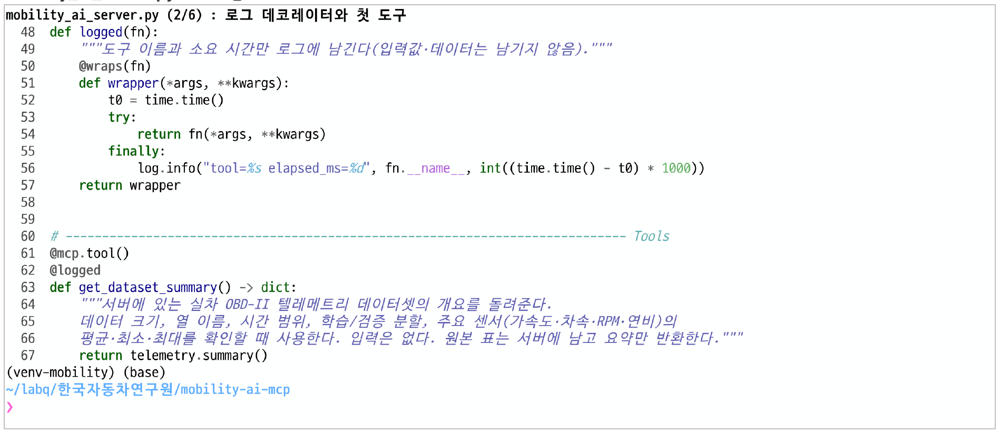

## 포인트

- **@logged** : 도구 이름과 소요 시간(ms)만 기록, 입력값과 데이터는 남기지 않음(보안 유의사항)
- **@mcp.tool()** : 함수 이름이 도구 이름, 타입 힌트가 입력 스키마, docstring이 설명
- **get_dataset_summary** : 입력 없음, 서버의 CSV를 읽어 요약(행 수·열·통계)만 반환
- **원칙** : 데이터는 서버에, 모델에는 이름·요약만(5교시 컨텍스트 관리)

## Step 1. 코드 확인 ③ 연비 예측 도구와 입력 검증

도구는 단위와 범위를 설명에 적고, 벗어난 입력에는 무엇을 고칠지 알려주는 오류를 돌려줍니다.

## mobility_ai_server.py 70~88행, mobility_ai/fuel.py 46~62행

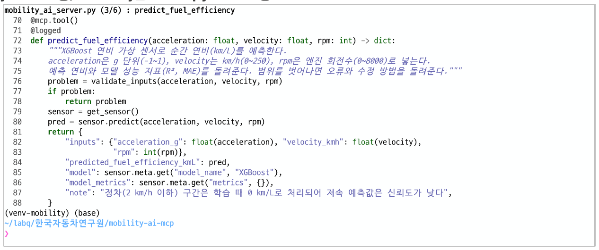

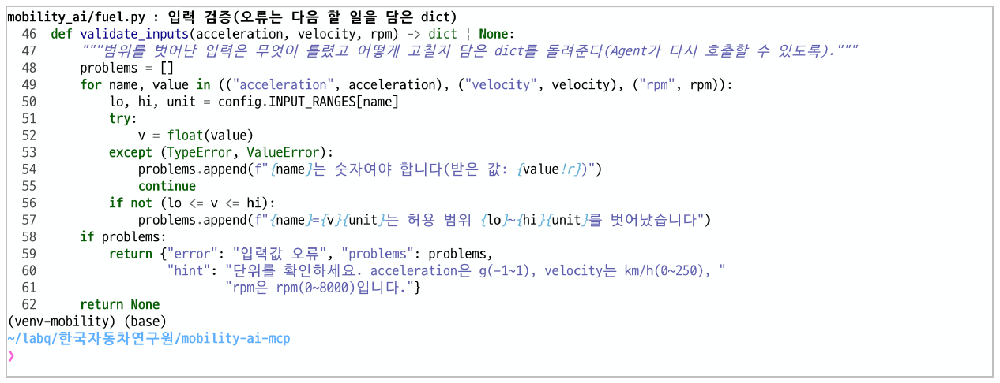

## 포인트

- **docstring** : 단위(g, km/h, rpm)와 허용 범위를 명시 → 모델이 올바른 값을 넣음
- **validate_inputs** : 범위 밖이면 `{error, problems, hint}` 반환, 예외를 던지지 않음
- **반환값** : 예측 연비와 모델 성능 지표(R² 0.687, MAE 5.03)를 함께 돌려줘 답변 근거 제공
- **note** : 저속(2 km/h 이하) 구간의 신뢰도 한계를 모델에게 알림

## Step 1. 코드 확인 ④ 이상 진단·조건 조회 도구

매개변수 기본값으로 쉬운 호출을 열어 두고, 조건은 코드가 아닌 열·연산자·값으로 받습니다.

## mobility_ai_server.py 91~110행

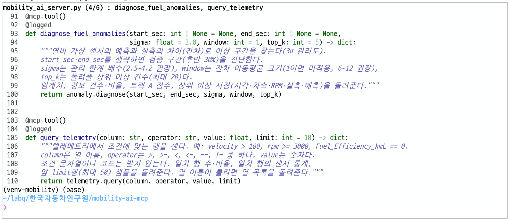

## 포인트

- **diagnose_fuel_anomalies** : `start_sec`·`end_sec` 생략 시 검증 구간(후반 30%) 진단, `sigma`·`window` 기본값 제공
- 권장 범위를 설명에 적어 모델이 7교시 트랙 A 튜닝 범위 안에서 호출하도록 유도
- **query_telemetry** : 연산자 6종만 허용, 조건 문자열·eval 금지(보안)
- **오류** : 열 이름이 틀리면 열 목록을 돌려줘 Agent가 다시 호출

## Step 1. 코드 확인 ⑤ 이상 진단 계산(anomaly.py)

5교시 노트북의 잔차 3σ 관리도와 7교시 트랙 A 채점식을 함수 하나로 옮겼습니다.

## mobility_ai/anomaly.py 32~59행

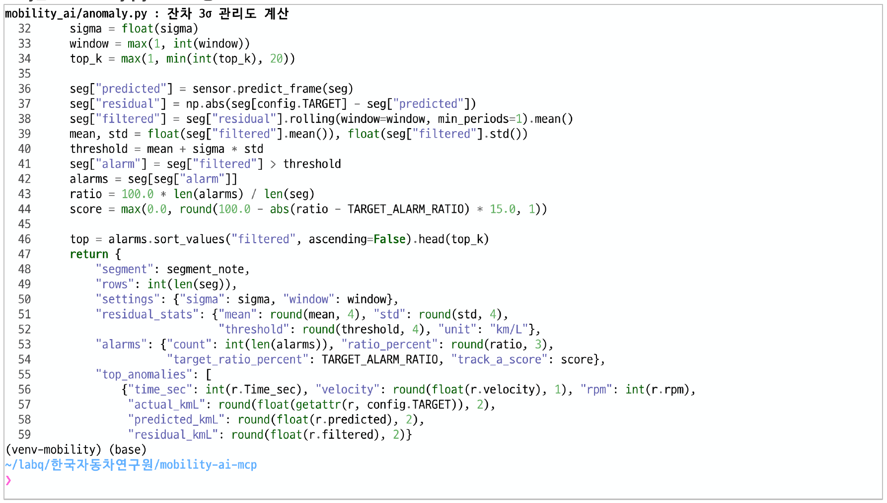

## 포인트

- **predict_frame** : 저장된 StandardScaler·XGBoost로 구간 전체를 한 번에 예측
- **residual → rolling(window).mean()** : 이동평균으로 스파이크 노이즈 완화(트랙 A의 W)
- **threshold = mean + sigma × std** : 관리 한계선(트랙 A의 k)
- **score** : 목표 경보 비율 1.5%와의 차이로 채점(노트북과 동일 공식)
- **반환** : 상위 top_k 이상 시점에 차속·RPM·실측·예측을 함께 담아 원인 추정 근거 제공

## Step 1. 코드 확인 ⑥ 부품 검사 도구

무거운 비전 모델은 첫 호출 때만 불러오고, 의존성이 없으면 설치 방법을 담은 오류를 돌려줍니다.

## mobility_ai_server.py 113~138행

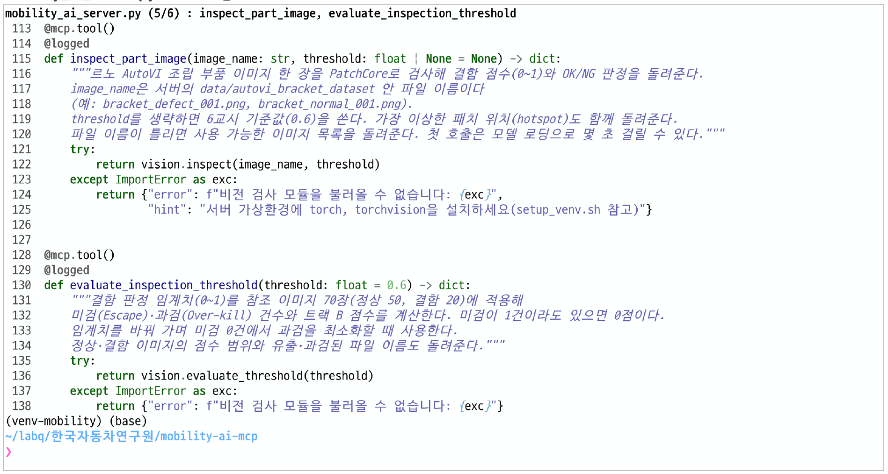

## 포인트

- **inspect_part_image** : 파일 이름으로 서버의 이미지를 검사, 점수(0~1)·판정·hotspot 반환
- **threshold** 생략 시 6교시 메타데이터의 0.6 사용
- **ImportError 처리** : torch 미설치면 설치 안내를 오류로 반환(서버는 계속 동작)
- **evaluate_inspection_threshold** : 참조 70장으로 미검·과검 계산, 트랙 B 채점식

## Step 1. 코드 확인 ⑦ PatchCore 계산(vision.py)

6교시 노트북과 같은 ResNet-18 layer2 특징과 메모리 뱅크를 쓰되, 거리 계산 메모리를 100분의 1로 줄였습니다.

## mobility_ai/vision.py 32~65행

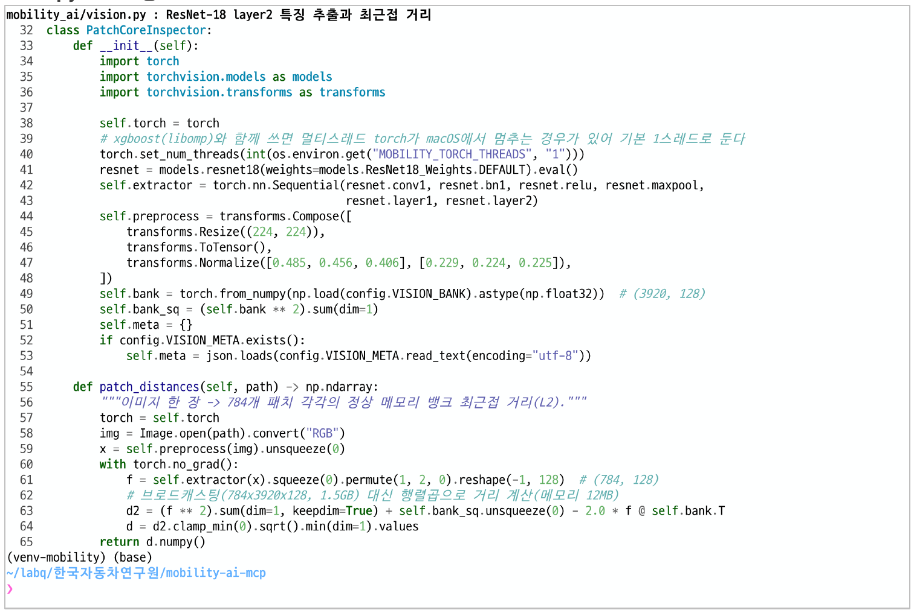

## 포인트

- **import torch를 `__init__` 안에서** : 서버 시작을 가볍게, 첫 검사 때만 로딩
- **set_num_threads(1)** : xgboost(libomp)와 함께 쓸 때 멈춤 방지, 1 vCPU VM에 적합
- **extractor** : conv1~layer2까지만 통과 → 28×28×128 패치 특징(노트북과 동일)
- **거리** : ‖f‖²+‖b‖²−2f·bᵀ 행렬곱(12MB)으로 브로드캐스팅(1.5GB) 대체 → 1.9GB VM에서 동작
- **raw_score** : 패치 최근접 거리의 최댓값과 위치(hotspot)

## Step 1. 코드 확인 ⑧ Resources와 Prompts

Tools 외에 읽기 전용 데이터(Resources)와 작업 템플릿(Prompts)도 같은 서버에서 제공합니다.

## mobility_ai_server.py 141~170행

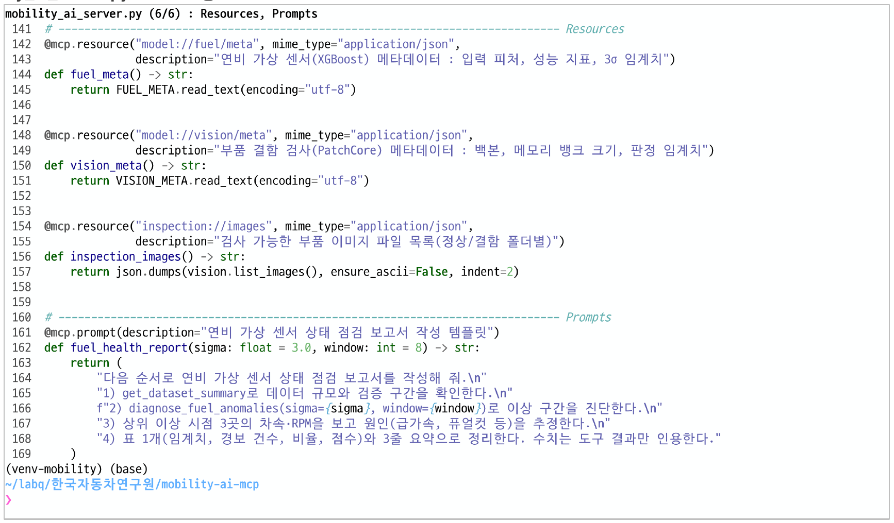

## 포인트

- **@mcp.resource("model://fuel/meta")** : 메타데이터 JSON을 읽기 전용으로 제공(6교시 Resources)
- **inspection://images** : 검사 가능한 이미지 목록, 모델이 파일 이름을 추측하지 않게 함
- **@mcp.prompt** : 연비 점검 보고서 작성 순서를 템플릿으로 제공(사용자가 선택)
- KADaP 지식 Agent가 Tools만 쓰더라도 Claude Code 같은 Host에서는 셋 다 활용

## Step 1. 코드 확인 ⑨ 실행 진입점

환경변수 하나로 VM용 Streamable HTTP와 Claude Code용 stdio를 전환합니다.

## mobility_ai_server.py 172~190행

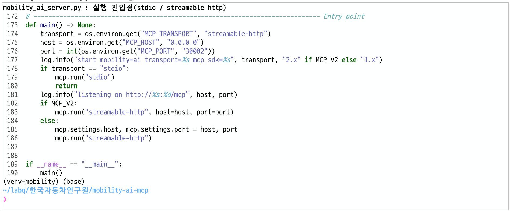

## 포인트

- **MCP_TRANSPORT** : `streamable-http`(기본, VM) 또는 `stdio`(로컬 Host)
- **MCP_HOST 0.0.0.0** : 외부 접속 허용(127.0.0.1이면 421 Invalid Host header)
- **MCP_PORT 30002** : 포트포워딩 대상 포트, 충돌 시 변경
- **mcp 1.x 호환** : `settings.host`·`port` 설정 후 `run()`

## Step 2. 복사·접속·설치

패키지를 VM에 복사해 압축을 풀고, 가상환경에 패키지를 설치합니다(최초 1회).

## PC에서 VM으로 복사 후 VM에서 압축 해제·설치

```bash
## PC(PowerShell, 배포 폴더에서)에서 : SSH 접속과 같은 주소·포트, scp는 대문자 -P
ssh <계정>@user.bigdata-car.kr -p <SSH 포트> "mkdir -p mcp"     # VM에 받을 폴더 생성(최초 1회)
scp -P <SSH 포트> mobility-ai-mcp.tar.gz <계정>@user.bigdata-car.kr:mcp/
ssh <계정>@user.bigdata-car.kr -p <SSH 포트>
## VM에서
cd ~/mcp && tar -xzf mobility-ai-mcp.tar.gz && cd mobility-ai-mcp
./setup_venv.sh          # 가상환경 생성과 패키지 설치, 최초 1회(수 분)
```

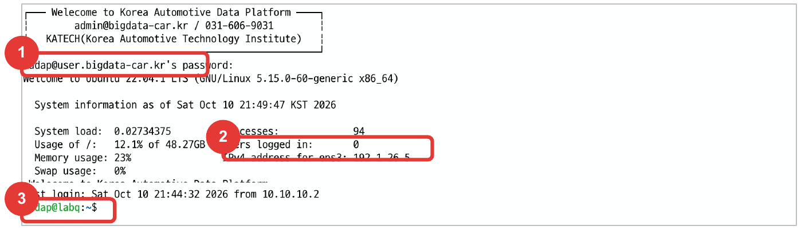

ssh 접속 : ① 비밀번호 입력(표시 안 됨) ② VM 자신의 IP 192.1.26.5 ③ 프롬프트

## 확인 포인트

- **설치 확인** : `setup_venv.sh` 마지막 줄에 mcp·xgboost·torch 버전 표시
- **용량** : 패키지 약 16MB, torch CPU 휠 약 200MB(최초 1회만 내려받음)
- **주의** : 가상환경을 켜지 않으면 `No module named mcp` 오류
- **비밀번호** : 3일차에 받은 VM 계정 비밀번호, 입력 중에는 화면에 표시되지 않음
- **도구** : Windows 10 이상은 PowerShell에 ssh·scp 내장. 화면으로 옮기려면 WinSCP·FileZilla(SFTP, 같은 주소·포트)

## 복사·접속·설치(화면)

scp는 PC에서 실행하고, 압축 해제와 `setup_venv.sh`는 VM에서 실행합니다. 마지막 줄의 버전 표시가 나오면 설치가 끝난 것입니다.

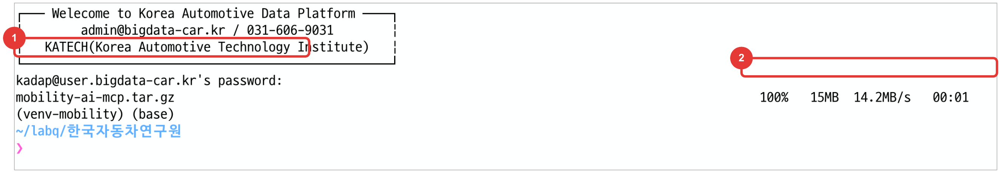

PC : `scp -P <포트> …` → ① VM 비밀번호 → ② 100% 15MB 전송 완료

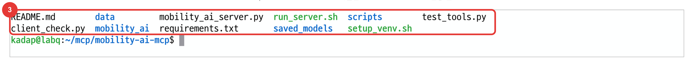

VM : `tar -xzf` 후 `ls` → ③ 서버 코드·data·saved_models 폴더

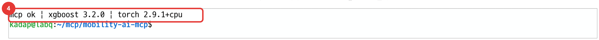

VM : `./setup_venv.sh` 마지막 줄 → ④ mcp ok | xgboost 3.2.0 | torch 2.9.1+cpu

## Step 2. 서버 실행과 접속 확인

서버를 백그라운드로 실행하고, 같은 VM에서 MCP 클라이언트로 접속해 도구 목록과 호출 결과를 확인합니다.

## VM에서 서버 실행 후 접속 확인

```bash
./run_server.sh start      # nohup 실행, http://0.0.0.0:30002/mcp
python client_check.py     # initialize → tools/list → tools/call
tail -n 8 mobility_ai.log  # 도구 이름과 소요 시간만 기록
./run_server.sh status     # 프로세스와 30002 포트
./run_server.sh stop       # 중지
```

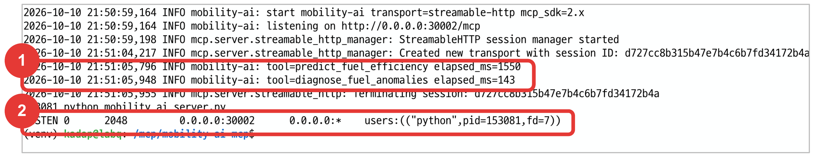

로그·상태 : ① `tool=…` 호출 기록(이름·소요 시간만) ② 30002 포트 LISTEN

## 확인 포인트

- **실행 확인** : 로그에 `listening on http://0.0.0.0:30002/mcp`와 `Uvicorn running` 표시
- **접속 확인** : `client_check.py`가 서버 이름 mobility-ai, 도구 6개, 예측 15.82 km/L를 출력
- **포트 변경** : `MCP_PORT=30003 ./run_server.sh start`
- **메시지 순서** : 6교시 MCP 호출 흐름(initialize, tools/list, tools/call)과 동일

## 서버 실행과 접속 확인(화면)

`run_server.sh start`의 listening 줄과 `client_check.py`의 도구 6개·예측값이 나오면 Agent가 접속할 준비가 된 것입니다.

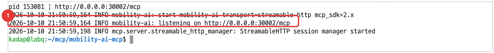

`./run_server.sh start` → ① listening on http://0.0.0.0:30002/mcp

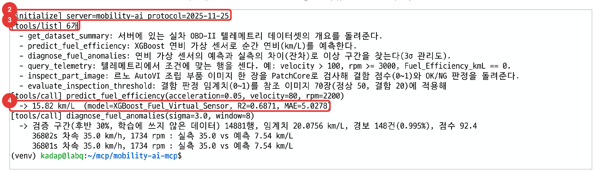

`python client_check.py` → ② initialize(서버 이름) ③ tools/list 6개 ④ tools/call 예측 15.82 km/L

## Step 3-1. KADaP 지식 Agent 로그인과 관리자 메뉴

agent.bigdata-car.kr에 로그인하고 계정 메뉴의 관리자 대시보드에서 MCP 서버 관리로 들어갑니다.

## 진행 순서

1. https://agent.bigdata-car.kr 접속 > **로그인**
2. 자동차데이터포털 로그인 화면에서 **구글 로그인**(교육 계정)
3. 우측 상단 계정 메뉴 > **관리자 대시보드**
4. 왼쪽 관리자 기능 > **MCP 서버 관리**
5. 목록에서 기존 MCP 서버(Exa Search, KADaP 데이터포털 등) 확인

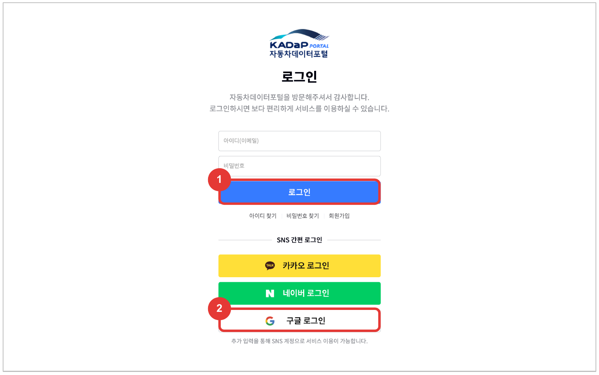

agent.bigdata-car.kr > 로그인 : ① 포털 계정(이메일) 또는 ② 구글 간편 로그인(교육 계정)

## 확인 포인트

- **권한** : MCP 서버 관리는 관리자(admin) 역할만 보임. 교육생 권한은 한자연과 확인 필요
- **로그인** : KADaP 포털 계정(이메일) 또는 카카오·네이버·구글 간편 로그인
- **기존 서버** : 전송 방식 HTTP(원격) 서버는 모두 공인 HTTPS 주소로 등록돼 있음

## 관리자 대시보드와 MCP 서버 관리(화면)

우측 상단 계정 메뉴의 관리자 대시보드로 들어가면 왼쪽 관리자 기능에 MCP 서버 관리가 있습니다(admin 역할만 표시).

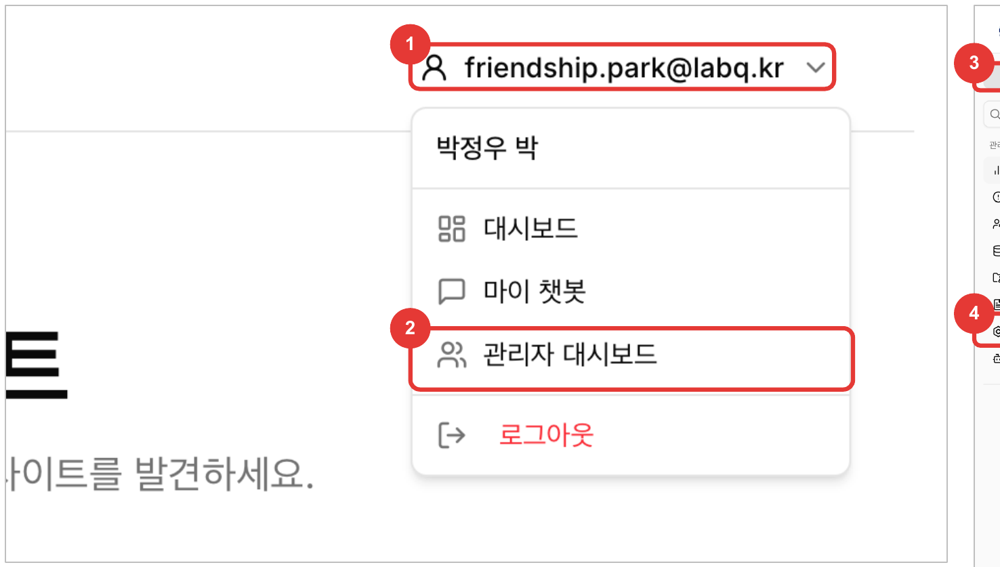

① 우측 상단 계정 메뉴 → ② 관리자 대시보드

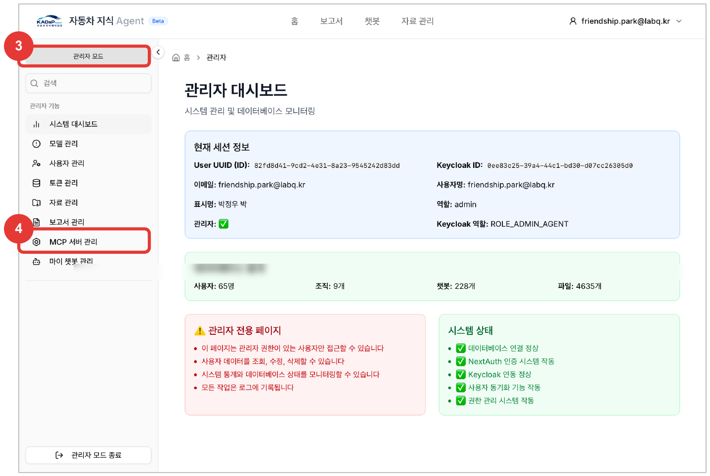

관리자 대시보드 : ③ 관리자 모드 ④ 왼쪽 메뉴 MCP 서버 관리

## MCP 서버 목록(화면)

MCP 서버 관리 목록에는 이미 등록된 서버(Exa Search, KADaP 데이터포털 등)가 보이고, 오른쪽 위 버튼으로 새 서버를 등록합니다.

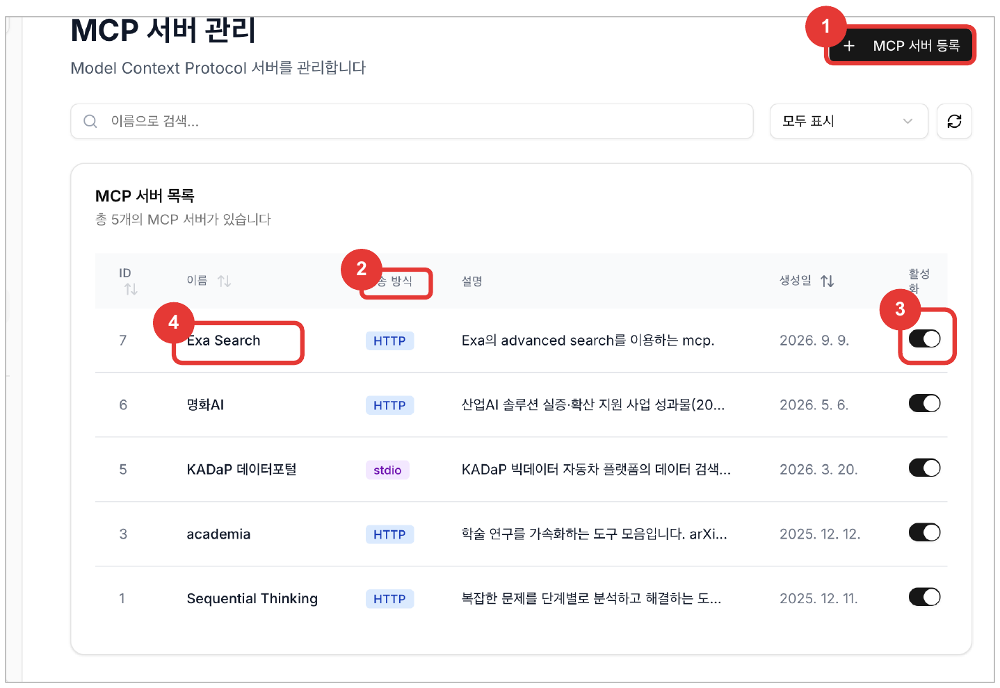

관리자 > MCP 서버 관리(등록 전, 서버 5개)

### 화면 읽는 법

1. **MCP 서버 등록** 버튼 : 다음 단계의 등록 폼이 열림
2. **전송 방식** : HTTP(공인 주소로 접속하는 원격 서버) 또는 stdio(Agent 서버 안에서 실행)
3. **활성화 토글** : 끄면 챗봇의 MCP 목록에서 사라짐
4. 이름을 누르면 상세 정보(URL·타임아웃·JSON)

교육생 권한으로 이 메뉴가 안 보이면 강사(관리자)가 대신 등록하고, 챗봇에서 선택만 합니다.

## Step 3-2. MCP 서버 등록

MCP 서버 등록에서 HTTP(원격) 방식으로 VM 내부 주소를 등록하면 목록에 활성 상태로 추가됩니다.

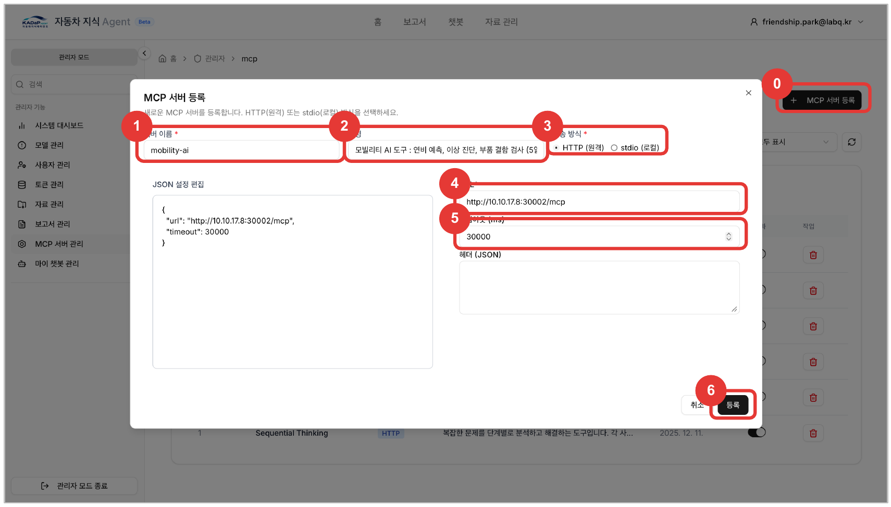

관리자 > MCP 서버 관리 > ⓪ MCP 서버 등록 버튼 → 등록 폼(번호는 아래 항목과 대응)

## 입력 항목

| 번호 | 항목 | 입력값 |
| --- | --- | --- |
| 1 | 서버 이름 | `mobility-ai` |
| 2 | 설명 | 모빌리티 AI 도구 : 연비 예측, 이상 진단, 부품 결함 검사 |
| 3 | 전송 방식 | HTTP(원격) |
| 4 | URL | `http://<VM 내부 IP>:30002/mcp` (예 : `http://10.10.17.8:30002/mcp`) |
| 5 | 타임아웃 | 30000(ms), 첫 결함 검사(모델 로딩 2~3초)를 고려 |
| 6 | 등록 | 클릭 후 목록에서 활성화 토글 확인 |

헤더(JSON)는 비웁니다. Agent 서버는 VM 내부 IP(10.10.17.x)로 접근하며, user.bigdata-car.kr 도메인은 Agent 내부망에서 풀리지 않습니다(확인 방법은 다음 단계).

## 등록 결과 확인(화면)

등록 직후 목록 맨 위에 mobility-ai가 HTTP·활성화 상태로 나타나면 Agent가 이 주소로 도구 목록을 가져올 수 있습니다.

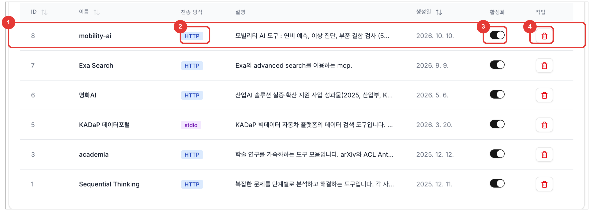

등록 후 목록 : ① mobility-ai 행(ID 8) ② 전송 방식 HTTP ③ 활성화 토글 ON ④ 삭제(실습 후 정리)

## Step 3-3. VM 내부 주소 확인과 등록 결과

VM이 스스로 보는 IP(192.1.x)와 Agent가 접근하는 내부 IP(10.10.17.x)가 다르므로 메타데이터로 확인해 등록합니다.

## VM에서 내부 주소 확인(교육생 각자 실행)

```bash
hostname -I        # VM 자신의 IP 192.1.26.5 (Agent에서 접근 불가)
curl -s http://169.254.169.254/latest/meta-data/public-ipv4
                   # 클라우드 내부 IP 10.10.17.8 → 이 값을 등록 URL에
## 등록 URL : http://10.10.17.8:30002/mcp
```

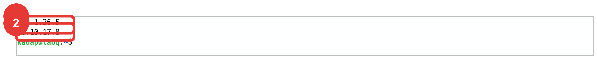

VM : ① `hostname -I` → 192.1.26.5 ② 메타데이터 → 10.10.17.8(이 값을 URL에)

## 확인 포인트

- **주소 세 가지** : 192.1.26.5(VM 내부망), 10.10.17.8(클라우드 내부 IP, Agent·API GW가 접근), user.bigdata-car.kr:포트(공인, 외부용)
- **왜 내부 IP** : Agent 파드에서 user.bigdata-car.kr 도메인이 안 풀리고, 한자연은 보안상 공인 포트포워딩을 내부 연동에 쓰지 않음
- **확인** : 등록 후 상세 정보의 URL·타임아웃, 수정 시 URL을 다시 입력해야 함(빈 값이면 저장 안 됨)
- **문제 시** : 챗봇이 "도구 목록에 없다"고 답하면 URL이 틀린 것. VM 로그(`mobility_ai.log`)에 요청이 안 찍힘

## 등록 결과 상세 정보(화면)

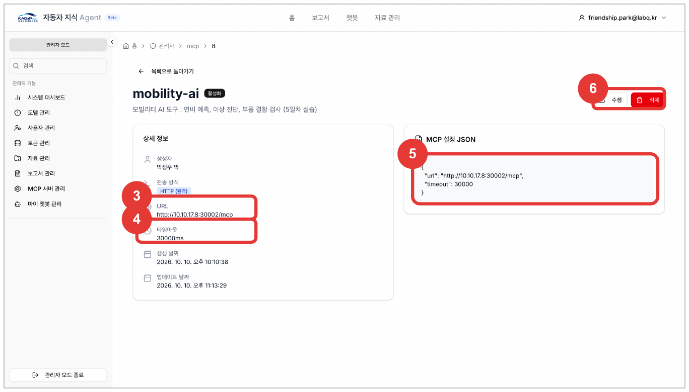

목록에서 이름 클릭 → 상세 정보 : ③ URL ④ 타임아웃 ⑤ 설정 JSON ⑥ 수정(URL 다시 입력)

## Step 4-1. 챗봇에서 MCP 선택

챗봇 입력창의 MCP 버튼에서 mobility-ai를 선택하면 그 대화에서 서버의 도구를 쓸 수 있습니다.

## 진행 순서

1. 상단 메뉴 **챗봇** > **새 대화**
2. 입력창 아래 **MCP** 버튼 클릭 > MCP 서버 선택 목록
3. **mobility-ai** 클릭 → "1개 MCP 서버 선택", 버튼이 **MCP 1**로 바뀜
4. 모델(GPT-4.1)과 참조 자료는 기본값 그대로

**선택하지 않으면 Agent가 웹 검색이나 참조 자료로만 답하므로 질문 전에 반드시 선택합니다.**

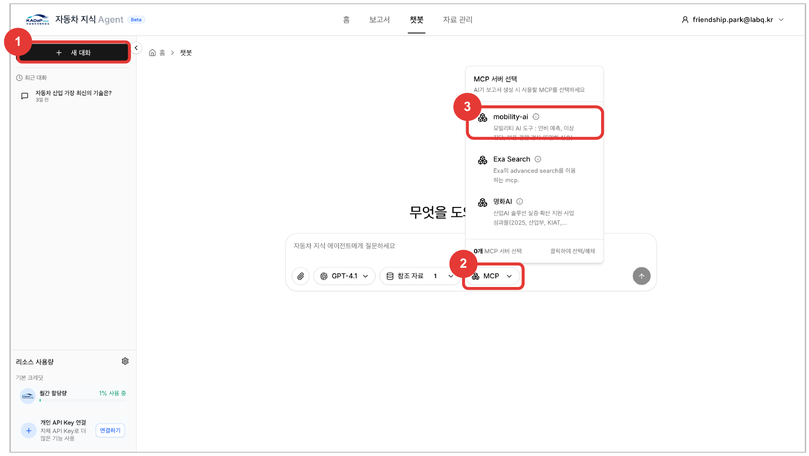

챗봇 : ① 새 대화 → ② MCP 버튼 → ③ 목록에서 mobility-ai 클릭

## 새 대화와 선택 결과(화면)

새 대화 화면의 입력창 아래에 모델·참조 자료·MCP 버튼이 있고, 선택이 끝나면 버튼이 MCP 1로 바뀝니다.

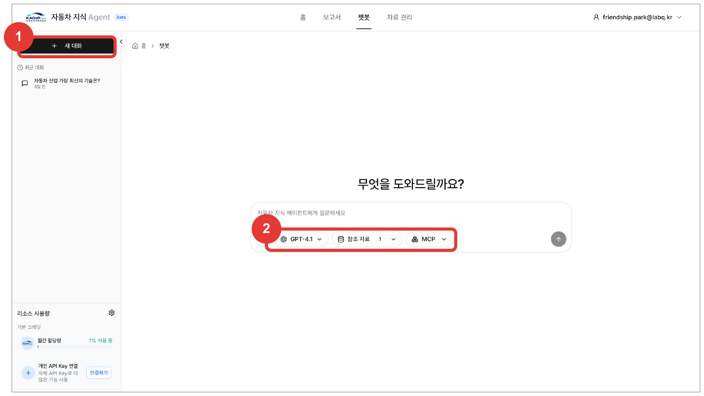

새 대화 : ① 새 대화 버튼 ② 입력창 아래 GPT-4.1 · 참조 자료 · MCP 버튼

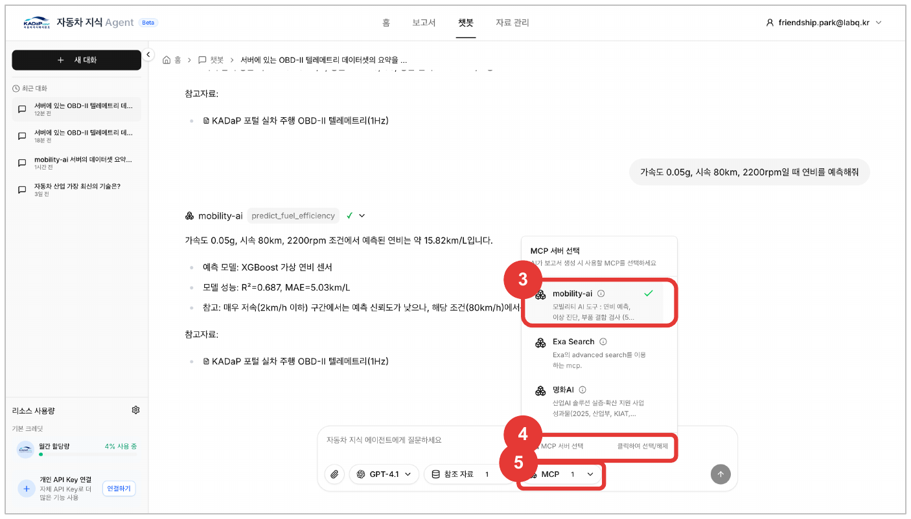

선택 후 : ③ mobility-ai ✓ ④ 1개 MCP 서버 선택 ⑤ 버튼이 MCP 1로 바뀜(대화 중에도 열어 확인 가능)

## Step 4-2. 첫 질문 : 데이터셋 요약

데이터셋 요약을 물으면 Agent가 `get_dataset_summary`를 호출하고, 호출 표시(✓)와 결과 JSON을 펼쳐 볼 수 있습니다.

## 질문과 확인 포인트

- **질문** : 서버에 있는 OBD-II 텔레메트리 데이터셋의 요약을 알려줘
- **표시** : **mobility-ai get_dataset_summary ✓** ← 서버 이름과 도구 이름
- **결과** : rows 49602, 검증 14,881행(34,721~49,601초), 차속 평균 62.08 km/h
- **검산** : `test_tools.py` / `client_check.py` 값과 동일한지 대조

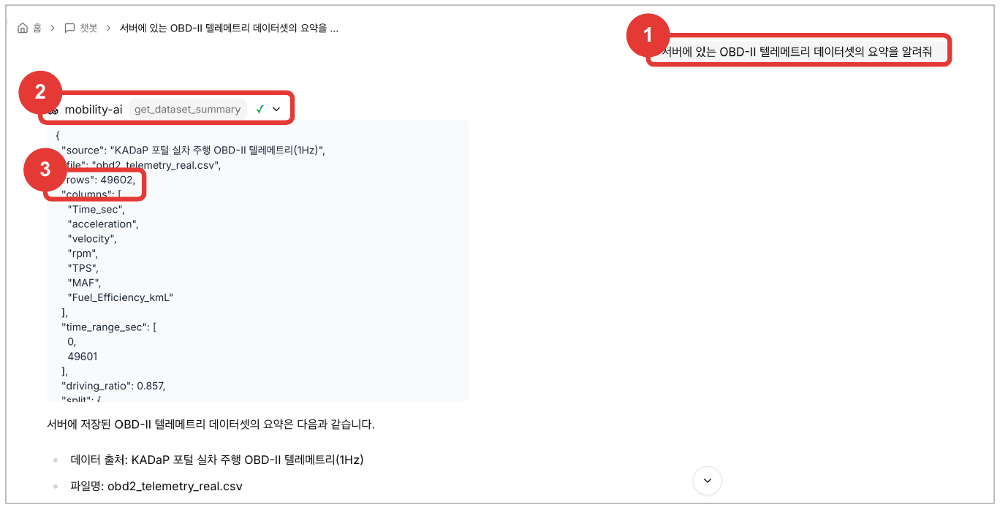

챗봇 : ① 질문 ② mobility-ai get_dataset_summary ✓(펼치면 원문 JSON) ③ rows 49602

## 알아둘 점

- **도구 호출 표시** : 답변 위의 서버·도구 이름과 ✓가 MCP 호출 증거, 펼치면 서버가 돌려준 JSON 원문
- **질문 요령** : "mobility-ai 서버의 …"처럼 서버 이름만 넣으면 웹 검색으로 새는 경우가 있어, 데이터·도구가 하는 일(텔레메트리 요약, 연비 예측)을 말한다
- **원칙** : 데이터는 서버에, 모델에는 요약만. 49,602행 원본은 전달되지 않음

## Step 5. 질문과 최종 결과

연비 예측, 이상 진단, 조건 조회, 부품 검사를 물으면 Agent가 알맞은 도구를 골라 서버에서 계산합니다.

| 질문 | 호출 도구 | 결과(예제 데이터) |
| --- | --- | --- |
| **가속도 0.05g, 시속 80km, 2200rpm일 때 연비는?** | `predict_fuel_efficiency` | 15.82 km/L(R² 0.687, MAE 5.03 km/L) |
| **검증 구간의 연비 이상 구간을 3σ로 찾아줘** | `diagnose_fuel_anomalies(sigma=3)` | 경보 224건(1.505%), 임계치 21.94 km/L, 점수 99.9 |
| **이동평균 8로 다시 진단해줘** | `diagnose_fuel_anomalies(sigma=3, window=8)` | 경보 148건(0.995%), 임계치 20.08 km/L |
| **시속 100km를 넘는 구간이 얼마나 돼?** | `query_telemetry(velocity > 100)` | 14,419행(전체의 29.1%) |
| **bracket_defect_001.png을 검사해줘** | `inspect_part_image` | 점수 0.869, NG(결함), hotspot (11, 0) |
| **임계치 0.6이면 미검·과검이 몇 건이야?** | `evaluate_inspection_threshold(0.6)` | 미검 19건, 과검 3건 → 0점(라벨 품질 확인 필요) |

결과 열의 수치는 2026-10-10 KADaP 지식 Agent(GPT-4.1) 챗봇에서 mobility-ai 도구를 호출해 받은 실제 값이며, 아래에 화면이 있습니다.

## 연비 예측(화면)

연비를 물으면 Agent가 `predict_fuel_efficiency`에 가속도·차속·RPM을 넣어 호출하고, 서버가 돌려준 15.82 km/L로 답합니다.

### 질문과 확인 포인트

- **질문** : 가속도 0.05g, 시속 80km, 2200rpm일 때 연비를 예측해줘
1. 답변 위 **mobility-ai predict_fuel_efficiency ✓**
2. 예측 연비 15.82 km/L와 모델 성능(R² 0.687, MAE 5.03)
3. `test_tools.py`의 predicted_kmL 15.8199…와 같은 값

저속(2 km/h 이하) 구간의 신뢰도 한계는 도구가 note로 돌려줘 Agent가 함께 안내합니다.

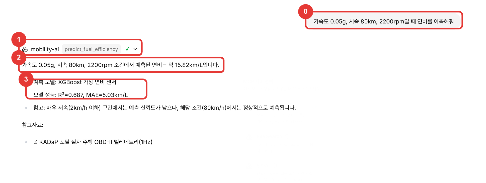

챗봇 : ⓪ 질문 → ① 도구 호출 표시 ② 예측값 ③ 모델 성능

## 이상 진단(화면)

이동평균 8, 3시그마로 진단을 요청하면 `diagnose_fuel_anomalies(sigma=3, window=8)`가 호출되고 경보 148건과 상위 구간이 돌아옵니다.

### 질문과 확인 포인트

- **질문** : 검증 구간의 연비 이상 구간을 이동평균 8, 3시그마로 진단해줘
1. 답변 위 **mobility-ai diagnose_fuel_anomalies ✓**
2. 임계치 20.08 km/L, 경보 148건(1.0%), 트랙 A 점수 92.4
3. 상위 이상 구간 5개 : 시간·차속·RPM·실측·예측·잔차

매개변수를 바꿔 다시 물으면(기본값 : 경보 224건, 임계치 21.94) 7교시 트랙 A 튜닝을 대화로 반복할 수 있습니다.

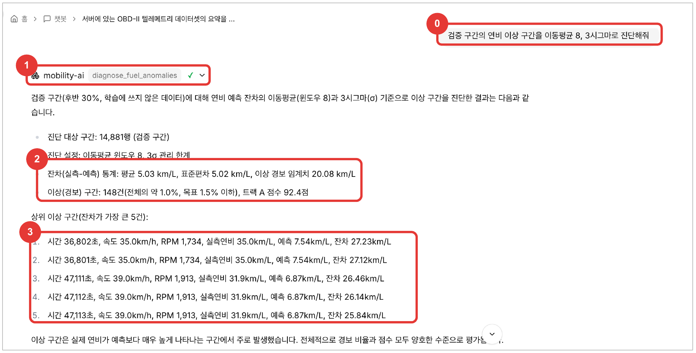

챗봇 : ⓪ 질문 → ① 도구 호출 ② 임계치·경보 건수·점수 ③ 상위 이상 구간

## 부품 검사(화면)

이미지 파일 이름으로 검사를 요청하면 `inspect_part_image`가 서버의 이미지를 PatchCore로 검사해 점수 0.869, NG(결함)를 돌려줍니다.

### 질문과 확인 포인트

- **질문** : bracket_defect_001.png 부품 이미지를 검사해줘
1. 답변 위 **mobility-ai inspect_part_image ✓**
2. 결함 점수 0.869(임계치 0.6), 판정 NG(결함)
3. 검사 방식·의심 위치(hotspot)·소요 시간(약 0.6초, 첫 호출은 모델 로딩으로 2~3초)

이미지는 서버에만 있고 모델(LLM)에는 점수와 판정만 전달됩니다. 파일 이름을 모르면 `inspection://images` 리소스 목록을 참고합니다.

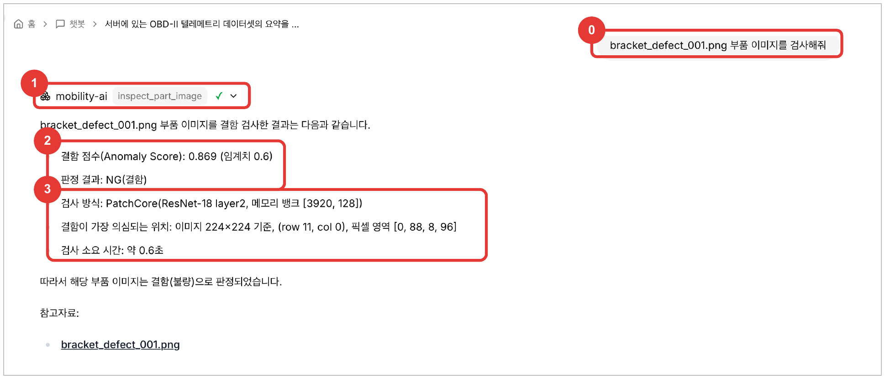

챗봇 : ⓪ 질문 → ① 도구 호출 ② 점수와 판정 ③ 검사 방식·위치·시간

## 조건 조회(화면)

조건을 말로 물으면 `query_telemetry(velocity > 100)`로 바뀌어 호출되고, 행 수와 비율·구간 통계가 돌아옵니다.

### 질문과 확인 포인트

- **질문** : 시속 100km를 넘는 구간이 전체의 몇 퍼센트야?
1. 답변 위 **mobility-ai query_telemetry ✓**
2. 14,419행 / 49,602행 = 29.1%
3. 구간의 평균 속도·RPM·연비 등 통계

조건은 열·연산자·값으로만 받고 코드 실행은 없습니다(보안). 열 이름이 틀리면 열 목록을 돌려줘 Agent가 다시 호출합니다.

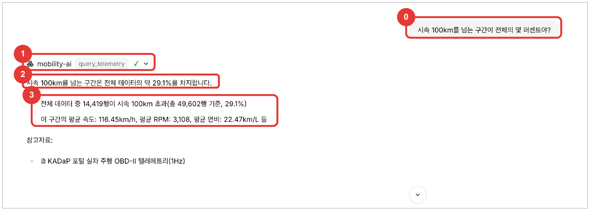

챗봇 : ⓪ 질문 → ① 도구 호출 ② 결과 비율 ③ 행 수와 구간 통계

## 결과 검증과 한계

Agent 답변의 수치를 서버 도구 결과·노트북 값과 대조하고, 모델과 데이터의 한계를 알고 씁니다.

## 검증 방법

- **예측값** : `test_tools.py`의 15.82 km/L와 Agent 답변 대조
- **이상 진단** : 5교시 노트북의 관리 한계 21.94 km/L, 경보 224건과 일치
- **결함 점수** : 6교시 노트북과 같은 원시 거리(bracket_defect_001 7.24)
- **호출 기록** : 서버 로그(`mobility_ai.log`)의 `tool=…` 줄과 Agent 화면의 호출 표시 대조

## 검산 명령(VM)

```bash
source ~/mcp/venv/bin/activate
python test_tools.py        # 도구 함수 직접 실행
python client_check.py      # MCP 경유 호출
tail -n 20 mobility_ai.log  # 호출 기록
```

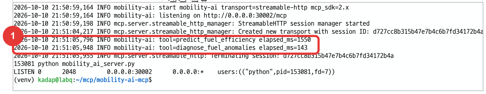

서버 로그(mobility_ai.log) : ① `tool=…` 줄과 Agent 화면의 호출 표시(✓)를 대조

## 한계

| 한계 | 내용 |
| --- | --- |
| **모델 정확도** | R² 0.687, MAE 5.0 km/L의 참고용 가상 센서, 절대값보다 추세·이상 탐지에 적합 |
| **산출물 버전** | pkl이 수강생 PC(sklearn 1.9)에서 저장돼 VM(1.7)에서 경고, 결과는 동일 |
| **응답 크기** | `query_telemetry`는 최대 50행만 반환, 원본은 서버에 유지 |
| **첫 호출 지연** | `inspect_part_image` 첫 호출은 ResNet-18 로딩으로 2~3초(1 vCPU) |
| **라벨 품질** | Kaggle 이미지를 파일명 키워드로 나눠 임계치 0.6에 미검 19건, 데이터 점검 필요 |

## 자주 발생하는 오류와 해결

오류가 Agent 연결, MCP 서버 실행, 도구 입력 중 어디에서 났는지 먼저 구분합니다.

| 증상 | 발생 위치 | 확인할 것 |
| --- | --- | --- |
| **scp 실패(파일 없음, 연결 거부)** | PC와 VM 사이 | PC에서 실행, 대문자 -P, SSH 접속과 같은 주소·포트 |
| **Address already in use** | VM | 30002를 다른 프로그램이 사용 중, `ss -ltnp`로 확인 후 `run_server.sh stop` |
| **챗봇이 "도구 목록에 없다"고 답함** | Agent와 MCP 서버 사이 | URL이 VM 내부 IP(10.10.17.x):30002/mcp인지, 서버 실행 여부, 챗봇에서 MCP 선택 여부 |
| **421 Invalid Host header** | MCP 서버 | `MCP_HOST`가 127.0.0.1, 0.0.0.0으로 변경 |
| **No module named mcp·xgboost·torch** | VM 실행 환경 | 가상환경 미활성화 또는 `setup_venv.sh` 미실행 |
| **모델 파일이 없습니다** | MCP 서버 | `saved_models/` 누락, 패키지 전체를 압축 해제했는지 확인 |
| **'○○' 열이 없습니다 / 이미지가 없습니다** | MCP 서버 | 정상 안내, Agent가 돌려받은 목록을 보고 다시 호출 |
| **입력값 오류(허용 범위)** | MCP 서버 | 단위 확인(g, km/h, rpm), Agent가 hint를 보고 다시 호출 |
| **도구를 쓰지 않음** | Agent(모델) | 도구 설명 보완, 활성화 토글, 질문에 도구 이름 언급 |

**확인 순서 : Agent 화면 → 서버 로그(mobility_ai.log) → test_tools.py**
