# [실습] [8교시] AI Agent + MCP 활용 실습

## [8교시] AI Agent + MCP 활용 실습

카카오톡 데일리 뉴스 Agent 만들기 실습입니다. 제공된 MCP 서버를 Claude Code에 연결해 뉴스 요약을 매일 카카오톡으로 받습니다.

## 학습 목표

- Claude Code에 제공된 뉴스 검색·카카오톡 전송 MCP 서버를 연결한다.
- 매일 정해진 시각에 뉴스 요약을 자동으로 받도록 구성한다.

## 학습 내용

| 순서 | 내용 |
| --- | --- |
| 04-01 | 원격 Host와 로컬 Host |
| 04-02 | 실습 시나리오와 구성 |
| 04-03 | 준비 ① 뉴스 소스 : Google News RSS(키 불필요) |
| 04-04 | 준비 ② 카카오 앱 등록과 토큰 발급 |
| 04-05 | 준비 ③ Claude Code 설치와 인증 |
| 04-06 | Step 1. 제공 코드 받기(daily-news-mcp) |
| 04-07 | Step 2. 코드 확인 |
| 04-08 | Step 3. Claude Code에 등록과 연결 확인 |
| 04-09 | Step 4. 대화로 실행 |
| 04-10 | Step 5. 매일 자동 실행 |
| 04-11 | 주의사항과 확장 |
| 04-12 | 오후 과정 정리 |

## 원격 Host와 로컬 Host

7교시는 KADaP 서버에 연결한 원격 방식, 8교시는 내 PC의 Claude Code에 연결한 로컬 방식입니다.

| 구분 | 7교시 : KADaP 지식 Agent | 8교시 : Claude Code |
| --- | --- | --- |
| **Host 위치** | KADaP 서버(웹 서비스) | 내 PC |
| **MCP 서버 위치** | 내 VM, Streamable HTTP | 내 PC, stdio |
| **등록 방법** | 관리자 화면에 URL 등록 | `claude mcp add` 명령 |
| **실행 시점** | 사용자가 질문할 때 | 질문할 때 또는 예약 실행 |
| **적합 용도** | 조직 공용 도구 | 개인 업무 자동화 |

**같은 MCP 규격이므로, 서버 실행 방식만 바꾸면 두 Host 모두에서 쓸 수 있습니다.**

## 실습 시나리오와 구성

뉴스 검색과 카카오톡 전송 도구를 가진 MCP 서버를 Claude Code에 연결하고, 매일 요약해 보내게 합니다.

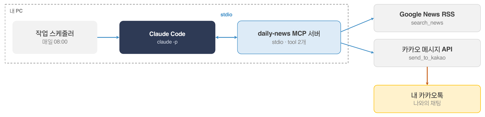

## 구성 요소

| 위치 | 구성 요소 | 설명 |
| --- | --- | --- |
| 내 PC | **작업 스케줄러** | 매일 08:00 |
| 내 PC | **Claude Code** | `claude -p` |
| 내 PC | **daily-news MCP 서버** | stdio · tool 2개 |
| 외부 | **Google News RSS** | `search_news` |
| 외부 | **카카오 메시지 API** | `send_to_kakao` |
| 외부 | **내 카카오톡** | 나와의 채팅 |

Claude Code와 daily-news MCP 서버는 stdio로 통신합니다.

## 실행 흐름

1. `search_news`로 오늘 기사를 검색
2. 모델이 중요한 3건을 골라 각 200자 이내로 요약
3. `send_to_kakao`로 나와의 채팅에 전송
4. 작업 스케줄러가 매일 같은 지시로 반복 실행

## 준비 ① 뉴스 소스 : Google News RSS(키 불필요)

뉴스 소스는 키 없이 쓰는 Google News RSS이며, 검색어를 주소에 넣으면 최신순 기사가 XML로 옵니다.

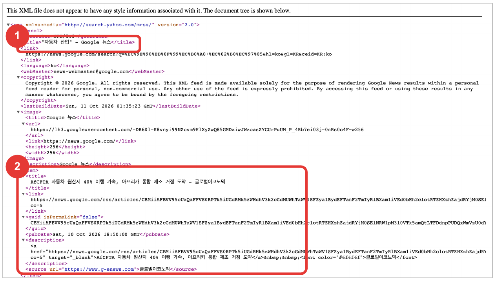

RSS 주소를 브라우저로 열기(로그인·키 없음) : ① 피드 제목 ② 기사 1건(item)의 title·link·pubDate·source

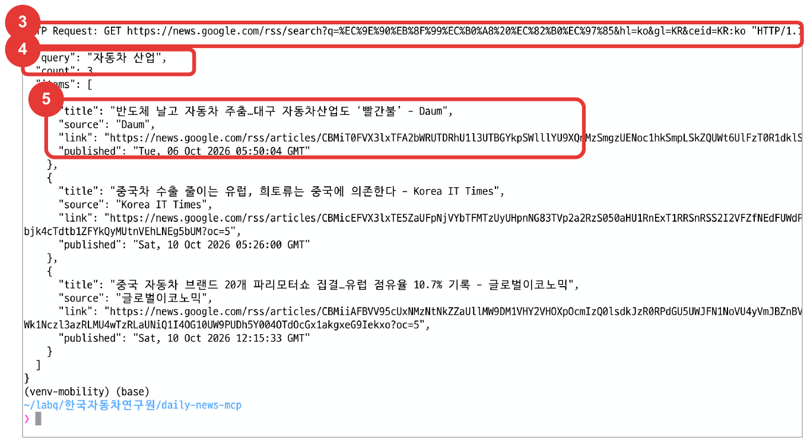

`search_news('자동차 산업', 3)` 실행 : ③ 호출한 주소 ④ query·count ⑤ 기사 항목

## 알아둘 점

- **주소 형식** : `https://news.google.com/rss/search?q=<검색어>&hl=ko&gl=KR&ceid=KR:ko` → 키·가입 없이 최신순, 검색어의 URL 인코딩은 코드가 처리
- **link** : `search_news`가 돌려주는 기사 링크는 news.google.com 주소 → 카카오 앱 웹 도메인에 news.google.com을 등록(준비 ②)하는 이유
- **직접 확인** : `python -c "import daily_news_server as s; print(s.search_news('자동차 산업', 3))"`
- 네이버 API는 이용신청제로 바뀌어 제외

## 준비 ② 카카오 앱 등록과 토큰 발급

개편된 카카오 콘솔(2025.12)에서 REST API 키·리다이렉트 URI·웹 도메인·메시지 동의항목을 설정하고, 나에게 보내기용 토큰을 발급합니다.

## 설정 순서(2025.12 개편 콘솔 기준, 사전 과제 권장)

1. developers.kakao.com > **앱** > **앱 생성** : 이름·회사명·카테고리 입력
2. **[앱] > [플랫폼 키] > [REST API 키]** : 키 값 복사, 리다이렉트 URI에 `http://localhost` 등록, 클라이언트 시크릿은 기본 '사용함'이라 '사용 안함'으로 변경(안 끄면 토큰 발급 KOE010)
3. **[앱] > [제품 링크 관리] > [웹 도메인]** : `https://news.google.com` 등록(메시지 '기사 보기' 링크가 열리는 도메인)
4. **[카카오 로그인] > [사용 설정]** > 상태 ON
5. **[카카오 로그인] > [동의항목] > [접근권한]** > 카카오톡 메시지 전송(talk_message) > 설정
6. 인가 코드로 토큰을 발급해 `kakao_token.json`으로 저장(아래 명령)

예전 콘솔의 '플랫폼 > Web 사이트 도메인'과 '카카오 로그인 > Redirect URI'는 2·3번 위치로 옮겨졌습니다. 플랫폼 키(네이티브·JavaScript 키)는 이번 실습에 안 씁니다.

**현장 운영** : 카카오 토큰은 '나에게 보내기'라 사용자별로 필요 → 공용 키로 대체 불가. 사전 과제로 각자 발급하거나 강사 토큰으로 시연합니다.

## 토큰 발급 명령

```bash
## 1) 브라우저로 접속해 동의 → '사이트에 연결할 수 없음' 화면의 주소창에서 code= 값 복사
https://kauth.kakao.com/oauth/authorize?client_id=REST_API_KEY
  &redirect_uri=http://localhost&response_type=code&scope=talk_message
## 2) 토큰 발급(code는 10분 안에 1회만) → kakao_token.json을 C:\mcp\ 로 이동
get_kakao_token.bat REST_API_KEY 복사한_code      # Windows(curl.exe)
./get_kakao_token.sh REST_API_KEY 복사한_code     # macOS·Linux
## 성공 : saved: ['access_token', …, 'refresh_token', …]   실패 : ['error', …] → error_code 확인
```

## 카카오 콘솔 설정(화면) : REST API 키와 리다이렉트 URI

플랫폼 키에서 REST API 키를 복사하고, 키 카드에서 리다이렉트 URI `http://localhost` 등록과 클라이언트 시크릿을 끕니다.

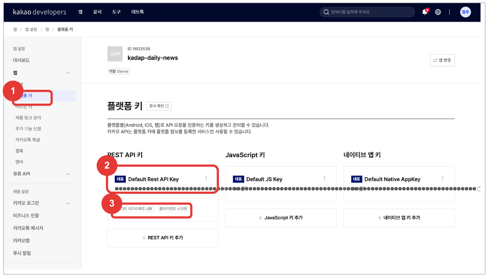

① [앱] > 플랫폼 키 → ② Default Rest API Key 카드(값 복사, 가림) → ③ 카드 클릭 또는 칩으로 상세

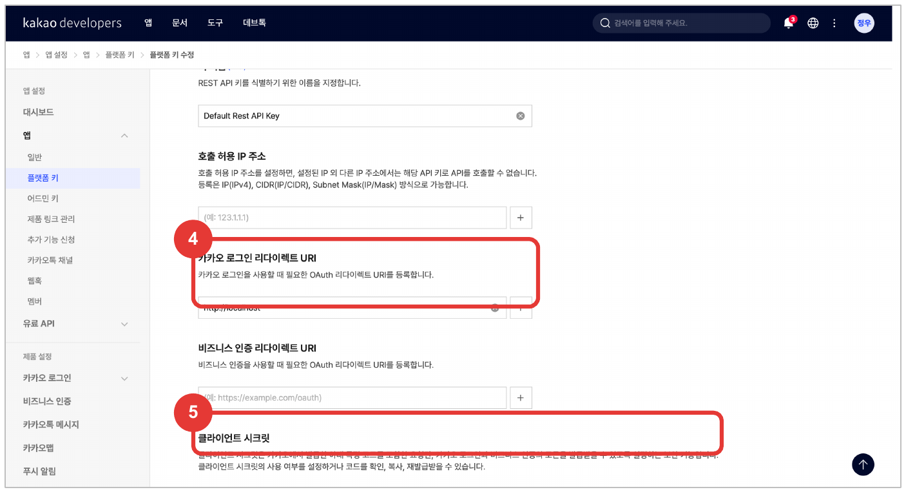

④ 리다이렉트 URI에 `http://localhost` 추가 → ⑤ 클라이언트 시크릿 '사용 안함'(KOE010 방지)

## 카카오 콘솔 설정(화면) : 웹 도메인과 로그인 ON

메시지의 '기사 보기' 링크가 열리도록 웹 도메인을 등록하고, 토큰 발급에 필요한 카카오 로그인을 켭니다.

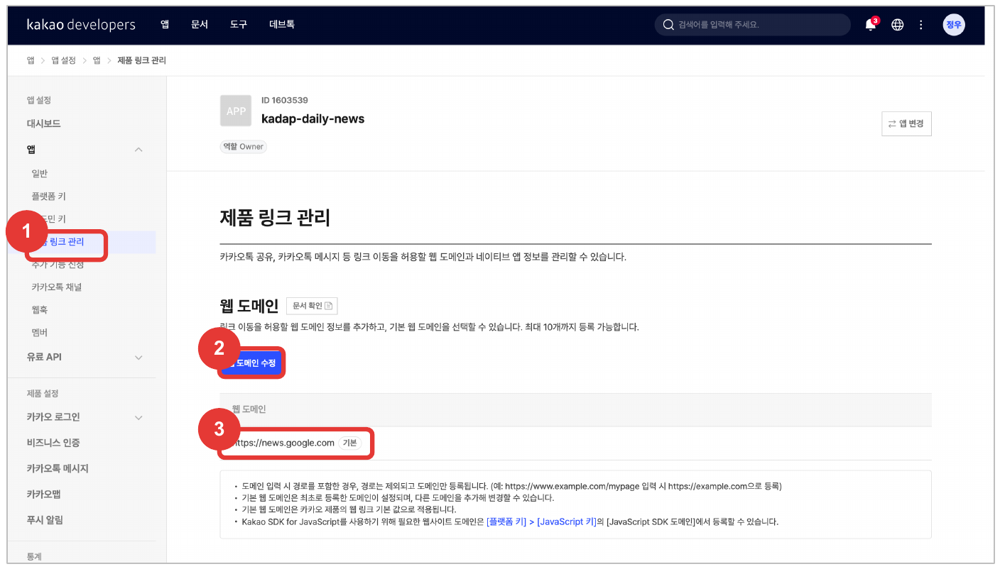

① [앱] > 제품 링크 관리 → ② 웹 도메인 수정 → ③ `https://news.google.com` 등록(기본)

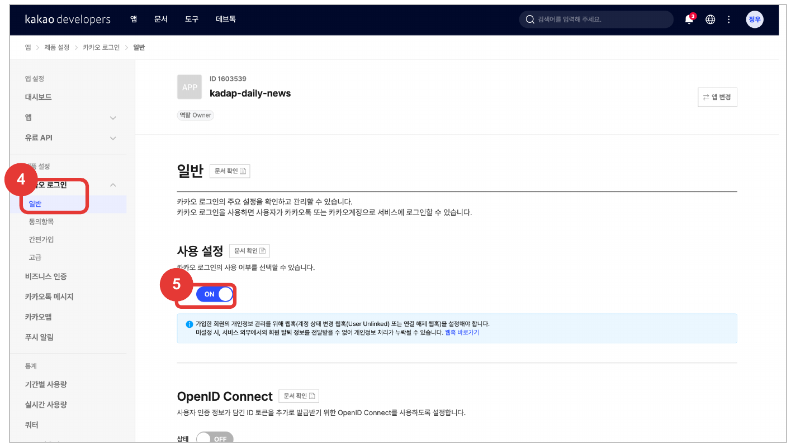

④ [카카오 로그인] > 일반 → ⑤ 사용 설정 상태 ON(OpenID Connect는 OFF 그대로)

## 카카오 콘솔 설정(화면) : 동의항목과 앱 생성

접근권한의 카카오톡 메시지 전송(talk_message)을 선택 동의로 설정해야 인가 코드에 `scope=talk_message`를 넣을 수 있습니다.

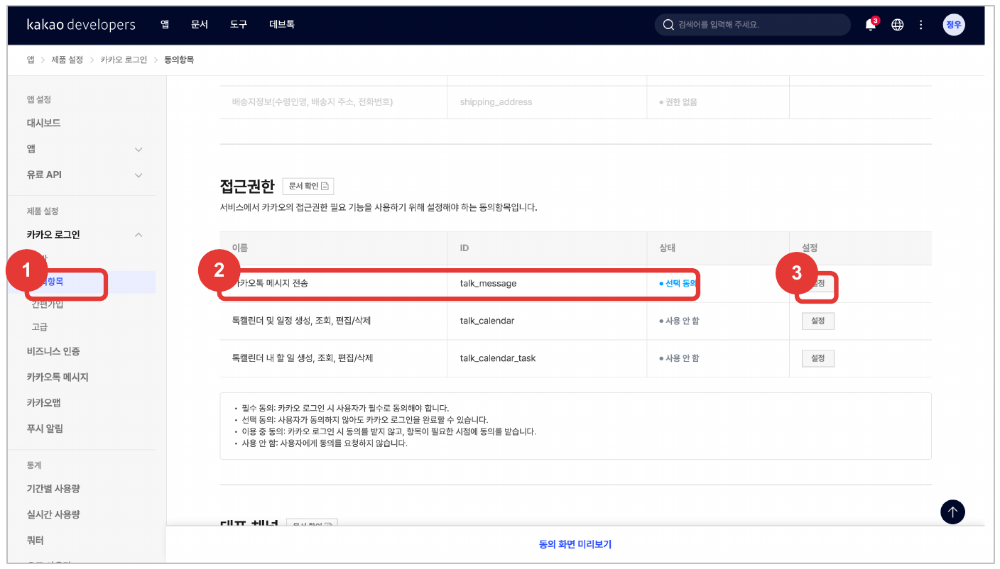

① 동의항목 > 접근권한 → ② 카카오톡 메시지 전송(talk_message) → ③ 설정 : 선택 동의

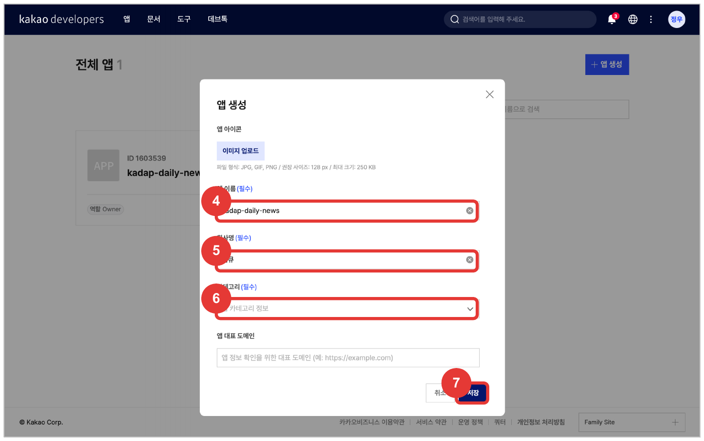

(참고) 앱 생성 폼 : ④ 앱 이름 ⑤ 회사명 ⑥ 카테고리 선택 → ⑦ 저장(앱 아이콘·대표 도메인은 생략 가능)

## 준비 ③ Claude Code 설치와 인증

Claude Code를 설치하고 claude.ai 로그인 또는 API 키로 인증해야 MCP 서버를 붙일 수 있습니다.

## 설치와 인증 순서

1. **설치** : `npm install -g @anthropic-ai/claude-code`(Node.js 18 이상) 또는 공식 설치 프로그램
2. **확인** : `claude --version`
3. **인증 A** : `claude` 실행 후 claude.ai 계정으로 로그인(브라우저)
4. **인증 B** : 환경변수 `ANTHROPIC_API_KEY`에 발급받은 키를 넣고 `claude` 실행
5. **확인** : `claude auth status`에서 loggedIn true

**현장 운영** : 강사가 발급한 API 키 1개를 공용으로 쓰면 로그인 없이 바로 실습 가능(사용량·속도 제한 공유). 계정별 로그인이 필요하면 사전 과제로 안내합니다.

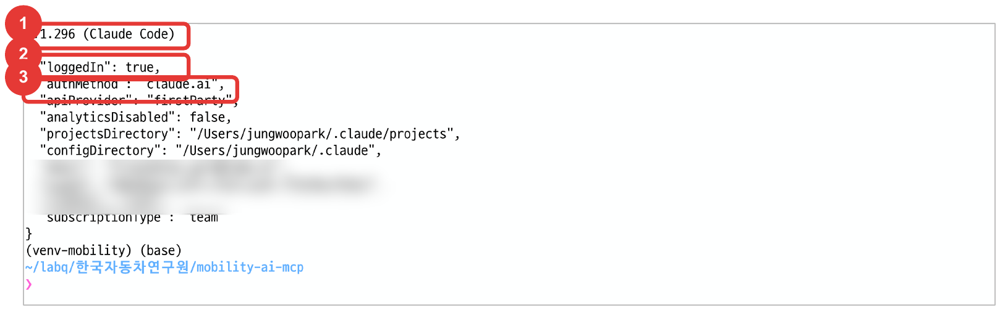

① `claude --version` → 2.1.x ② `claude auth status` → loggedIn true ③ authMethod(claude.ai 또는 api key)

## Step 1. 제공 코드 받기(daily-news-mcp)

뉴스 검색과 카카오톡 전송 도구 2개를 가진 stdio MCP 서버 코드를 받아 내 PC에 둡니다.

## 패키지 구조(daily-news-mcp.tar.gz 압축 해제, 예 : C:\mcp\daily-news-mcp)

```
daily-news-mcp/
├─ daily_news_server.py   도구 2개(search_news : Google News RSS, send_to_kakao), stdio 실행
├─ requirements.txt       mcp, httpx
├─ get_kakao_token.bat    인가 코드로 kakao_token.json 발급(Windows, curl.exe)
├─ get_kakao_token.sh     같은 역할(macOS·Linux)
├─ run_daily.bat          작업 스케줄러용 claude -p 실행 배치
└─ README.md              설치·콘솔 설정·토큰·등록·실행 순서
```

## 도구 목록

| 도구 | 역할 |
| --- | --- |
| `search_news` | Google News RSS 검색(최신순, 키 불필요), 제목·언론사·링크·발행 시각 |
| `send_to_kakao` | 카카오톡 나와의 채팅으로 200자 이내 메시지 1건 전송 |

## 설계 포인트

- **결과물** : stdio MCP 서버(도구 2개), 기사 요약은 Host의 모델(Claude Code)이 담당
- **SDK** : mcp 2.x MCPServer, 1.x FastMCP 호환 import
- **키 관리** : 카카오 REST 키는 환경변수, 토큰은 파일. 코드에 키 없음, 뉴스 검색은 키 자체가 없음
- **카카오 토큰** : 리프레시 토큰으로 매번 갱신해 만료 방지
- **메시지 규칙** : 200자 제한, 링크는 카카오 앱에 등록한 도메인(news.google.com)
- **오류** : 예외 대신 `{"error": …}` 반환, 키·토큰 값은 출력하지 않음

## Step 2. 코드 확인

완성 코드 기준으로 뉴스 검색 도구와 카카오톡 전송 도구의 입력, 정리, 반환 형식을 확인합니다.

## 코드 확인 ① 뉴스 검색 tool : daily_news_server.py (1/2)

완성 코드 기준으로 뉴스 검색 도구의 입력, 정리, 반환 형식을 확인합니다.

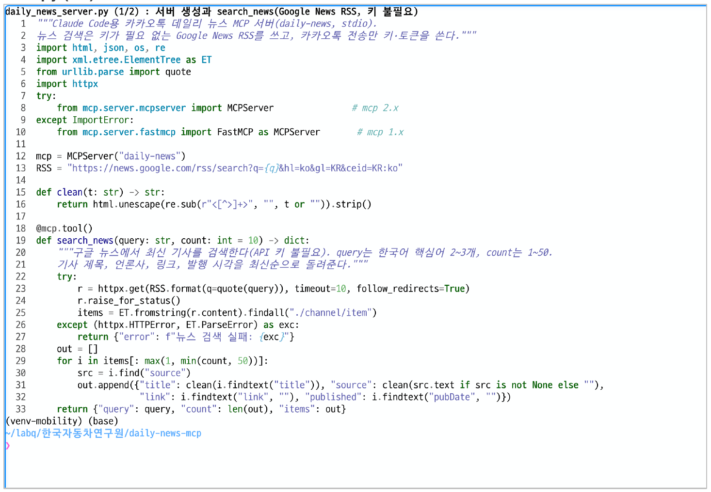

### 포인트

- **import** : mcp 2.x와 1.x 모두에서 실행
- **RSS** : news.google.com/rss/search, `hl=ko&gl=KR`로 한국어 최신순 결과(키 없음)
- **clean** : 제목의 HTML 태그·특수문자 제거
- **link** : 구글 뉴스 주소(카카오 앱의 Web 도메인 등록과 일치)
- **오류** : 예외 대신 `{"error": …}`로 반환

## 코드 확인 ② 카카오톡 전송 tool : daily_news_server.py (2/2)

토큰 갱신, 200자 제한, 오류 반환이 코드에 들어 있는지 확인합니다.

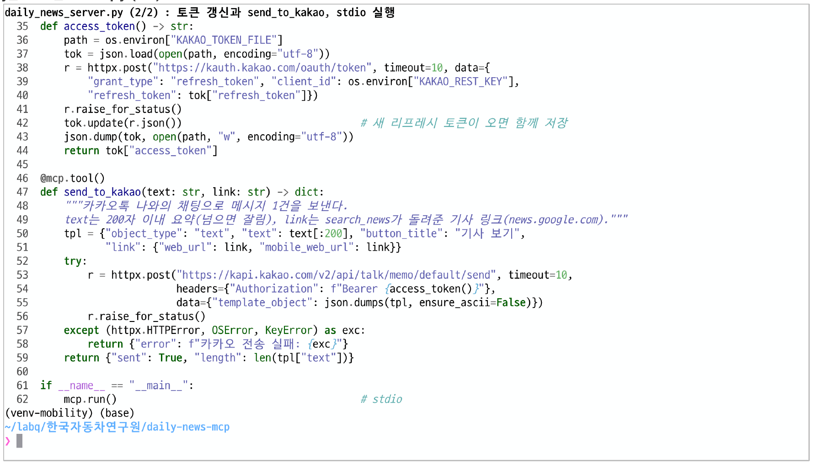

### 포인트

- **200자** : 텍스트 템플릿 최대 표시 길이, 설명에 적고 코드에서도 자름
- **토큰 갱신** : 리프레시 토큰으로 호출마다 액세스 토큰을 새로 받음(`KAKAO_REST_KEY`, `KAKAO_TOKEN_FILE` 환경변수)
- **나와의 채팅** : 친구 발송은 검수 대상이라 실습에서 제외
- **클라이언트 시크릿** : 코드는 시크릿 없이 요청하므로 콘솔 기본값 '사용함'을 꺼야 함
- **stdio** : 마지막 줄 `mcp.run()`이 표준 입출력으로 Claude Code와 통신

## Step 3. Claude Code에 등록과 연결 확인

`claude mcp add` 명령으로 서버 실행 방법과 키를 등록하고 연결 상태를 확인합니다.

## 내 PC 터미널(Windows 기준)

```bat
cd C:\mcp\daily-news-mcp
python -m venv .venv && .venv\Scripts\pip install -r requirements.txt
claude mcp add daily-news -s local --env KAKAO_REST_KEY=... ^
  --env KAKAO_TOKEN_FILE=C:/mcp/kakao_token.json ^
  -- C:/mcp/daily-news-mcp/.venv/Scripts/python.exe C:/mcp/daily-news-mcp/daily_news_server.py
claude mcp list       # daily-news ... ✔ Connected
```

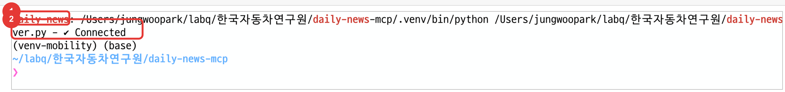

`claude mcp list` : ① daily-news(가상환경 python 전체 경로 + 서버 경로) → ② ✔ Connected. macOS 화면이며, Windows는 경로와 줄바꿈 기호(^)만 다릅니다.

## 연결 확인

1. `claude mcp list`에 daily-news ✔ Connected → `claude` 실행 후 `/mcp`에서 daily-news 2 tools(search_news, send_to_kakao)
2. `-s local`은 명령을 실행한 폴더에서만 보임. 어디서나 쓰려면 `-s user`. Codex는 `codex mcp add`로 같은 서버 등록 가능

키는 `--env`로만 넘기고 코드·대화·캡쳐에는 쓰지 않습니다. 실행 파일은 가상환경의 python.exe 전체 경로로 지정합니다.

## 연결 확인(/mcp 화면)

`claude` 실행 후 `/mcp`를 입력하면 등록된 서버의 연결 상태와 도구 수를 확인할 수 있습니다.

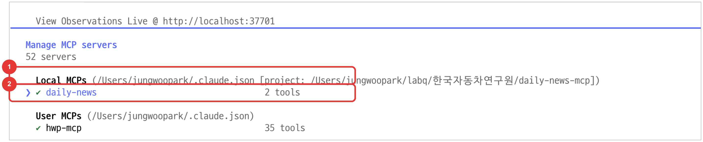

Claude Code 대화창에서 `/mcp` 입력 → Manage MCP servers 화면(상단만 표시)

### 확인 포인트

1. **Local MCPs** : 이 폴더(`-s local`)에 등록된 서버. ① 괄호 안이 등록된 프로젝트 경로
2. ② **daily-news ✔ 2 tools** : 연결 성공과 도구 수. 선택(Enter)하면 search_news, send_to_kakao 설명이 보임
3. ✘ failed면 python 경로·서버 경로 오타, 가상환경에 mcp·httpx 미설치, 환경변수 누락 순으로 확인

User MCPs(`-s user`)는 어느 폴더에서나 보이고, claude.ai·Built-in 항목은 Claude Code 기본 제공이라 실습과 무관합니다.

## Step 4. 대화로 실행

Claude Code에 요청하면 검색, 요약, 전송을 Agent가 순서대로 수행합니다.

## 요청 예

> "오늘 국내 자동차 산업 뉴스에서 중요한 3건을 골라 각각 200자 이내로 요약하고, 카카오톡으로 나에게 보내줘."

| 순서 | Agent 동작 | 확인 |
| --- | --- | --- |
| **1** | `search_news` 호출 | 도구 사용 승인 요청이 뜨면 허용 |
| **2** | 기사 3건 선정과 요약 | 요약이 200자 이내인지 |
| **3** | `send_to_kakao` 3회 호출 | 카카오톡 수신 여부 |

## 알아둘 점

- **도구 사용 승인** : 처음 호출할 때 Claude Code가 search_news, send_to_kakao 사용 여부를 물으면 허용(Yes). 자동 실행(Step 5)에서는 `--allowedTools`로 미리 허용합니다.
- **요약 길이** : send_to_kakao 설명에 200자 제한이 있어 모델이 알아서 줄이지만, 요청문에도 적어 두면 재시도가 줄어듭니다.
- **확인** : 아래의 실행 결과 화면과 휴대폰 카카오톡 '나와의 채팅'

## 실행 결과(화면)

요청 한 번에 Agent가 뉴스 검색 → 3건 선정·요약 → 카카오톡 전송 3회를 순서대로 수행하고, 무엇을 보냈는지 표로 보고합니다.

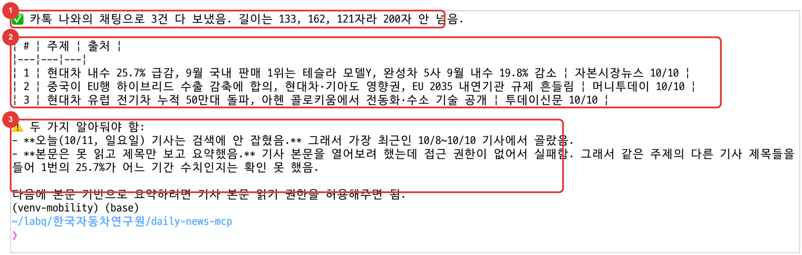

`claude -p` 실행 결과(2026-10-11) : ① 전송 보고 ② 보낸 기사 표 ③ Agent가 스스로 알린 한계

실행 명령 :

```bash
claude -p "오늘 국내 자동차 산업 뉴스에서 중요한 3건을 골라 각각 200자 이내로 요약해 카카오톡으로 나에게 보내줘" --allowedTools "mcp__daily-news__search_news,mcp__daily-news__send_to_kakao"
```

## 휴대폰 카카오톡 도착 화면

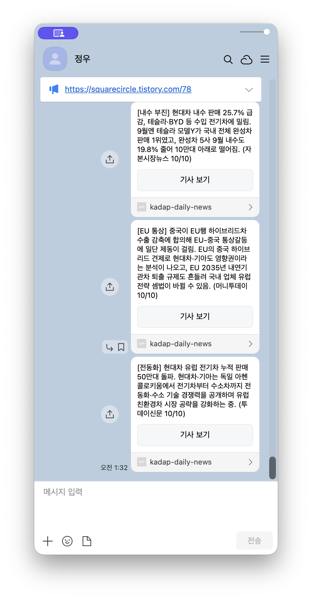

카카오톡 '나와의 채팅'에 기사 요약 3건이 '기사 보기' 링크와 함께 도착한 화면

## Step 5. 매일 자동 실행

비대화형 실행(`claude -p`)을 담은 `run_daily.bat`를 Windows 작업 스케줄러에 등록하면 매일 같은 시각에 뉴스 요약이 카카오톡으로 옵니다. macOS·Linux는 `run_daily.sh` + crontab을 씁니다.

## run_daily.bat(Windows 배치 파일, 패키지에 포함)

```bat
claude -p "오늘 국내 자동차 산업 뉴스에서 중요한 3건을 각각 200자 이내로 요약해 카카오톡으로 나에게 보내줘" ^
  --allowedTools "mcp__daily-news__search_news,mcp__daily-news__send_to_kakao" >> C:\mcp\daily.log
```

## 작업 스케줄러 등록(기본 작업 만들기 마법사)

1. **Win+R** → `taskschd.msc` 입력 → 작업 스케줄러 실행
2. 오른쪽 [동작] 패널 > **기본 작업 만들기** → 이름 `daily-news` → 다음
3. **트리거** : 매일 → 시작 시간 08:00:00, 1일마다 → 다음
4. **동작** : 프로그램 시작 → 프로그램/스크립트 `C:\mcp\daily-news-mcp\run_daily.bat`
5. 시작 위치 `C:\mcp\daily-news-mcp` → 다음 → 마침
6. **테스트** : 작업 스케줄러 라이브러리에서 daily-news 선택 → [실행] → `C:\mcp\daily.log` 확인

**조건** : PC가 켜져 있고 로그인 상태여야 실행됩니다. 노트북은 작업 속성 > 조건의 '배터리 전원이면 작업 시작 안 함'을 끕니다.


마법사 입력 순서(그림, 실제 Windows 화면 아님) : ① 이름 daily-news → ② 트리거 매일, 08:00 → ③ 동작 프로그램 시작 → ④ 프로그램 run_daily.bat → ⑤ 마침, 선택 후 [실행]로 테스트

## 명령 한 줄로 등록(PowerShell, 마법사와 같은 결과)

```bat
schtasks /Create /SC DAILY /ST 08:00 /TN daily-news ^
   /TR "C:\mcp\daily-news-mcp\run_daily.bat"
schtasks /Run /TN daily-news                  # 즉시 실행해 테스트
schtasks /Query /TN daily-news /V /FO LIST   # 마지막 실행 시간·결과
```

## macOS·Linux crontab

Windows가 아닌 PC는 `run_daily.sh`를 crontab에 한 줄 등록하면 같은 작업을 매일 08:00에 실행합니다.

### 진행 순서(macOS·Linux 터미널)

1. `chmod +x run_daily.sh` : 실행 권한(패키지의 run_daily.sh는 `claude -p` 한 줄 + PATH 설정)
2. `(crontab -l; echo "0 8 * * * <경로>/run_daily.sh") | crontab -` : 기존 항목 뒤에 한 줄 추가
3. `crontab -l`로 등록 확인. 지우려면 `crontab -e`에서 줄 삭제
4. 결과는 `~/mcp/daily.log`, 시간 형식은 분 시 일 월 요일(`0 8 * * *` = 매일 08:00)

**주의** : cron은 PATH가 짧아 스크립트 안에서 claude 위치를 PATH에 넣었고, macOS는 첫 실행 때 cron의 폴더 접근 권한을 물을 수 있습니다. launchd(plist)로도 가능하지만 crontab이 짧습니다.

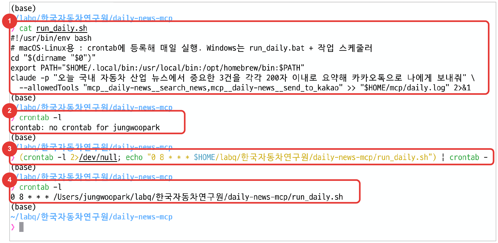

macOS 터미널(2026-10-11) : ① run_daily.sh 내용 ② 등록 전 crontab 없음 → ③ 한 줄 추가 → ④ `crontab -l`에 등록된 항목

## 주의사항과 확장

키와 토큰 보관, 발송 빈도, 기사 저작권을 지키고 다른 업무로 확장합니다.

| 항목 | 내용 |
| --- | --- |
| **키·토큰 보관** | 환경변수와 토큰 파일로만 보관하고 코드·대화·저장소에 올리지 않음 |
| **발송 빈도** | 짧은 시간에 토큰 발급과 발송을 반복한 뒤 발송이 막힌 사례가 있어 테스트 횟수를 줄임 |
| **기사 저작권** | 기사 본문을 수집하지 않고 RSS가 주는 제목·링크만 사용(요약은 모델이 제목 기준으로 작성) |
| **실행 조건** | PC가 켜져 있고 Claude Code 로그인이 유지되어야 예약 실행이 동작 |
| **확장** | hwp-mcp로 주간 보고서 작성, 카카오 PlayMCP의 공식 도구 활용, 사내 시스템 연결 |

**MCP는 도구를 연결하고, 정기 실행은 스케줄러가 맡습니다.**

## 오후 과정 정리

도구를 만들고, 표준으로 연결하고, 검증하며 쓰는 것이 Agent 활용의 기본 순서입니다.

1. AI Agent는 도구를 호출하며 일하고, MCP는 그 도구를 연결하는 표준 규격이다.
2. **원격 연결** : 2회차에서 만든 AI 모델을 MCP 서버로 감싸 KADaP 지식 Agent에서 활용하고, 인증·통계는 API Gateway가 맡는다.
3. **로컬 연결** : Claude Code에 stdio MCP 서버를 붙여 개인 업무를 자동화한다.
4. 성능은 도구 설명과 검증에서, 안전은 권한 관리와 사람 확인에서 나온다.

**다음 단계 : 내 업무 데이터나 사내 시스템 하나를 골라 MCP 서버로 만들어 보기**
